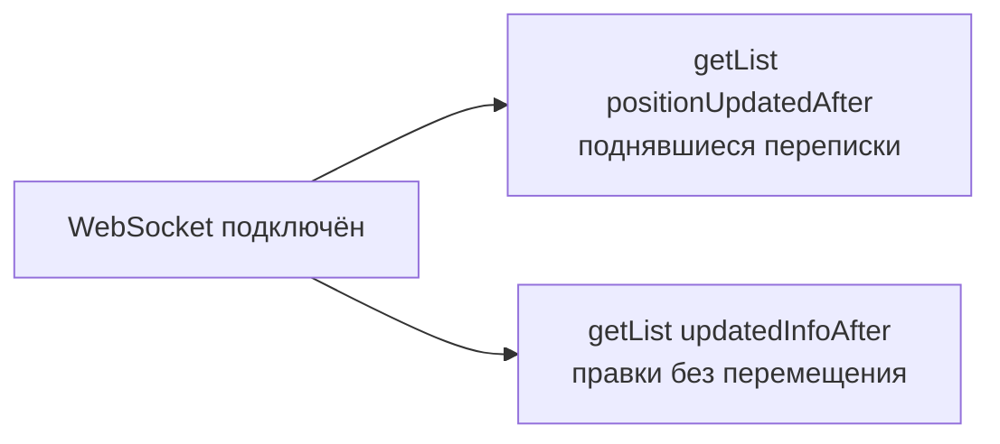

# ServerAi API: изменения для клиентов

13.10.2026 · Mikhail Kuzmin

## Коротко

Список чатов теперь сортируется по последнему сообщению, а время в API отдаётся в миллисекундах. Оба изменения ломающие: клиент нужно обновить одновременно с сервером, отдельной версии API нет.

- **Время — в миллисекундах.** Все `createdAt`, `updatedAt` и новые поля времени — Unix timestamp в мс, нужен 64-битный тип.
- **Conversation:** поле `updatedAt` переименовано в `updatedInfoAt`, добавлены `lastMessage` и `positionUpdatedAt`.
- **`/conversations/getList`** сортирует по `positionUpdatedAt` (наверху — чат с самым свежим сообщением) и получил фильтры для синхронизации после переподключения.
- **Новый метод `/conversations/getBatch`** — переписки по списку id.
- **`/messages/edit` и WS-события `messages` / `received`, `edited`** несут `lastMessage`.
- **Новые правила слияния переписки** на клиенте: у неё две независимые версии — позиция и информация.

Полная документация — `API_Documentation.md` и `docs/api/` в репозитории сервера.

## Время в миллисекундах

Все поля, которые отдают хранимое на сервере время, теперь Unix timestamp **в миллисекундах**, а не в секундах. Секунд не хватало: за одну секунду может прийти несколько сообщений, и фильтры синхронизации со строгим сравнением теряли бы изменения.

| Что | Было | Стало |
| --- | --- | --- |
| `Message.createdAt`, `Message.updatedAt` | секунды, `1790846400` | миллисекунды, `1790846400123` |
| `Conversation.updatedAt` | секунды | переименовано в `updatedInfoAt`, миллисекунды |
| Новые поля `positionUpdatedAt`, `LastMessage.updatedAt` | — | миллисекунды |
| Параметры `positionUpdatedAfter`, `updatedInfoAfter` | — | миллисекунды |
| Длительности: `expiresIn`, таймауты WebSocket | секунды | без изменений, секунды |

На клиенте время нужно хранить в 64-битном целом (`Int64` / `Long`). Время, уже сохранённое в локальном кэше в секундах, нужно сбросить и запросить заново.

## Объекты Conversation и LastMessage

У Conversation теперь две независимые версии: **позиция** в списке (`positionUpdatedAt` вместе с `lastMessage`) и **информация** (`updatedInfoAt`). Поля `conversationId`, `type`, `memberIds`, `name`, `avatar`, `opponentUserId` не изменились.

| Поле                | Изменение | Тип                 | Что значит                                                                                                                                             |
| ------------------- | --------- | ------------------- | ------------------------------------------------------------------------------------------------------------------------------------------------------ |
| `updatedAt`         | удалено   | —                   | Заменено на `updatedInfoAt`                                                                                                                            |
| `lastMessage`       | новое     | LastMessage \| null | Последнее сообщение. `null`, пока сообщений нет, или если последнее сообщение удалено (например, вместе с автором)                                     |
| `positionUpdatedAt` | новое     | Int, мс             | Когда переписка последний раз поднялась: `createdAt` последнего сообщения, до первого сообщения — время создания переписки. По нему сортируется список |
| `updatedInfoAt`     | новое     | Int, мс             | Когда менялось то, что не двигает переписку: участники, название, аватар и текст последнего сообщения. Новое сообщение его не меняет                   |

Новая переписка сразу появляется в списке у всех участников — с `lastMessage: null` и `positionUpdatedAt`, равным времени создания.

**LastMessage** — новый объект, краткое представление последнего сообщения для списка чатов. Время отправки в него не входит — это `positionUpdatedAt` переписки.

| Поле | Тип | Описание |
| --- | --- | --- |
| `messageId` | Int | Id сообщения |
| `type` | String | Тип сообщения, пока только `text` |
| `text` | String \| null | Текст; `null` для будущих типов без текста |
| `updatedAt` | Int, мс | Как `Message.updatedAt`; версия текста при слиянии |

```json
{
  "conversationId": 7,
  "type": "single",
  "memberIds": [1, 5],
  "name": null,
  "avatar": null,
  "opponentUserId": 5,
  "lastMessage": { "messageId": 15, "type": "text", "text": "Привет!", "updatedAt": 1790846400123 },
  "positionUpdatedAt": 1790846400123,
  "updatedInfoAt": 1790846000456
}
```

## Методы

### GET /conversations/getList — другая сортировка и фильтры

Сортировка теперь по убыванию `positionUpdatedAt`, при равенстве — по убыванию `conversationId` (было: по убыванию `conversationId`). Новое сообщение поднимает переписку наверх, правка сообщения — нет.

Если переписка поднялась, пока клиент листал страницы через `offset`, на следующей странице может повториться уже полученная. Клиент убирает повторы по `conversationId` и сливает версии по правилам ниже.

Новые параметры нужны для синхронизации после переподключения:

| Параметр | Тип | Описание |
| --- | --- | --- |
| `positionUpdatedAfter` | Int, мс | Только переписки с `positionUpdatedAt` строго больше значения. Сортировка и `offset` — как без фильтра |
| `updatedInfoAfter` | Int, мс | Только переписки с `updatedInfoAt` строго больше значения. Сортировка — по **возрастанию** `updatedInfoAt`, затем `conversationId`; следующая страница — курсором, без `offset` |
| `updatedInfoAfterId` | Int | Курсор для `updatedInfoAfter`: `conversationId` последней полученной переписки. Тогда в выдачу попадают переписки, у которых пара `(updatedInfoAt, conversationId)` строго больше курсора |

`hasNext` считается в пределах фильтра. Ошибка `1004` — если переданы вместе `positionUpdatedAfter` и `updatedInfoAfter`, `updatedInfoAfter` вместе с `offset` или `updatedInfoAfterId` без `updatedInfoAfter`, а также если значение не целое неотрицательное число.

### GET /conversations/getBatch — новый метод

Возвращает переписки по id. Нужен, когда пришло событие по чату, которого нет в загруженном списке. Требует активной сессии.

- Параметр `conversationIds` — от 1 до 100 id, через запятую (`conversationIds=1,2,3`) или массивом (`conversationIds[]=1&conversationIds[]=2`); повторы игнорируются.
- Ответ: `conversations` — найденные Conversation в порядке запроса (не в порядке списка чатов); `notFoundIds` — id несуществующих переписок и тех, в которых пользователь не состоит.
- Отдаётся action `users` с участниками всех переписок в выдаче.
- Ошибки: `1004` — невалидный список, `2003` — не авторизован.

### POST /messages/send

Ответ не изменился, кроме времени в миллисекундах. Сообщение становится `lastMessage` переписки, её `positionUpdatedAt` = `message.createdAt`. Клиент-отправитель поднимает переписку сразу по ответу, не дожидаясь события. Повтор с тем же `clientId` переписку не меняет.

### POST /messages/edit — новое поле lastMessage

Если отредактировано последнее сообщение переписки, в ответе есть `lastMessage` — новое превью; иначе поля нет. Если текст не изменился, поля тоже нет. Позиция переписки не меняется, а её `updatedInfoAt` становится равным `message.updatedAt`.

## WebSocket и слияние переписки

События `messages` несут не весь Conversation, а только его `lastMessage`; позиция переписки в них равна `message.createdAt` и отдельным полем не приходит. В `conversations` / `singleCreated` приходит полный Conversation в новом формате.

| Событие | Новое в `body` | Что делает клиент |
| --- | --- | --- |
| `messages` / `received` | `lastMessage` — всегда | Переписка в списке → слить и поднять. Нет в списке → запросить через `getBatch`, слить с событием, вставить по сортировке. События, пришедшие пока запрос в полёте, копить и применить после ответа |
| `messages` / `edited` | `lastMessage` — только если отредактировано последнее сообщение | Переписка в списке → слить. Нет в списке → ничего не загружать |
| `conversations` / `singleCreated` | новые поля Conversation | Слить как полный объект |

Правило «побеждает больший `updatedAt`» к переписке больше не применяется. К каждой пришедшей версии — из `getList`, `getBatch`, `createSingle`, `singleCreated`, `received`, `edited` — клиент применяет по порядку три правила:

1. **Позиция.** Версия — пара `(positionUpdatedAt, lastMessage.messageId)`, сравнивается лексикографически; при `lastMessage: null` берётся `messageId = 0`. Пришедшая пара строго больше локальной → взять `positionUpdatedAt` и `lastMessage` целиком и переместить переписку.
2. **Текст последнего сообщения.** После шага 1 `lastMessage.messageId` совпадает с локальным, а `lastMessage.updatedAt` больше → взять `lastMessage`.
3. **Информация.** Только для полного Conversation (ответы REST, `singleCreated`): `updatedInfoAt` больше локального → взять `memberIds`, `name`, `avatar`, `opponentUserId`, `updatedInfoAt`. События `messages` `updatedInfoAt` не меняют.

Повтор той же версии ничего не меняет. Порядок доставки `received` и `edited` не гарантирован, правила покрывают оба случая:

- `edited` по старому сообщению M15 пришло после `received` по M16 — позиция меньше, `messageId` не совпадает, превью не откатывается.
- `edited` по M16 пришло раньше `received` по M16 — переписка сразу поднимается с отредактированным текстом, а позднее `received` ничего не меняет.

## Синхронизация списка после переподключения

После каждого (пере)подключения WebSocket клиент делает два независимых запроса `getList`: поднявшиеся переписки — через `positionUpdatedAfter`, правки без перемещения — через `updatedInfoAfter`. Значения фильтров берутся из данных сервера, а не из часов устройства.



- **`maxPositionUpdatedAt`** — максимальный `positionUpdatedAt` из всех полученных переписок, и из ответов, и из событий.
- **`maxUpdatedInfoAt`** — максимальный `updatedInfoAt` только из полных Conversation (ответы REST, `singleCreated`).
- **Запас в несколько секунд** (например, 5): время фиксируется до коммита транзакции, и переписка с чуть меньшим временем может стать видна чуть позже. Лишние переписки в ответе безвредны — слияние идемпотентно.
- **`hasNext: true` по позиции** означает, что поднялось больше страницы. Страница с фильтром совпадает с началом полного списка, поэтому дальше идёт обычная пагинация без фильтра с `offset` = размеру полученной страницы.
- **Страницы `updatedInfoAfter`** запрашиваются курсором последней полученной переписки: `updatedInfoAfter` = её `updatedInfoAt`, `updatedInfoAfterId` = её `conversationId`. Переписка, изменившаяся во время листания, уходит в конец выдачи и не теряется.
- **Новые переписки из `updatedInfoAfter` в список не добавляются** — иначе чат с условной 1000-й позиции появился бы в списке, где прогружено 200. Уже загруженные сливаются по всем трём правилам, включая позицию.

## Чек-лист для клиента

- [ ] Все поля времени — 64-битные, в миллисекундах; локальный кэш со старым временем в секундах сброшен
- [ ] `Conversation.updatedAt` заменён на `updatedInfoAt`, добавлены `lastMessage` и `positionUpdatedAt`; новая модель LastMessage
- [ ] Список чатов сортируется по `positionUpdatedAt` ↓, затем `conversationId` ↓; превью берётся из `lastMessage`
- [ ] Повторы при пагинации `getList` дедуплицируются по `conversationId`
- [ ] Три правила слияния применяются ко всем источникам переписки (REST и WS)
- [ ] После `/messages/send` переписка поднимается по ответу, без ожидания события
- [ ] `received` по незагруженной переписке → `/conversations/getBatch`, события до ответа копятся
- [ ] `lastMessage` из ответа `/messages/edit` и события `edited` обновляет превью
- [ ] После каждого (пере)подключения WebSocket — два запроса синхронизации с запасом в несколько секунд
