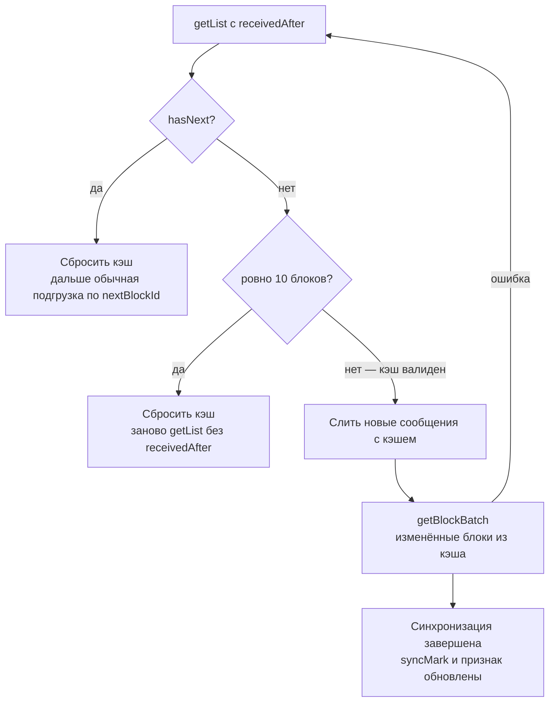

# Синхронизация кэша сообщений: изменения API для клиентов

14.10.2026 · Mikhail Kuzmin

## Кратко

Клиент с локальным кэшем переписки теперь может догнать её после офлайна двумя запросами, не перезагружая целиком: `getList` с новым параметром `receivedAfter` и новый метод `getBlockBatch`. Изменения обратно совместимы: без `receivedAfter` ответ `getList` содержит те же поля, что и раньше.

| Что | Тип изменения | Нужно ли менять клиент |
| --- | --- | --- |
| `/messages/getList`: параметр `receivedAfter`, поле `updatedBlockIds` | новое, необязательное | только для синхронизации кэша |
| `/messages/getBlockBatch`, объект `MessageBlock` | новый метод | только для синхронизации кэша |
| Пустые блоки: страница `getList` может содержать меньше 40 сообщений, вплоть до 0 при `hasNext: true` | уточнение контракта | **да, всем клиентам**: листать по `hasNext`, а не по числу сообщений |
| Код `1004` у `getList` и `getBlockBatch`, `2003` у `getBlockBatch` | новые случаи ошибок | обработать вместе с новыми вызовами |

Удаления сообщений в API пока нет, поэтому пустые блоки сейчас не встречаются. Контракт фиксирует их заранее, чтобы клиенты не сломались, когда удаление появится.

## GET /messages/getList: параметр receivedAfter

С `receivedAfter` метод возвращает только сообщения, присланные после отметки, и список блоков, в которых после отметки менялись старые сообщения. Без него метод работает как раньше.

| Параметр | Тип | Обязательный | Описание |
| --- | --- | --- | --- |
| `receivedAfter` | Int, мс | нет | Отметка синхронизации — Unix timestamp в миллисекундах, время сервера. Сравнение строгое: `createdAt > receivedAfter`. Не передаётся вместе с `blockId` |

Поля ответа с `receivedAfter`:

| Поле | Тип | Значение |
| --- | --- | --- |
| `messages` | Message[] | Сообщения первой страницы с `createdAt > receivedAfter`, от новых к старым. Часто пуст |
| `hasNext` | Bool | `true` — новых сообщений больше, чем помещается на страницу: кэш нужно сбросить. Это другой смысл, чем без фильтра |
| `nextBlockId` | Int \| null | Только при `hasNext: true` — блок для продолжения обычной подгрузки, иначе `null` |
| `updatedBlockIds` | Int[] | Только при `hasNext: false`. Блоки, где после отметки изменились или удалились старые сообщения, по убыванию id, не больше 10. Ровно 10 — их может быть больше, кэш нужно сбросить |

- Изменённые старые сообщения в `messages` не попадают — только id их блоков в `updatedBlockIds`. Сами блоки забираются через `getBlockBatch`.
- Блок нового сообщения, отредактированного после отметки, тоже попадёт в `updatedBlockIds`. Это безвредно, различать не нужно.
- Action `users` не отдаётся, если `messages` пуст, даже при непустом `updatedBlockIds`.

```json
{
  "status": 1,
  "response": {
    "messages": [
      {
        "messageId": 57,
        "clientId": "0b3e6c1a-2f4d-4a8e-9b7c-5d1e2f3a4b6c",
        "conversationId": 1,
        "blockId": 3,
        "senderId": 2,
        "type": "text",
        "text": "Ты где?",
        "isEdited": false,
        "createdAt": 1790850000456,
        "updatedAt": 1790850000456
      }
    ],
    "nextBlockId": null,
    "hasNext": false,
    "updatedBlockIds": [3, 1]
  },
  "actions": [
    { "type": "users", "data": { "userIds": [2] } }
  ]
}
```

## GET /messages/getBlockBatch и объект MessageBlock

Новый метод возвращает до 10 блоков целиком за один запрос. Он нужен, чтобы обновить блоки из `updatedBlockIds`, но к синхронизации не привязан. Требует активной сессии.

| Параметр | Тип | Обязательный | Описание |
| --- | --- | --- | --- |
| `blockIds` | Int[] | да | От 1 до 10 id, можно из разных переписок. Через запятую (`blockIds=1,2,3`) или массивом (`blockIds[]=1&blockIds[]=2`). Повторы игнорируются, но учитываются в лимите 10 |

| Поле ответа | Тип | Значение |
| --- | --- | --- |
| `blocks` | MessageBlock[] | Найденные блоки в порядке `blockIds` |
| `notFoundIds` | Int[] | Несуществующие блоки и блоки переписок, в которых пользователь не состоит, — неотличимы, в порядке `blockIds` |

Объект **MessageBlock**:

| Поле | Тип | Значение |
| --- | --- | --- |
| `blockId` | Int | Идентификатор блока |
| `conversationId` | Int | Идентификатор переписки |
| `messages` | Message[] | Все сообщения блока, от новых к старым. Пустой массив — все сообщения блока удалены |
| `updatedAt` | Int \| null | Время последнего изменения или удаления сообщений блока, мс; `null` — не менялись. Новые сообщения его не меняют |

`updatedAt` блока нужен для `syncMark`. После удаления в блоке может не остаться сообщения с таким временем, и без него блок возвращался бы в `updatedBlockIds` при каждой синхронизации. Action `users` отдаётся по отправителям сообщений всех блоков, если сообщения есть.

```json
{
  "status": 1,
  "response": {
    "blocks": [
      {
        "blockId": 3,
        "conversationId": 1,
        "messages": [
          {
            "messageId": 45,
            "clientId": "6f1c2a9e-4b7d-4e3a-9c51-0d2f8b6a7e14",
            "conversationId": 1,
            "blockId": 3,
            "senderId": 1,
            "type": "text",
            "text": "Буду через 10 минут",
            "isEdited": true,
            "createdAt": 1790846400123,
            "updatedAt": 1790849000789
          }
        ],
        "updatedAt": 1790849000789
      },
      {
        "blockId": 1,
        "conversationId": 1,
        "messages": [],
        "updatedAt": 1790849500000
      }
    ],
    "notFoundIds": [999]
  },
  "actions": [
    { "type": "users", "data": { "userIds": [1] } }
  ]
}
```

## Пустые блоки и постраничная загрузка

Подгружайте страницы дальше, пока `hasNext: true`, и не опирайтесь на число сообщений в ответе. Это касается всех клиентов, даже без кэша.

- Блок может стать пустым, если из него удалили все сообщения. Блоки не удаляются, так что `blockId` и `nextBlockId` у клиента остаются валидными.
- Место удалённого сообщения остаётся занятым. Новые сообщения попадают только в последний блок, границы блоков не сдвигаются.
- `getList` набирает страницу, пока в блоках не наберётся 40 **мест**, а не сообщений. Поэтому сообщений на странице может быть как больше 40, так и меньше — вплоть до 0 при `hasNext: true`.
- `hasNext: true` не гарантирует, что в более старых блоках есть сообщения.
- `getBlock` и `getBlockBatch` для пустого блока возвращают пустой `messages` без ошибки.

Пустая страница с `hasNext: true` — не конец переписки. Клиент, который прекращает подгрузку на пустом ответе, потеряет старую историю.

## Синхронизация кэша на клиенте

Синхронизация — один `getList` с `receivedAfter` и, если есть изменённые блоки из кэша, один `getBlockBatch`. В итоге кэш либо дополняется и остаётся валидным, либо сбрасывается.



Кэш сбрасывается, только если новых сообщений больше страницы или изменилось 10 и более блоков; в остальных случаях он дополняется.

### Что хранит клиент

Для каждой закэшированной переписки:

- **`syncMark`** — максимум `createdAt` и `updatedAt` полученных сообщений и `updatedAt` блоков из `getBlockBatch`. Только время сервера, часы устройства не используются.
- **Признак «синхронизирована в текущем соединении».** Ставится по завершении синхронизации, если WebSocket-соединение было в состоянии `auth` / `connected` до первого запроса и осталось текущим до конца. Сбрасывается у всех переписок, когда соединение закрывается или заменяется; при запуске приложения не стоит ни у одной.

Пока признак стоит, `syncMark` двигается по всему полученному: событиям `messages` / `received` и `edited`, ответам `getList`, `getBlock`, `getBlockBatch`, `send`, `edit`. Без признака данные сливаются с кэшем, но **`syncMark` не двигают**: иначе события, пропущенные без соединения, уже не вернутся.

### Когда синхронизировать

- При открытии закэшированной переписки без признака.
- После переподключения WebSocket — для открытой сейчас переписки. Остальные синхронизируются при открытии.
- Без кэша переписка грузится как обычно — `getList` без `receivedAfter`.

### Шаги

1. `getList` с `receivedAfter = max(syncMark − 5000, 0)`, без `blockId`. Запас 5 с нужен, потому что два сообщения могут получить одну миллисекунду, а `received` и `edited` — прийти не по порядку. Повторы безвредны: слияние идемпотентно.
2. `hasNext: true` — сбросить кэш относительно этого запроса и продолжить обычную подгрузку по `nextBlockId`. В этом случае страница совпадает с первой страницей без фильтра.
3. `hasNext: false` и ровно 10 `updatedBlockIds` — сбросить кэш и загрузить переписку как без кэша: `getList` без `receivedAfter`, сброс — относительно этого запроса.
4. `hasNext: false` и меньше 10 `updatedBlockIds` — все новые сообщения уже в ответе. Слить их с кэшем по `messageId` (побеждает больший `updatedAt`), кэш остаётся валидным.
5. Блоки из `updatedBlockIds`, сообщения которых есть в кэше, запросить одним `getBlockBatch` и применить к кэшу. Остальные блоки придут актуальными при обычной подгрузке.
6. После шагов 1–5 `syncMark` = максимум из всего полученного, ставится признак. Если `getBlockBatch` не удался, отметка не двигается и синхронизация повторяется целиком, а не только `getBlockBatch`.

### Сброс кэша

Сброс делается относительно запроса `getList` без `blockId`: его ответ становится новым началом кэша. Из кэша переписки удаляются все сообщения, кроме:

- полученных событием `received` после отправки этого запроса — они новее любого сообщения ответа;
- локальных, ещё не подтверждённых сервером (с `clientId`, без `messageId`).

Ответ сливается с оставшимся по общему правилу.

### Применение блока к кэшу

Ответ `getBlockBatch` или `getBlock` по блоку — его полное содержимое. Сообщения ответа сливаются с кэшем, а сообщения этого блока из кэша, которых в ответе нет, удаляются. Исключение — сообщения, полученные событием `received` после отправки запроса: новое сообщение могло попасть в последний блок уже после чтения.

## Ошибки

Новых кодов нет, у методов появились новые случаи существующих.

| Код | Метод | Когда |
| --- | --- | --- |
| `1004` | `/messages/getList` | `receivedAfter` — не целое неотрицательное число или передан вместе с `blockId` |
| `1004` | `/messages/getBlockBatch` | `blockIds` не передан, пуст, длиннее 10 элементов или содержит не целое неотрицательное число |
| `2003` | `/messages/getBlockBatch` | Пользователь не авторизован |

У `getList` доступ к переписке проверяется раньше параметров: без доступа придёт `5002`, даже если `receivedAfter` невалиден. Чужие и несуществующие блоки в `getBlockBatch` — не ошибка, они приходят в `notFoundIds`.

## Чек-лист для клиента

- [ ] Постраничная загрузка идёт по `hasNext`, пустая страница с `hasNext: true` не останавливает подгрузку
- [ ] Пустой `messages` у `getBlock` и `getBlockBatch` не считается ошибкой
- [ ] Для каждой переписки хранятся `syncMark` и признак «синхронизирована в текущем соединении»
- [ ] Признак сбрасывается у всех переписок при закрытии или замене WebSocket-соединения; без него `syncMark` не двигается
- [ ] Синхронизация запускается при открытии переписки без признака и после переподключения — для открытой переписки
- [ ] `receivedAfter = max(syncMark − 5000, 0)`, без `blockId`
- [ ] Сброс кэша при `hasNext: true` или ровно 10 `updatedBlockIds`, с сохранением свежих `received` и неподтверждённых отправок
- [ ] Изменённые блоки из кэша запрашиваются одним `getBlockBatch` и применяются с удалением отсутствующих сообщений
- [ ] При ошибке `getBlockBatch` синхронизация повторяется целиком, `syncMark` не меняется

Полный контракт — в репозитории сервера: `docs/api/methods/Messages.md` (разделы getList, «Синхронизация кэша сообщений», getBlockBatch), `docs/api/Objects.md` (блоки и MessageBlock), `docs/api/Errors.md`. При расхождении с этим документом верна документация в репозитории.
