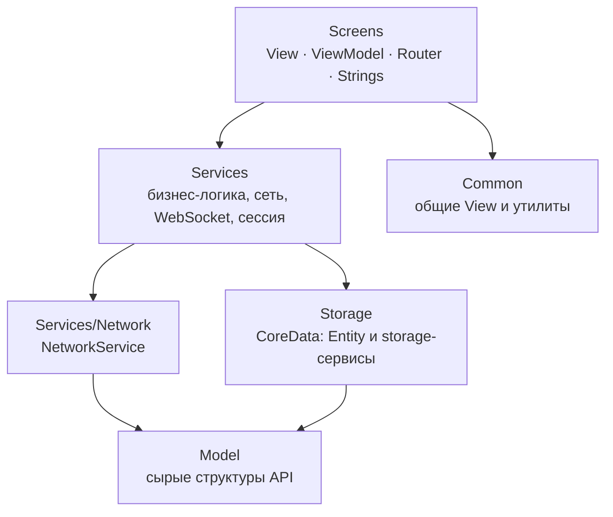
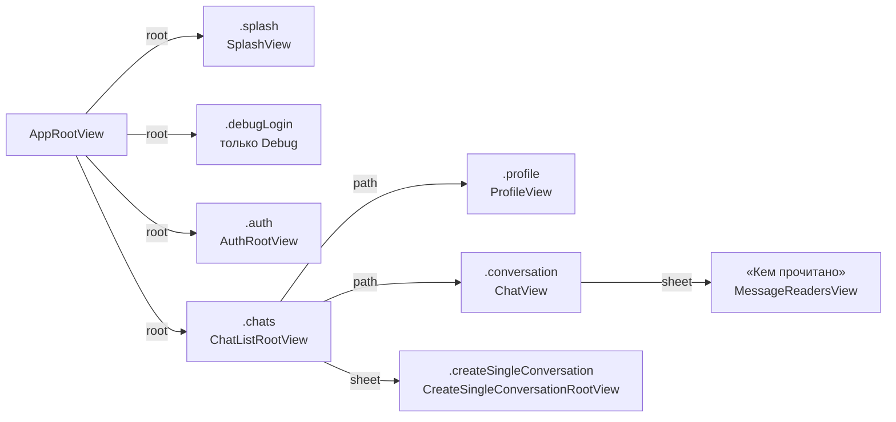

# Архитектура приложения: обзор

22.10.2026 · Mikhail Kuzmin

Статус: описание реализованного.

Документ — карта приложения: из каких слоёв оно состоит, как собираются сервисы, как устроен экран и навигация, как настраивается сборка. Подробности отдельных частей — в документах, на которые ведут ссылки.

## Слои

| Слой | Что в нём | Правило |
| --- | --- | --- |
| `Model` | `Decodable`-структуры ответов API (`User`, `Conversation`, `Message`, `RemoteFile`…) | без логики, кроме разбора и простых вычисляемых свойств |
| `Services/Network` | `NetworkService`, `Endpoint`, обёртка ответа, ошибки, кодирование тел | единственный, кто ходит в HTTP — [сетевой слой](networking.md) |
| `Services/*` | сервисы API (`AuthService`, `ConversationService`…), кэши, очереди, сессия, WebSocket | доступ к сервисам — только через протоколы и инжекцию |
| `Storage` | `CoreDataStack`, Entity, storage-сервисы | у каждого вида данных — один писатель — [локальная БД](local-storage.md) |
| `Screens` | экраны | ViewModel не знает о View, View не обращается к сервисам |
| `Common` | общие компоненты (`AvatarView`, `PaginatedList`, `Localized`, `ErrorMessages`…) | без зависимостей от конкретных экранов |

## Сборка сервисов — `DIContainer`

`DIContainer.shared` — `@MainActor`-синглтон, единственная точка, где создаются общие сервисы. Все зависимости передаются через `init` по протоколам. Обращаться к `DIContainer.shared` разрешено только:

- корневым View экранов (`AppRootView`, `AuthRootView`, `ChatListRootView`, `CreateSingleConversationRootView`) — чтобы собрать ViewModel;
- `Localized` — строки читаются из статических хелперов, куда инжекцию не передать ([локализация](localization.md)).

Порядок сборки в `init` важен, и он прокомментирован в коде. Главное:

1. **Хранилище открывается в фоне.** `BackgroundLoadedContainer { CoreDataStack.makeContainer() }`: открытие SQLite и возможная миграция не задерживают первый кадр, запросы к БД ждут открытия.
2. **Черновики и очередь отправки создаются раньше сессии** — `SessionService` загружает их данные при восстановлении и входе (`SessionDataLoading`).
3. **Циклы зависимостей разорваны слабыми ссылками, проставленными после сборки:**
   - `SessionExpirationRelay.authService` — сетевому слою нужен обработчик 2003, а `AuthService` сам зависит от сетевого слоя;
   - `APIActionDispatcher.userCache` — кэш пользователей ходит в сеть, а сеть отдаёт ему action `users`.
4. **`MessageCacheService` подписывается на очередь событий первым** и до запуска соединения: очередь не хранит события для будущих подписчиков.
5. **Наблюдатели выхода** подписываются на `AuthService` в конце; от порядка подписки ничего не зависит — важны фазы ([авторизация и сессия](auth-and-session.md)).
6. **`NetworkPathMonitor`** живёт, пока жив контейнер, и при появлении сети будит `RealtimeService`.

Сервисы, у которых экземпляр на экран, создаются фабричными методами контейнера: `makeMessagesListService(conversationId:)`.

## Экран

Каждый экран — каталог `Screens/<Экран>`:

| Файл | Роль |
| --- | --- |
| `<Экран>RootView` | владеет роутером (`@State`) и `NavigationStack`, собирает ViewModel из `DIContainer` |
| `View/<Экран>View`, `View/Subviews/*` | отображение; состояние читает из ViewModel, действия передаёт в её методы `didTap…` / `did…` |
| `ViewModel/<Экран>ViewModel` | `@MainActor @Observable`; хранимое состояние и действия. Крупные ViewModel разбиты на extensions по темам: `+Texts`, `+Validation`, `+Authentication`, `+AvatarPicking` |
| `ViewModel/*DisplayModel` | данные в готовом для показа виде (`ChatRowDisplayModel`, `ProfileDisplayModel`) |
| `<Экран>Router` | `@MainActor @Observable`; стек (`path`) и модальные экраны |
| `<Экран>Strings` + `ru.lproj` / `en.lproj` | строки экрана в своей таблице `.strings` |

Ошибки экранов показываются не алертами, а уведомлениями поверх приложения: ViewModel вызывает `InAppNotificationServiceProtocol.showError(ErrorMessages.message(for: error))` — см. [уведомления в приложении](in-app-notifications.md). `ErrorMessages` переводит `NetworkError` и коды API в тексты `CommonStrings`.

## Навигация

- **Корень выводится из состояния, а не переключается командами.** `AppRouter.root` вычисляется из `isSplashFinished` и `SessionService.isLoggedIn` (в Debug — ещё из `debugLoginState`). Вход, выход и истечение сессии меняют `SessionService`, и корень переключается сам: ни экран профиля с кнопкой «Выйти», ни сетевой слой о корне не знают.
- **`ChatListRouter`** — типизированный `path: [ChatListRoute]`, а не `NavigationPath`: по нему список знает, какая переписка открыта (`openedConversationId`), — это нужно уведомлениям о сообщениях и прочтению. `openConversation(_:)` открывает переписку с любого экрана (из уведомления): закрывает лист и заменяет стек.
- **`CreateSingleConversationRouter`** завершает модальный экран через замыкание `onFinish(Conversation?)`: результат получает `ChatListRootView`, он закрывает лист и добавляет переписку в список.
- **`AuthRouter`** — пустой `NavigationPath`; переход к чатам — через сессию.
- На iPad сцен может быть несколько: у каждой свой `AppRootView` и роутеры, а переходы по уведомлению выбирают роутер сцены через `ConversationNavigator` ([уведомления о входящих](incoming-message-notifications.md)).

## Жизненный цикл приложения

`AppRootView` в `.task` вызывает `AppRouter.restoreSession()`:

1. Splash держится не меньше 600 мс (`minimumSplashDuration`), чтобы не мелькать.
2. `LocalizationService.restore()` — сохранённый язык.
3. `SessionService.restore()` — пользователь из `UserDefaults` и его данные, которых нет на сервере (черновики, очередь отправки).
4. `SessionWorkStarting.startSessionWork()` — список переписок, уведомления о сообщениях, прочтение другими, отправка очереди, WebSocket. Splash этого не ждёт.

`onChange(of: scenePhase)` передаётся в `AppRouter.didChangeScenePhase(isActive:)`: уход в фон закрывает WebSocket (`realtimeService.stop()`), возврат — открывает заново с `/global/start`. Состояние `.inactive` (шторка, системный алерт) соединение не трогает. Подробно — в [авторизации и сессии](auth-and-session.md) и [соединении реального времени](realtime-connection.md).

## Конкурентность

- ViewModel, роутеры и сервисы с наблюдаемым состоянием — `@MainActor`.
- Тяжёлая работа уходит с main: `NetworkService.request` и `upload` — `@concurrent`; разбор WebSocket-фреймов — `@concurrent`; БД — только фоновые контексты (`performBackgroundTask`); логика кэша пользователей — в `actor UserCacheStore`; `UserDefaultsService` — `actor`; подготовка изображений — `Task.detached`.
- Протоколы сервисов, которые вызываются из разных акторов, объявлены `Sendable`.

## Сборка и конфигурация

| Файл | Что задаёт |
| --- | --- |
| `Config/Base.xcconfig` | `PRODUCT_BUNDLE_IDENTIFIER`, пустой `DEVELOPMENT_TEAM`, `API_BASE_URL` (по умолчанию `http://localhost:8080`), исключение `DebugLogin.strings` из Release; в конце — `#include? "Local.xcconfig"` |
| `Config/Local.xcconfig` | машинозависимые значения: команда подписи, свой bundle id, адрес сервера в локальной сети для запуска на устройстве. В `.gitignore`, шаблон — `Local.xcconfig.example` |
| `Chatik/Info.plist` | `APIBaseURL = $(API_BASE_URL)` |
| `AppConfig` | читает `APIBaseURL` из Info.plist (нет или некорректен — `fatalError` с подсказкой), таймаут запросов 30 с, адреса лицензии и политики конфиденциальности (`static/docs/*.pdf` на сервере API) |

В xcconfig `//` начинает комментарий, поэтому адрес пишется как `http:/$()/host:port`.

Зависимость через SPM одна — Kingfisher (загрузка и кэш изображений в `AvatarView`).

## Превью

`PreviewDependencies` (только `#if DEBUG`) собирает зависимости для `#Preview`: моки вместо сети и `UserDefaults`, CoreData в памяти, язык — русский. Превью не ходят на сервер, не трогают настройки и БД приложения, а состояния (загрузка, ошибка) воспроизводимы.

## Логи

`os.Logger` с подсистемой bundle id и категориями: `Auth`, `Realtime`, `Storage`, `Users`. Это ошибки, которые пользователю не показываются (сбой выхода на сервере, переподключение WebSocket, ошибки БД, незагруженные пользователи), но и не должны теряться молча. Сетевые запросы и ответы пишет `NetworkLogger` через `print` и только в Debug ([сетевой слой](networking.md)).

## Тесты

`ChatikTests` повторяет структуру приложения: `Common`, `Model`, `Screens`, `Services`, `Storage`, `Integration`. Моки и стабы — в `ChatikTests/Mocks` (`<Протокол>Mock`, `<Модель>+Stub`); вспомогательное: `TestClock`, `SleepController`, `Gate`, `URLProtocolStub`, `XCTestCase+YieldUntil`. Хранилище в тестах — SQLite по адресу `/dev/null`: работают unique constraints и `NSBatchDeleteRequest`, как в настоящей БД.

`NetworkServiceUploadIntegrationTests` проверяет загрузку файла и прогресс против локального сервера — `URLProtocol`-стаб не генерирует `didSendBodyData`.
