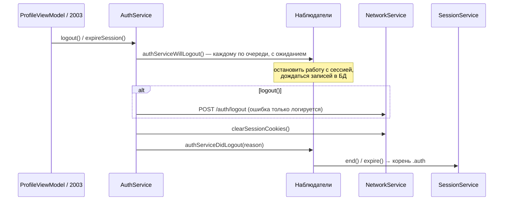

# Авторизация и сессия: архитектура клиента

22.10.2026 · Mikhail Kuzmin

Статус: описание реализованного.

## Назначение

- Регистрация и вход открывают сессию, выход и истечение сессии на сервере — закрывают.
- Сессия переживает перезапуск приложения.
- Данные одного пользователя не видны следующему на том же устройстве.
- Сервисы, которые работают с сессией (WebSocket, список переписок, очередь отправки…), останавливаются при выходе сами — экран с кнопкой «Выйти» и сетевой слой о них не знают.

Debug-вход по аргументам запуска — отдельно, в [debug-auto-login.md](debug-auto-login.md).

## Состав

| Тип | Роль |
| --- | --- |
| `AuthEndpoint` | `POST /auth/signup`, `/auth/login`, `/auth/logout` |
| `AuthService` | запросы авторизации и проведение выхода; наблюдатели выхода |
| `AuthServiceObserver`, `AuthServiceObservers` | протокол наблюдателя и общая логика двухфазного выхода (её же использует мок для превью) |
| `LogoutReason` | `.userInitiated` (кнопка) / `.sessionExpired` (2003, `null` из `/global/start`) |
| `SessionExpirationRelay` | передаёт 2003 из сетевого слоя в `AuthService` |
| `SessionService` | `@Observable` источник истины о текущем пользователе |
| `SessionDataLoading` | загрузка данных пользователя при открытии сессии (черновики, очередь отправки) |
| `LocalStorageCleaner` | очистка БД при входе и выходе |
| `SessionWorkStarting` / `SessionWorkLauncher` | начало работы открытой сессии с сервером |
| `UserDefaultsService` | хранит пользователя сессии (JSON `User`) |
| `AppRouter` | корневой экран по сессии; закрытие соединения на время фона |
| `AuthViewModel` и экран `Auth` | форма регистрации / входа |

## Сессия на сервере

Сессия — cookie `PHPSESSID`. `URLSession.shared` сохраняет и подставляет её сама; клиент только удаляет её при выходе (`NetworkService.clearSessionCookies()`). Признак «залогинен» на устройстве — пользователь в `UserDefaults`, а не cookie: экран не ждёт сети, чтобы решить, что показывать.

## `SessionService`

`@MainActor @Observable`. Хранит `currentUser` в памяти и в `UserDefaults`; корень и экраны наблюдают за ним.

| Метод | Что делает |
| --- | --- |
| `restore()` | на старте: читает пользователя из `UserDefaults`, загружает его данные (`SessionDataLoading`), затем ставит `currentUser` и `isRestored`. Повторный вызов — no-op |
| `start(user:)` | после входа / регистрации: очищает БД → загружает данные пользователя → `currentUser` → `isExpired = false` → `UserDefaults` |
| `update(user:)` | новый профиль (аватар); без сессии — no-op, чтобы обновление профиля не «открыло» сессию в обход `start` |
| `end()` | очищает БД → `currentUser = nil` → удаляет из `UserDefaults` |
| `expire()` | `isExpired = true` **до** `end()`: сброс пользователя переключает корень на авторизацию, и экран может прочитать флаг ещё до конца `end()` |
| `acknowledgeExpiration()` | сбрасывает `isExpired`, когда сообщение показано |

Решения:

1. **Данные пользователя загружаются до того, как сессия станет видна корню.** Экран переписки, открытый раньше загрузки черновиков, показал бы пустое поле и стёр бы черновик при уходе; список чатов мигнул бы последним сообщением вместо «Не отправлено:». Загрузчики (`MessageDraftService`, `MessageSendQueue`) работают параллельно: чтения независимы.
2. **БД очищается и при выходе, и при входе.** Сессию можно завершить в обход `AuthService` (`end()` / `expire()` напрямую), без ожидания записей сервисов; повторная очистка при входе гарантирует, что новый пользователь не увидит чужих данных.
3. **Ошибка очистки не блокирует ни вход, ни выход** — она логируется (`Logger.storage`).
4. **Сервис сам — наблюдатель выхода:** `authServiceDidLogout(reason:)` вызывает `end()` или `expire()`.

### Что очищается

`LocalStorageCleaner.clearAll()` удаляет `NSBatchDeleteRequest` записи **всех** сущностей модели, кроме `preservedEntityNames` — `MessageDraftEntity` и `OutgoingMessageEntity`. Список сущностей берётся из модели, поэтому новая сущность очищается автоматически. Черновиков и очереди отправки нет на сервере — они переживают выход и вернутся пользователю при следующем входе, а чужие записи скрывает ключ пользователя в записи (`userId` у черновика, `senderId` у сообщения очереди). См. [черновики](message-drafts.md) и [неотправленные сообщения](unsent-messages.md).

Кэш пользователей в памяти при выходе не очищается: профили не принадлежат текущему пользователю ([кэш пользователей](users-cache.md)).

## Выход — две фазы

- **Фаза 1 — `authServiceWillLogout()`**, до запроса: наблюдатель прекращает работу, которая пишет в БД или пользуется сессией. После выхода БД очищается, и поздняя запись досталась бы следующему пользователю.
- **Фаза 2 — `authServiceDidLogout(reason:)`**, после запроса при любом его исходе: устройство разлогинено, cookie удалены.
- **Важны фазы, а не порядок подписки.** Все `WillLogout` заканчиваются до запроса, все `DidLogout` начинаются после него; на порядок внутри фазы не полагаться.
- **Выход не может не удаться.** Пользователь нажал «Выйти» и не должен остаться в аккаунте из-за сети: ошибка `/auth/logout` только логируется (`Logger.auth`), сессия на сервере в худшем случае истечёт сама.
- **Повторный выход игнорируется** (`isLoggingOut`): повторное нажатие или 2003 от запроса, отменяемого во время выхода, уведомили бы наблюдателей дважды.
- **`expireSession()` запускает выход отдельной задачей и не ждёт.** Истечение замечает работа, которую наблюдатели дожидаются в фазе 1 (загрузка списка, цикл WebSocket), — ожидание из неё привело бы к взаимной блокировке. Запроса нет: сессии на сервере уже нет.
- **Наблюдатели хранятся слабо**; повторная подписка того же объекта не дублирует уведомления.

Наблюдатели в приложении (`DIContainer`): `RealtimeService`, `RealtimeEventQueue`, `ConversationListService`, `MessageSendQueue`, `MessageEditService`, `MessageCacheLogoutObserver`, `MessageDraftLogoutObserver`, `InAppNotificationService`, `MessageNotificationService`, `MemberReadService`, `SessionService`.

## Истечение сессии

Источники:

- любой HTTP-запрос с кодом 2003 → `NetworkService` → `SessionExpirationRelay` → `AuthService.expireSession()` ([сетевой слой](networking.md));
- `/global/start` вернул `null`, а локально сессия открыта → `RealtimeService` вызывает `expireSession()` ([соединение реального времени](realtime-connection.md)).

Объяснение пользователю: `SessionService.isExpired` → экран авторизации в `showExpirationIfNeeded()` показывает ошибку «сессия истекла» через уведомление. Флаг сбрасывается, только если уведомление действительно показано (`showError` вернул `true`): сессия, истёкшая в фоне, объясняется при возврате в приложение. Вызывается при появлении экрана и при каждом включении уведомлений.

## Начало работы сессии — `SessionWorkLauncher`

Единая точка и для старта приложения (`AppRouter.restoreSession()`), и для входа (`AuthViewModel.performAuthentication()`), и для debug-входа. Порядок задан в одном месте, чтобы новый путь входа не мог его нарушить:

1. `ConversationListService.start()` — читает кэш и подписывается на события: очередь событий не хранит их для будущих подписчиков.
2. `MessageNotificationService.start()` — после списка: к обработке события переписка из него уже в списке.
3. `MemberReadService.start()` — до соединения, иначе пропустит первые `memberRead`.
4. `MessageSendQueue.resumeDeliveries()` — отправка сообщений, прерванных прошлой сессией или закрытием приложения; ответ поднимает переписку в списке, поэтому список уже запущен.
5. `RealtimeService.start()` — `/global/start` и токен WebSocket для пользователя сессии.

Повторный запуск (вход после выхода) у сервисов идемпотентен.

## Фон и активное состояние

`AppRouter.didChangeScenePhase(isActive:)`:

- уход в фон → `realtimeService.stop()`; повторный уход игнорируется;
- возврат → `realtimeService.start()` с `/global/start`, только если приложение было в фоне;
- `.inactive` (шторка, системный алерт) отфильтрован в `AppRootView` и соединение не трогает.

Пока идёт debug-сценарий, фаза только запоминается — см. [debug-auto-login.md](debug-auto-login.md).

## Экран авторизации

`AuthRootView` → `AuthView` + `AuthViewModel`. Один экран в двух режимах (`AuthMode`): регистрация (по умолчанию) и вход; переключение — ссылкой внизу.

- **Поля:** имя (только регистрация), логин, пароль с кнопкой показа. `focusedField` синхронизируется из View.
- **Кнопка** активна: при регистрации — при полностью валидной форме (`SignupValidator.isFormValid`), при входе — при непустых логине и пароле (`LoginValidator`). На время запроса неактивна, повторное нажатие игнорируется.
- **Подсказки и ошибки — только в режиме регистрации** (`AuthFieldState`): в фокусе — требования к полю, без фокуса при непустом невалидном вводе — ошибка с подсветкой.
- **Запрос:** логин и имя без краевых пробелов, пароль — как есть. Успех → `SessionService.start(user:)` → `SessionWorkStarting.startSessionWork()`; корень переключается на список чатов. Ошибка → уведомление с текстом `ErrorMessages`.
- **Меню языка** (`AuthLanguageMenu`) в тулбаре — см. [локализацию](localization.md).
- **Соглашение:** ссылки на лицензию и политику конфиденциальности — `AppConfig.licenseAgreementURL`, `privacyPolicyURL`.

### Правила валидации

Повторяют серверные, чтобы ошибка была видна до запроса:

| Поле | Правило | Ошибки |
| --- | --- | --- |
| имя | после обрезки краевых пробелов: не пустое; `^[\p{L}0-9_\- ]+$`; ≤ 128 символов | `empty`, `invalidCharacters`, `tooLong` |
| логин | после обрезки краевых пробелов: не пустой; `^[A-Za-z0-9_]+$`; ≤ 64 символа | `empty`, `invalidCharacters`, `tooLong` |
| пароль | ≥ 8 символов; есть заглавная, строчная латинская буква и цифра; прочие символы допускаются | первая нарушенная: `tooShort`, `missingUppercase`, `missingLowercase`, `missingDigit` |
| вход | логин и пароль содержат хотя бы один непробельный символ | — |

`MessageTextValidator` (тот же каталог `Services/Validation`) проверяет текст сообщения: 1…4096 code points после обрезки пробелов и невидимых символов U+200B, U+200D, U+FEFF — так же, как сервер.

## Splash

`SplashView` — логотип, название и индикатор; без ViewModel. Показывается, пока восстанавливаются язык и сессия, но не меньше 600 мс (`AppRouter.minimumSplashDuration`), чтобы не мелькать на один кадр.

## Тесты

- `AuthServiceTests`: регистрация и вход вызывают свои эндпоинты; выход при любом ответе чистит cookie и уведомляет наблюдателей вокруг запроса; повторная подписка не дублирует, отписка работает, наблюдатель хранится слабо; повторный выход и истечение во время выхода игнорируются; истечение — без запроса.
- `SessionServiceTests`: восстановление, `start` / `update` / `end` / `expire`; очистка БД до сброса пользователя и до открытия сессии; ошибка очистки не мешает; флаг истечения поднимается до сброса пользователя; данные загружаются до `isRestored` и до открытия сессии; черновики переживают выход и вход.
- `SessionWorkLauncherTests`: порядок запуска.
- `AppRouterTests`: корень до и после восстановления, следование за сессией, минимальное время splash, язык, порядок запуска работы, фон и возврат; debug-сценарии.
- `LocalStorageCleanerTests`: удаляются все сущности, кроме черновиков и очереди отправки.
- `AuthViewModelTests`, `SignupValidatorTests`, `LoginValidatorTests`, `MessageTextValidatorTests`, `UserDefaultsServiceTests`.
