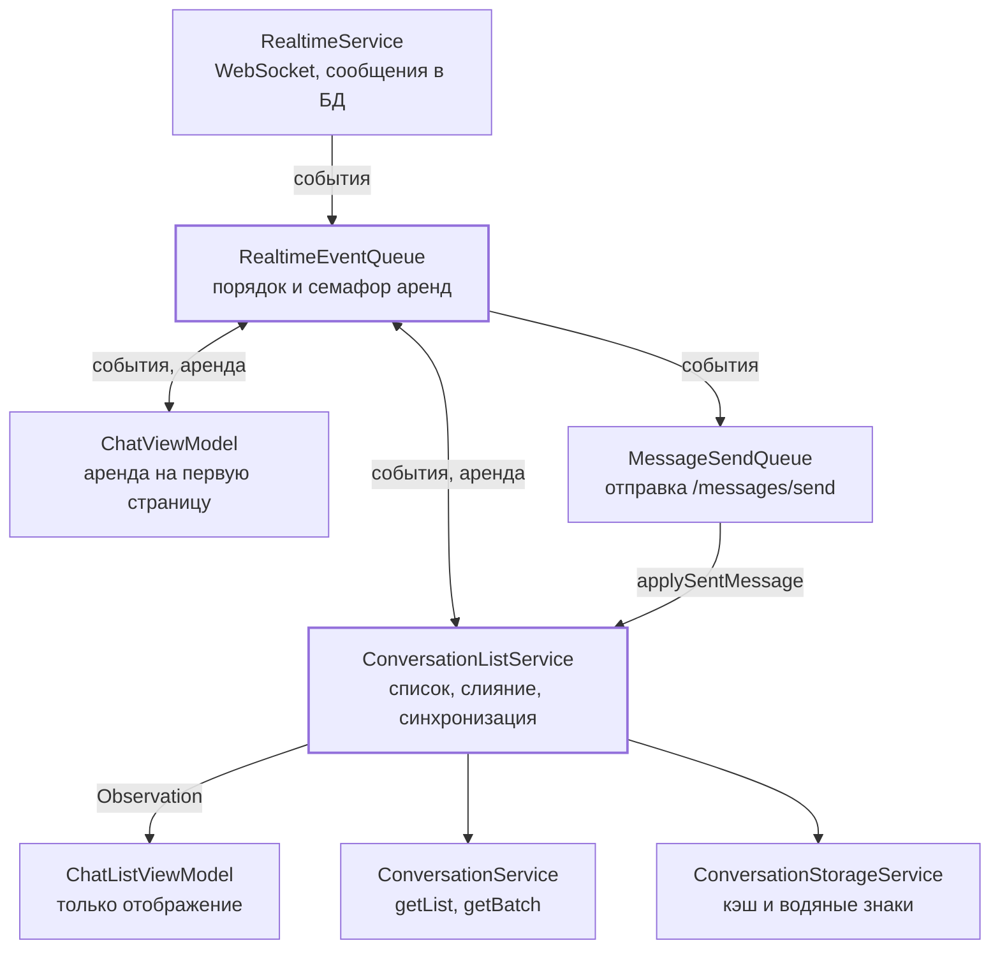
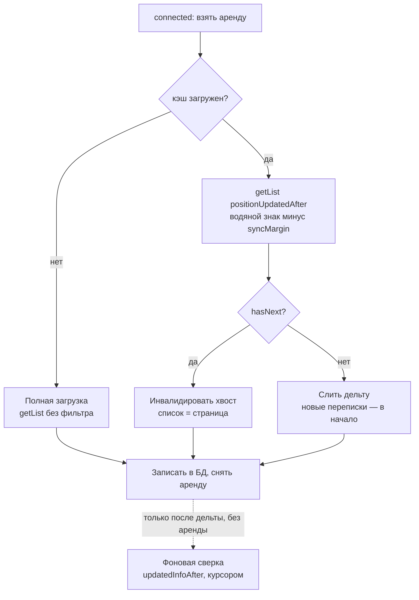

# Подъём чатов в списке: архитектура клиента

13.10.2026 · Mikhail Kuzmin

## Цель и ключевые решения

Список чатов сортируется по последнему сообщению и поднимает переписку при новом сообщении — из события WebSocket, из ответа `/messages/send` и после синхронизации с сервером. Серверная часть описана в документе [ServerAi API: изменения для клиентов](api-changes/2026-10-13-conversation-position-and-ms-time.md); здесь — только клиент iOS. Редактирование сообщений в эту итерацию не входит: обрабатываем только входящее событие `messages/edited`.

Ключевые решения:

1. **`ConversationListService`** — новый сервис уровня приложения (живёт в `DIContainer`, не в экране). Он единственный хранит упорядоченный список переписок, единственный пишет переписки в БД и единственный применяет правила слияния. `ChatListViewModel` становится тонким: читает список и передаёт действия пользователя.
2. **`RealtimeEventQueue`** — очередь событий WebSocket между `RealtimeService` и всеми потребителями. Обработку можно приостановить «арендой» (семафор со счётчиком); события копятся и применяются после снятия последней аренды в порядке прихода. Аренда снимается гарантированно: scoped-API, освобождение в `deinit`, сторожевой таймаут и сброс при выходе.
3. **Стартовая синхронизация** — кэш из БД сразу, затем дельта через `positionUpdatedAfter`, при переполнении — инвалидация хвоста, иначе фоновая сверка информации через `updatedInfoAfter`. Повторный старт прерывает предыдущий.
4. **Время — `ServerTime` (Int64, мс)** вместо `Date`: значения уходят обратно в фильтры со строгим сравнением, поэтому храним ровно то целое, что прислал сервер, без перевода в секунды и обратно.
5. **Водяные знаки синхронизации хранятся в БД**, а не вычисляются из максимума по кэшу: так подъём по ответу `/messages/send` при оборванном WebSocket и прерванная фоновая сверка не приводят к потере изменений (подробно — в разделе о стартовой загрузке).



Все события WebSocket идут через одну очередь; сервис списка и экран переписки берут в ней аренду на время загрузки, а писать переписки в БД может только `ConversationListService`. `MessageSendQueue` тоже подписан на очередь — чтобы подтверждать свои сообщения.

## Модели и сетевой слой

Все серверные метки времени переходят на миллисекунды одновременно с сервером; отдельной версии API нет. Длительности (`expiresIn`, таймауты WebSocket) остаются в секундах.

| Тип / файл | Изменение |
| --- | --- |
| `ServerTime` (новый, `Model/ServerTime.swift`) | `struct ServerTime: Comparable, Hashable, Decodable { let milliseconds: Int64 }`; `var date: Date` для UI; `func adding(milliseconds:)` для запаса синхронизации. Декодируется из целого числа |
| `Message` | `createdAt`, `updatedAt` — `ServerTime`; `isNotOlder(than:)` сравнивает мс. Форматирование в `ChatViewModel+Texts` берёт `.date` |
| `LastMessage` (новый) | `messageId: Int`, `type: MessageType`, `text: String?`, `updatedAt: ServerTime`; `init(message:)` — превью из отправленного сообщения |
| `Conversation` | удалён `updatedAt` и `isNotOlder(than:)`; добавлены `lastMessage: LastMessage?`, `positionUpdatedAt: ServerTime`, `updatedInfoAt: ServerTime`; вычисляемое `position: ConversationPosition` |
| `ConversationPosition` (новый) | пара `(positionUpdatedAt, lastMessage?.messageId ?? 0)`, `Comparable` лексикографически — версия позиции для правила 1 |
| `ConversationPatch` (новый) | частичная версия из событий `messages` и ответа `/messages/send`: `conversationId`, `positionUpdatedAt` (= `message.createdAt`), `lastMessage` |
| `ConversationsPage` | удалён `coveredIdRange` — удаление по диапазону id больше не работает (список сортируется по позиции) |
| `ConversationsBatch` (новый) | ответ `getBatch`: `conversations: [Conversation]`, `notFoundIds: [Int]` |
| `WebSocketServerMessage` | тело `messages/received` — `{ message, lastMessage }`, `messages/edited` — `{ message, lastMessage? }`; события `.messageReceived(Message, LastMessage)` и `.messageEdited(Message, LastMessage?)` |

Сетевой слой переписок:

```swift
enum ConversationListFilter: Equatable {
    /// Без фильтра: обычная пагинация сдвигом.
    case none(offset: Int?)
    /// Переписки, поднявшиеся после метки; сдвиг — как без фильтра.
    case positionUpdatedAfter(ServerTime, offset: Int?)
    /// Переписки с изменённой информацией; следующая страница — курсором.
    case updatedInfoAfter(ServerTime, afterId: Int?)
}

protocol ConversationServiceProtocol {
    func createSingle(userId: Int) async throws -> Conversation
    func fetchConversations(filter: ConversationListFilter, count: Int?) async throws -> ConversationsPage
    func fetchConversations(ids: [Int]) async throws -> ConversationsBatch
}
```

Фильтр сделан перечислением, чтобы недопустимые сочетания параметров (ошибка `1004`: два фильтра сразу, `updatedInfoAfter` с `offset`) нельзя было собрать. Отрицательная метка (запас у начала эпохи) уходит как 0 — иначе тоже `1004`. `ConversationEndpoint` получает `getList(filter:count:)` и `getBatch(ids:)` — id через запятую, не больше 100; больше id сервис запрашивает частями и склеивает ответы. `MessageService.edit` и `/messages/edit` в эту итерацию не меняются: поле `lastMessage` в ответе просто игнорируется декодером.

### Правила слияния — `ConversationMerger`

Чистая функция без состояния; её используют и сервис, и `ConversationEntity.upsert` как страховка.

```swift
enum ConversationUpdate {
    case full(Conversation)      // getList, getBatch, createSingle, singleCreated
    case patch(ConversationPatch) // received, edited, ответ /messages/send
}

enum ConversationMerger {
    /// Результат слияния; `nil` — локальная версия не меняется.
    static func merge(_ update: ConversationUpdate, into local: Conversation) -> Conversation?
}
```

1. **Позиция:** входящая `ConversationPosition` строго больше локальной → берём `positionUpdatedAt` и `lastMessage` целиком.
2. **Текст:** `lastMessage.messageId` совпадает, а `lastMessage.updatedAt` больше → берём `lastMessage`.
3. **Информация** (только `.full`): `updatedInfoAt` больше → берём `memberIds`, `name`, `avatar`, `opponentUserId`, `updatedInfoAt`.

Результат сообщает сервису, изменилась ли позиция (нужно ли перемещать строку). Порядок списка: `positionUpdatedAt` ↓, затем `conversationId` ↓.

## ConversationListService

Сервис хранит список переписок дольше любого экрана и публикует его через Observation. `@MainActor @Observable final class`, живёт в `DIContainer`, подписан на выход (`AuthServiceObserver`). Файл: `Services/ConversationList/ConversationListService.swift`.

```swift
@MainActor
protocol ConversationListServiceProtocol: AnyObject, AuthServiceObserver {
    /// Переписки по позиции: positionUpdatedAt ↓, conversationId ↓.
    var conversations: [Conversation] { get }
    /// Идёт ли стартовая синхронизация — для индикатора «Обновление…».
    var isSyncing: Bool { get }
    var isLoadingNextPage: Bool { get }
    var hasMorePages: Bool { get }

    /// Подписывается на очередь и запускает чтение кэша из БД. Вызывается из AppRouter до realtimeService.start().
    func start()
    /// Стартовая синхронизация; прерывает идущую (включая фоновую сверку информации).
    func synchronize()
    /// Pull-to-refresh: полная перезагрузка первой страницы без фильтра.
    func refresh() async throws
    func loadNextPageIfNeeded(currentConversationId: Int)
    /// Полная версия из REST (createSingle).
    func apply(_ conversation: Conversation)
    /// Поднимает переписку по ответу /messages/send.
    func applySentMessage(_ message: Message)
}
```

Ошибку синхронизации экран не показывает: кэш остаётся на экране, повтор — при следующем `connected` или pull-to-refresh. Поэтому отдельного состояния `failed` нет — только `isSyncing`.

**Инвариант префикса.** Список в памяти совпадает с переписками в БД и всегда остаётся непрерывным началом серверного списка (с точностью до переписок, пропавших с сервера, — их убирает только pull-to-refresh). Отсюда: переписка из события с новой позицией всегда попадает в префикс (она самая свежая); переписка из `updatedInfoAfter`, которой нет локально, отбрасывается. Кэш на старте читается целиком (а не `limit: 30`), иначе префикс в памяти разойдётся с БД.

**Сдвиг следующей страницы — `serverLoadedCount`.** Ошибка в меньшую сторону безопасна: следующая страница повторит уже известные переписки, а слияние их уберёт. Ошибка в большую — нет: переписка на стыке страниц пропадёт. Поэтому сдвиг считается с недобором:

| Момент | `serverLoadedCount` |
| --- | --- |
| Старт из кэша | `conversations.count` — в БД лежат только переписки из серверных страниц и событий, а все они входят в префикс |
| Полная загрузка, инвалидация хвоста | размер полученной страницы |
| Следующая страница | `+` число переписок в ответе (вместе с повторами — их позиции на сервере уже заняты) |
| Дельта без `hasNext`, события, `createSingle`, `applySentMessage` | не меняется: новые переписки сверху сдвигают серверный список, и следующая страница вернёт повторы — это безопасная сторона |

**Внутреннее состояние:**

- `conversations` и индекс `[conversationId: Int]` — для O(1) поиска; перемещение — удаление и вставка бинарным поиском по порядку.
- `serverLoadedCount` — сдвиг для следующей страницы, правила выше.
- `listState: ConversationListState` — хранится в БД: `isLoaded`, `hasMorePages`, `positionWatermark: ServerTime?`, `positionWatermarkCeiling: ServerTime?`, `infoWatermark: ServerTime?`.
- `cacheTask: Task<Void, Never>?` — чтение кэша, запущенное в `start()`. Любой обработчик события сначала дожидается его: `connected` может прийти раньше, чем кэш прочитан, и без ожидания синхронизация увидела бы пустое состояние.
- `pendingLocalUpdates: [ConversationUpdate]` — изменения из `applySentMessage` и `apply(_:)`, пришедшие, пока идёт запрос под арендой (см. «Замена списка»).
- `syncGeneration: Int` и `syncTask` / `infoSyncTask` / `nextPageTask` — новая синхронизация и `refresh()` отменяют задачи и увеличивают поколение; ответ старого поколения отбрасывается даже если запрос не успел отмениться.
- `lastWrite: Task<Void, Never>?` — последовательная цепочка записей в БД, как в `MessageSendQueue`: записи идут в порядке изменений в памяти, выход дожидается их.

**Ответственность, которая уходит из других мест:** `ChatListViewModel` теряет `PaginatedList`, `liveConversations`, `firstPageTasks` и зависимость от `ConversationStorageService`; `RealtimeService` больше не пишет переписки в БД — иначе два писателя с разным порядком записей ломали бы инвариант префикса.

**Выход из аккаунта** (`authServiceWillLogout`): увеличить поколение, отменить и дождаться всех задач и `lastWrite`, очистить список и `isSyncing`. БД чистит `LocalStorageCleaner`, включая `ConversationListState`.

## Стартовая синхронизация

Список показывается из БД сразу, а синхронизация догоняет пропущенное за время офлайна одним запросом в обычном случае. Запускается по событию `RealtimeEvent.connected`: оно приходит при старте, входе, возврате из фона и каждом переподключении — именно тогда сервер мог пропустить события. Отдельный запуск из `start()` не нужен: сразу за ним пришёл бы `connected` и отменил его.

**Запуск без WebSocket.** Чтобы список не зависел от того, подключится ли WebSocket (упал WS-сервер, прокси режет WS, не выдан токен), экран списка при открытии вызывает `synchronizeIfNeeded()`. Он дожидается чтения кэша (иначе без водяных знаков вместо дельты ушла бы полная загрузка) и запускает `synchronize()`, только если в этой сессии синхронизации ещё не было — ни по `connected`, ни через pull-to-refresh. Флаг сбрасывается выходом из аккаунта. Если `connected` придёт позже, он запустит ещё одну синхронизацию: события между снимком сервера и подключением могли потеряться, а дельта после свежей синхронизации дешёвая. Ошибку `synchronizeIfNeeded()` экран показывает; прерывание новой синхронизацией завершается `CancellationError` и не показывается.

### Алгоритм `synchronize()`

1. Дождаться `cacheTask`. Отменить идущие `syncTask`, `infoSyncTask`, `nextPageTask`; `syncGeneration += 1`; `isSyncing = true`.
2. **Взять аренду очереди синхронно** — ещё внутри обработчика `connected`, до первого `await` (ожидание `cacheTask` идёт уже под арендой): все события после `connected` накопятся и применятся после ответа `getList`.
3. Если `listState.isLoaded == false` или `positionWatermark == nil` → **полная загрузка**: `getList(.none(offset: nil))`, список и БД заменяются страницей (см. «Замена списка»), водяные знаки = максимумы страницы. Переход к шагу 6.
4. Иначе запомнить снимок `infoFrom = listState.infoWatermark` и запросить **дельту позиций**: `getList(.positionUpdatedAfter(positionWatermark − syncMargin, offset: nil), count: pageSize)`.
   - `hasNext == true` — поднялось больше страницы. Страница с фильтром совпадает с началом полного списка, поэтому остальные локальные переписки **инвалидируются**: список и БД = эта страница (см. «Замена списка»), `serverLoadedCount = page.count`, `hasMorePages = true`, водяные знаки = максимумы страницы. Дальше — обычная пагинация без фильтра при прокрутке. Сверка информации не нужна: все переписки свежие.
   - `hasNext == false` — слить каждую переписку как `.full` (неизвестные встают в начало — префикс не рвётся), поднять `positionWatermark` до максимума страницы, запустить `infoSyncTask(from: infoFrom)` (шаг 5).
   - В обеих ветках успешный ответ снимает `positionWatermarkCeiling` (см. «Ошибка `getBatch`»): дельта вернула все переписки выше прежнего водяного знака.
5. **Фоновая сверка информации** — идёт уже без аренды и без индикатора. Цикл: `getList(.updatedInfoAfter(cursorTime − syncMargin для первой страницы, afterId: cursorId), count: 100)` → слить только локально известные по всем трём правилам, остальные отбросить → `infoWatermark` = `updatedInfoAt` последней переписки страницы → курсор = `(updatedInfoAt, conversationId)` последней → пока `hasNext`. Перед каждым запросом и после ответа — проверка `Task.isCancelled` и поколения: новая синхронизация прерывает цикл. Ошибка сети просто останавливает цикл — продолжит следующая синхронизация с сохранённого водяного знака.
6. Записать список и `listState` в БД, `isSyncing = false`, **освободить аренду** (в `defer`, то есть и при ошибке и отмене). Накопленные события применяются по порядку. При ошибке `getList` кэш остаётся на экране, повтор — при следующем `connected` или pull-to-refresh.



Все три ветки сходятся на записи и снятии аренды; ошибка или отмена на любом шаге тоже снимает аренду через `defer`. Фоновая сверка идёт уже при работающей очереди и обрывается следующей синхронизацией.

### Замена списка

Полная загрузка, инвалидация хвоста и `refresh()` заменяют список страницей (`replaceList`), а не сливают с ним. Это корректно, только если за время запроса список не менялся. Два источника всё же могут его изменить:

- **`applySentMessage` и `apply(_:)`** идут мимо очереди, и аренда их не держит. Пока запрос под арендой в полёте, сервис применяет их как обычно и дополнительно копит в `pendingLocalUpdates`. После `replaceList` накопленное сливается со страницей через `ConversationMerger` (переписки, которых нет на странице, вставляются по сортировке), и буфер очищается. Без этого отправленное сообщение пропадало бы из превью до прихода `received`.
- **Запись в БД без слияния.** `replaceList` в памяти просто ставит страницу (с наложенными `pendingLocalUpdates`), поэтому и `ConversationStorageService.replaceList` перезаписывает записи как есть (`ConversationEntity.upsert(mergingWithStored: false)`), а не сливает с сохранёнными. Иначе версия сервера, «старшая» по правилам слияния только формально — последнее сообщение удалено (`lastMessage: null`) или позиция ушла назад, — попала бы в память, но не в БД, и после перезапуска из кэша всплыло бы удалённое превью.
- **Принудительное снятие аренды сторожевым таймаутом.** Очередь к этому моменту уже применила накопленные события, и страница, запрошенная раньше них, старее списка. Поэтому перед заменой сервис проверяет `lease.isExpired` (вместе с поколением): истёкшая аренда — страница **сливается** как `.full`, а не заменяет список, и сверка информации не запускается. Водяные знаки при этом **не двигаются**: слитая страница не гарантирует непрерывного префикса (поднявшихся могло быть больше страницы), и следующая синхронизация повторит запрос от прежнего водяного знака.

### Ошибка `getBatch`

Если `getBatch` по событию `received` не удался, переписка не вставляется, и вернуть её может только дельта позиций — а для этого `positionWatermark` не должен уйти выше её позиции. Но следующие события из очереди подняли бы его, и при неудачной синхронизации (сети нет) переписка потерялась бы до pull-to-refresh. Поэтому при ошибке:

1. `positionWatermarkCeiling = min(ceiling, message.createdAt)`; `positionWatermark = min(positionWatermark, ceiling)`.
2. Пока потолок задан, любой подъём водяного знака ограничен им: `positionWatermark = min(max(positionWatermark, t), ceiling)`.
3. Потолок хранится в `ConversationListState` (переживает перезапуск) и снимается только успешной дельтой или полной загрузкой.
4. Сервис планирует `synchronize()`.

### Водяные знаки: кто их двигает

| Источник | `positionWatermark` | `infoWatermark` |
| --- | --- | --- |
| Полная загрузка, инвалидация хвоста | = максимум страницы | = максимум страницы |
| Ответ после истёкшей аренды | не меняется | не меняется |
| Дельта позиций | максимум со страницей | не меняется |
| Фоновая сверка информации | не меняется (даже если правило 1 подняло переписку) | = `updatedInfoAt` последней переписки страницы |
| События `received`, `singleCreated` | максимум с позицией (с учётом потолка) | не меняется |
| Событие `edited` | не меняется | не меняется |
| Следующие страницы, `applySentMessage`, `createSingle` | не меняется | не меняется |

### Почему водяные знаки хранятся, а не вычисляются

Если брать `max(positionUpdatedAt)` и `max(updatedInfoAt)` по кэшу, теряются изменения в трёх случаях:

- **Отправка при оборванном WebSocket.** REST работает, WS ещё не переподключился. Чат A поднялся на сервере в T8 (событие потеряно), мы отправили в чат B в T9 и подняли его по ответу. Максимум по кэшу = T9, и дельта не вернёт A. Поэтому `positionWatermark` поднимают только страницы синхронизации и события WS (они идут без разрывов от `connected` до обрыва), а `applySentMessage` и `createSingle` — нет.
- **Прерванная сверка информации.** Дельта позиций принесла полный объект с `updatedInfoAt = T5`, а сверка оборвалась до чата с изменением в T3. Максимум по кэшу = T5, и T3 потеряно навсегда. Поэтому `infoWatermark` двигает только сама сверка, постранично (выдача идёт по возрастанию), и полная загрузка первой страницы.
- **Новая переписка из `singleCreated`.** Смена названия, аватара или участников не приходит по WebSocket — её находит только сверка при следующем `connected`. Если бы `singleCreated` с `updatedInfoAt = T10` поднял `infoWatermark`, переименование другого чата в T5, случившееся онлайн, не попало бы в сверку никогда. Поэтому `singleCreated` двигает только `positionWatermark`. Здесь клиент сознательно расходится с серверным документом, который включает `singleCreated` в `maxUpdatedInfoAt`: там водяной знак вычисляется, а не хранится.

### Пагинация и pull-to-refresh

- `loadNextPageIfNeeded` — `getList(.none(offset: serverLoadedCount))`; повторы по `conversationId` сливаются, новые дописываются. Водяные знаки страницы не двигают. Не запускается, пока идёт основная фаза синхронизации: сдвиг в это время нестабилен. Отклонённый вызов запоминается (`deferredPrefetchId`) и повторяется в конце фазы: строка уже на экране, и `onAppear` для неё больше не придёт — без повтора пагинация вставала бы до следующей прокрутки.
- `refresh()` — та же полная загрузка, что и шаг 3, с арендой и новым поколением. Это единственный способ убрать из кэша переписку, которая пропала с сервера: дельты удаления не сообщают. Если `refresh()` прервала новая синхронизация, он завершается `CancellationError`, и экран её не показывает — список и так обновляет синхронизация.

## RealtimeEventQueue — очередь событий с приостановкой

Одна общая очередь на приложение доставляет события всем потребителям в порядке прихода; пока есть хотя бы одна аренда, события только копятся. Общая, а не по очереди на подписчика — чтобы список чатов, экран переписки и очередь отправки видели события в одном порядке. Цена: загрузка одного экрана задерживает события для всех — это осознанный компромисс (см. «Компромисс: аренда экрана переписки задерживает события для всех»). Файл: `Services/Realtime/RealtimeEventQueue.swift`.

```swift
@MainActor
protocol RealtimeEventQueueProtocol: AuthServiceObserver {
    /// Подписывает обработчик. Очередь ждёт каждый обработчик, прежде чем взять
    /// следующее событие. Подписка живёт, пока жив возвращённый токен.
    func subscribe(_ handler: @escaping @MainActor (RealtimeEvent) async -> Void) -> RealtimeSubscription
    /// Кладёт событие в конец очереди (вызывает RealtimeService).
    func enqueue(_ event: RealtimeEvent)
    /// Аренда для случаев, когда приостановка начинается и заканчивается в разных местах.
    func suspendProcessing(reason: StaticString) -> RealtimeQueueLease
}

extension RealtimeEventQueueProtocol {
    /// Приостанавливает обработку на время operation; снимает аренду в defer. Операция получает аренду,
    /// чтобы перед применением результата проверить isExpired.
    func withProcessingSuspended<T>(
        reason: StaticString,
        _ operation: (RealtimeQueueLease) async throws -> T
    ) async rethrows -> T
    /// Подписка на время вызывающей задачи: возвращается после её отмены и отписывает (экран переписки).
    func observe(_ handler: @escaping @MainActor (RealtimeEvent) async -> Void) async
}

@MainActor
final class RealtimeQueueLease {
    /// Аренду сняли принудительно (сторожевой таймаут или выход): результат операции старее
    /// уже применённых событий, заменять им состояние нельзя.
    var isExpired: Bool { get }
    /// Идемпотентно: повторный вызов ничего не делает.
    func release()

    /// Страховка от забытого release(). `isolated deinit` требует iOS 18.4+, а цель — iOS 17,
    /// поэтому deinit неизолированный и вызывает Sendable-замыкание, переданное очередью:
    /// `{ id in Task { @MainActor in queue?.releaseLease(id) } }` (очередь — слабо).
    deinit { onDeinit(id) }
}
```

**Состояние:** `pending: [RealtimeEvent]` с индексом головы `pendingHead` (массив сжимается, когда голова уходит дальше половины, — без зависимости от swift-collections ради `Deque`), `subscribers` (массив — порядок доставки подписчикам постоянный), `activeLeases: [UUID: LeaseInfo]` (семафор — это число активных аренд; `LeaseInfo` держит аренду слабо вместе с задачей сторожа), `drainTask: Task<Void, Never>?`. Отдельное поколение не нужно: аренда снимается по id, и id аренды, которой уже нет в `activeLeases`, игнорируется.

**Доставка.** Очередь доставляет событие только текущим подписчикам и не хранит его для будущих, поэтому подписаться нужно до того, как события пойдут: `AppRouter` вызывает `conversationListService.start()` (подписка — в нём) и `messageSendQueue.start()` до `realtimeService.start()`. Очередь отправки подписывается ещё в `init`: `DIContainer` создаёт её раньше соединения. `ChatViewModel` подписывается позже — и это нормально: свою первую страницу он загружает сам. `enqueue(event)` кладёт событие в конец и запускает `drainTask`, если он не идёт. `drain()` берёт события по одному и **перед каждым** проверяет `activeLeases.isEmpty`: аренда, взятая во время обработки (например, в обработчике `connected`), останавливает доставку со следующего события. Событие доставляется обработчикам последовательно с `await`. Снятие последней аренды снова запускает `drain()`.

**Гарантии, что семафор откроется:**

1. **Scoped-API по умолчанию.** `withProcessingSuspended` снимает аренду в `defer` — при возврате, ошибке и отмене задачи. Все вызовы в проекте идут через него, кроме синхронного захвата в обработчике `connected` (там — `suspendProcessing`, и аренда сразу передаётся в задачу синхронизации, которая освобождает её в `defer`).
2. **`deinit` аренды** освобождает её, если объект потеряли без `release()` (в том числе при отменённой и уничтоженной задаче). Очередь держит аренду только по id, а не сильной ссылкой. Освобождение из `deinit` асинхронное (через `Task { @MainActor … }`) — для страховки это допустимо.
3. **Сторожевой таймаут** — 90 с на аренду. Запросы под арендой получают явный `URLRequest.timeoutInterval = 30 с` (сейчас действует значение по умолчанию — 60 с), а это таймаут простоя, а не всего запроса, поэтому сторожу нужен запас втрое. По истечении аренда снимается принудительно и помечается `isExpired`, в лог уходит `.fault` с `reason`, а в Debug срабатывает `assertionFailure` — почти всегда это ошибка в коде. Поздний `release()` такой аренды игнорируется, а владелец по `isExpired` сливает результат вместо замены (см. «Замена списка»). Часы подменяются в тестах (`sleep`, как в `RealtimeService`).
4. **Выход из аккаунта** (`authServiceWillLogout`): очистить `pending`, сбросить все аренды (они становятся `isExpired`, их поздний `release()` ничего не меняет); **отменить** `drainTask` и дождаться его. Только ждать нельзя: обработчик может висеть на `getBatch` до сетевого таймаута, и выход завис бы на это время. Обработчики обязаны завершаться по отмене (сетевой запрос при отмене бросает `CancellationError`).

**Изменения в `RealtimeService`:** событие по-прежнему сначала применяется к БД, но только сообщения (`messageStorage`); запись переписок и зависимость от `conversationStorage` удаляются. Вместо `broadcast` событие кладётся в `RealtimeEventQueue`, после чего уходит подтверждение серверу — не дожидаясь обработки, иначе приостановленная очередь задержала бы чтение сокета. Событие, потерянное из памяти при убийстве приложения, восстановит стартовая синхронизация. `connected` тоже идёт через очередь, чтобы события старого соединения применились раньше синхронизации. `events()` у `RealtimeService` убирается: все потребители (`ConversationListService`, `ChatViewModel`, `MessageSendQueue`) подписываются на очередь.

**Кто берёт аренду:**

| Процесс | Что покрывает |
| --- | --- |
| Стартовая синхронизация списка | от обработки `connected` до записи ответа `getList`; фоновая сверка информации — без аренды |
| Pull-to-refresh списка | весь запрос первой страницы |
| Загрузка и сверка сообщений в `ChatViewModel` | `loadFirstPage()` и `syncFirstPage()` — запрос первой страницы сообщений |
| `getBatch` по незагруженной переписке | отдельная аренда не нужна: обработчик ждёт ответ, и очередь не берёт следующее событие |

Подгрузка следующих страниц (и списка, и сообщений) аренду не берёт: она не заменяет список, а слияние идемпотентно.

## Обработка событий списком

`ConversationListService` подписывается на `RealtimeEventQueue` в `start()` и обрабатывает четыре события. Все изменения идут через `ConversationMerger`, так что повтор и перестановка `received` / `edited` безопасны.

| Событие | Переписка в списке | Переписки нет в списке | Водяной знак |
| --- | --- | --- | --- |
| `connected` | — | — | взять аренду и запустить `synchronize()` |
| `conversations/singleCreated` | слить `.full`, переместить при смене позиции | вставить по сортировке (позиция = время создания, свежая) | `position` — максимум с объектом; `info` не меняется (см. «Почему водяные знаки хранятся») |
| `messages/received` | слить `.patch(positionUpdatedAt: message.createdAt, lastMessage)` и поднять | `getBatch([id])` → слить `.full`, затем патч события → вставить. В `notFoundIds` — пропустить | `position` — максимум с `message.createdAt` |
| `messages/edited` | если есть `lastMessage` — слить патч (может поднять, если пришло раньше `received`); без `lastMessage` — ничего | ничего не загружать | не меняется |

**`getBatch` и накопление событий.** Обработчик `received` ждёт ответ `getBatch` внутри `drain()`, поэтому все следующие события — в том числе по этой же переписке — копятся в очереди и применяются после ответа, как требует сервер. Время блокировки ограничено сетевым таймаутом запроса. При ошибке `getBatch` переписка не вставляется, водяной знак ограничивается потолком, а сервис планирует `synchronize()` — дельта позиций вернёт переписку (см. «Ошибка `getBatch`»).

**После каждого изменения** сервис обновляет `conversations` (Observation перерисует список) и ставит запись слитой переписки и `listState` в цепочку `lastWrite`. Собеседников по-прежнему догружает `UserCacheService` по action `users` (`getBatch` его отдаёт) и по `userIds` события.

Переписка, открытая поверх списка, тоже поднимается: подсветка строки (`selectedConversationId`) идёт по id и переезжает вместе с ней.

## Экран переписки и отправка

**Отправка.** `MessageSendQueue` получает зависимость от узкого протокола `ConversationPositionUpdating` (`func applySentMessage(_ message: Message)`), который реализует `ConversationListService`. По успешному ответу `/messages/send` очередь вызывает его сразу, рядом с публикацией в `sentMessages()`. Сервис сливает патч `(message.createdAt, LastMessage(message: message))` — переписка поднимается наверх, не дожидаясь события. Вызов прямой, без очереди событий: это наш собственный ответ REST, а позднее событие `received` с тем же сообщением сливается вхолостую. Переписки нет в списке (открыта из создания, а список инвалидирован) — `getBatch`, как для `received`. `positionWatermark` не двигается (см. раздел о водяных знаках).

Направление зависимости — очередь отправки → список, а не наоборот: списку не нужно знать об очереди, а узкий протокол легко подменить в `MessageSendQueueTests`. Очередь отправки переходит с `realtimeService.events()` на подписку `RealtimeEventQueue` (подтверждение своих сообщений по событию).

**Экран переписки (`ChatViewModel`):**

- `loadFirstPage()` и `syncFirstPage()` оборачивают запрос в `realtimeQueue.withProcessingSuspended(reason: "chat.firstPage")`. Аренда берётся внутри независимой `Task` (как сейчас сама загрузка), поэтому уход с экрана её не обрывает, а `defer` снимает её по любому исходу.
- `observeRealtimeEvents()` заменяется подпиской на очередь; токен подписки живёт, пока жива `.task` экрана.
- Обработка `.messageReceived(message, _)` и `.messageEdited(message, _)` не меняется: `liveMessages` остаются — они нужны для сообщений из очереди отправки, которые приходят мимо событий.
- Подгрузка более старых сообщений аренду не берёт.

`ChatViewModel` по-прежнему получает `Conversation` из маршрута; заголовок из сервиса списка в эту итерацию не читается.

## Хранилище

Новая версия модели `Chatik 6.xcdatamodel` (лёгкая миграция) плюс одноразовая очистка кэша со старым временем в секундах.

| Entity | Изменение |
| --- | --- |
| `ConversationEntity` | удалён `updatedAt`; добавлены `positionUpdatedAt: Int64` (индекс), `updatedInfoAt: Int64`, `lastMessageId: NSNumber?`, `lastMessageType: String?`, `lastMessageText: String?`, `lastMessageUpdatedAt: NSNumber?`. `upsert` применяет `ConversationMerger` вместо `isNewer(than:)` |
| `MessageEntity` | `createdAt`, `updatedAt` (`Date`) удалены; добавлены `createdAtMs`, `updatedAtMs: Int64`, чтобы `ServerTime` возвращался из БД без перевода. Имена новые намеренно: смену типа атрибута лёгкая миграция не выводит, а при неудачной миграции `CoreDataStack` удаляет хранилище целиком — вместе с неотправленными сообщениями. Удаление и добавление атрибутов лёгкая миграция поддерживает. Старые записи стираются очисткой ниже |
| `ConversationListStateEntity` (новая, одна запись) | `isLoaded`, `hasMorePages`, `positionWatermark: NSNumber?`, `positionWatermarkCeiling: NSNumber?`, `infoWatermark: NSNumber?` |

**Очистка кэша.** До открытия хранилища `CoreDataStack` проверяет по его метаданным, создано ли оно одной из версий модели со временем в секундах (1–5). Если да — после лёгкой миграции на 6-ю версию удаляет все `ConversationEntity` и `MessageEntity`. Отдельный флаг не нужен: после миграции хранилище уже 6-й версии, и проверка больше не срабатывает. Неотправленные сообщения (`OutgoingMessageEntity`) и пользователи остаются — их время локальное или не серверное. Пересоздавать всю БД нельзя: пропали бы неотправленные сообщения. По той же причине модель 6 должна мигрировать лёгкой миграцией без ошибок — иначе сработает пересоздание хранилища в `CoreDataStack.makeContainer`.

**`ConversationStorageServiceProtocol`** после изменений:

```swift
protocol ConversationStorageServiceProtocol {
    /// Все сохранённые переписки в порядке списка и состояние синхронизации.
    func fetchList() async throws -> (conversations: [Conversation], state: ConversationListState)
    /// Upsert с правилами слияния и запись состояния одной транзакцией; state == nil — состояние не трогается.
    func save(conversations: [Conversation], state: ConversationListState?) async throws
    /// Замена списка целиком без слияния: переписки вне conversations удаляются (полная загрузка, инвалидация).
    func replaceList(with conversations: [Conversation], state: ConversationListState) async throws
    func find(byId id: Int) async throws -> Conversation?
}
```

`state == nil` нужен записям, поставленным до окончания чтения кэша (`apply(_:)`, `applySentMessage` от очереди отправки сразу после старта): `listState` в памяти тогда ещё по умолчанию, и запись его в БД затёрла бы сохранённые водяные знаки — следующая синхронизация стала бы полной загрузкой.

`save(page:isFirstPage:)`, `fetchLatest(limit:)`, `deleteMissing(in:)` и `ConversationsPage.coveredIdRange` удаляются. В `LocalStorageCleaner` добавляется `ConversationListStateEntity`.

## Экран списка чатов

- `ChatListViewModel` зависит от `ConversationListServiceProtocol`, `UserCacheService`, `SessionService`, `LocalizationService` (язык формата времени), роутера. `conversations` строится из `conversationList.conversations`; `isSyncing` читает `conversationList.isSyncing`; pull-to-refresh → `refresh()`, ошибка → `errorMessage` (`CancellationError` не показывается); `didCreateConversation` → `conversationList.apply(_:)` и открытие чата. `observeRealtimeEvents`, `loadFirstPage`, `syncFirstPage` и `authServiceWillLogout` удаляются.
- **Индикатор обновления:** пока `isSyncing`, в заголовке вместо «Чаты» — `ProgressView` и «Обновление…» (новая строка в `ChatListStrings`, ru/en). Список при этом показан из кэша и остаётся интерактивным.
- **Пустой список до первой загрузки** — ещё не «чатов нет»: «Нет чатов» показывается только при `isLoaded` (первая страница получена с сервера), а пока список пуст, не загружен и идёт синхронизация — прелоадер по центру.
- При открытии экрана — `loadIfNeeded()` → `synchronizeIfNeeded()` (см. «Запуск без WebSocket»).
- «Сейчас» для формата времени (`referenceDate`) хранится во ViewModel и обновляется при открытии экрана и по `NSCalendarDayChanged`: иначе после полуночи вчерашние строки показывали бы только время.
- `ChatRowDisplayModel`: превью = `lastMessage.text` (для `.unknown` и `nil` — «Сообщение», для переписки без сообщений — пусто), время = `positionUpdatedAt.date` в формате ленты сообщений. Формат вынесен из `MessageDisplayModel` в общий `Common/MessageTimeFormatter`.
- Ошибка загрузки следующей страницы только логируется: загрузка повторится при прокрутке.
- В `ConversationsListView` — анимация перемещения строки (`.animation(.default, value: ids)`), строки идентифицируются по `conversationId`.

## Тесты

| Файл | Что проверяет |
| --- | --- |
| `ConversationMergerTests` (новый) | три правила; `messageId = 0` при `lastMessage: null`; повтор версии; оба сценария из серверного документа (`edited` M15 после `received` M16; `edited` M16 до `received` M16); патч не меняет информацию |
| `RealtimeEventQueueTests` (новый) | порядок доставки; накопление при аренде; две аренды — доставка после второго `release`; аренда из обработчика останавливает следующее событие; снятие при `throw`, отмене, `deinit`; сторожевой таймаут и `isExpired`; повторный `release`; сброс при выходе с отменой висящего обработчика; событие до подписки не доставляется |
| `ConversationListServiceTests` (новый) | кэш на старте; `connected` до окончания чтения кэша; `serverLoadedCount` после кэша, страниц и дельты; первая загрузка; дельта с `hasNext` true / false; запас `syncMargin` в запросе; сверка информации по страницам курсором и отброс неизвестных; прерывание сверки новой синхронизацией; события во время синхронизации применяются после ответа; `getBatch` и его ошибка: потолок не даёт следующим событиям поднять водяной знак, снимается успешной дельтой, переживает перезапуск; `singleCreated` не двигает `infoWatermark`; `applySentMessage` не двигает водяной знак; `applySentMessage` во время полной загрузки переживает `replaceList`; ответ после истёкшей аренды сливается, а не заменяет список; аренда снимается при ошибке сети; выход |
| `ConversationTests`, `MessageTests`, `WebSocketMessagesTests` | разбор мс, `lastMessage`, новые тела событий `messages` |
| `ConversationServiceTests` | параметры трёх фильтров, `getBatch` |
| `ConversationStorageServiceTests`, `CoreDataStackTests` | слияние в `upsert`, `replaceList`, состояние, миграция с 5-й версии на 6-ю проходит без пересоздания хранилища: очистка переписок и сообщений, `OutgoingMessageEntity` и пользователи сохранены |
| `ChatListViewModelTests`, `ChatViewModelTests`, `MessageSendQueueTests`, `RealtimeServiceTests` | упрощаются и переходят на моки очереди и сервиса списка; аренда на загрузку чата; вызов `applySentMessage` |

## План работ

1. `ServerTime`, миллисекунды в `Message` и `Conversation`, `LastMessage`, `ConversationPosition`, `ConversationPatch`, `ConversationMerger` с тестами.
2. `ConversationEndpoint` / `ConversationService`: фильтры и `getBatch`; новые тела событий `messages`.
3. Модель CoreData 6, очистка кэша, новый `ConversationStorageService`.
4. Явный `timeoutInterval` для запросов; `RealtimeEventQueue` и перевод `RealtimeService`, `MessageSendQueue`, `ChatViewModel` на неё; аренда на загрузку чата.
5. `ConversationListService`: кэш, синхронизация, пагинация, события, выход; `applySentMessage` из `MessageSendQueue`.
6. `ChatListViewModel`, `ChatRowDisplayModel`, индикатор и анимация в `ConversationsListView`; `DIContainer`, `PreviewDependencies` и порядок запуска в `AppRouter`.

## Принятые решения

| Вопрос | Решение |
| --- | --- |
| Запас для фильтров синхронизации | 5 с (5000 мс), константа `syncMargin` — как рекомендует сервер; лишние переписки в ответе безвредны |
| Когда запускать синхронизацию | при каждом `connected`; при открытии экрана списка — если в сессии синхронизации ещё не было |
| Pull-to-refresh | полная перезагрузка: первая страница без фильтра заменяет список и БД |
| Размер кэша списка | пока не ограничиваем |
| `singleCreated` и `infoWatermark` | не двигает, в отличие от `maxUpdatedInfoAt` в серверном документе: водяной знак хранится, и подъём от события пропустил бы правки, найденные только сверкой |
| Сторожевой таймаут аренды | 90 с при `timeoutInterval` запросов 30 с |
| Аренда экрана переписки останавливает общую очередь | осознанный компромисс, см. ниже |

### Компромисс: аренда экрана переписки задерживает события для всех

`ChatViewModel.loadFirstPage()` и `syncFirstPage()` берут аренду общей очереди событий. Пока идёт запрос первой страницы сообщений, события не получает никто: список чатов не поднимает переписки, `MessageSendQueue` не видит подтверждений по WebSocket. В обычной сети это доли секунды, при плохой — до таймаута простоя запроса (30 с); сторож аренды (90 с) это покрывает.

Почему так, а не очередь на каждого подписчика или аренда «только для своего подписчика»:

- **Один порядок событий.** Все потребители видят события в одном порядке и в одном состоянии БД. С раздельными очередями список чатов мог бы уже поднять переписку по `received`, а экран переписки ещё не применить то же сообщение — и наоборот, что усложняет рассуждения о гонках.
- **Сообщения из событий уже в БД.** `RealtimeService` сохраняет сообщение до постановки события в очередь и подтверждает его серверу, не дожидаясь обработки. Задержка доставки ничего не теряет и не тормозит чтение сокета — события просто применятся позже, по порядку.
- **Отправленные сообщения не ждут очереди.** Подъём переписки по ответу `/messages/send` (`applySentMessage`) идёт мимо очереди, поэтому свои сообщения поднимают чат сразу и во время аренды.

Цена — «замороженный» на время запроса список чатов при открытии переписки в плохой сети. Если это станет заметно, путь развития — аренда, приостанавливающая доставку только подписчику-владельцу (экрану переписки), при сохранении общего порядка для остальных.
