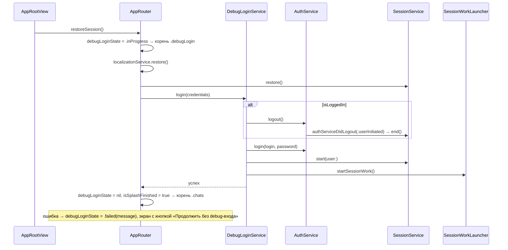

# Debug-вход по аргументам запуска: архитектура клиента

20.10.2026 · Mikhail Kuzmin

Статус: реализовано.

## Цель и требования

Ускорить ручное тестирование: запускать приложение сразу под нужным пользователем, без ввода логина и пароля на экране авторизации.

1. Логин и пароль передаются аргументами запуска: `-debugLogin <логин> -debugPassword <пароль>`.
2. Фича есть только в Debug-сборке. В Release кода фичи нет, аргументы игнорируются.
3. Пока идёт вход, вместо splash показывается отдельный пустой стартовый экран — видно, что запуск идёт по debug-сценарию.
4. Если на устройстве уже залогинен пользователь (любой, в том числе тот же), он сначала разлогинивается — полным выходом, как по кнопке «Выйти».
5. После успешного входа приложение открывает список чатов, как после обычного входа.
6. Ошибка входа (неверный пароль, нет сети, передан только один из аргументов) показывается на стартовом экране. Оттуда можно продолжить обычный старт (экран авторизации).
7. Без аргументов приложение запускается как сейчас: splash, восстановление сессии.

## Как сейчас

- `AppRootView` в `.task` вызывает `AppRouter.restoreSession()`: восстанавливаются язык и сессия, затем `SessionWorkStarting.startSessionWork()` (список переписок, отправка очереди, `/global/start`). Splash держится не меньше 600 мс.
- Корень (`AppRoot`) выводится из состояния: `.splash`, пока splash не закончен, затем `.chats` или `.auth` по `SessionService.isLoggedIn`.
- Вход — `AuthViewModel.performAuthentication()`: `AuthService.login` → `SessionService.start(user:)` → `startSessionWork()`.
- Выход — `AuthService.logout()`: наблюдатели проходят `authServiceWillLogout` → `POST /auth/logout` → удаление cookie → `authServiceDidLogout`. `SessionService` в последней фазе очищает БД (кроме черновиков и очереди отправки) и сбрасывает пользователя.
- `NetworkLogger` маскирует поле `password` в логах запросов.

## Ключевые решения

1. **Всё в `#if DEBUG`.** Парсер аргументов, сервис debug-входа и экран целиком лежат в файлах под `#if DEBUG`. В общем коде точечные `#if DEBUG` есть только в `AppRoot`, `AppRouter`, `AppRootView` и `DIContainer`. `DebugLogin.strings` исключается из Release в `Config/Base.xcconfig` (`EXCLUDED_SOURCE_FILE_NAMES[config=Release]`). Release-сборка не содержит ни кода, ни строк фичи, и случайно оставленный в схеме аргумент ни на что не влияет.
2. **Аргументы читаются из `ProcessInfo.processInfo.arguments`, а не из `UserDefaults`.** Аргументы вида `-key value` iOS также кладёт в домен `NSArgumentDomain` у `UserDefaults`, но прямой доступ к `UserDefaults` стандарт проекта запрещает. К тому же явный парсер различает «аргументов нет» и «передан только один».
3. **Вход повторяет обычный путь, а не обходит его.** `DebugLoginService` вызывает те же методы, что `AuthViewModel` и кнопка «Выйти»: `AuthService.logout()`, `AuthService.login`, `SessionService.start(user:)`, `SessionWorkStarting.startSessionWork()`. Очистка БД, загрузка черновиков и очереди, подписки на выход работают без изменений, новый путь ничего не пропустит.
4. **Выход — полный, через `AuthService.logout()`, при любом залогиненном пользователе.** Сессию на сервере закрывает `POST /auth/logout`, cookie удаляются, наблюдатели останавливают работу. Сравнивать логин с текущим пользователем не нужно: требование 4 одинаково для всех, а черновики и очередь отправки переживают выход и вернутся, если вошли тем же пользователем.
5. **Работа с сервером начинается только после входа.** В debug-сценарии `AppRouter` не вызывает `startSessionWork()` после `restore()`, как делает обычный старт. Иначе список переписок, очередь и WebSocket стартовали бы для прежнего пользователя и сразу бы останавливались выходом. Сессия восстанавливается (`SessionService.restore()`) только чтобы узнать, есть ли кого разлогинивать: `logout()` без восстановленной сессии не сбросил бы пользователя в `UserDefaults`.
6. **Корневой экран `.debugLogin`.** `AppRouter` хранит состояние debug-входа `debugLoginState: DebugLoginState?`. Пока оно не `nil`, корень — `.debugLogin`, а не splash/auth/chats. При успехе состояние сбрасывается, и корень выводится из сессии как обычно (`.chats`). Минимального времени показа у стартового экрана нет: вход всё равно идёт по сети.
7. **Ошибка не уводит молча на экран авторизации.** При ошибке экран показывает её текст и кнопку «Продолжить без debug-входа». Тестировщик видит, почему не вошёл, а не гадает, почему открылась авторизация. Кнопка сбрасывает состояние, и корень выводится из сессии (после неудачного входа — `.auth`). После неудачного входа пользователь гарантированно разлогинен (выход уже прошёл или не требовался), поэтому `startSessionWork()` не вызывается — его вызовет `AuthViewModel` при ручном входе. Ошибка разбора аргументов — особый случай, см. «Корневой роутер».
8. **Экран без ViewModel.** Состояние и единственное действие принадлежат `AppRouter`; экран — простая View, как `SplashView`. Отдельная ViewModel добавила бы только проброс.
9. **Пока идёт debug-сценарий, смена фазы сцены только запоминается.** Пока `debugLoginState != nil` (вход или экран ошибки), `AppRouter.didChangeScenePhase` обновляет `isInBackground`, но не трогает соединение. Иначе возврат из фона во время входа вызвал бы `realtimeService.start()` со старой cookie или без неё, и ответ 2003 запустил бы `expireSession()` — он разлогинил бы пользователя, только что вошедшего по debug-сценарию. На экране ошибки при сохранённой сессии соединение открылось бы раньше списка переписок, и `connected` прошёл бы мимо него. Запомненная фаза применяется при завершении сценария: если вход закончился в фоне, соединение, открытое `startSessionWork()`, сразу закрывается, как при уходе в фон, а возврат открывает его заново.
10. **Под XCTest аргументы игнорируются.** Test-действие схемы по умолчанию берёт аргументы Run-действия (`shouldUseLaunchSchemeArgsEnv`). Без защиты Cmd+U в схеме с debug-аргументами запустил бы в тестовом хосте настоящий выход и вход на сервере и очистку БД посреди юнит-тестов. `DebugLaunchArguments.parse` возвращает `nil`, если в окружении задан `XCTestConfigurationFilePath`.



## Аргументы запуска

| Аргумент | Значение |
| --- | --- |
| `-debugLogin` | логин пользователя; краевые пробелы обрезаются, как в `AuthViewModel` |
| `-debugPassword` | пароль, передаётся как есть |

Разбор — `DebugLaunchArguments.parse(_ arguments: [String], environment: [String: String]) -> Result<DebugLoginCredentials, DebugLaunchArgumentsError>?`:

- процесс запущен под XCTest (`XCTestConfigurationFilePath` в окружении) → `nil`, обычный старт (решение 10);

- нет ни одного ключа → `nil`, обычный старт;
- оба ключа с непустыми значениями → `.success(DebugLoginCredentials(login:password:))`;
- передан один ключ, значение пустое (у логина — из одних пробелов), отсутствует или само начинается с `-` (следующий ключ) → `.failure`: `.missingLogin` / `.missingPassword`. Поэтому пароль, начинающийся с `-`, не поддерживается. Debug-сценарий всё равно запускается и показывает ошибку на стартовом экране (требование 6). Тихий обычный старт выглядел бы как «аргумент не сработал».

```swift
#if DEBUG
/// Логин и пароль для debug-входа из аргументов запуска.
struct DebugLoginCredentials: Equatable {
    let login: String
    let password: String
}

/// Ошибка разбора аргументов debug-входа.
enum DebugLaunchArgumentsError: Error, Equatable {
    case missingLogin
    case missingPassword
}

/// Разбор аргументов запуска `-debugLogin <логин> -debugPassword <пароль>`.
enum DebugLaunchArguments {
    static let loginKey = "-debugLogin"
    static let passwordKey = "-debugPassword"

    /// Достаёт логин и пароль из аргументов запуска.
    /// - Parameter arguments: аргументы процесса (`ProcessInfo.processInfo.arguments`).
    /// - Returns: `nil` — ключей нет, обычный старт; иначе данные для входа или ошибка разбора.
    static func parse(
        _ arguments: [String],
        environment: [String: String] = [:]
    ) -> Result<DebugLoginCredentials, DebugLaunchArgumentsError>?
}
#endif
```

### Как передать

- **Xcode.** Продублировать схему `Chatik` в **неразделяемую** (`Chatik Debug Login`, без галочки Shared — она ляжет в `xcuserdata` и не попадёт в репозиторий). В Edit Scheme → Run → Arguments → Arguments Passed On Launch добавить пары аргументов для нескольких тестовых пользователей и включать нужную галочками. Общую схему `Chatik` не трогать: пароли в ней ушли бы в git. Тесты из этой схемы запускать можно: под XCTest аргументы игнорируются (решение 10).
- **Симулятор из терминала** (bundle id может быть переопределён в `Local.xcconfig` — актуальный смотреть в `Info.plist` собранного приложения):

```bash
xcrun simctl launch --terminate-running-process booted mihateam.Chatik -debugLogin anna_smirnova -debugPassword '<пароль>'
```

Тестовые пользователи локального сервера описаны в `ServerAi/Test_Users.md`; пароли в документы и схемы, попадающие в репозиторий, не копируются.

## Сервис debug-входа

`Services/DebugLogin/DebugLoginService.swift`, `@MainActor`, закрыт протоколом `DebugLoginPerforming` (для моков в тестах `AppRouter`). Там же `DebugLoginLaunch` — разобранные аргументы вместе с сервисом.

```swift
#if DEBUG
@MainActor
protocol DebugLoginPerforming: AnyObject {
    /// Разлогинивает текущего пользователя, если он есть, входит под переданным, открывает сессию
    /// и начинает работу с сервером. Сессия должна быть восстановлена (`SessionService.restore()`).
    /// - Parameter credentials: логин и пароль из аргументов запуска.
    /// - Throws: ошибка входа; пользователь в этом случае разлогинен.
    func login(_ credentials: DebugLoginCredentials) async throws
}

@MainActor
final class DebugLoginService: DebugLoginPerforming {
    private let authService: AuthServiceProtocol
    private let sessionService: SessionServiceProtocol
    private let sessionWork: SessionWorkStarting

    func login(_ credentials: DebugLoginCredentials) async throws {
        if sessionService.isLoggedIn {
            await authService.logout()
        }
        let user = try await authService.login(login: credentials.login, password: credentials.password)
        await sessionService.start(user: user)
        sessionWork.startSessionWork()
    }
}
#endif
```

- `logout()` не бросает ошибок: при сбое запроса устройство всё равно разлогинивается (поведение `AuthService`).
- Логин обрезается от краевых пробелов при разборе аргументов, а не в сервисе: сервис получает готовые данные.

## Корневой роутер

```swift
enum AppRoot: Equatable {
    case splash
    #if DEBUG
    /// Стартовый экран debug-входа по аргументам запуска.
    case debugLogin
    #endif
    case auth
    case chats
}

#if DEBUG
/// Состояние debug-входа.
enum DebugLoginState: Equatable {
    /// Вход идёт; `login` — `nil`, пока не ясно, верны ли аргументы.
    case inProgress(login: String?)
    /// Вход не удался; `message` — текст для экрана.
    case failed(message: String)
}
#endif
```

`AppRouter`:

- Разобранные аргументы и сервис передаются вместе — `DebugLoginLaunch(arguments:service:)`. Swift не позволяет `#if` внутри списка параметров, поэтому основной `init` не меняется, а в Debug есть `convenience init(..., debugLoginLaunch:, minimumSplashDuration:)`. `DIContainer.debugLoginLaunch` в Debug строится из `DebugLaunchArguments.parse(ProcessInfo.processInfo.arguments, environment: ProcessInfo.processInfo.environment)`; `nil` — аргументов нет или запущены тесты. `AppRootView.makeRouter()` передаёт его роутеру, в тестах он передаётся явно.
- `private(set) var debugLoginState: DebugLoginState?` ставится уже в `init` (`.inProgress(login:)`, логин `nil` при ошибке разбора): иначе до вызова `restoreSession()` мелькнул бы splash.
- `root`: `debugLoginState != nil` → `.debugLogin`; иначе как сейчас.
- `restoreSession()`: если `debugLoginLaunch == nil` — обычный путь без изменений. Иначе `performDebugLogin(_:)`:
  1. `localizationService.restore()`, `sessionService.restore()` — без `startSessionWork()`;
  2. ошибка разбора → `debugLoginState = .failed(message:)` с текстом из `DebugLoginStrings` (после восстановления языка — текст на нужном языке);
  3. иначе `service.login(credentials)`: успех → `debugLoginState = nil`, `isSplashFinished = true`, и если приложение в фоне — `realtimeService.stop()`; ошибка → `.failed(message: ErrorMessages.message(for: error))`.
- `didTapSkipDebugLogin()` — кнопка «Продолжить без debug-входа», работает только в `.failed`: `debugLoginState = nil`, `isSplashFinished = true`, корень выводится из сессии. После неудачного входа сессии нет — корень `.auth`.
- `didChangeScenePhase` при `debugLoginState != nil` только запоминает `isInBackground` (решение 9).

При ошибке разбора аргументов сессия восстановлена и не тронута. Кнопка тогда ведёт на `.chats`, если сессия была, и `didTapSkipDebugLogin()` вызывает `startSessionWork()`: это обычный старт, только отложенный до нажатия.

## Стартовый экран

`Screens/DebugLogin/`:

| Файл | Что внутри |
| --- | --- |
| `View/DebugLoginView.swift` | фон `systemBackground`; в `.inProgress` — `ProgressView` и мелкая подпись «Debug-вход: <логин>» (без подписи, пока логин неизвестен); в `.failed` — заголовок «Debug-вход», текст ошибки и кнопка «Продолжить без debug-входа» |
| `DebugLoginStrings.swift`, `ru.lproj/DebugLogin.strings`, `en.lproj/DebugLogin.strings` | строки экрана и ошибок разбора аргументов |

Экран намеренно не похож на splash: нет логотипа и названия приложения. По нему сразу видно, что запуск идёт по debug-сценарию.

`AppRootView` получает ветку `case .debugLogin: DebugLoginView(state:onSkip:)`, данные берутся из роутера.

Строки:

| Ключ | ru |
| --- | --- |
| `debugLogin.title` | Debug-вход |
| `debugLogin.progress` | Debug-вход: %@ |
| `debugLogin.skip` | Продолжить без debug-входа |
| `debugLogin.error.missingLogin` | Не передан аргумент -debugLogin |
| `debugLogin.error.missingPassword` | Не передан аргумент -debugPassword |

Ошибки входа (неверный пароль, сеть) берутся из общего `ErrorMessages.message(for:)`, как на экране авторизации.

## Безопасность

- Пароль виден в аргументах процесса и в настройках схемы. Это допустимо для Debug и тестовых пользователей. Схема с паролями — только неразделяемая (не в git).
- Пароль не пишется в лог: `NetworkLogger` маскирует `password`, сервис и роутер его не логируют. В `DebugLoginState` хранится только логин.
- В Release кода нет (решение 1).

## Ограничения

- Debug-вход выполняется при каждом запуске с аргументами: каждый раз выход и вход заново. Чтобы перезапустить приложение и сохранить сессию, аргументы нужно убрать (снять галочки в схеме).
- Регистрация по аргументам не поддерживается — только вход существующего пользователя.
- Если залогиненный пользователь на сервере уже недействителен, `POST /auth/logout` вернёт ошибку. Она только логируется, выход проходит локально.
- Если вход закончился в фоне, соединение на мгновение открывается (`startSessionWork()`) и сразу закрывается (решение 9). Разделять запуск списка и соединения ради отладочной фичи не стоит.

## Затронутые файлы

| Файл | Изменение |
| --- | --- |
| `Chatik/Services/DebugLogin/DebugLaunchArguments.swift` | новый: `DebugLoginCredentials`, `DebugLaunchArgumentsError`, парсер |
| `Chatik/Services/DebugLogin/DebugLoginService.swift` | новый: `DebugLoginPerforming`, `DebugLoginService` |
| `Chatik/Screens/DebugLogin/…` | новый экран и строки |
| `Chatik/Screens/AppRoot/AppRouter.swift` | `AppRoot.debugLogin`, `DebugLoginState`, `convenience init` с `debugLoginLaunch`, ветка в `restoreSession()`, `didTapSkipDebugLogin()`, запоминание фазы в `didChangeScenePhase` и закрытие соединения после входа в фоне |
| `Chatik/Screens/AppRoot/AppRootView.swift` | ветка `.debugLogin`, сборка роутера в `makeRouter()` |
| `Chatik/DIContainer.swift` | `debugLoginLaunch` из `ProcessInfo.processInfo.arguments` (под `#if DEBUG`) |
| `Config/Base.xcconfig` | `DebugLogin.strings` исключается из Release |
| `ChatikTests/Mocks/DebugLoginServiceMock.swift` | новый мок |
| `ChatikTests/Mocks/AuthServiceMock.swift` | журнал вызовов `calls` — для проверки порядка выхода и входа |

## Тесты

**`DebugLaunchArgumentsTests`** (кейсы — массивом-таблицей):

- нет ключей → `nil`;
- оба ключа → данные; логин без краевых пробелов, пароль как есть;
- ключи в любом порядке и вперемешку с системными аргументами Xcode (`-NSDocumentRevisionsDebugMode YES` и т. п.) → данные;
- только `-debugLogin` / только `-debugPassword` → `.missingPassword` / `.missingLogin`;
- ключ последним без значения, пустое значение, вместо значения следующий ключ → соответствующая ошибка;
- под XCTest (`XCTestConfigurationFilePath` в окружении) → `nil` при любых аргументах; другое окружение на разбор не влияет.

**`DebugLoginServiceTests`** (`AuthServiceMock`, настоящие `SessionService` и `SessionWorkLauncher` над моками):

- пользователь залогинен (другой или тот же) → порядок вызовов `logout` → `login` → `start(user:)` → `startSessionWork`;
- пользователя нет → `logout` не вызывается;
- `login` бросил ошибку → ошибка проброшена, `start(user:)` и `startSessionWork` не вызваны.

**`AppRouterTests`** (мок `DebugLoginPerforming`):

- без аргументов → прежнее поведение: `.splash`, затем `.auth` / `.chats`, `startSessionWork` после `restore`;
- с данными → во время входа корень `.debugLogin`; после успеха `.chats`; `startSessionWork` роутером не вызван (его вызывает сервис);
- до `restoreSession()` корень уже `.debugLogin`, а не splash;
- вход упал → корень `.debugLogin`, состояние `.failed` с текстом ошибки; `didTapSkipDebugLogin()` → `.auth`;
- ошибка разбора → `.failed` без вызова сервиса; `didTapSkipDebugLogin()` при восстановленной сессии → `.chats` и `startSessionWork`;
- нажатие кнопки во время входа игнорируется;
- фон и возврат во время входа → `realtimeService` не вызывается;
- вход закончился в фоне → `stop` сразу после входа, возврат → `start`;
- фон и возврат на экране ошибки разбора при сохранённой сессии → соединение не трогается; после «Продолжить без debug-входа» — список, очередь, соединение по порядку.

Release-сборка проверяется вручную: `xcodebuild -configuration Release build` собирается без warnings, в бинаре нет строк `debugLogin`, в бандле нет `DebugLogin.strings`.
