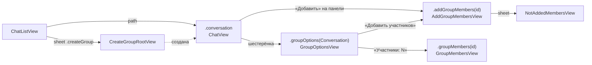

# Групповые чаты: архитектура клиента

23.10.2026 · Mikhail Kuzmin

Статус: реализовано 23.10.2026; решения по требованиям приняты 23.10.2026 (критика, пп. 1–13); замечания ревью документа (23.10.2026, 24 пункта) внесены, п. 7 — как осознанное ограничение (решение 5). Отступления реализации от плана — в разделе «Реализация». Серверная часть — ServerAi `docs/api/changes/2026-10-22_Groups.md` (методы — `docs/api/methods/Groups.md`, события — `docs/api/websocket/Groups.md`, объекты — `docs/api/Objects.md`).

## Цель и требования

Пользователь создаёт группу, приглашает в неё участников, видит состав и может выйти. Создатель может передать свои права другому участнику.

**Создание группы**

1. В меню «+» списка чатов рядом с «Личный диалог» — пункт «Группа». Он открывает экран создания группы.
2. На экране — аватар, название и описание. Аватар выбирается из галереи или снимается камерой; выбранный можно заменить и удалить. Аватар и описание необязательны, название обязательно.
3. Кнопка «Создать» активна, только если введено название. Участники при создании не добавляются.

**Экран переписки группы**

4. Если в группе только создатель, при входе в переписку поверх ленты показывается плавающая панель: «В группе нет других участников», кнопка «Добавить» и крестик, который скрывает панель.
5. Справа в навигационной панели — кнопка-шестерёнка. Она открывает опции группы.

**Опции группы**

6. Аватар, название и описание — только просмотр в этой итерации.
7. Строка с числом участников открывает экран участников группы.
8. «Добавить участников» открывает экран добавления.
9. «Выйти» — алерт «Вы действительно хотите покинуть группу? Переписка станет недоступной для вас.» с красной кнопкой «Выйти». Создателю, если он не единственный участник, алерт сообщает ещё и то, что права создателя перейдут другому участнику.
10. Пока идёт запрос выхода, в строке «Выйти» крутится индикатор, все кнопки заблокированы. После выхода открывается список чатов и показывается уведомление «Вы покинули группу». Ошибка — уведомление об ошибке.

**Участники группы**

11. Две секции: «Создатель» и «Участники».
12. Создатель долгим нажатием на участника открывает меню действий. Пока в нём один пункт — «Передать права создателя».
13. Пункт открывает подтверждение: вы потеряете право приглашать участников в группу. Красная «ОК» отправляет запрос. Успех — уведомление «Права создателя переданы», экран перерисовывается. Ошибка — уведомление об ошибке.
14. Экран реагирует на события WebSocket: добавленные участники сразу появляются.

**Добавить участников**

15. Список пользователей с поиском. Можно выбрать сразу несколько.
16. В группе не больше 100 участников, сверх лимита выбрать нельзя: если в группе 10, выбрать можно не больше 90.
17. Те, кто уже в группе, показаны с отметкой, и выбрать их нельзя.
18. Фильтр «Все пользователи» / «Не в группе».
19. В шапке — «Добавить: X», если выбраны X пользователей, иначе — «Добавить участников».
20. После добавления экран обновляется, выбор сбрасывается.
21. Если кого-то добавить не удалось, показывается уведомление «X участников не было добавлено». Нажатие на него открывает попап со списком не добавленных и ошибкой для каждого; участники с одинаковой ошибкой сгруппированы. Попап можно только закрыть.
22. Экран не реагирует на события WebSocket. Он меняется только после запроса добавления.

## Что меняется на сервере, коротко

- **Ломающее изменение.** `Conversation.memberIds` у групп — `null`. Клиент сейчас декодирует его как `[Int]`, поэтому одна группа в ответе `getList` ломает разбор всего списка. Это нужно исправить до того, как у пользователей появятся группы.
- `Conversation` получает `description`, `LastMessage` — `senderId`.
- Состав и роли группы хранятся не в `Conversation`, а в отдельном объекте `GroupInfo` (`version` и `members` — `userId`, `role` `owner` / `member`, `joinedAfterMessageId`). При разных версиях выигрывает большая.
- Методы `/groups/create`, `addMembers`, `removeMembers`, `changeOwner`, `getInfo`, `leave`. Добавлять участников и передавать права может только владелец (`5004`).
- События `groups`: `created`, `membersAdded`, `membersRemoved`, `memberLeft`, `ownerChanged`. Что в теле, зависит от получателя: добавленный получает ссылку на группу и версию для курсора, удалённый или вышедший — метку `RemovedConversation`, остальные участники — новую `GroupInfo`.
- **Метки удаления.** `RemovedConversation` (`conversationId`, `changeVersion`) приходит в событиях, в ответе `leave` и в `getList` с `changedAfter` (`removedConversations`). Клиент хранит `removedVersions[conversationId]` и отбрасывает версии переписки, которые не новее метки.
- **Прочтение в группе.** Учитываются только участники из текущей `GroupInfo` и только сообщения с `messageId > joinedAfterMessageId` участника.

## Как сейчас

- **`Conversation.memberIds: [Int]`** не опционален. `ConversationEntity` тоже считает запись без `memberIds` битой и пропускает её при чтении.
- **`ConversationType.group`** уже разбирается. Строка списка чатов, уведомление о сообщении и заголовок переписки умеют показывать `name` и `avatar` группы. Отправители в ленте показываются (`MessageDisplayModel.sender`). Действие «Кем прочитано» есть только в `group` ([прочтение другими](read-receipts.md)).
- **Создать группу клиент не умеет.** В меню «+» (`ChatListView.createMenu`) один пункт — «Личный диалог».
- **Переписки не удаляются.** Ни `ConversationListService`, ни кэш сообщений, ни мета прочтения не умеют убрать одну переписку. Пропавшую с сервера переписку убирает только pull-to-refresh.
- **Курсор синхронизации** `syncedChangeVersion` двигают события по правилу непрерывности (`seenVersions`) и сверка `changedAfter`. Версии, которые придут в событиях `groups`, сейчас никто не учтёт, и курсор будет вставать на пропуске до следующей сверки ([непрочитанные](unread-messages.md), решение 4).
- **Галочки** считаются по одному порогу `readUpTo = max(указатели)`. В группе это даст ошибку: новому участнику сервер ставит указатель на последнее сообщение, и после первого же добавления все старые сообщения покажутся прочитанными.
- **Экран переписки** получает `Conversation` снимком из маршрута `ChatListRoute.conversation`. Роутера у него нет; единственный лист — «Кем прочитано».
- **Аватар** выбирается и загружается в профиле: `AvatarSourcePickerViewModifier` и `ProfileViewModel+AvatarPicking` лежат в каталоге экрана профиля.
- **Уведомления в приложении** бывают двух видов: `.error` (без нажатия) и `.message`. Нейтрального и успешного вида нет.
- **Последняя версия модели CoreData** — `Chatik 12`.

## Ключевые решения

### 1. Модели

| Тип | Изменение |
| --- | --- |
| `Conversation` | `memberIds: [Int]?`, новое `description: String?` |
| `LastMessage` | новое `senderId: Int` |
| `GroupInfo` (новый) | `conversationId`, `version`, `members: [GroupMember]` |
| `GroupMember` (новый) | `userId`, `role: GroupRole`, `joinedAfterMessageId` |
| `GroupRole` (новый) | `.owner` / `.member`. Неизвестная роль читается как `.member` (требование сервера). Сделано не так, как в `ConversationType`, где неизвестное значение становится `.unknown`: для роли сервер явно задаёт поведение. Права задаются свойствами роли, а не сравнением с `.owner` на экранах: `canAddMembers`, `canTransferOwnership` (сейчас оба — только у `.owner`). Когда появятся модераторы, поменяется только `GroupRole` (критика, п. 1) |
| `RemovedConversation` (новый) | `conversationId`, `changeVersion` |
| `ConversationRemoval` (новый) | `RemovedConversation` и `totalUnreadCount` — то, что вместе приходит в событии и в ответе `leave` |
| `UserErrorInfo` (новый) | `userId`, `errorCode` |
| `AddMembersResult` (новый) | `addedUserIds`, `notAddedUsersInfo`, `groupInfo` |
| `ConversationsPage` | `removedConversations: [RemovedConversation]` |
| `GroupLimits` (новый) | `maxMembers = 100`, `nameMaxLength = 128`, `descriptionMaxLength = 1024` — единственный владелец чисел, как `ImageUploadLimits` |

`ConversationMerger`, правило 3 («Информация»): вместе с `name` и `avatar` берётся `description`.

`NetworkError.Code` получает `invalidDescription = 1007` и коды `5003`–`5008`. `ErrorMessages` и `CommonStrings` получают тексты для них.

### 2. Сеть — `GroupService`

`GroupEndpoint` и `GroupServiceProtocol`: `create(name:description:avatarFileId:) -> (Conversation, GroupInfo)`, `addMembers(conversationId:userIds:) -> AddMembersResult`, `changeOwner(conversationId:newOwnerUserId:) -> GroupInfo`, `getInfo(conversationId:) -> GroupInfo`, `leave(conversationId:) -> ConversationRemoval`. `removeMembers` в этой итерации не нужен — экрана для него нет. Action `users` в ответах исполняет сетевой слой, как обычно.

### 3. `GroupInfoService` — состав группы

Новый `@MainActor` сервис уровня приложения. Он единственный хранит и пишет `GroupInfo`. Устроен по образцу `MemberReadService`:

- **Наблюдаемое состояние на группу.** `GroupInfoState` (`@Observable`): `info: GroupInfo?` и `isRefreshFailed`. Словарь состояний не наблюдается, поэтому событие одной группы не перерисовывает экраны других. Действует тот же контракт: читать состояние можно только после `beginObserving`.
- **Протокол для экранов** `GroupInfoProviding`:
  - `beginObserving(conversationId:)` / `endObserving` — учёт по счётчику: экран переписки, опции и участники могут быть открыты одновременно, а на iPad — ещё и в двух сценах;
  - `groupInfo(conversationId:) -> GroupInfo?`, `isRefreshFailed` — наблюдаемые, только после `beginObserving`;
  - `refresh(conversationId:)`;
  - `currentInfo(conversationId:) -> GroupInfo?` — ненаблюдаемое чтение из памяти для сервисов (`MemberReadService`, решение 7);
  - `snapshot(conversationId:) async throws -> GroupInfo` — разовый снимок для экрана, который за составом не следит («Добавить участников», решение 14). Отдаёт состояние в памяти, иначе сохранённое в БД, иначе ждёт `getInfo` — тот же запрос, что `refresh`, поэтому правило «один запрос в полёте» сохраняется. Контракт «читать после `beginObserving`» на снимок не распространяется: он не наблюдается;
  - `apply(_ info: GroupInfo)` — для ответов `create`, `addMembers`, `changeOwner`. Ответ REST сохраняется **безусловно** (по версии), а не по правилу «наблюдается или сохранена» для событий: ответ всегда относится к группе, с которой пользователь работает.
- **Наблюдатели изменения состава.** `GroupInfoService` хранит список `GroupInfoObserver` (`groupInfoDidChange(_ info: GroupInfo)`, вызывается синхронно на main после каждого применённого изменения). На него подписывается `MemberReadService` (решение 7). Наблюдаемое состояние экранов для этого не годится: `MemberReadService` не экран и не `@Observable`.
- **Когда запрашивать.** В `beginObserving` сначала читается сохранённая `GroupInfo` (показывается сразу, в том числе офлайн), затем уходит `getInfo`. Запрос повторяется на каждый `connected` для каждой наблюдаемой группы. В полёте — один запрос на группу.
- **Слияние.** Пришедшая `GroupInfo` заменяет локальную целиком, только если её `version` больше.
- **События.** `GroupInfo` из события применяется, если группа наблюдается или её `GroupInfo` уже сохранена (`storedConversationIds`, как в `MemberReadService`). Исключение — `membersAdded` для добавленного: сервер требует сохранить `GroupInfo` безусловно. Но если `changeVersion` события не больше метки удаления, событие устарело и не сохраняется (решение 5): `GroupInfoService` спрашивает об этом `ConversationListService` через узкий протокол `ConversationRemovalMarks.isRemoved(conversationId:changeVersion:)`.
- **Хранение.** Новая сущность `GroupInfoEntity`: `conversationId` (уникальный), `version`, `members` (JSON в `Binary`, как `memberIds` у `ConversationEntity`). Состав всегда заменяется целиком, поэтому отдельная сущность на участника не нужна. Запись — через `GroupInfoStorageService` в фоновом контексте. При выходе сущность очищает `LocalStorageCleaner`.
- **`5002` на `getInfo`** — сервис просит список переписок проверить, состоит ли пользователь в группе (решение 6).

### 4. События `groups`

`WebSocketMessages` разбирает пять событий в новые случаи `RealtimeEvent`:

| Событие | `RealtimeEvent` |
| --- | --- |
| `created` | `.groupCreated(Conversation, GroupInfo)` |
| `membersAdded` | `.groupMembersAdded(conversationId:, addedUserIds:, groupInfo:, changeVersion: Int?)` |
| `membersRemoved` | `.groupMembersRemoved(conversationId:, removedUserIds:, groupInfo: GroupInfo?, removal: ConversationRemoval?)` |
| `memberLeft` | `.groupMemberLeft(conversationId:, leftUserId:, groupInfo: GroupInfo?, removal: ConversationRemoval?)` |
| `ownerChanged` | `.groupOwnerChanged(conversationId:, newOwnerUserId:, groupInfo:)` |

Кто обрабатывает:

| Случай | `ConversationListService` | `GroupInfoService` |
| --- | --- | --- |
| `created` | слить как `singleCreated`: полный объект, курсор, `positionWatermark` | сохранить |
| `membersAdded`, `changeVersion != nil` (добавили меня) | загрузить группу через `getBatch` (решение 5); версия не новее метки — только отметить для курсора | сохранить безусловно, кроме версии не новее метки |
| `membersRemoved` / `memberLeft` с `removal` (удалили меня или я вышел) | применить метку (решение 6) | — (очистку делает каскад) |
| остальные | — | применить `GroupInfo` |

Остальные подписчики очереди (`MessageCacheService`, `MessageSendQueue`, `MessageNotificationService`, `MemberReadService`) новые события пропускают.

### 5. Добавление в группу — `pendingConversations`

Ссылку на группу из `membersAdded` (`changeVersion != nil`) `ConversationListService` разрешает через `getBatch`:

0. **Сверка с меткой.** Если `changeVersion <= removedVersions[conversationId]`, событие устарело (пользователя уже удалили после этого добавления): оно только отмечается для курсора, группа в ожидание не ставится.
1. **Сначала запись.** `pendingConversations[conversationId] = changeVersion` записывается в БД (`ConversationListStateEntity`, JSON в `Binary`) **до** запроса и до того, как обработчик события вернёт управление очереди. Так ссылка не теряется, даже если приложение убьют во время `getBatch`.
2. **Успех** — группа вставляется через `applyLocal` (тот же путь, что `apply(_:)`: на время основной фазы синхронизации изменение копится в `pendingLocalUpdates` и переживает `replaceList`), проходит фильтр меток (решение 6) и правило вставки (ниже). Версия отмечается для курсора. Ссылка снимается **после** записи переписки в БД.
3. **Сбой** — ссылка остаётся. `getBatch` по всем ожидающим повторяется **после окончания основной фазы** синхронизации каждого `connected` (а не параллельно с ней), чтобы ответ не попал в окно `replaceList`.
4. **`notFoundIds`** (группу успели удалить) — ссылка снимается, версия отмечается для курсора.

**Правило вставки.** Позиция группы — время вступления, обычно это верх списка. Но если повтор `getBatch` случился поздно, время вступления может оказаться старше хвоста загруженного префикса. Тогда группа **не вставляется**: вставка за хвостом нарушила бы инвариант префикса (`serverLoadedCount` и следующая страница перестали бы совпадать с сервером). Ссылка всё равно снимается — группа уже есть на сервере ниже загруженного, и её принесёт обычная пагинация при прокрутке. Если `hasMorePages == false`, хвоста за загруженным нет, и группа вставляется по сортировке.

Сверка `changedAfter` в конце ставит курсор в максимум версий ответа и может перешагнуть ожидающую версию. Это не страшно: группу гарантирует `pendingConversations`, а не курсор.

**Потерянное событие — осознанное ограничение.** Если событие `membersAdded` не дошло вовсе (сервер доставку не гарантирует), клиент о группе не узнает: `changedAfter` неизвестные переписки отбрасывает, а дельта позиций вернёт группу, только если водяной знак ещё ниже времени вступления. Вставлять неизвестные переписки из `changedAfter` по позиции значило бы менять инвариант префикса для всего списка ради редкого случая (ревью, п. 7). Поэтому в эту итерацию группа в таком случае появится после pull-to-refresh или полной перезагрузки. Обычный случай — событие пришло, но `getBatch` не удался или приложение убили — закрывает запись ссылки до запроса (шаг 1).

### 6. Удаление из группы и метки удаления

**Применение метки** — `ConversationListService.applyRemoval(_:reason:)`. Источники: события (решение 4), ответ `leave`, `removedConversations` из `getList` с `changedAfter`, `verifyMembership`.

- Переписка загружена и её `changeVersion` меньше метки — она удаляется из списка и БД, и запускается каскад (ниже). Если метка меньше локальной версии, она устарела (пользователя уже вернули) и игнорируется.
- Метка сохраняется **всегда**, в том числе по незагруженной переписке: `removedVersions[conversationId] = changeVersion`. Словарь хранится в `ConversationListStateEntity` (JSON в `Binary`).
- Метка снимает ожидающую группу: `pendingConversations[conversationId]` удаляется (требование сервера: метка очищает и ссылку из `membersAdded`).
- Вместе с перепиской удаляется внутреннее состояние прочтения сервиса по ней: `confirmedReadStates`, `pendingReads`, `queuedReads`, а `markRead` в полёте отменяется (`readTasks`). Иначе его ответ `5002` запустил бы лишний `verifyMembership`.
- `totalUnreadCount` применяется по правилам `ReadInfo` на версии метки.
- Версия метки из события отмечается для курсора по правилу непрерывности **всегда** — даже если та же метка уже применена ответом `leave` или `verifyMembership`. Иначе курсор встал бы на этой версии до следующей сверки. Ответ `leave` курсор не двигает: это REST, а то же изменение придёт событием `memberLeft`.

**Причина удаления** — `ConversationRemovalReason`: `.left` (свой выход: ответ `leave` или событие `memberLeft`, где вышел текущий пользователь), `.removed` (событие `membersRemoved`), `.lostAccess` (`verifyMembership`, `removedConversations` при синхронизации — причина неизвестна). По ней каскад выбирает уведомление (ниже).

**Выход в полёте.** Ответ `leave` и событие `memberLeft` приходят в любом порядке: сервер шлёт событие во все соединения, включая вызвавшее. `ConversationListService` держит множество `leavingConversationIds`: id добавляется перед запросом `leave` (`beginLeaving`) и убирается после ответа или ошибки (`endLeaving`). Пока группа в множестве, удаление по ней — с какой бы стороны оно ни пришло — получает причину `.left` и уведомления «больше не участник» не порождает: «Вы покинули группу» показывает экран опций по ответу. Если первым пришло событие, ответ `leave` находит переписку уже удалённой, метку — той же версии и ничего не делает, кроме возврата результата экрану.

**Фильтр.** Любая полная версия переписки (`getList`, `getBatch`, `created`, `createSingle`, `create`) с `changeVersion <= removedVersions[id]` отбрасывается. Если версия больше, это повторное добавление: переписка принимается, метка снимается. Иначе ответ REST, собранный до удаления и пришедший после события, вернул бы группу в список. Фильтр стоит в обёртке `admit(_ update:)`, через которую проходят **все** пути вставки полной версии: оба `upsert` (поштучный и пачкой `MergeBatch`), повторное применение `pendingLocalUpdates` после `replaceList` и сама страница `replaceList`. Патчи (`received`, `edited`, ответ `send`) неизвестную переписку не вставляют, а ведут к `getBatch`, ответ которого проходит тот же фильтр.

**Синхронизация `changedAfter`.** Метки из `removedConversations` применяются так же (причина `.lostAccess`). Курсор следующей страницы — максимум `changeVersion` по `conversations` и `removedConversations` вместе.

**Полная перезагрузка** (`replaceList`: первый старт, `refresh()`, инвалидация хвоста). Сервер требует сбрасывать метки вместе со списком, но сбросить их целиком нельзя: ответ `leave` и `verifyMembership` идут мимо очереди и могут применить удаление, пока страница в полёте. Страница собрана раньше и вернула бы группу. Поэтому:

1. снимаются только метки с версией **не больше** `page.changeVersion` — их страница уже учитывает (переписки в ней нет);
2. более новые метки остаются, и страница проходит через фильтр по ним;
3. `pendingConversations` сохраняется: лишний `getBatch` безвреден.

Удаления, применённые во время основной фазы, уже сохранены метками, поэтому отдельный буфер вроде `pendingLocalUpdates` для них не нужен: шаг 2 отбросит устаревшую версию из страницы.

**Пропущенное удаление.** Если метод по известной группе ответил `5002` (или `6002` для `getBlock`), пользователя, возможно, удалили, пока он был офлайн. Узкий протокол `ConversationMembershipVerifying.verifyMembership(conversationId:)` запрашивает переписку через `getBatch`. Если она в `notFoundIds`, переписка удаляется с меткой на своей локальной версии (причина `.lostAccess`). На каждую переписку в полёте один запрос. Вызывают: `GroupInfoService` (`getInfo`), `MemberReadService` (`getMembersReadMeta`), `MessagesListService` (`getList`, `getBlock`), `MessageSendQueue` (`send`), `ConversationListService` (`markRead`) и экраны групп (`addMembers`, `changeOwner`, `leave`).

**Каскад.** Удалить переписку из списка мало: сервер требует очистить и её локальный кэш. Новый протокол наблюдателя:

```swift
struct RemovedConversationInfo: Sendable {
    let conversationId: Int
    /// Название группы на момент удаления — для уведомления; переписки в списке к вызову уже нет.
    let name: String?
    let reason: ConversationRemovalReason
}

protocol ConversationRemovalObserver: AnyObject {
    func conversationWasRemoved(_ info: RemovedConversationInfo) async
}
```

`ConversationListService` собирает `RemovedConversationInfo` до удаления из списка. Если переписка не была загружена, каскад всё равно вызывается (у других сервисов могут быть её данные), с `name == nil`. На протокол подписываются в `DIContainer`, как наблюдатели выхода на `AuthService`:

| Наблюдатель | Что делает |
| --- | --- |
| `MessageCacheService` | удаляет сообщения и `MessageCacheStateEntity` переписки — **через свою цепочку записей** (`enqueueWrite`), после записей, поставленных раньше. Иначе пачка событий, поставленная до удаления, дописала бы сообщения после него |
| `MemberReadService` | удаляет состояние и `MemberReadEntity`, отбрасывает склеенные записи в ожидании |
| `GroupInfoService` | удаляет состояние и `GroupInfoEntity` |
| `MessageSendQueue` | удаляет исходящие этой переписки: отправить их уже нельзя (`5002`) |
| `MessageDraftService` | удаляет черновик и режим редактирования текущего пользователя: открыть переписку больше нельзя |
| `ConversationNavigator` | во всех сценах вызывает `ConversationOpening.closeConversation(id:)`; если переписка была открыта хотя бы в одной сцене и причина не `.left` — показывает уведомление (`.info`) «Вы больше не участник группы «Название»» (без названия — «Вы больше не участник группы») |

`ConversationOpening.closeConversation(id:)` (реализует `ChatListRouter`): если в `path` есть экраны этой переписки (`.conversation` с этим id или экраны групп с ним), стек сбрасывается к списку; открытый поверх лист (например, «Кем прочитано») закрывается вместе со стеком.

Каждый удаляет только свои данные: правило «один писатель» сохраняется.

**Компромисс: несохранённый ввод теряется.** Неотправленные сообщения и черновик — данные, которых нет на сервере. Удаляем их сознательно: экрана, где их можно увидеть или отправить, больше нет, а при повторном добавлении в группу старый черновик скорее мешал бы (ревью, п. 22).

### 7. Прочтение другими в группе

Порог `readUpTo` заменяется покрытием `MessageReadCoverage`: отсортированные непересекающиеся полуинтервалы `(from, to]`, в которых сообщения прочитаны хотя бы одним участником, и метод `contains(messageId)`.

- **`single`** — один интервал `(0, max(указатели)]`, то есть поведение прежнее.
- **`group`** — по интервалу `(joinedAfterMessageId, указатель]` на каждого участника из текущей `GroupInfo`, кроме текущего пользователя; пересекающиеся интервалы склеиваются. Пока `GroupInfo` неизвестна, покрытие равно `nil` и галочек нет (безопасная сторона, как и сейчас без меты).
- **Откуда `MemberReadService` берёт состав.** Он подписывается на `GroupInfoService` как `GroupInfoObserver` (решение 3) и получает каждую применённую `GroupInfo`: для наблюдаемой переписки пересчитывает покрытие, для любой — удаляет из меты (в памяти и в БД) участников, которых в `GroupInfo` нет (требование сервера). Удаление участников — **только** при применении новой `GroupInfo`, не при ответе `getMembersReadMeta` и не по событиям. Для расчёта покрытия текущий состав читается методом `GroupInfoProviding.currentInfo(conversationId:)` — ненаблюдаемым чтением из памяти, которое не регистрирует Observation (сервис не экран).
- **`memberRead` от пользователя, которого нет в `GroupInfo`** (событие обогнало `membersAdded`, или `GroupInfo` ещё не загружена) указатель сохраняется, как сейчас, но в покрытии не учитывается. Когда придёт `GroupInfo` с этим участником, покрытие пересчитается и он начнёт учитываться; если не придёт — указатель удалится при следующей `GroupInfo`.
- Наблюдаемое `coverage` присваивается только при изменении — так же, как `readUpTo` сейчас. Лента пересобирается, только когда меняются галочки.
- «Кем прочитано» для группы дополнительно требует `joinedAfterMessageId < messageId`.
- Правило «порог не уменьшается» ([прочтение другими](read-receipts.md), решение 4) для групп отменяется: по требованию сервера ушедший участник перестаёт учитываться, и две галочки у сообщений, которые читал только он, пропадут (критика, п. 10).

### 8. Хранение: модель `Chatik 13`

| Сущность | Изменение |
| --- | --- |
| `ConversationEntity` | `memberIds` допустим пустым у `group`; `groupDescription: String?` (не `description`: имя занято свойством `NSObject`); `lastMessageSenderId: Int64`, по умолчанию 0 |
| `ConversationListStateEntity` | `removedVersions: Binary?`, `pendingConversations: Binary?` |
| `GroupInfoEntity` | новая: `conversationId` (unique), `version`, `members: Binary` |

Миграция лёгкая, **кэш не очищается**. Групп в кэше до `Chatik 13` нет: их не было до 22.10, а со старым клиентом группа ломала разбор `getList` и в БД не попадала. Подпись отправителя нужна только группам. Поэтому у переписок из старого кэша `lastMessageSenderId = 0` — «отправитель неизвестен»: id пользователей начинаются с 1, а превью без отправителя показывается как сейчас. Настоящий `senderId` придёт с первым же изменением последнего сообщения или синхронизацией. Так не теряются офлайн-список и кэш, и не нужна проверка «мигрировано с ≤ 12» (ревью, п. 11). В модели `LastMessage.senderId` остаётся `Int`, «неизвестно» — 0 только из БД; `ChatRowDisplayModel` при 0 подпись не показывает.

### 9. Навигация



- `ChatListRoute` получает `.groupOptions(Conversation)`, `.groupMembers(conversationId:)`, `.addGroupMembers(conversationId:)`. `openedConversationId` по-прежнему смотрит на `path.first`.
- **Данные группы на экранах.** Опции показывают живую `Conversation` из `ConversationListService`, но её там может не быть: переписка открыта из уведомления, а в загруженном префиксе её нет, или хвост списка инвалидирован синхронизацией (ревью, п. 9). Поэтому в маршрут опций передаётся снимок `Conversation` с экрана переписки — запасной источник: экран берёт версию из списка, если она там есть, иначе снимок. Снимок верен: название, описание и аватар в этой итерации не меняются. Экранам участников и добавления `Conversation` не нужна — им хватает id и `GroupInfo`.
- Удаление переписки закрывает все эти экраны (`closeConversation(id:)`, решение 6): они ищутся в `path` по id.
- `ChatListSheet.createGroup`. `CreateGroupRouter` завершается замыканием `onFinish(Conversation?)`, как `CreateSingleConversationRouter`.
- Экран переписки получает узкий протокол `GroupNavigating` (`showGroupOptions`, `showAddMembers`), который реализует `ChatListRouter`. Экраны групп получают тот же протокол с `showGroupMembers`, `pop` и `popToRoot`.
- После создания `ChatListRootView` закрывает лист и открывает переписку группы (критика, п. 2). В список группу добавляет **только** `CreateGroupViewModel` (решение 10), а `ChatListRootView` получает её через `onFinish` лишь для навигации — одно место записи.

### 10. Экран создания группы — `CreateGroup*`

- **Поля.** Аватар (круг с камерой; нажатие — диалог «Выбрать из галереи» / «Сделать снимок» (если камера есть) / «Удалить» (если аватар выбран)), «Название» (одна строка), «Описание» (`TextField(axis: .vertical)`, до 5 строк).
- **Выбор аватара — общий код с профилем.** `AvatarSourcePickerViewModifier` переезжает в `Common`. Подготовку и загрузку с прогрессом (`ImageFileStore` → `FilesService.uploadImage`, монотонный прогресс, удаление временного файла) выносим из `ProfileViewModel+AvatarPicking` в `AvatarUploader`, который используют оба экрана. Отличие только в последнем шаге: профиль вызывает `setAvatar`, группа запоминает `fileId`.
- **Загрузка сразу после выбора**, а не при нажатии «Создать». Так создание — один быстрый запрос, а прогресс виден на аватаре, как в профиле. На время загрузки показывается локальное превью выбранного изображения. Замена во время загрузки отменяет её; удаление сбрасывает `fileId`. Ошибка загрузки — уведомление, и аватар возвращается к прежнему. Цена такого порядка — на сервере остаются неиспользованные файлы (критика, п. 7).
- **Валидация** — `GroupValidator`, по правилам сервера (`Request::normalizeText` в ServerAi): обрезаются по краям пробелы и переводы строк, разделители Unicode (`\p{Z}`), zero-width (U+200B–U+200D), U+2060 и BOM; длина считается в **кодовых точках Unicode** (`unicodeScalars.count`, как `mb_strlen` на сервере), а не в графемах (`String.count`): эмодзи из нескольких кодовых точек сервер считает за несколько символов. Название — от 1 до 128, описание — до 1024. Длину поля не обрезаем на вводе: при превышении под полем появляется подсказка «Не больше N символов», и кнопка неактивна.
- **Что отправляется.** Название и описание — уже обрезанными; пустое после обрезки описание не отправляется вовсе (сервер и так считает его отсутствующим).
- **«Создать»** активна, если название валидно, описание валидно, аватар не загружается (критика, п. 7) и создание не идёт. Запрос `POST /groups/create`. Ответ применяет **`CreateGroupViewModel`** — `GroupInfoService.apply(groupInfo)` и `ConversationListService.apply(conversation)` — и затем отдаёт `Conversation` роутеру (`onFinish`); курсор не двигается: придёт событие `created`. Ошибка — уведомление, экран остаётся. Кнопка неактивна на всё время запроса, повторные нажатия игнорируются: метод не идемпотентен, повтор создал бы вторую группу (критика, п. 12).
- **«Отмена»** неактивна во время создания. Смахивание листа (`interactiveDismissDisabled`) запрещено, пока идёт создание или введены данные, — чтобы случайно не потерять ввод.
- **Закрытие листа отменяет загрузку аватара.** «Отмена» и смахивание (если разрешено) отменяют задачу загрузки, а временный файл удаляется — так же, как при замене аватара: `AvatarUploader` удаляет файл в `defer` и при отмене. Уже загруженный файл остаётся на сервере неиспользованным (критика, п. 7).

### 11. Экран переписки группы

- **Шестерёнка** — `ToolbarItem(.topBarTrailing)` только у `group`, открывает опции.
- **`GroupInfo`.** `ChatViewModel` для группы вызывает `groupInfo.beginObserving` в `startList()` и `endObserving` при закрытии, как с `memberReads`.
- **Плавающая панель** показывается, если `GroupInfo` известна, в ней один участник — текущий пользователь, у его роли есть `canAddMembers`, и панель не скрыта. Сейчас единственный участник всегда владелец, поэтому проверка права ничего не меняет, но держит одно правило с опциями. Пока `GroupInfo` неизвестна, панели нет: она не должна мелькать при открытии группы, где участники есть. Панель — оверлей сверху ленты (материал, скругление, тень), лента под ней не сдвигается. «Добавить» открывает экран добавления. Крестик скрывает панель до следующего входа в переписку: флаг живёт в ViewModel (критика, п. 4). Если участники появятся (событие), панель исчезнет сама.

### 12. Опции группы — `GroupOptions*`

- **Заголовок** — «Опции группы» (критика, п. 13).
- **Данные** — живые: `Conversation` из `ConversationListService` (название, описание, аватар), а если её там нет — снимок из маршрута (решение 9); `GroupInfo` из `GroupInfoService` (наблюдение, как у экрана переписки).
- **Содержимое** (`List`):
  - шапка: аватар 96 pt, название, описание (если есть);
  - «Участники» со значением N справа; пока `GroupInfo` неизвестна — индикатор вместо N;
  - «Добавить участников» — только если у роли текущего пользователя есть `canAddMembers` (критика, п. 1); право пропало (передал права, событие) — строка исчезает;
  - «Покинуть группу» — красным (`role: .destructive`), отдельной секцией. Неактивна, пока `GroupInfo` неизвестна (офлайн без сохранённой): без состава нельзя выбрать текст алерта (ревью, п. 15).
- **Выход.** Алерт с текстом по случаю (критика, п. 5):

  | Случай | Текст |
  | --- | --- |
  | участник | «Вы действительно хотите покинуть группу? Переписка станет недоступной для вас.» |
  | владелец, есть другие участники | то же + «Права создателя перейдут участнику, который вступил раньше остальных.» |
  | единственный участник | то же + «В группе не останется участников.» |

  Заголовок алерта — «Покинуть группу?», кнопки — «Отмена» и красная «Выйти» (`role: .destructive`, требование 9). «Выйти» → `ConversationListService.beginLeaving(id)` → `GroupService.leave` → `endLeaving(id)` (решение 6, «Выход в полёте»). На время запроса `isLeaving`: индикатор в строке, все строки неактивны, кнопка «Назад» и жест возврата отключены (`navigationBarBackButtonHidden`), чтобы результат не пришёл на закрытый экран. Успех: `ConversationListService.applyRemoval(...)` (каскад закроет экраны группы), затем `popToRoot` и уведомление «Вы покинули группу» (`.info`). Ошибка — уведомление, экран разблокируется.
- **Если пользователя удалили, пока экран открыт** (событие или `verifyMembership`), каскад сбрасывает стек к списку и показывает уведомление «Вы больше не участник группы «Название»» (решение 6, критика, п. 9). Свой выход второе уведомление не порождает при любом порядке ответа и события: пока выход в полёте, удаление получает причину `.left`, а каскад для `.left` уведомления не показывает (решение 6).

### 13. Участники группы — `GroupMembers*`

- **Данные** — `GroupInfo` из `GroupInfoService` (наблюдение), пользователи — из `UserCacheService`. Незагруженные дозагружаются через `loadUsers` (как в `MessageReadersViewModel`, включая повтор после сбоя). Экран живой: события `membersAdded`, `memberLeft` и `ownerChanged` перерисовывают его сами.
- **Секции.** «Создатель» — один пользователь. «Участники» — остальные, по имени (`localizedStandardCompare`, при равных — по id), незагруженные — в конце. Текущий пользователь подписан «Вы».
- **Меню.** `.contextMenu` на строке (системное долгое нажатие) — только если у роли текущего пользователя есть `canTransferOwnership`, строка не его и не идёт запрос. Пункт «Передать права создателя».
- **Подтверждение.** Алерт «Передать права создателя?» с текстом «Создателем станет «Имя». Вы потеряете право приглашать участников в группу.» и кнопками «Отмена» / «ОК» (`.destructive`).
- **Запрос** `changeOwner`. Успех — `GroupInfoService.apply(groupInfo)` (экран перерисуется, меню пропадёт) и уведомление «Права создателя переданы» (`.info`). Ошибка — уведомление.

### 14. Добавить участников — `AddGroupMembers*`

- **Доступ.** Экран открывается только из мест, которые видны при `canAddMembers` (опции, плавающая панель). Если право пропало, пока экран открыт, это покажет сервер (`5004`, ниже), и экран закроется.
- **Состав — снимок.** При открытии ViewModel берёт `GroupInfoProviding.snapshot(conversationId:)` (решение 3) и дальше за составом не следит (требование 22): `beginObserving` не вызывается. Пока снимка нет (идёт `getInfo`), на весь экран — индикатор; ошибка — заглушка с кнопкой «Повторить». Снимок обновляется только из ответа `addMembers`, а заодно этот ответ применяется в `GroupInfoService`.
- **Список** — `PaginatedList` по `/users/getList` с поиском, как на экране личного диалога: пауза 300 мс, следующие страницы — под `listedQuery`. Текущий пользователь исключается.
- **Фильтр** — сегменты «Все пользователи» / «Не в группе» над списком. Сервер не умеет исключать участников, поэтому фильтр — **при сборке строк**, а не в загрузчике: `PaginatedList` всегда хранит всех пользователей выдачи, а ViewModel строит видимые строки из `items` и текущего снимка. Так смена фильтра и новый снимок после `addMembers` меняют список без запроса, и `PaginatedList` не нужен метод удаления элементов.
  - **Подгрузка** — по `onAppear` последней **видимой** строки: ViewModel передаёт `PaginatedList` id последнего загруженного элемента (а не видимой строки), чтобы условие «у конца» сработало.
  - **Пустая видимая выдача.** Если в режиме «Не в группе» видимых строк нет или их меньше экрана, а `hasMorePages` есть, `onAppear` не придёт. Поэтому после каждой применённой страницы и смены фильтра ViewModel проверяет: видимых строк меньше порога (20) и есть следующая страница — запрашивает её. Участников не больше 100, так что подряд уходит не больше нескольких лишних запросов.
- **Строка** — аватар, имя, логин и галочка выбора. Участник группы показан с подписью «В группе», он неактивен.
- **Выбор** — `Set<Int>`. Он **сохраняется** при смене поиска и фильтра: выбор нескольких человек через поиск — основной сценарий (критика, п. 6). Ёмкость — `GroupLimits.maxMembers − снимок.members.count`. Когда выбрано столько, сколько помещается, невыбранные строки становятся неактивными, а над списком появляется подсказка «Достигнут лимит в 100 участников».
- **Шапка.** Заголовок — «Добавить участников» / «Добавить: X». Действие — кнопка «Добавить» справа, активна при X > 0, во время запроса — индикатор (критика, п. 3). Во время запроса выбор заблокирован.
- **После ответа.** Снимок равен `groupInfo` из ответа, выбор сброшен. В режиме «Все» добавленные получают подпись «В группе». В режиме «Не в группе» они пропадают из списка: список фильтруется заново по новому снимку, без запроса.
  - Если `notAddedUsersInfo` не пуст — уведомление `.warning` «X участников не было добавлено» (плюрализация в `.stringsdict`). Оно держится дольше обычного, потому что по нажатию раскрываются подробности.
  - Если добавлены все — уведомление «Участники добавлены» (критика, п. 8).
  - Ошибка запроса — уведомление. На `5004` (права уже переданы) запускается `GroupInfoService.refresh`, а экран закрывается (`pop`) — добавлять больше нельзя, и оставлять выбор активным бессмысленно; уведомление об ошибке объясняет причину. На `5002` — `verifyMembership`: если пользователя удалили, экран закроет каскад.
- **Попап не добавленных** — `NotAddedMembersView`, лист `.sheet` с `presentationDetents([.medium, .large])`. Заголовок «Не добавлены», справа «Закрыть», других действий нет. Секции — по коду ошибки в порядке первого появления, заголовок секции — текст причины:

  | Код | Причина |
  | --- | --- |
  | `4001` | Пользователь не найден |
  | `5005` | Достигнут лимит в 100 участников |
  | `5006` | Уже в группе |
  | другой | `ErrorMessages` по коду |

  Строки — аватар и имя из кэша. Данные — снимок `notAddedUsersInfo` последнего ответа в ViewModel. Нажатие на уведомление вызывает слабо захваченную ViewModel. Если экрана уже нет, нажатие только закрывает уведомление.

### 15. Уведомления

`InAppNotification.Content` получает два вида:

- `.info(message:)` — нейтральное или успешное: «Вы покинули группу», «Права создателя переданы», «Участники добавлены». Значок `checkmark.circle`, отклик `.success`.
- `.warning(message:)` — частичный неуспех с подробностями по нажатию: «X участников не было добавлено». Значок `exclamationmark.triangle`, шеврон справа, отклик `.warning`.

Время показа — по `InAppNotificationTiming` от длины текста. У `.warning` с действием — не меньше 5 с.

### 16. Список чатов

- **Пункт «Группа»** (`person.2`) в меню «+», `ChatListRouter.showCreateGroup()`.
- **Превью отправителя в группе** — по требованию сервера («Что сделать клиенту», п. 2): «Имя: текст», для своих — «Вы: текст». `senderId == 0` (старый кэш, решение 8) — без подписи. Префикс «Черновик:» и «Не отправлено:» по-прежнему важнее.
- **Загрузка отправителей.** С сервера их уже отдаёт action `users` (`getList`, `getBatch`), отдельная загрузка на строку не нужна. Но после запуска из кэша action нет: `ConversationListService.loadCache` сейчас загружает только собеседников (`opponentUserId`) и должен добавить в тот же `loadUsers` `lastMessage.senderId` групп (кроме 0). Пока отправитель не загружен — подпись-заглушка, как имя в ленте (`ChatStrings.userLoading`).
- **Заглушка аватара группы** — `person.2.circle.fill` вместо силуэта человека. `AvatarView` получает параметр заглушки.

### 17. Строки

Новые таблицы: `CreateGroupStrings`, `GroupOptionsStrings`, `GroupMembersStrings`, `AddGroupMembersStrings` (ru / en). Числа («Участники: N», «X участников не было добавлено», «Добавлено: N») — через `.stringsdict`. Тексты ошибок `1007`, `5003`–`5008` — в `CommonStrings`. Ошибки `create`: `3003` / `3004` (файл аватара не изображение / не найден) уже есть в `ErrorMessages`, но их текст про «файл» — экран создания показывает свой «Не удалось установить аватар, выберите другое изображение». `1003` в `ErrorMessages` сейчас описывает имя пользователя («только буквы, цифры…») и к названию группы не подходит: экран создания показывает на `1003` свой текст «Название — от 1 до 128 символов» (клиентская валидация делает эту ошибку маловероятной).

## Реализация

Отступления от плана и уточнения, появившиеся при реализации:

- **События групп** приходят в очередь одним случаем `RealtimeEvent.group(GroupEvent)`, а не пятью: подписчикам, которым группы не нужны, хватает одной ветки в `switch`. Разбор тел — `GroupEventDecoding` (`Services/Realtime/GroupEvent.swift`); тело `membersRemoved` / `memberLeft` валидно, только если несёт что-то одно — состав или метку со счётчиком.
- **`MemberReadProviding`**: `readUpTo` заменён на `coverage(conversationId:) -> MessageReadCoverage?`, добавлены `beginObserving(conversationId:isGroup:)` (старый вызов без `isGroup` — личная переписка) и `joinedAfterMessageIds(conversationId:)` для «Кем прочитано».
- **Подпись отправителя в списке**: пока отправитель не загружен, подписи нет (а не заглушка «Загрузка…»), чтобы превью не мигало; `ChatListViewModel.RowBuilder` получил параметр отправителя.
- **Аватар при создании**: общая подготовка и загрузка — `AvatarUploader` (`Common/AvatarPicking`), туда же переехали `AvatarSourcePickerViewModifier`, `AvatarSource` и `AvatarUploadProgressView`; профиль пользуется тем же загрузчиком.
- **`PaginatedList.hasMorePages`** открыт на чтение — экрану добавления он нужен, чтобы догружать страницы при малой видимой выдаче.
- **Проверено в симуляторе** (под тестовым пользователем): меню «+» → «Группа», создание группы и переход в неё, плавающая панель и шестерёнка, опции (число участников, «Добавить участников», «Покинуть группу»), поиск и выбор с сохранением между поисками, заголовок «Добавить: X», добавление с уведомлением, экран участников и передача прав создателя (после исправления алерта по ревью). Выход, частичное добавление и удаление из группы проверены unit-тестами.
- **По ревью реализации (23.10.2026, 19 замечаний):**
  - причина удаления различает свой выход на этом устройстве (`.left`) и на другом (`.leftOnOtherDevice`) — во втором случае экран закрывается с уведомлением, как в критике п. 9; для личной переписки уведомления нет (в `RemovedConversationInfo` есть тип);
  - удаление выкидывает изменения переписки из `pendingLocalUpdates`, проверка членства только сливает найденную переписку (не вставляет за хвост), сдвиг следующей страницы после `replaceList` считается без отброшенных меткой;
  - повторное добавление в группу отменяет каскад более старой метки (`rejoinVersions`), навигатор подписан на каскад первым;
  - `GroupInfoObserver.groupInfoDidChange(_:isAuthoritative:)`: состав из БД не удаляет указатели прочтения; появление группы в наблюдении наблюдается (экран может читать состав до `beginObserving`); отменённый запрос состава не снимает более новый;
  - «Кем прочитано» в группе без известного состава показывает загрузку; `MessagesListService` проверяет членство на `5002` / `6002`; ошибка `leave` с `5002` не показывается отдельно;
  - тексты алерта выхода — три цельные строки; поиск группы в опциях — по id; бесшовная подгрузка на экране добавления, pull-to-refresh у участников; зависимости `membership` / `groupInfo` сервисов обязательны.
- **После проверки пользователем (26.10.2026):** отменённая загрузка страницы (новый поисковый запрос отменил прежний) — не ошибка: `PaginatedList` отдаёт её как `.superseded`, уведомление не показывается (касается и экрана личного диалога); в опциях группы иконка строки того же цвета, что её текст.
- **Найдено попутно, вне задачи**: приложение упало на `CheckedContinuation.resume` в `URLSessionWebSocketConnection.sendPing()` (`WebSocketConnection.swift:114`) — продолжение возобновляется дважды, предположительно при обрыве туннеля. Код существовал до групп.

## Доработка: исключение участников и личный диалог

26.10.2026. Статус: реализовано, замечания ревью реализации (26.10.2026, 10 пунктов) внесены — см. «После ревью реализации» ниже.

### Требования

23. Создатель может исключить участника из группы (`/groups/removeMembers`).
24. На экране участников у любого участника, кроме себя, есть действие «Личный диалог». Оно создаёт личную переписку и открывает её. Запрос уходит всегда: узнать заранее, есть ли уже переписка, нельзя.

### Решения

18. **Меню участника** — то же `.contextMenu` на строке (долгое нажатие), пункты по порядку:
    - «Личный диалог» (`bubble.left`) — у любого участника, кроме себя, для всех ролей;
    - «Передать права создателя» (`crown`) — если у роли есть `canTransferOwnership`;
    - «Исключить из группы» (`person.badge.minus`, `role: .destructive`, последним) — если у роли есть новое право `GroupRole.canRemoveMembers` (сейчас только у `.owner`, как и остальные права).

    Пока идёт любой запрос с экрана (передача прав, исключение, создание диалога), меню не показывается — `isPerformingAction` вместо `isChangingOwner`.
19. **Исключение.** `GroupService.removeMembers(conversationId:userIds:) -> RemoveMembersResult` (`removedUserIds`, `notRemovedUsersInfo`, `groupInfo`), с экрана — по одному участнику.
    - Подтверждение — алерт «Исключить участника?» с текстом ««Имя» больше не сможет читать и писать в группу.» и кнопками «Отмена» / «Исключить» (`.destructive`). Участник передаётся в кнопку алерта, как при передаче прав (ревью реализации, п. 1).
    - Успех — `GroupInfoService.apply(groupInfo)` (участник пропадает из списка) и уведомление «Участник исключён из группы» (`.info`). Имя в текст не подставляем: «исключён / исключена» зависит от пола, которого клиент не знает.
    - Участник в `notRemovedUsersInfo` (`5007` — уже не участник, например, вышел сам; `5008` — владелец) — состав применяется так же, а показывается ошибка по коду (`ErrorMessages`).
    - Ошибка запроса — уведомление; `5004` (права уже нет) — ещё и `GroupInfoService.refresh`; `5002` — проверка членства без отдельного уведомления.
    - Удалённый получает `membersRemoved` с меткой — это уже обработано (решение 6); оставшиеся — новый состав событием.
20. **Личный диалог.** `ConversationService.createSingle(userId:)` — сервер возвращает созданную **или уже существующую** переписку без ошибки, поэтому отдельной ошибки «диалог уже есть» нет и игнорировать нечего (критика, п. 16). Ответ — `ConversationListService.apply(conversation)` (экран зависит от узкого `ConversationApplying & ConversationMembershipVerifying`), затем переход.
    - **Переход заменяет стек** (`GroupNavigating.openConversation(_:)` → `ChatListRouter.openConversation`): «Назад» из личного диалога ведёт к списку чатов. Положить диалог поверх экранов группы нельзя: открытая переписка определяется по первому экрану стека (`openedConversationId`), и уведомления и прочтение относились бы к группе (критика, п. 15).
    - Пока запрос идёт — меню скрыто, в строке участника индикатор; ошибка — уведомление.
    - Уход с экрана отменяет запрос: поздний ответ кладёт переписку в список, но не открывает её и не выбрасывает пользователя с того экрана, где он теперь.
21. **Строки** — в `GroupMembersStrings`: пункты меню, алерт исключения, уведомление. Тексты ошибок `5007` / `5008` уже есть в `CommonStrings`.

### Тесты

- `GroupService`: `removeMembers` — параметры запроса; модели: разбор `RemoveMembersResult`, право `canRemoveMembers` по ролям.
- `GroupMembersViewModel`: состав меню по роли и строке (своя строка — без меню; участник — только «Личный диалог»; создатель — все три); исключение — успех (состав применён, уведомление), `notRemovedUsersInfo`, `5004` и `5002`, участник из алерта при сброшенном состоянии; передача прав — `5004` обновляет состав; подтверждение после потери права — ошибка без запроса; личный диалог — переписка применена в список и открыта, ошибка, повторное нажатие во время запроса (один запрос), уход с экрана во время запроса (не открывается).

### Критика и вопросы

15. **Личный диалог заменяет стек.** Пользователь уходит с экрана участников, и вернуться к нему можно только заново через группу. Это вынужденно (решение 20). **Предлагаю** так и сделать; если нужен возврат к группе, придётся переделать определение открытой переписки (по последнему экрану стека).
16. **«Ошибка, что диалог уже создан».** Сервер такой ошибки не отдаёт: `createSingle` возвращает существующую переписку. **Предлагаю:** любую другую ошибку показывать как обычно.
17. **Исключение по одному.** Сервер принимает до 100 участников за раз, но множественного выбора на экране участников нет. **Предлагаю** в этой итерации исключать по одному через меню; множественное исключение — отдельно, если понадобится.

**Итог (26.10.2026):** пп. 15–17 приняты как предложено.

### После ревью реализации

Ревью 26.10.2026, 10 пунктов, все исправлены:

1. Действия, меняющие состояние, — в основном файле `GroupMembersViewModel`; в расширении `+Menu` только `actions(for:)` и роль. Состояние снова `private(set)`, зависимости — `private`; тесты не пишут в `pendingTransfer` / `pendingRemoval`.
2. Создание личного диалога хранится в задаче и отменяется в `didDisappear`; после отмены переписка только применяется в список (решение 20).
3. Вместо всего `ConversationListServiceProtocol` — `ConversationApplying & ConversationMembershipVerifying`; `ConversationApplying` — новый узкий протокол с `apply(_:)`.
4. Тесты: `5002` при исключении, повторный выбор «Личного диалога» во время запроса, `5004` при передаче прав.
5. Тест права `canRemoveMembers`.
6. Разбор `RemoveMembersResult` — в `GroupInfoTests` рядом с `AddMembersResult`.
7. Кнопка «Отмена» обоих алертов — общий ключ `group_members.cancel`.
8. Если право пропало, пока открыт алерт, подтверждение показывает ошибку «только создатель» вместо молчаливого отказа.
9. Меню строки — одна ветка `.contextMenu` (пустое не показывается), без смены идентичности строк; у индикатора — `accessibilityLabel`.
10. Статус раздела и общий список тестов обновлены.

## Вне этой итерации

- Изменение названия, описания и аватара группы (сервер пока не умеет).
- Переход в профиль участника, уведомление «Вас добавили в группу», выключение звука группы.

## Тесты

- **Модели:** `Conversation` с `memberIds: null` и `description`; `LastMessage.senderId`; `GroupInfo`, неизвестная роль → `.member`, права `canAddMembers` / `canTransferOwnership` / `canRemoveMembers` по ролям; `ConversationsPage.removedConversations`; `AddMembersResult`, `RemoveMembersResult`.
- **`WebSocketMessages`:** все пять событий `groups`, оба варианта тела (для себя и для других); неполное тело отбрасывается.
- **`GroupInfoService`:** слияние по версии в любом порядке; показ сохранённой до ответа; `refresh` на `connected` только для наблюдаемых; склейка запросов; событие для наблюдаемой, сохранённой и чужой группы; `membersAdded` для добавленного сохраняется безусловно, но не при версии не новее метки; ответ REST (`apply`) сохраняется для ненаблюдаемой группы; `snapshot` — из памяти, из БД и через тот же запрос, что `refresh`; наблюдатели `GroupInfoObserver` вызываются на каждое применённое изменение и только на него; `5002` вызывает `verifyMembership`; очистка по каскаду и при выходе.
- **`ConversationListService` — добавление:** `created` — слияние и курсор; `membersAdded` — ссылка записана в БД до `getBatch`, вставка через `applyLocal` переживает `replaceList`, ссылка снимается после записи, курсор после успеха; сбой — повтор после основной фазы `connected`, переживает перезапуск; `notFoundIds` снимает ссылку; версия не новее метки — только курсор; вставка не происходит, если время вступления старше хвоста префикса при `hasMorePages`, и происходит при `hasMorePages == false`.
- **`ConversationListService` — удаление:** метка — загруженная, незагруженная, устаревшая; метка снимает `pendingConversations` и состояние прочтения (`confirmedReadStates`, `pendingReads`, `queuedReads`, отмена `markRead` в полёте); фильтр версий не новее метки на всех путях — `upsert` поштучно и пачкой, `pendingLocalUpdates` после `replaceList`, страница `replaceList`, `getBatch`, события; снятие метки повторным добавлением; `removedConversations` и курсор следующей страницы по максимуму двух частей; `replaceList` снимает только метки не новее `page.changeVersion`, а удаление, применённое ответом `leave` во время основной фазы, не возвращается страницей; версия события отмечается для курсора, даже если метка уже применена; `leave` не двигает курсор; ответ `leave` раньше и позже события `memberLeft` — одно удаление с причиной `.left`; `verifyMembership` — склейка и `.lostAccess`; каскад вызывается один раз с названием и причиной.
- **Каскад:** каждый наблюдатель удаляет только свою переписку; `MessageCacheService` удаляет после ранее поставленных записей; `ConversationNavigator` закрывает экраны и листы переписки во всех сценах, уведомление — только если переписка была открыта и причина не `.left`, без названия — общий текст.
- **`MemberReadService` / `MessageReadCoverage`:** склейка интервалов; `single` — один интервал; `group` — `joinedAfterMessageId`, новый участник не делает старые сообщения прочитанными; пересчёт по `GroupInfoObserver`; ушедший участник удаляется из меты только при новой `GroupInfo`; `memberRead` от неизвестного участника сохраняется, но не учитывается до `GroupInfo` с ним; `coverage` присваивается только при изменении; «Кем прочитано» учитывает `joinedAfterMessageId`.
- **Миграция:** БД `Chatik 12` открывается `Chatik 13`, переписки и состояние списка сохранены, `lastMessageSenderId == 0`, превью без подписи.
- **Список чатов:** подпись отправителя группы, «Вы:», без подписи при 0; `loadCache` загружает отправителей групп.
- **ViewModel:**
  - `CreateGroupViewModel` — валидация по кодовым точкам и набору обрезаемых символов сервера; обрезанные значения и пустое описание не отправляется; активность кнопки, в том числе во время загрузки аватара; загрузка, замена и удаление аватара; отмена загрузки и удаление файла при закрытии листа; применение ответа в сервисах один раз; ошибки `1003`, `3003`, `3004`; повтор нажатия;
  - `ChatViewModel` — условия плавающей панели, скрытие, исчезновение по событию;
  - `GroupOptionsViewModel` — снимок из маршрута, если переписки нет в списке; тексты алерта по трём случаям; «Покинуть группу» неактивна без `GroupInfo`; `beginLeaving` / `endLeaving`; блокировка на время выхода; успех и ошибка; видимость «Добавить» по праву;
  - `GroupMembersViewModel` — секции, порядок, меню по роли и не на себе, личный диалог, передача прав и исключение (подробно — в разделе «Доработка: исключение участников и личный диалог»);
  - `AddGroupMembersViewModel` — снимок через `snapshot`, ошибка и повтор; ёмкость, блокировка сверх лимита, отметка участников; фильтр при сборке строк без запроса; подгрузка при малой видимой выдаче; сохранение выбора при поиске; обновление после ответа; `5004` закрывает экран; группировка не добавленных; заголовок.
- **Строки:** плюрализация ru / en.

## Критика требований и предложения

1. **«Добавить участников» видят все, а добавлять может только владелец** (`5004`). Участник нажмёт и получит ошибку. **Предлагаю:** показывать пункт и экран только владельцу. Плавающая панель и так показывается только владельцу: единственный участник группы всегда её владелец. **Итог (23.10.2026):** пункт, панель и экран — только тем, у кого есть право добавлять участников (сейчас владелец, в будущем и модераторы); права — свойства `GroupRole` (решения 1, 11, 12, 14).
2. **Что после создания группы, не сказано.** **Предлагаю:** закрывать лист и сразу открывать переписку. Там создатель увидит панель «В группе нет других участников» с кнопкой «Добавить» — требование 4 по сути и описывает этот сценарий. **Итог (23.10.2026):** принято (решение 9).
3. **«Шапка» с «Добавить: X» — заголовок или кнопка?** Если это кнопка, при X = 0 на ней написано «Добавить участников», и это выглядит как действие, хотя добавлять некого. **Предлагаю:** заголовок экрана «Добавить участников» / «Добавить: X» и отдельную кнопку «Добавить» справа, активную при X > 0. **Итог (23.10.2026):** принято (решение 14).
4. **Крестик на панели — до следующего входа или навсегда?** Если навсегда, создатель, который передумал, потеряет подсказку. Если до входа, она надоест тому, кто ведёт группу «для себя». **Предлагаю:** до следующего входа в переписку (без хранения); если окажется навязчивой, запоминать по группе. **Итог (23.10.2026):** до следующего входа (решение 11).
5. **Текст алерта выхода у единственного участника** не сообщает главного: группа фактически исчезнет. Сервер просит предупредить, что в группе никого не останется. **Предлагаю** тексты из решения 12. «Права создателя будут переданы другому участнику» лучше уточнить: получит их тот, кто вступил раньше всех. **Итог (23.10.2026):** тексты из решения 12 приняты.
6. **Выбор при поиске.** На экране личного диалога выбор сбрасывается, если выбранного не видно в выдаче. Для множественного выбора так нельзя: выбрать пятерых через поиск было бы невозможно. **Предлагаю:** выбор сохраняется. Список выбранных сверху (чипами) — по желанию, в эту итерацию не входит. **Итог (23.10.2026):** выбор сохраняется (решение 14).
7. **Аватар загружается при выборе** (решение 10): если пользователь передумал, файл остаётся на сервере без владельца. Альтернатива — загружать при «Создать»: тогда нет лишних файлов, но создание длиннее и может упасть на загрузке. **Предлагаю** загрузку при выборе, как в профиле; мусорные файлы — вопрос к серверу (очистка непривязанных). **Итог (23.10.2026):** загрузка при выборе; «Создать» неактивна, пока аватар загружается (решение 10).
8. **Успешное добавление без отклика.** В режиме «Не в группе» добавленные просто пропадают из списка, и это легко принять за сбой. **Предлагаю** короткое уведомление «Участники добавлены», когда добавлены все. **Итог (23.10.2026):** принято (решение 14).
9. **Удаление из группы или выход с другого устройства при открытой переписке** в требованиях не описаны. **Предлагаю:** закрывать экраны группы, возвращать к списку и показывать «Вы больше не участник группы «Название»». **Итог (23.10.2026):** принято (решения 6, 12).
10. **Галочки в группе.** По правилу сервера участник, который вышел, перестаёт учитываться. Если сообщение прочитал только он, две галочки пропадут. Это странно, но так требует сервер. **Предлагаю** принять. Альтернатива — попросить сервер не забывать указатели ушедших для статуса «прочитано». **Итог (23.10.2026):** принято, следуем правилу сервера (решение 7).
11. **Блокировка «Назад» во время выхода.** Требование «все кнопки заблокированы» понимаю и как запрет уйти с экрана. Запрос может идти до 30 с (таймаут). **Предлагаю** так и сделать: иначе ошибку выхода пришлось бы показывать на другом экране. **Итог (23.10.2026):** принято (решение 12).
12. **`create` не идемпотентен.** Если ответ потерялся (таймаут), повторное нажатие создаст вторую группу. **Предлагаю:** принять. Группа придёт событием `created` и появится в списке, а в тексте ошибки таймаута ничего не обещать. Правильное решение — `clientId` в `create` на сервере, как у `messages/send`. **Итог (23.10.2026):** риск принимаем, защита на сервере пока не планируется; главное — кнопка «Создать» заблокирована на время запроса (решение 10).
13. **Название экрана опций.** «Опции группы» — техническое название. **Предлагаю** заголовок «Группа». **Итог (23.10.2026):** оставляем «Опции группы» (решение 12).
14. **Объём итерации.** Помимо экранов, в неё неизбежно входит протокольная часть: ломающее изменение `memberIds`, события `groups`, метки удаления, `pendingConversations`, удаление переписки из всех кэшей и прочтение по `joinedAfterMessageId`. Без неё группа не появится у добавленного, не пропадёт у вышедшего, а галочки будут неверны. Это примерно половина работы, поэтому реализацию предлагаю делить на шаги (ниже) с отдельными коммитами.

## Порядок реализации

1. Модели (`memberIds?`, `description`, `senderId`, новые типы), `Chatik 13` и миграция без очистки кэша, `ConversationMerger`. Сразу после этого шага группы с сервера перестают ломать список.
2. `GroupService`, `GroupInfoService`, `GroupInfoEntity`, разбор событий `groups`.
3. `ConversationListService`: `created`, `pendingConversations`, метки удаления и фильтр `admit`, `removedConversations`, выход в полёте, `verifyMembership`; каскад удаления с `RemovedConversationInfo` и `closeConversation(id:)`.
4. `MessageReadCoverage` и правило `joinedAfterMessageId` в `MemberReadService`.
5. Общие компоненты: `AvatarUploader`, `AvatarSourcePickerViewModifier` в `Common`, виды уведомлений `.info` / `.warning`, заглушка аватара группы.
6. Экран создания группы и пункт в меню «+».
7. Экран переписки: шестерёнка, плавающая панель. Опции группы и выход.
8. Участники группы и передача прав.
9. Добавить участников и попап не добавленных.
10. Превью отправителя в списке чатов и загрузка отправителей из кэша.
