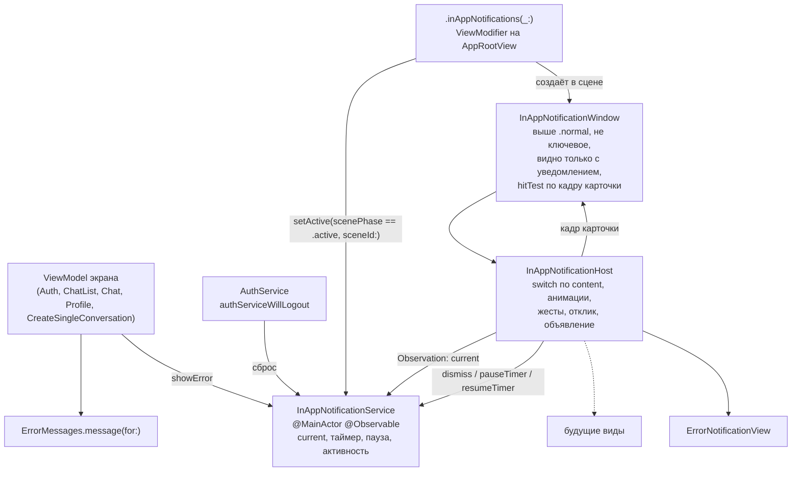
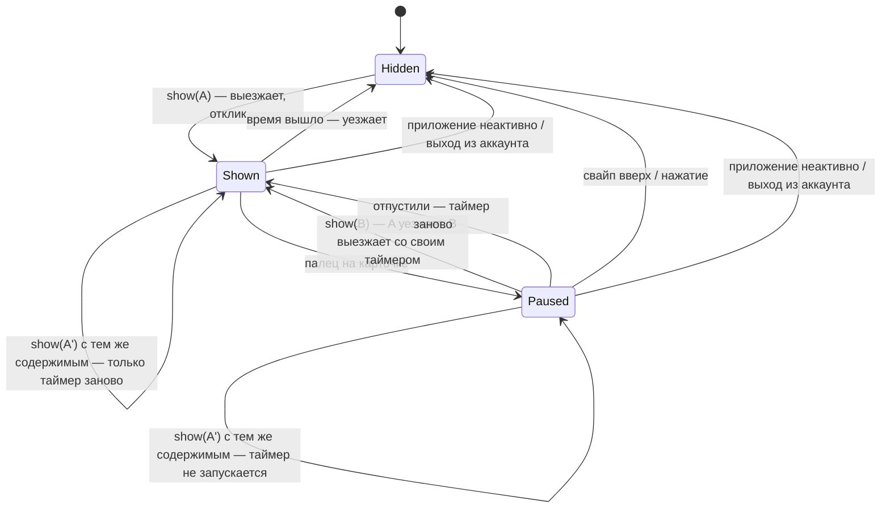

# Уведомления в приложении: архитектура клиента

20.10.2026 · Mikhail Kuzmin

Статус: реализовано, кроме ручного подбора времени показа (порядок работ, шаг 4): в `InAppNotificationTiming` стоят стартовые значения.

## Цель и требования

Показывать короткие уведомления поверх экрана, по аналогии с системными пушами, и перевести на них ошибки, которые сейчас показываются алертом с единственной кнопкой «OK».

1. Уведомление показывается поверх любого экрана приложения, в том числе поверх модальных листов (`sheet`, `fullScreenCover`). Показ уведомления не забирает фокус у поля ввода: открытая клавиатура остаётся на месте.
2. Уведомления бывают разных видов. Каждый вид может иметь свою форму и размер. Первый вид — ошибка, у всех ошибок один внешний вид. Механизм не привязан к ошибкам: следующие виды (например, новое сообщение в другой переписке) добавляются без его переделки.
3. Уведомление появляется и исчезает с анимацией: выезжает сверху и уезжает наверх, как системный пуш.
4. После появления уведомление висит 2 секунды, затем скрывается с анимацией. Длинный текст держится дольше: время показа ошибки растёт с длиной текста (принято 20.10.2026). Точные значения подбираются вручную и лежат константами в одном месте. При включённом VoiceOver текст уведомления объявляется, а уведомление держится дольше, чтобы его успели дослушать (принято 20.10.2026).
5. Если за время показа пришло новое уведомление, оно появляется сразу, и отсчёт времени начинается заново. Старое при этом уходит с анимацией одновременно с появлением нового, а если анимацию не удастся сделать аккуратно — пропадает без неё. Новое никогда не ждёт, пока уйдёт старое: очереди нет, всегда показывается последнее (принято 20.10.2026).
6. Если во время показа пришло уведомление с тем же содержимым, оно не появляется заново: показанное остаётся на месте, а отсчёт времени начинается сначала (принято 20.10.2026).
7. Жесты как у системных пушей (принято 20.10.2026): свайп вверх скрывает уведомление, пока палец на карточке, таймер стоит. Уведомление может обрабатывать нажатие: после нажатия выполняется действие, и уведомление скрывается. У ошибок действия нет, нажатие на них ничего не делает.
8. Тактильный отклик настраивается для каждого уведомления. У ошибок он есть (`.error`) (принято 20.10.2026).
9. Уведомления показываются только в активном приложении (принято 20.10.2026): пришедшее в фоне или в неактивном состоянии отбрасывается, а показанное в момент ухода из `.active` убирается без анимации и не возвращается. Исключение — сообщение об истечении сессии: оно не должно теряться и показывается, когда приложение станет активным (решение 12) (принято 20.10.2026).
10. При выходе из аккаунта (по кнопке или по истечении сессии) показанное уведомление прошлой сессии убирается (принято 20.10.2026).
11. Ошибки, которые сейчас показываются алертом с одной кнопкой «OK», показываются уведомлением-ошибкой. Алерты с выбором (подтверждение выхода в профиле) и `confirmationDialog` остаются как есть.

## Как сейчас

- **Пять экранов показывают ошибки алертом.** У каждой ViewModel есть `var errorMessage: String?`, View вешает `.alert(CommonStrings.errorTitle, isPresented: $viewModel.errorMessage.isPresent(), presenting: viewModel.errorMessage)` с кнопкой `CommonStrings.ok`:

  | Экран | Откуда ошибки |
  | --- | --- |
  | `AuthView` | вход / регистрация, истечение сессии (`handleAppear`, `errorUnauthorized`) |
  | `ChatListView` | загрузка и обновление списка |
  | `ChatView` | снимок ленты (`snapshot.failure`), неудачный запрос правки |
  | `ProfileView` | загрузка профиля, выбор и загрузка аватара |
  | `CreateSingleConversationView` | поиск пользователей, создание переписки (экран открыт в `sheet`) |

- **Только эти пять алертов используют** `CommonStrings.errorTitle`, `CommonStrings.ok` (ключи `common.error.title`, `common.ok` в `Common/{en,ru}.lproj/Common.strings`) и перегрузку `Binding.isPresent()` без аргумента. Перегрузка `isPresent(_ value:)` используется ещё в `AvatarSourcePickerViewModifier`.
- **Текст ошибки** собирает `ErrorMessages.message(for:)` (`@MainActor`) — он остаётся без изменений.
- **Истечение сессии показывает `AuthView` при появлении:** `handleAppear` сразу отмечает истечение просмотренным (`sessionService.acknowledgeExpiration()`) и записывает `errorMessage`. Алерт, показанный в фоне, дожидается возврата в приложение; уведомление в фоне отбрасывается (требование 9), поэтому порядок нужно поменять (решение 12).
- **У `ChatView` кнопка «OK» несёт логику:** `didDismissError()` возвращает фокус в поле ввода, если показывалась ошибка правки (клавиатура пряталась на время запроса). Фокус — `@FocusState` во View, у ViewModel механизма запроса фокуса нет. У уведомления кнопки нет, эту логику нужно перенести (решение 13).
- **Активность приложения** `AppRootView` уже передаёт роутеру по `scenePhase`, но пропускает `.inactive` (`guard phase != .inactive`): роутеру важен только уход в фон.
- **Отдельное окно над приложением уже есть:** `MessageMenuWindowPresenter` создаёт `UIWindow` уровня `.normal + 1` в сцене пузыря и делает его ключевым.
- **Строки** лежат в перечислениях `XxxStrings` (`CommonStrings`, `ChatStrings`) поверх таблиц `Xxx.strings` рядом с кодом.
- `DebugLoginView` показывает ошибку в своём состоянии, без алерта, — вне объёма фичи.

## Ключевые решения

1. **Состояние уведомлений хранит сервис уровня приложения `InAppNotificationService`, а не экран.** Сервис `@MainActor @Observable` за протоколом, создаётся в `DIContainer`. ViewModel вызывает `notifications.showError(...)` вместо записи в `errorMessage`. Правила показа (замена, повтор, таймер, пауза, активность приложения, выход из аккаунта) живут в одном месте и тестируются без UI. Экран только сообщает, что показать.
2. **Показ — в отдельном окне-оверлее, а не в `overlay` корневой View.** `overlay` на `AppRootView` рисует внутри иерархии корневого окна, а `sheet` и `fullScreenCover` UIKit показывает выше неё: ошибка из `CreateSingleConversationView` оказалась бы под листом. Поэтому уведомления рисуются в прозрачном окне `InAppNotificationWindow` уровня выше `.normal`, как меню сообщения.
   - Окно **никогда не становится ключевым** (`isHidden = false`, без `makeKeyAndVisible`): иначе поле ввода потеряет фокус и клавиатура спрячется.
   - Окно **видно, только пока в его сцене есть уведомление**, и ещё немного после — пока доигрывает анимация ухода карточки (`InAppNotificationWindowPresenter.hideDelay`). Постоянно видимое окно во весь экран с собственным корневым контроллером UIKit учитывает при выборе вида статус-бара и ориентации (например, поверх камеры в `fullScreenCover`), а пустому окну влиять на них незачем. Презентер следит за сервисом через `withObservationTracking`: окно открывается ещё до изменения (Observation сообщает о нём заранее, синхронно на main), чтобы новая карточка появлялась с анимацией уже в видимом окне, а скрывается с задержкой, если после изменения уведомления в сцене нет.
   - Касания мимо карточки проходят в экран под окном. `hitTest` окна сверяет точку с кадром карточки, а не с тем, какую View вернул `super.hitTest`: начиная с iOS 18 `super.hitTest` возвращает хостинг-вью SwiftUI для любой точки, и на карточке, и мимо неё, поэтому по возвращённой View их не различить и приём «корневая View → `nil`» не работает. Кадр карточки в координатах окна Host передаёт окну через `onGeometryChange`; нет карточки — кадр пустой, все касания проходят насквозь.
   - Уровень окна — выше окна меню сообщения: ошибка не должна прятаться под затемнением. Выше окна клавиатуры поднимать не нужно: карточка сверху, клавиатура снизу, они не пересекаются.
3. **Подключение — `ViewModifier` на корне приложения.** `AppRootView` вызывает `.inAppNotifications(DIContainer.shared.notificationService)`. Модификатор:
   - при появлении берёт сцену (через `UIViewRepresentable`-якорь, как `MessageLongPressDetector`) и создаёт в ней окно с `InAppNotificationHost` — SwiftUI-View, которая наблюдает за сервисом и рисует текущее уведомление;
   - передаёт сервису активность своей сцены (требование 9): `setActive(scenePhase == .active, sceneId:)` в `onAppear` и при каждой смене `scenePhase`, включая `.inactive`. В отличие от роутера, `.inactive` здесь не пропускается. `sceneId` — `UUID` в `@State` модификатора: модификатор живёт в корне каждой сцены.

   Сервис создаётся без активных сцен: до первого `setActive(true, sceneId:)` уведомления не показываются. `onChange` не срабатывает на начальное значение, поэтому текущая фаза передаётся ещё и в `onAppear` — иначе при старте сразу в `.active` сервис остался бы выключенным до первой смены фазы.

   Отдельный модификатор на каждом экране не нужен.
4. **Уведомление — значение с закрытым перечислением содержимого.** Внешний вид выбирается по `content`, поведение (время, отклик, нажатие) — свойства уведомления со значениями по умолчанию от вида.

   ```swift
   /// Уведомление в приложении: что показать, сколько держать на экране и что делать по нажатию.
   struct InAppNotification: Identifiable {
       let id = UUID()
       let content: Content
       /// Время показа.
       let duration: Duration
       /// Тактильный отклик при появлении; `nil` — без отклика.
       let feedback: SensoryFeedback?
       /// Действие по нажатию; `nil` — нажатие ничего не делает (ошибки).
       let onTap: (@MainActor () -> Void)?

       /// - Parameters:
       ///   - content: что показать.
       ///   - duration: время показа; `nil` — по виду и тексту (`InAppNotificationTiming.duration(for:)`).
       ///   - feedback: отклик при появлении; по умолчанию — от вида (`Content.defaultFeedback`, у ошибок — `.error`).
       ///   - onTap: действие по нажатию.
       init(
           content: Content,
           duration: Duration? = nil,
           feedback: SensoryFeedback?? = .none,
           onTap: (@MainActor () -> Void)? = nil
       ) {
           self.content = content
           self.duration = duration ?? InAppNotificationTiming.duration(for: content)
           self.feedback = feedback ?? content.defaultFeedback
           self.onTap = onTap
       }

       enum Content: Equatable {
           /// Ошибка: текст уже готов к показу (`ErrorMessages.message(for:)`).
           case error(message: String)
           // Будущие виды: .newMessage(MessageNotificationDisplayModel), .info(...)
       }
   }
   ```

   `feedback` — двойной опционал: `.none` (по умолчанию) — отклик вида, `.some(nil)` — без отклика. `InAppNotificationTiming.duration(for:)` здесь — обёртка, которая подставляет текущее состояние VoiceOver (решение 5).

   `InAppNotificationHost` выбирает View вида `switch`-ем по `content`: `ErrorNotificationView`, позже другие. Перечисление, а не протокол с `AnyView`: новый вид заставляет компилятор дописать его отрисовку, содержимое `Equatable` (на этом построено требование 6) и проверяется в тестах. Содержимое — уже готовые для показа данные (DisplayModel), как в списках. Нажатие — замыкание, а не перечисление действий: будущие действия (открыть переписку) живут в роутерах, и сервис уведомлений не должен о них знать.
5. **Время показа считается в одном месте — `InAppNotificationTiming`.** Расчёт — чистая функция `duration(for: content, isVoiceOverRunning: Bool)`, тесты передают флаг явно; обёртка `duration(for:)` берёт `UIAccessibility.isVoiceOverRunning`.
   - Без VoiceOver: базовое время 2 секунды, у ошибки к нему добавляется время за каждый символ сверх короткого текста, с верхней границей. Стартовые значения — 2 с, +0,05 с за символ сверх 40, не больше 6 с.
   - С VoiceOver: отдельное, более длинное время, чтобы объявление успели дослушать, — стартовое значение 10 с.
   - Все значения подбираются вручную в симуляторе на реальных текстах `CommonStrings.error*` (порядок работ, шаг 4).

   Текст объявляет Host при появлении каждого нового `id` через `AccessibilityNotification.Announcement` — для всех видов; текст объявления Host берёт по виду (у ошибки — сам текст ошибки).
6. **Таймер — в сервисе, через внедряемое ожидание.**
   - `show(_:)` отменяет задачу прежнего таймера и запускает новую: `await sleep(duration)`, затем `current = nil`, если задача не отменена и показано всё ещё то же уведомление (сверка по `id`). Одной сверки по `id` мало: ожидание может завершиться, а задачу отменят до её возврата на main — пауза и повтор того же содержимого сохраняют `id`, и без проверки отмены уведомление скрылось бы из-под пальца. Ожидание внедряется (как `Sleep` в `ChatViewModel`), тесты не ждут реальные секунды.
   - **Повтор (требование 6):** если `content` нового уведомления равен показанному, `current` не меняется (тот же `id`, карточка не перерисовывается, отклик и объявление не повторяются), перезапускается только таймер — на `duration` показанного. `duration`, `feedback` и `onTap` нового уведомления не используются: одинаковое содержимое означает и одинаковое действие.
   - **Пауза (требование 7):** `pauseTimer(id:)` отменяет таймер и запоминает, что показанное на паузе; `resumeTimer(id:)` снимает паузу и запускает таймер заново на полное время уведомления — как у системных пушей, после касания уведомление снова висит целиком.
   - **Повтор во время паузы** таймер не запускает: палец на карточке, и уведомление не должно скрыться под ним. Таймер запустит `resumeTimer` после отпускания.
   - **Новое уведомление во время паузы** заменяет показанное как обычно и сразу получает свой таймер: пауза относится к прежнему `id`. Жест прежней карточки заканчивается вместе с её удалением, его `resumeTimer` и `dismiss` с прежним `id` ничего не делают.
7. **Смена уведомлений анимируется одновременно, без очереди.** Host рисует `ZStack` из `current`, карточка привязана к `id`:
   - появление — `.move(edge: .top)` вместе с `.opacity`, пружинная анимация;
   - уход — тот же переход в обратную сторону, причём по таймеру, свайпу, нажатию и при замене одинаково;
   - при замене старая карточка уезжает вверх и гаснет, а новая выезжает поверх неё (`zIndex` по `createdAt` уведомления: новее — выше) в той же анимации. Новое уведомление ничего не ждёт: вставка и удаление идут в одной транзакции.

   Отдельный переход для замены (например, затухание без движения) не делается: удаляемая View в SwiftUI уходит с тем переходом, который был у неё на прошлом кадре, и сменить его в момент удаления нельзя без лишнего кадра. Если в прототипе встречное движение двух карточек выглядит плохо, запасной вариант — замена в два шага: старая убирается в транзакции без анимации, новая вставляется следующим изменением с анимацией. Новое по-прежнему не ждёт старое, задержка — один кадр.
8. **Жесты — один `DragGesture(minimumDistance: 0)` на карточке.** Касание ставит таймер на паузу. Ведение вверх двигает карточку за пальцем, а вниз — с сопротивлением. Если при отпускании карточку увели вверх дальше порога или резким движением, вызывается `dismiss(id:)` и карточка уезжает. Если почти не двигали, это нажатие: выполняется `onTap`, если он есть, и уведомление скрывается. Иначе карточка возвращается на место. После отпускания таймер продолжает работу (`resumeTimer`). VoiceOver: у карточки с `onTap` — действие по умолчанию, у всех — действие «Скрыть» (`accessibilityAction(.escape)` и именованное действие `InAppNotificationStrings.dismissAction`).
9. **Тактильный отклик проигрывает Host, а не сервис:** `.sensoryFeedback(trigger: current?.id)` с `current?.feedback`. Отклик звучит при каждом новом `id`, поэтому при повторе того же содержимого он не повторяется.
10. **Неактивное приложение и несколько сцен (требование 9).** На iPad приложение поддерживает несколько окон (`UIApplicationSupportsMultipleScenes`), а сервис один на всё приложение, поэтому активность учитывается по сценам. Сервис хранит активные сцены в порядке активации:
    - `isActive` — активна хотя бы одна сцена. Пока активных сцен нет, `show(_:)` ничего не делает и возвращает `false` (`@discardableResult`);
    - `presentingSceneId` — последняя ставшая активной сцена. Карточку рисует и окно показывает только она: ошибка не дублируется во всех окнах;
    - смена сцены показа — уход её из `.active` или активация другой — убирает текущее уведомление и отменяет таймер: уведомление относится к сцене, где его показали. Уход из `.active` другой сцены уведомление не трогает;
    - активация ничего не восстанавливает.

    Обе величины наблюдаемы: Host убирает карточку без анимации, когда его сцена перестала быть сценой показа, а экраны могут дождаться включения уведомлений (решение 12). Ограничение: ошибка не знает, из какой сцены пришла, и при двух окнах рядом (Split View) показывается в последнем активированном.
11. **Выход из аккаунта (требование 10).** Сервис — `AuthServiceObserver` и подписывается в `DIContainer`. В `authServiceWillLogout()` он убирает текущее уведомление. Сообщение «Сессия истекла» не теряется: его показывает `AuthView` (решение 12), а это происходит после фазы `willLogout`. Ошибки закрывающихся экранов, которые придут между фазами выхода, не фильтруются: их задачи к этому моменту отменены, а отменённые ошибки экраны не показывают. Это проверяется при переводе экранов (порядок работ, шаг 5).
12. **Истечение сессии отмечается просмотренным только после реального показа** (принято 20.10.2026). `AuthViewModel.showExpirationIfNeeded()` вызывается при появлении экрана и при каждом включении уведомлений (`AuthView` по `onChange` от `isActive` сервиса, а не по `scenePhase`: порядок `onChange` экрана и корня, который включает сервис, не гарантирован). Если сессия истекла, он вызывает `showError(CommonStrings.errorUnauthorized)` и только при результате `true` — `sessionService.acknowledgeExpiration()`. Сессия, истёкшая в фоне или при открытой шторке, покажется при возврате в приложение, а не пропадёт молча. Остальные ошибки, пришедшие вне `.active`, по требованию 9 отбрасываются.
13. **Фокус в поле ввода после ошибки правки возвращается сразу, а не по «OK»** (принято 20.10.2026). `ChatViewModel` получает счётчик `inputFocusRequest: Int`. При ошибке запроса правки ViewModel показывает уведомление и, если режим редактирования ещё включён, увеличивает счётчик. `ChatView` в `.onChange(of: viewModel.inputFocusRequest)` ставит `isInputFocused = true`. Счётчик, а не `Bool`: повторная ошибка тоже должна вернуть фокус, а сбрасывать флаг из View не нужно. `didDismissError()` и `isEditFailureShown` удаляются.
14. **Алерты ошибок удаляются со всех пяти экранов** вместе со всем, что используют только они: `errorMessage` во ViewModel, `CommonStrings.errorTitle` и `CommonStrings.ok` с ключами `common.error.title` и `common.ok` в обеих локализациях, перегрузка `Binding.isPresent()` без аргумента. Перегрузка `isPresent(_ value:)` остаётся — её использует `AvatarSourcePickerViewModifier`.



## Компоненты

### `InAppNotificationServiceProtocol`

```swift
/// Показ уведомлений поверх приложения: всегда последнее, на время `duration`, только в активном приложении.
@MainActor
protocol InAppNotificationServiceProtocol: AnyObject, Observable, AuthServiceObserver {
    /// Показанное уведомление; `nil` — ничего не показано.
    var current: InAppNotification? { get }
    /// Активна ли хотя бы одна сцена приложения.
    var isActive: Bool { get }
    /// Сцена, в окне которой показывается уведомление: последняя ставшая активной; `nil` — активных сцен нет.
    /// Её смена убирает уведомление без анимации.
    var presentingSceneId: UUID? { get }
    /// Показывает уведомление вместо прежнего и запускает таймер. С тем же содержимым — только перезапускает таймер
    /// показанного (на паузе — не запускает).
    /// - Returns: `false` — приложение неактивно, уведомление отброшено.
    @discardableResult
    func show(_ notification: InAppNotification) -> Bool
    /// Скрывает уведомление `id`, если оно ещё показано (свайп, нажатие).
    func dismiss(id: InAppNotification.ID)
    /// Останавливает таймер уведомления `id`: палец на карточке.
    func pauseTimer(id: InAppNotification.ID)
    /// Снимает паузу и запускает таймер уведомления `id` заново на полное время.
    func resumeTimer(id: InAppNotification.ID)
    /// Активность сцены. Пока активных сцен нет, новые уведомления отбрасываются; смена сцены показа убирает
    /// показанное. Сервис создаётся без активных сцен.
    func setActive(_ isActive: Bool, sceneId: UUID)
}

extension InAppNotificationServiceProtocol {
    /// Показывает ошибку единого вида.
    /// - Parameter message: текст ошибки, готовый к показу.
    /// - Returns: `false` — приложение неактивно, ошибка отброшена.
    @discardableResult
    func showError(_ message: String) -> Bool {
        show(InAppNotification(content: .error(message: message)))
    }
}
```

### Поведение



### Вид ошибки

`ErrorNotificationView`: карточка на ширину экрана с отступами (на iPad — с ограничением ширины), под статус-баром в пределах безопасной области, иконка `exclamationmark.circle.fill`, текст ошибки целиком, без ограничения числа строк: обрезанная ошибка теряет смысл, а время показа и так растёт с длиной текста (принято 20.10.2026). Если на шаге 4 найдутся тексты, при которых карточка выходит слишком высокой, их стоит сократить в `Common.strings`, а не обрезать при показе.

Строки — `InAppNotificationStrings` поверх таблицы `InAppNotification.strings` (en, ru): название действия VoiceOver «Скрыть» (`dismissAction`).

## Тесты

- `InAppNotificationService` (с внедрённым ожиданием):
  - до `setActive(true, sceneId:)` `show` игнорируется и возвращает `false`;
  - `show` делает уведомление текущим и возвращает `true`;
  - по истечении `duration` текущее становится `nil`;
  - `show` во время показа заменяет текущее;
  - таймер заменённого уведомления, сработав, не скрывает новое;
  - `show` с тем же содержимым оставляет текущее с прежним `id` и перезапускает таймер: через полное время от повтора уведомление ещё показано, после — скрыто;
  - `pauseTimer` — по истечении времени уведомление не скрывается; `resumeTimer` — скрывается через полное время от возобновления;
  - `show` с тем же содержимым на паузе не скрывает уведомление по истечении времени; после `resumeTimer` — скрывается через полное время;
  - `show` с другим содержимым на паузе заменяет текущее, и новое скрывается по своему таймеру;
  - `dismiss`, `pauseTimer`, `resumeTimer` с `id` уже заменённого уведомления ничего не делают;
  - отменённый таймер, чьё ожидание успело завершиться, не скрывает уведомление с тем же `id` (пауза, повтор того же содержимого);
  - `setActive(false)` единственной сцены убирает текущее, `show` в неактивном состоянии игнорируется, `setActive(true)` ничего не возвращает;
  - несколько сцен: уход сцены показа переносит показ в другую активную сцену и убирает текущее; уход другой сцены его не трогает; активация новой сцены делает её сценой показа и убирает текущее; повторная активация сцены показа ничего не меняет; уход всех сцен выключает сервис;
  - `authServiceWillLogout` убирает текущее.
- `InAppNotificationTiming`: короткий текст — базовое время, длинный — больше базового, очень длинный — верхняя граница; с `isVoiceOverRunning: true` — время для VoiceOver.
- `InAppNotification`: без параметров — время от `InAppNotificationTiming` и отклик вида (`.error`), `feedback: .some(nil)` — без отклика.
- ViewModel пяти экранов: ошибка, которая раньше записывалась в `errorMessage`, передаётся в мок сервиса уведомлений с тем же текстом. Существующие тесты на `errorMessage` переписываются на мок.
- `AuthViewModel`: при истёкшей сессии и активном сервисе ошибка показывается и истечение отмечается просмотренным; при неактивном (мок возвращает `false`) — не отмечается, и следующий вызов `showExpirationIfNeeded()` показывает ошибку.
- `ChatViewModel`: ошибка запроса правки увеличивает `inputFocusRequest`; если режим редактирования уже выключен — не увеличивает.
- Вручную в симуляторе: анимация смены, свайп, пауза, касания мимо карточки проходят в экран, показ поверх листа создания переписки, клавиатура не прячется, отклик, VoiceOver, истечение сессии в фоне показывается при возврате.

## Порядок работ

1. Прототип `InAppNotificationHost` в окне: одновременная смена карточек (решение 7) и запасной вариант, свайп, пауза, `hitTest` по кадру карточки на iOS 17 и 18, показ поверх `sheet`, клавиатура не теряет фокус.
2. `InAppNotification`, `InAppNotificationTiming`, `InAppNotificationService`, тесты, регистрация в `DIContainer` и подписка на выход.
3. Модификатор `.inAppNotifications(_:)` на `AppRootView` с передачей активности, `ErrorNotificationView`, строки, отклик, доступность.
4. Подбор времени показа (без VoiceOver и с ним) на реальных текстах ошибок, проверка высоты карточки на самых длинных.
5. Перевод пяти экранов с алертов на `showError`, `showExpirationIfNeeded` в `AuthViewModel`, `inputFocusRequest` в `ChatViewModel`; удаление `errorMessage`, `didDismissError`, `isEditFailureShown`, `CommonStrings.errorTitle`, `CommonStrings.ok`, их ключей и `Binding.isPresent()` без аргумента; переписка тестов. Проверить, что отменённые при выходе запросы не показывают ошибок.
6. Чистая сборка без предупреждений, ручная проверка в симуляторе.
