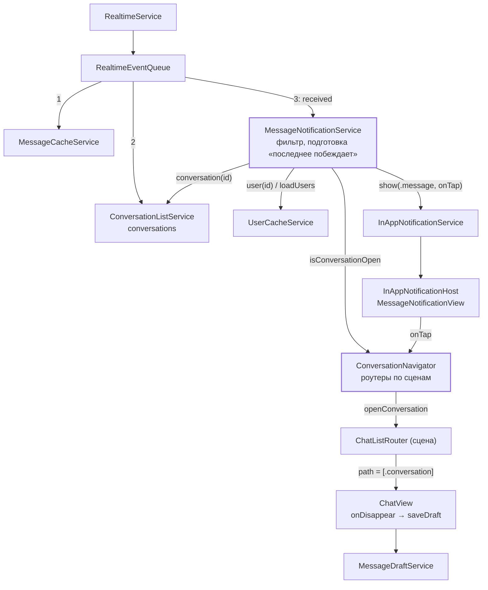

# Уведомления о входящих сообщениях: архитектура клиента

20.10.2026 · Mikhail Kuzmin

Статус: реализовано.

## Цель и требования

Показывать уведомление в приложении, когда в переписку, которая сейчас не открыта, пришло сообщение от другого пользователя. Нажатие на уведомление открывает эту переписку.

1. Уведомление показывается, если одновременно:
   - пришло новое сообщение (событие `messages` / `received`); правка сообщения (`edited`) уведомления не даёт;
   - отправитель — не текущий пользователь (своё сообщение, отправленное с другого устройства, уведомления не даёт);
   - переписка, в которую пришло сообщение, не открыта.
2. В уведомлении:
   - название переписки: у группы — её название, у личной переписки — имя отправителя;
   - аватар отправителя;
   - текст сообщения, не больше одной строки; в группе — с именем отправителя: «Имя: текст» (принято 20.10.2026).
3. Нажатие на уведомление открывает переписку, в которую пришло сообщение, — с любого экрана приложения, в том числе из другой открытой переписки, профиля и листа создания переписки.
4. Черновик и незавершённое редактирование переписки, с которой уходит пользователь, сохраняются и подставляются в поле ввода при возвращении в неё. Черновик и редактирование открываемой переписки подставляются как при обычном входе в неё.
5. Общие правила уведомлений (`docs/in-app-notifications.md`) действуют и здесь: всегда показывается последнее, без очереди; только в активном приложении; свайп и пауза; поверх листов; без потери фокуса поля ввода.

## Как сейчас

- **Механизм уведомлений готов** (`docs/in-app-notifications.md`). `InAppNotification.Content` — закрытое перечисление, пока с единственным видом `.error`. Новый вид требует: случай в `Content`, его `defaultFeedback`, время в `InAppNotificationTiming`, текст объявления VoiceOver в `InAppNotificationHost.announcement(for:)` и View в `switch` Host. Действие по нажатию — замыкание `onTap`, сервис уведомлений о навигации не знает.
- **Повтор того же содержимого** (требование 6 уведомлений) не перерисовывает карточку, а только перезапускает таймер. Для сообщений это значит: если в содержимом нет `messageId`, два одинаковых сообщения подряд будут склеены — это допустимо, но решение нужно принять явно (решение 4).
- **События WebSocket** идут через `RealtimeEventQueue`: одна очередь на приложение, события доставляются подписчикам по одному и **очередь ждёт каждый обработчик**. Обработчик, который ждёт сеть, задерживает все события всем подписчикам. Обработку можно приостановить арендой (синхронизация списка, ленты) — тогда события копятся и приходят пачкой после снятия.
- **Подписчики получают событие в порядке подписки.** `MessageCacheService` подписан в `DIContainer`, `ConversationListService` — в `start()` из `SessionWorkLauncher`. `ConversationListService.applyReceived` для переписки, которой нет в списке, ждёт `getBatch` — подписчик, подписанный после него, увидит переписку уже в `conversations`.
- **Пользователи из события** (`userIds`) загружаются `RealtimeService` в отдельной задаче (`userCache.loadUsers`), не дожидаясь: в момент обработки события отправитель может быть ещё `.pending`.
- **Сообщения, пропущенные без соединения**, приходят синхронизацией (REST), а не событиями: уведомлений по ним не будет. Это поведение подходит: после возврата в приложение не должен сыпаться поток уведомлений.
- **Открытая переписка** известна только `ChatListRouter` своей сцены: `openedConversationId` — первый элемент `path`. Роутер создаётся в `ChatListRootView`; на iPad у каждой сцены свой роутер, общего реестра нет.
- **Навигация** — `NavigationStack(path: $router.path)` с типизированным `[ChatListRoute]`; в стеке либо `[.profile]`, либо `[.conversation(Conversation)]`. Лист — `presentedSheet` (создание переписки).
- **Черновики** (`docs/message-drafts.md`, `docs/message-editing.md`): `ChatViewModel` передаёт текст в `MessageDraftService` при каждом изменении (память), в БД пишет на `onDisappear` и при уходе из `.active`. Новый `ChatViewModel` при создании синхронно читает черновик или правку из памяти. Запрос правки (`MessageEditService`) переживает уход с экрана.
- **Меню сообщения** (`MessageMenuWindowPresenter`) — отдельное ключевое окно. `ChatView` не закрывает его на `onDisappear`: если экран переписки уйдёт по навигации из уведомления, меню останется висеть над чужой перепиской (решение 8).
- **Строка списка чатов** (`ChatRowDisplayModel`) уже умеет: заголовок группы / собеседника с заглушками для `.pending` и `.notFound`, `smallURL` аватара, превью сообщения неизвестного типа («Сообщение»), сведение текста в одну строку (`labeledPreview`: пробельные символы → один пробел, обрезка по `MessageTextValidator.trimmedCharacters`, первые 200 символов).

## Ключевые решения

1. **`MessageNotificationService` — сервис уровня приложения, который решает, показывать ли уведомление, и собирает его.** `@MainActor`, за протоколом, создаётся в `DIContainer`. Подписывается на `RealtimeEventQueue` в `start()`, который вызывает `SessionWorkLauncher` **после** `conversationList.start()` — так к обработке события переписка уже в списке (см. «Как сейчас»). Экран и роутер о сообщениях не знают; сервис уведомлений не знает о сообщениях.
2. **Обработчик события не ждёт ничего.** Он синхронно отсекает лишнее (`guard`: событие `received`, `senderId != currentUser`, переписка не открыта) и передаёт сообщение в подготовку, которая идёт в собственной задаче сервиса. Иначе ожидание пользователя или сети остановило бы очередь для кэша сообщений и списка.
3. **Подготовка — «последнее побеждает».** События, задержанные арендой очереди, не отбрасываются: после снятия аренды они приходят пачкой, и показывается последнее из них (принято 20.10.2026). Новое сообщение отменяет подготовку предыдущего: показано будет всё равно только последнее (правило 5 уведомлений), а параллельные подготовки могли бы показать сообщения не по порядку. Подготовка:
   1. если отправитель `.pending` — ждёт `userCache.loadUsers(ids: [senderId])`, но не дольше `MessageNotificationService.userWaitTimeout` (стартовое значение — 1 с); загрузка по тайм-ауту не отменяется — её результат нужен списку и ленте;
   2. проверяет заново, что переписка не открыта и задача не отменена, — за время ожидания пользователь мог открыть переписку;
   3. собирает `MessageNotificationDisplayModel` (решение 5) и вызывает `notifications.show(...)` с `onTap`, открывающим переписку (решение 6).

   Если отправитель не загрузился за тайм-аут, уведомление всё равно показывается — с заглушкой вместо имени (принято 20.10.2026).

   Если переписки нет в `conversationList.conversations` (`getBatch` в `ConversationListService` не удался) — уведомление не показывается, событие логируется: без переписки нечего открыть по нажатию.
4. **Содержимое уведомления включает `conversationId` и `messageId`.** Каждое новое сообщение — новое содержимое: карточка заменяется с анимацией, в том числе в серии сообщений из одной переписки (принято 20.10.2026). Правило «то же содержимое — только таймер» срабатывает лишь на повторную доставку того же события.
5. **`MessageNotificationDisplayModel` — готовые для показа данные**, собираются фабрикой по тем же правилам, что строка списка чатов:

   ```swift
   /// Уведомление о новом сообщении в готовом для показа виде.
   struct MessageNotificationDisplayModel: Equatable {
       let conversationId: Int
       let messageId: Int
       /// Название группы либо имя отправителя личной переписки.
       let title: String
       /// Аватар отправителя — уменьшенная копия, если она есть; `nil` — плейсхолдер.
       let avatarURL: URL?
       /// Текст сообщения в одну строку: пробельные символы сведены к одному пробелу, края обрезаны.
       /// В группе — с префиксом «Имя:» основным цветом, сам текст — второстепенным.
       let text: AttributedString
   }
   ```

   - Заголовок: у личной переписки — имя отправителя (`userCache.user(id: senderId)`), у остальных — `conversation.name`, без названия — «Без названия».
   - Имя отправителя (заголовок личной переписки и префикс в группе): загружен — `user.name`; не загрузился за `userWaitTimeout` — заглушка «Пользователь»; `.notFound` — «Удалённый пользователь». Заглушка — обычный текст, а не `redacted`, как в списке: карточка висит несколько секунд и не обновляется, когда пользователь догрузится.
   - Аватар — всегда отправителя (`smallURL ?? url`), а не группы: так в требовании. У личной переписки это одно и то же.
   - Текст — сведение в одну строку выносится из `ChatRowDisplayModel.labeledPreview` в общую функцию (`Common/SingleLineText`), чтобы список и уведомление обрезали текст одинаково. В группе перед текстом — «Имя: ». Неизвестный тип сообщения — «Сообщение». Ограничение одной строкой — `lineLimit(1)` во View с `truncationMode(.tail)`; в модель кладутся первые 200 символов, как в списке.
6. **Нажатие открывает переписку через `ConversationNavigator`** — реестр роутеров списка чатов по сценам, `@MainActor`, за протоколом, в `DIContainer`.
   - `ChatListViewModel` регистрирует роутер экрана с идентификатором сцены при появлении (`didAppear(sceneId:)`) и снимает регистрацию по токену при исчезновении (`didDisappear()`): корень меняется при выходе и входе, и появление нового корня может прийти раньше исчезновения старого. Идентификатор сцены уже есть у модификатора `.inAppNotifications` (`sceneId` в `@State`) — модификатор кладёт его в окружение (`\.inAppNotificationSceneId`), `ChatListRootView` читает его оттуда и передаёт ViewModel. View с навигатором не работает.
   - `isConversationOpen(_ id:)` — открыта ли переписка в зарегистрированном роутере **активной** сцены (`InAppNotificationService.isSceneActive(_:)`). Любой активной, а не только сцены показа: в Split View пользователь видит обе сцены, и уведомление о переписке, открытой рядом, лишнее. Свёрнутая сцена остаётся зарегистрированной (`onDisappear` при уходе в фон не вызывается), но переписку в ней не видно — уведомления о ней показываются. Роутер без сцены (превью) считается видимым.
   - `openConversation(id:)` — открывает переписку в роутере сцены показа (`InAppNotificationService.presentingSceneId`): уведомление нажали именно там. Если такого роутера нет — в последнем зарегистрированном. Переписку берёт из `conversationList` по id в момент нажатия — она могла обновиться с момента показа.
   - Роутеры закрыты узким протоколом (`ConversationOpening`: `openedConversationId`, `openConversation(_:)`), сервисы о `ChatListRouter` не знают.
7. **`ChatListRouter.openConversation(_:)`** — переход «с любого экрана»:
   - закрывает лист (`presentedSheet = nil`);
   - если эта переписка уже первая в `path` — ничего не делает (оставляет стек как есть);
   - иначе заменяет стек: `path = [.conversation(conversation)]`. Назад из открытой переписки — список чатов, как при обычном входе.

   Закрытие листа и смена стека в одной транзакции считались риском для SwiftUI (переход не выполнится или сломается анимация). Проверено в симуляторе iPhone 17 Pro (iOS 26.2) 20.10.2026: при открытом листе «Личный диалог» нажатие на уведомление закрывает лист и открывает переписку с её черновиком, «назад» ведёт к списку. Запасной вариант (сменить стек после закрытия листа — `onDismiss` листа или следующий кадр) не понадобился.
8. **Черновики при переходе сохраняются существующим механизмом, без новых точек сохранения.**
   - Текст уже в памяти `MessageDraftService` (обновляется при каждом изменении поля), поэтому новая переписка и список видят его сразу.
   - Уход старого экрана вызывает `ChatView.onDisappear` → `saveDraft()` → запись в БД, включая незавершённое редактирование (`saveEdit`).
   - Новый `ChatViewModel` при создании читает черновик или правку своей переписки из памяти — как при обычном входе.
   - **Обязательное условие:** экран новой переписки должен получить новую идентичность. Замена `[.conversation(A)]` на `[.conversation(B)]` меняет элемент стека на той же позиции; если SwiftUI сохранит идентичность View, `@State viewModel` останется от A, а `onDisappear` не вызовется. Поэтому в `navigationDestination` экрану переписки ставится `.id(conversation.id)`. Проверяется тестом в симуляторе (порядок работ, шаг 1).
   - **Меню сообщения закрывается при уходе с экрана**: `ChatView.onDisappear` вызывает `menuController?.dismiss()` — новый метод контроллера, который отменяет ждущее меню и закрывает показанное без выбора. Сейчас это не нужно (уйти с экрана при открытом меню нельзя), но нажатие на уведомление поверх меню — новый путь ухода.
   - Запрос правки, начатый в старой переписке, продолжается в `MessageEditService`; его ошибка покажется уведомлением-ошибкой при возвращении в переписку, как сейчас.
9. **Новый вид уведомления — `.message(MessageNotificationDisplayModel)`** в `InAppNotification.Content`:
   - View — `MessageNotificationView`: `AvatarView` (Kingfisher, плейсхолдер), заголовок жирным в одну строку, текст в одну строку; та же карточка `InAppNotificationCard`, что у ошибки.
   - Время показа — фиксированное, без зависимости от длины: текст и так в одну строку. 4 с (`InAppNotificationTiming.messageDuration`), с VoiceOver — как у ошибки.
   - Без тактильного отклика: сообщения приходят часто, а у системы баннер внутри приложения тоже не вибрирует.
   - Объявление VoiceOver — «Новое сообщение, <заголовок>: <текст>» (строка с форматом в `InAppNotification.strings`); у карточки с `onTap` действие по умолчанию — нажатие (открыть переписку).
10. **Выход из аккаунта.** `MessageNotificationService` — `AuthServiceObserver`: в `authServiceWillLogout()` отменяет подготовку. Подписка на очередь переживает выход — `start()` новой сессии ничего не делает: без пользователя сессии (`currentUser == nil`) обработчик событие отбрасывает, а после входа отсекает свои сообщения уже по новому пользователю. Показанное уведомление убирает `InAppNotificationService` (как сейчас). `onTap` уже показанной карточки после выхода не выполнится: карточка убрана; для надёжности `openConversation` ничего не делает, если переписки нет в списке.
11. **Открытие переписки убирает уведомление о ней.** Если пользователь сам открыл переписку, о которой висит уведомление, оно скрывается: `ChatListRootView` по `onChange(of: router.openedConversationId)` передаёт смену в `ChatListViewModel.openedConversationDidChange(_:)`, ViewModel вызывает `MessageNotificationService.conversationDidOpen(_:)`, и сервис вызывает `notifications.dismiss(id:)`, если текущее уведомление — `.message` с этим `conversationId`, а идущую подготовку уведомления об этой переписке отменяет. Мелочь, но без неё карточка висит над перепиской, которую уже читают.



## Компоненты

### `MessageNotificationServiceProtocol`

```swift
/// Уведомления о новых сообщениях в неоткрытых переписках.
@MainActor
protocol MessageNotificationServiceProtocol: AuthServiceObserver {
    /// Подписывается на очередь событий. Вызывается после `conversationList.start()`; повторный вызов ничего не делает.
    func start()
    /// Переписка открылась: уведомление о ней скрывается, подготовка уведомления о ней отменяется.
    func conversationDidOpen(_ conversationId: Int)
}
```

Зависимости: `RealtimeEventQueueProtocol`, `SessionServiceProtocol` (id текущего пользователя), `ConversationListServiceProtocol` (переписка по id), `UserCacheServiceProtocol`, `ConversationNavigating`, `InAppNotificationServiceProtocol`, внедряемое ожидание (тайм-аут пользователя) — как `sleep` в `InAppNotificationService`.

### `ConversationNavigating`

```swift
/// Роутер сцены, умеющий открыть переписку.
@MainActor
protocol ConversationOpening: AnyObject {
    /// Переписка, открытая первой поверх списка; `nil` — не открыта.
    var openedConversationId: Int? { get }
    /// Открывает переписку с любого экрана: закрывает лист и заменяет стек.
    func openConversation(_ conversation: Conversation)
}

/// Реестр роутеров списка чатов по сценам.
@MainActor
protocol ConversationNavigating: AnyObject {
    /// Регистрирует роутер сцены (роутер держится слабо).
    /// - Returns: токен для снятия регистрации.
    func register(_ router: ConversationOpening, sceneId: UUID?) -> UUID
    /// Снимает регистрацию по токену; неизвестный токен ничего не делает.
    func unregister(_ token: UUID)
    /// Открыта ли переписка хотя бы в одной активной сцене.
    func isConversationOpen(_ conversationId: Int) -> Bool
    /// Открывает переписку в сцене показа уведомлений. Переписки нет в списке — ничего не делает.
    func openConversation(id: Int)
}
```

### Размещение

`MessageNotificationService` и `ConversationNavigator` — в `Services/MessageNotification/`; `MessageNotificationDisplayModel` и `MessageNotificationView` — рядом с остальным UI уведомлений, в `Common/InAppNotification/`.

### Строки

Существующая таблица `InAppNotification.strings` (en, ru): «Без названия», «Пользователь», «Удалённый пользователь», «Сообщение» для неизвестного типа, формат объявления VoiceOver.

## Тесты

- `MessageNotificationService` (моки очереди, сессии, списка, кэша пользователей, навигатора и сервиса уведомлений; внедрённое ожидание):
  - `received` от другого пользователя в неоткрытую переписку — `show` с ожидаемой моделью;
  - своё сообщение, `edited`, `conversationCreated`, `connected` — `show` не вызывается;
  - переписка открыта — не показывается; открылась во время ожидания пользователя — не показывается;
  - переписки нет в списке — не показывается;
  - отправитель `.pending` — показ после загрузки; не загрузился за тайм-аут — показ с заглушкой;
  - группа — текст с префиксом имени отправителя;
  - два сообщения подряд, первое ждёт пользователя — показано только второе;
  - обработчик события возвращается, не дожидаясь загрузки пользователя;
  - `authServiceWillLogout` отменяет подготовку — `show` не вызывается;
  - `onTap` вызывает `navigator.openConversation(id:)` с id переписки;
  - открытие переписки текущего уведомления вызывает `dismiss(id:)`; другой переписки — не вызывает.
- Фабрика `MessageNotificationDisplayModel`: группа с названием (префикс имени), группа без названия, личная с загруженным / `.pending` / `.notFound` отправителем (без префикса), аватар `smallURL` / `url` / нет, многострочный текст, неизвестный тип.
- Общая функция сведения текста в одну строку — тесты переезжают из `ChatRowDisplayModel`, список чатов проверяется прежними тестами.
- `ConversationNavigator`: открыта в одной из активных сцен; открыта только в свёрнутой сцене — не считается открытой; роутер без сцены — открыта; регистрация снимается вместе с токеном; `openConversation` идёт в роутер сцены показа; неизвестная переписка — ничего.
- `InAppNotificationService.isSceneActive`: активна только сцена в `.active`.
- `ChatListViewModel`: регистрация роутера при появлении один раз, снятие при исчезновении, открытая переписка передаётся в сервис уведомлений о сообщениях.
- `MessageNotificationService`: тайм-аут ожидания отправителя не отменяет его загрузку.
- `ChatListRouter.openConversation`: из пустого стека, из профиля, из другой переписки, при открытом листе, ту же переписку — стек не меняется.
- `InAppNotificationTiming` и `InAppNotification`: время и отклик вида `.message`.
- Вручную в симуляторе (два тестовых пользователя): уведомление из списка, профиля, другой переписки, листа создания; не показывается в открытой переписке; нажатие поверх меню сообщения; черновик и режим редактирования старой переписки на месте после возвращения; черновик новой подставлен; клавиатура; iPad Split View.

## Порядок работ

1. Прототип навигации: `ChatListRouter.openConversation` с `.id(conversation.id)` у экрана переписки — смена переписки создаёт новый `ChatViewModel` и вызывает `onDisappear` старой; закрытие листа вместе со сменой стека; закрытие меню сообщения на `onDisappear`.
2. Вынос сведения текста в одну строку в `Common/`, `MessageNotificationDisplayModel` и фабрика, тесты.
3. `ConversationNavigator`, `\.inAppNotificationSceneId` в модификаторе, регистрация в `ChatListViewModel`, тесты.
4. `MessageNotificationService`, подписка из `SessionWorkLauncher`, выход из аккаунта, тесты.
5. Вид `.message`: `MessageNotificationView`, время, отклик, объявление, строки.
6. Подбор времени и отклика в симуляторе, ручная проверка, чистая сборка без предупреждений.
