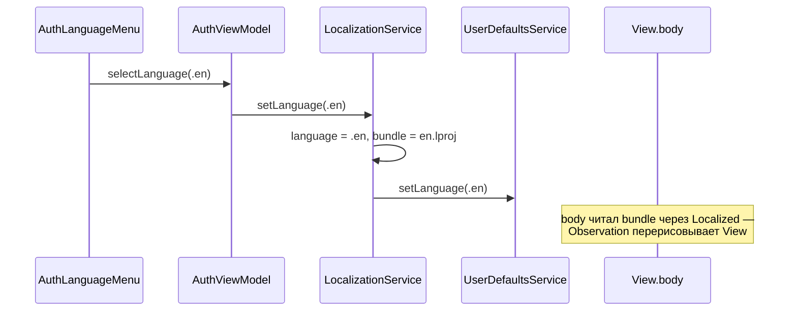

# Язык интерфейса и строки: архитектура клиента

22.10.2026 · Mikhail Kuzmin

Статус: описание реализованного.

## Назначение

Приложение поддерживает русский и английский. Язык выбирается в приложении, независимо от системного, и переключается сразу, без перезапуска. По умолчанию берётся системный язык, если он поддерживается, иначе английский.

## Состав

| Тип | Роль |
| --- | --- |
| `AppLanguage` | `ru` / `en`; `fallback = .en`; `displayName` на самом языке; `locale`; `systemDefault(preferredLanguages:)` |
| `LocalizationServiceProtocol` / `LocalizationService` | `@MainActor @Observable`: текущий `language` и `bundle` с его `.strings`; `restore()`, `setLanguage(_:)` |
| `UserDefaultsService` | хранит выбранный язык (ключ `language`) и пользователя сессии (`currentUser`) |
| `Localized` | единственная точка чтения строк: `string(_:table:)`, `plural(_:table:count:)` |
| `<Экран>Strings`, `CommonStrings`, `InAppNotificationStrings` | строки своей таблицы в виде статических свойств и функций |
| `<lang>.lproj/<Таблица>.strings`, `.stringsdict` | переводы |
| `AuthLanguageMenu` | выбор языка на экране авторизации |

## Как переключается язык



1. **Строки читаются не через `String(localized:)`, а из `bundle` языка.** `LocalizationService.bundle` — `Bundle` директории `<language>.lproj` (если её нет — `Bundle.main`). `Localized.string` вызывает `bundle.localizedString(forKey:value:table:)`. Системная локализация привязана к языку системы и в процессе не меняется — поэтому свой bundle.
2. **Перерисовка — через Observation.** `LocalizationService` — `@Observable`; чтение `bundle` внутри `body` регистрируется, и при смене языка все View, показывающие строки, перерисовываются сами. Отдельных уведомлений и `id` на корне нет.
3. **`Localized` обращается к `DIContainer.shared` напрямую.** Это единственное разрешённое исключение из правила «сервисы только через инжекцию»: строки читаются из статических хелперов (`AuthStrings.titleLogin`), куда инжекцию не передать.
4. **Локаль для форматирования.** `AppRootView` ставит `.environment(\.locale, router.locale)` — системные элементы и форматтеры SwiftUI следуют языку приложения. ViewModel, которые форматируют время и даты сами, берут `localizationService.language` (`ChatListViewModel`, `ChatViewModel`; заголовки дней — [message-date-headers.md](message-date-headers.md)).
5. **Восстановление.** `AppRouter.restoreSession()` вызывает `localizationService.restore()` вместе с восстановлением сессии; до этого действует системный язык. Выбор в `UserDefaults` не зависит от аккаунта и переживает выход.

Сейчас язык выбирается только на экране авторизации (меню с глобусом в тулбаре).

## Строки экрана

Каждый экран — своя таблица `<Экран>.strings` в `Screens/<Экран>/{ru,en}.lproj` и `@MainActor enum <Экран>Strings`:

```swift
@MainActor
enum AuthStrings {
    private static let table = "Auth"

    static var titleLogin: String { localized("auth.title.login") }

    static func errorNameTooLong(maxLength: Int) -> String {
        String(format: localized("auth.error.name.too_long"), maxLength)
    }

    private static func localized(_ key: String) -> String {
        Localized.string(key, table: table)
    }
}
```

- Ключи — `<таблица>.<раздел>.<имя>` в snake_case: `auth.error.login.empty`, `common.error.api.unauthorized`.
- Свойства вычисляемые (`var … { }`), а не сохранённые: строка читается при каждом обращении — из текущего языка.
- Общие строки (ошибки сети и API) — `CommonStrings`, таблица `Common`; перевод ошибок в текст — `ErrorMessages` ([сетевой слой](networking.md)).
- Строки debug-входа (`DebugLogin.strings`) исключены из Release в `Config/Base.xcconfig`.

### Подстановки

- **Числа** — `String(format:)` с `%d` (например, лимит длины).
- **Ссылки в тексте** — markdown-шаблон с позиционными `%1$@`, `%2$@` на месте адресов: `"Уже зарегистрированы? **[Войти](%1$@)**"`. `AuthViewModel.makeMarkdownText` подставляет адреса **текстовой заменой**, а не `String(format:)`: потерянный или лишний плейсхолдер в переводе не должен ронять приложение. Ссылка переключения режима — служебный URL `chatik://auth/switch-mode`, его перехватывает экран.
- **Множественное число** — `.stringsdict` той же таблицы и `Localized.plural(_:table:count:)`. Число подставляется с локалью языка приложения: иначе форма выбиралась бы по системному языку. Сейчас так устроена подпись VoiceOver счётчика непрочитанных (`common.unread_count`).

## Системные тексты

`InfoPlist.strings` (`Chatik/{ru,en}.lproj`) — тексты системных диалогов разрешений (`NSCameraUsageDescription`). Их язык выбирает система, а не переключатель в приложении: диалог показывает iOS.

## Добавление языка

1. Case в `AppLanguage` с `displayName` на самом языке.
2. Директория `<код>.lproj` с переводом каждой таблицы и `InfoPlist.strings`; язык — в `knownRegions` проекта.
3. Для заголовков дней в ленте — форматтер языка в `MessageDateHeaderFormatterProvider` ([message-date-headers.md](message-date-headers.md)).
4. Прогнать `AuthStringsTests`: шаблоны ссылок и лимитов должны содержать те же плейсхолдеры во всех языках.

## `UserDefaultsService`

Единственная точка доступа к `UserDefaults`; прямое обращение из остального кода запрещено. `actor`: обращаться можно из любого потока через `await`.

| Ключ | Значение |
| --- | --- |
| `currentUser` | JSON `User` пользователя сессии; `nil` — запись удаляется |
| `language` | `AppLanguage.rawValue`, если пользователь выбирал язык |

Каждое значение читается из `UserDefaults` один раз — при первом обращении (`lazy`), дальше живёт в кэше актора и меняется только через сеттер: JSON пользователя не декодируется на каждое чтение.

## Тесты

- `AppLanguageTests`: поддерживаемый системный язык выбирается; неподдерживаемый или пустой список — английский.
- `LocalizationServiceTests`: без сохранённого — системный язык; `restore` применяет сохранённый; `setLanguage` применяет и сохраняет; `bundle` следует языку.
- `UserDefaultsServiceTests`: значения переживают пересоздание сервиса, `nil` удаляет запись, чтение из `UserDefaults` один раз, параллельный доступ.
- `AuthStringsTests`: шаблоны ссылок и лимитов содержат нужные плейсхолдеры во всех языках.
