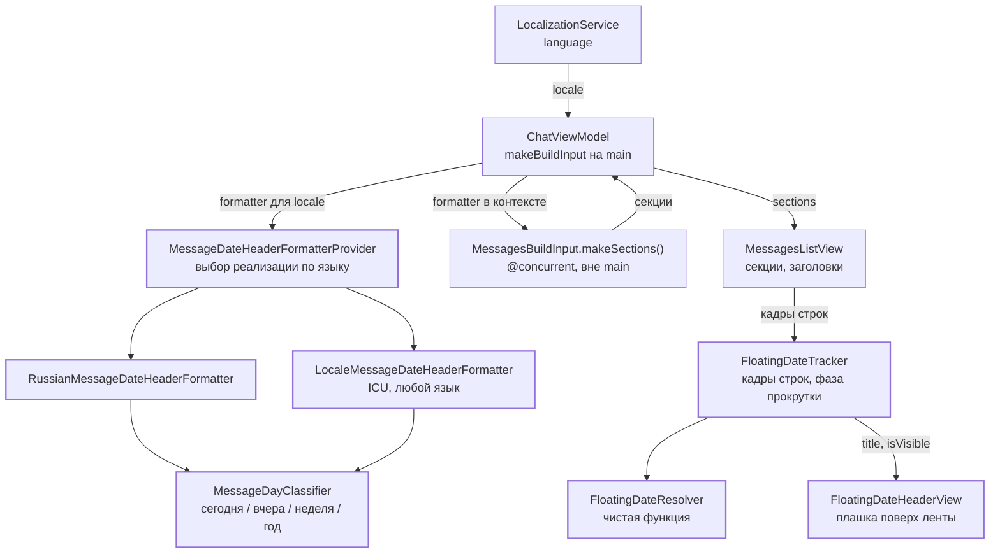
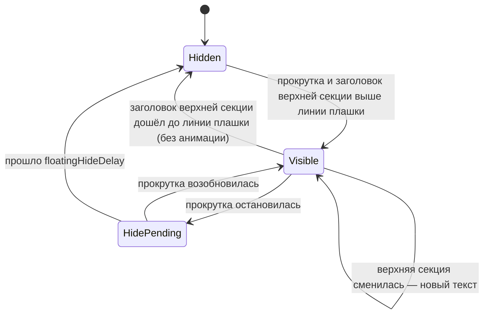

# Заголовки дат в ленте сообщений

15.10.2026 · Mikhail Kuzmin

## Цель и ключевые решения

Сообщения ленты разбиты по дням: над сообщениями каждого дня стоит заголовок с датой. В пузыре сообщения остаётся только время (`12:05`), дата из него убирается. Пока пользователь прокручивает ленту, а заголовок дня верхних видимых сообщений ушёл за верхний край, поверх ленты показывается плавающая плашка с этой датой. После остановки прокрутки она плавно скрывается.

Ключевые решения:

1. **Форматирование даты заголовка — отдельный сервис** за протоколом `MessageDateHeaderFormatting`. Правила (сегодня, вчера, последняя неделя, год) вычисляются в одном месте — `MessageDayClassifier`, а реализации только превращают результат в текст. Это позволяет добавить реализацию для отдельного языка, не повторяя правил.
2. **Реализацию выбирает провайдер** `MessageDateHeaderFormatterProvider` по языку приложения (`LocalizationService.language`). Для русского — `RussianMessageDateHeaderFormatter` с явными таблицами названий. Для остальных языков — `LocaleMessageDateHeaderFormatter` поверх ICU (`Date.FormatStyle`, `RelativeDateTimeFormatter`).
3. **Лента — секции по дням.** ViewModel отдаёт `[MessageDaySectionDisplayModel]`, а не плоский `[MessageDisplayModel]`. Заголовок секции собирается вне main вместе с сообщениями, в той же `@concurrent`-сборке. View ничего не форматирует.
4. **В сообщении — только время.** В пузыре теперь показывается только время отправки (`12:05`) — в том числе у вчерашних и прошлогодних сообщений. Дату показывает заголовок дня. У сообщений, которых ещё нет на сервере, на месте времени — статус: у отправляющегося индикатор отправки, у неотправленного светло-розовый текст «Не отправлено». Высота подвала во всех случаях одна и та же, поэтому пузырь не меняет высоту при смене статуса.
5. **Серия отправителя прерывается на границе дня**: первое сообщение под заголовком снова показывается с аватаром и именем.
6. **Плавающая плашка — состояние View**, а не ViewModel: она зависит только от геометрии прокрутки. Какую дату показать, решает чистая функция `FloatingDateResolver`, которую можно покрыть тестами. За кадрами строк следит `FloatingDateTracker`.
7. **Определение прокрутки зависит от версии iOS:** на iOS 18+ — `onScrollPhaseChange`, на iOS 17 (deployment target) — по изменению кадров строк и таймеру.
8. **Смена дня и языка пересобирает ленту:** «Сегодня» превращается во «Вчера» в полночь (событие `SignificantTimeChangeService` поверх `significantTimeChangeNotification`), заголовки переводятся при смене языка приложения.



## Правила форматирования

«Сегодня», «вчера» и «последняя неделя» считаются по календарным дням в календаре и часовом поясе устройства (`Calendar.current`), а не по 24-часовым интервалам. Пусть `days` — число полуночей между днём сообщения и текущим днём.

| Условие | Формат | Год |
| --- | --- | --- |
| `days == 0` | «Сегодня, » + день и месяц | никогда (текущий год) |
| `days == 1` | «Вчера, » + день и месяц | если вчера — прошлый год (1 января) |
| `days` от 2 до 6 | день недели + день и месяц | если день не в текущем году |
| `days >= 7` | день и месяц | если день не в текущем году |
| `days < 0` (дата в будущем: часы устройства отстают от сервера) | день и месяц | если день не в текущем году |

Неделя — это 2–6 дней назад, а не текущая календарная неделя: 7 дней назад — тот же день недели, что и сегодня, и «Четверг» без даты был бы неоднозначен. День недели и слово «Сегодня»/«Вчера» пишутся с заглавной буквы — заголовок начинается с них.

Примеры для текущей даты **четверг, 15 октября 2026**:

| Дата сообщения | `days` | Русский | English |
| --- | --- | --- | --- |
| 15.10.2026 | 0 | Сегодня, 15 октября | Today, October 15 |
| 14.10.2026 | 1 | Вчера, 14 октября | Yesterday, October 14 |
| 13.10.2026 | 2 | Вторник, 13 октября | Tuesday, October 13 |
| 09.10.2026 | 6 | Пятница, 9 октября | Friday, October 9 |
| 08.10.2026 | 7 | 8 октября | October 8 |
| 30.12.2025 | 289 | 30 декабря 2025 г. | December 30, 2025 |

Переход через год, текущая дата **суббота, 2 января 2027**:

| Дата сообщения | `days` | Русский | English |
| --- | --- | --- | --- |
| 02.01.2027 | 0 | Сегодня, 2 января | Today, January 2 |
| 01.01.2027 | 1 | Вчера, 1 января | Yesterday, January 1 |
| 31.12.2026 | 2 | Четверг, 31 декабря 2026 г. | Thursday, December 31, 2026 |
| 30.12.2026 | 3 | Среда, 30 декабря 2026 г. | Wednesday, December 30, 2026 |
| 26.12.2026 | 7 | 26 декабря 2026 г. | December 26, 2026 |

Если сегодня 1 января 2027, вчерашний заголовок — «Вчера, 31 декабря 2026 г.».

## Сервис форматирования

Каталог `Chatik/Services/DateFormatting/`.

### Классификация дня

Правила таблицы выше живут только здесь. Реализации форматтеров их не повторяют.

```swift
/// Положение дня сообщения относительно текущего дня.
enum MessageDayRelation: Equatable, Sendable {
    case today
    case yesterday
    /// 2–6 дней назад: в заголовке есть день недели.
    case lastWeek
    /// 7 и больше дней назад или дата в будущем.
    case earlier
}

/// День сообщения для заголовка: как он соотносится с сегодняшним и нужен ли год.
struct MessageDay: Equatable, Sendable {
    let relation: MessageDayRelation
    /// `true` — день не в текущем году, в заголовке нужен год.
    let includesYear: Bool
}

/// Определяет, к какому дню относится сообщение, по календарным дням календаря устройства.
struct MessageDayClassifier: Sendable {
    let calendar: Calendar

    /// Классифицирует день сообщения.
    /// - Parameters:
    ///   - date: время сообщения.
    ///   - now: текущее время.
    func day(of date: Date, now: Date) -> MessageDay
}
```

`days` считается как `calendar.dateComponents([.day], from: startOfDay(date), to: startOfDay(now)).day`. Разница `Date` в секундах не подходит: из-за перехода на летнее время в сутках бывает 23 или 25 часов.

### Протокол форматтера и реализации

```swift
/// Текст заголовка дня в ленте сообщений.
protocol MessageDateHeaderFormatting: Sendable {
    /// Форматирует дату заголовка.
    /// - Parameters:
    ///   - date: время любого сообщения этого дня.
    ///   - now: текущее время.
    func string(from date: Date, now: Date) -> String
}
```

**`LocaleMessageDateHeaderFormatter`** — реализация по умолчанию для любого языка. Её параметры — `locale` и `calendar`.

- День и месяц: `Date.FormatStyle(locale:calendar:timeZone:).day().month(.wide)`, с годом — `.year()`. ICU сам ставит падеж и порядок: `30 декабря 2026 г.`, `December 30, 2026`.
- С днём недели: тот же стиль с `.weekday(.wide)` и `capitalizationContext: .beginningOfSentence`, чтобы получилось «Среда», а не «среда».
- «Сегодня»/«Вчера»: `RelativeDateTimeFormatter` с `dateTimeStyle = .named` и `formattingContext = .beginningOfSentence` — `localizedString(from: DateComponents(day: 0))` и `day: -1`. Слова берутся из ICU, поэтому реализация работает для любого языка без строк в `.strings`.
- Склейка: `"<слово>, <день и месяц>"`. Порядок и разделитель в разных языках могут отличаться — если для языка это важно, для него пишется отдельная реализация.

**`RussianMessageDateHeaderFormatter`** — реализация для русского. Она не зависит от версии ICU и гарантирует точный вид заголовков:

- Названия месяцев в родительном падеже, дней недели и слова «Сегодня», «Вчера», «г.» заданы таблицами внутри реализации. Это не тексты интерфейса, а языковые данные форматтера, поэтому в `.strings` они не выносятся: реализация и так существует только для русского.
- Формат: `Сегодня, 15 октября`, `Вторник, 13 октября`, `30 декабря 2025 г.`, `Среда, 30 декабря 2026 г.`.

Обе реализации — `struct`. Классификацию дня они получают от `MessageDayClassifier`, построенного на том же `calendar`.

### Провайдер

```swift
/// Выдаёт форматтер заголовков для языка: реализацию для этого языка, если она есть, иначе общую на ICU.
protocol MessageDateHeaderFormatterProviding: Sendable {
    /// - Parameters:
    ///   - locale: язык приложения.
    ///   - calendar: календарь с часовым поясом устройства.
    func formatter(locale: Locale, calendar: Calendar) -> any MessageDateHeaderFormatting
}

struct MessageDateHeaderFormatterProvider: MessageDateHeaderFormatterProviding {
    typealias Factory = @Sendable (Locale, Calendar) -> any MessageDateHeaderFormatting

    /// Реализации для отдельных языков по коду языка (`Locale.Language.LanguageCode`).
    let languageSpecific: [String: Factory]

    /// Набор приложения: русский — `RussianMessageDateHeaderFormatter`, остальные — `LocaleMessageDateHeaderFormatter`.
    static let `default` = MessageDateHeaderFormatterProvider(languageSpecific: [
        "ru": { _, calendar in RussianMessageDateHeaderFormatter(calendar: calendar) },
    ])
}
```

- Провайдер создаётся в `DIContainer` (`messageDateHeaderFormatterProvider`) и инжектируется в `ChatViewModel` через протокол.
- Чтобы добавить реализацию для языка, нужно написать `struct`, реализующий `MessageDateHeaderFormatting`, добавить его в `languageSpecific` и написать тесты. Код экранов при этом не меняется.
- Под «текущей локалью» понимается язык приложения (`AppLanguage.locale`), а не системный: интерфейс переключает язык независимо от системы, и заголовки должны совпадать с ним. Календарь и часовой пояс — системные (`Calendar.current`), как у `MessageTimeFormatter`.

## Модель ленты

### Время в пузыре

В самих сообщениях теперь отображается **только время** отправки, без даты — у сообщений, которые уже есть на сервере (`MessageDeliveryState.delivered`), сегодняшних и старых. Дата сообщения видна из заголовка его дня. У отправляющихся (`.sending`) и неотправленных (`.failed`) сообщений на месте времени показывается статус: время у них — ещё не время сообщения на сервере, а момент нажатия «Отправить».

| Сообщение | Было | Стало |
| --- | --- | --- |
| сегодня, 12:05 | 12:05 | 12:05 |
| 13 октября 2026, 18:40 | 13 окт., 18:40 | 18:40 |
| 30 декабря 2025, 09:15 | 30 дек. 2025 г., 09:15 | 09:15 |
| отправляется, 12:07 | 12:07 и часы | индикатор отправки (часы) |
| не отправлено, 12:07 | 12:07 | «Не отправлено» светло-розовым |

- Формат времени остаётся в одном месте — в `MessageTimeFormatter`. В нём появляется `timeString(from:)` — только время, без даты, тем же стилем `Date.FormatStyle(locale:calendar:timeZone:).hour().minute()`, что и у сегодняшних сообщений. `string(from:)` строится поверх того же стиля и остаётся для списка чатов: там дата по-прежнему нужна. 12- или 24-часовой формат выбирает язык приложения (`18:40` в `ru`, `6:40 PM` в `en`).
- `MessageDisplayModel.formattedTime` вызывает `MessageTimeFormatter.timeString(from:)` вместо `string(from:)`.
- `MessageDisplayModel.time` становится `String?`: `nil` у всех сообщений очереди отправки (`init(outgoing:)`), значение — только у сообщений сервера (`init(message:)`).
- В `MessageBubbleView` подвал пузыря выводится **всегда**, а на месте времени — по `deliveryState`:
  - `.delivered` — пометка «изменено», если есть, и время;
  - `.sending` — индикатор отправки: значок `clock` (как сейчас), без времени;
  - `.failed` — текст `strings.failed` («Не отправлено» / «Not sent» — та же строка, что у `deliveryStateLabel`) светло-розовым `#FFD6D6` (цвет `FailedLabel` в каталоге ассетов, один для обеих тем; без общей прозрачности подвала 0,7), без времени. Красный значок слева от пузыря остаётся — сигнал ошибки даёт он.
  - Почему не красный: неотправленное сообщение всегда исходящее, и текст лежит на фоне `OutgoingBubble`. Контраст по WCAG:

    | Цвет текста | Светлая тема (`#007AFF`) | Тёмная тема (`#1F5FA8`) |
    | --- | --- | --- |
    | красный `.red` | 1,13 | 1,89 |
    | светло-розовый `#FFD6D6` | 3,03 | 4,86 |
    | белый (текст сообщения) | 4,02 | 6,44 |

    Красный на синем проверен на скриншотах (iOS 26.2) и почти не читается.
- **Высота подвала не зависит от статуса.** Её задаёт невидимая строка того же шрифта (`.caption2`), что и время: `Text(verbatim: "00:00").hidden()` в основании `ZStack`, а время, индикатор или текст лежат поверх. Значок часов — `.imageScale(.small)`, чтобы не быть выше строки. Тогда пузырь не меняет высоту, когда сообщение уходит в «Отправляется», «Не отправлено» и обратно или подтверждается сервером. Ширина подвала может меняться — это не сдвигает соседние сообщения.
- Подвал всегда остаётся последним элементом `MessageBubbleLayout`, поэтому прижатым вправо оказывается он, а текст сообщения остаётся по левому краю.
- Для VoiceOver: у отправляющегося статус читается из `accessibilityLabel` значка часов («Отправляется»). У неотправленного читается текст «Не отправлено», а значок слева скрывается от VoiceOver (`accessibilityHidden(true)`), чтобы статус не звучал дважды; признак кнопки у пузыря сохраняется.
- Когда сервер подтверждает отправку, пузырь заменяется серверной версией с тем же `id` и получает время с сервера. Если сообщение остаётся в той же секции, пузырь не пересоздаётся. Если серверное время относит его к другому дню (отправка около полуночи, расхождение часов устройства и сервера, повторная отправка вчерашнего неотправленного), сообщение переезжает в другую секцию и пузырь создаётся заново.
- В какую секцию дня попадает сообщение очереди, по-прежнему решает его `createdAt` (момент нажатия «Отправить»), хоть время и не показывается.

### Секции

```swift
/// Идентификатор секции: день и номер его появления в ленте.
struct MessageDaySectionID: Hashable, Sendable {
    /// Начало дня в календаре устройства.
    let day: Date
    /// Номер серии сообщений этого дня, считая от самой старой; обычно 0.
    let occurrence: Int
}

/// Сообщения одного дня, идущие в ленте подряд, и заголовок над ними.
struct MessageDaySectionDisplayModel: Identifiable, Equatable, Sendable {
    let id: MessageDaySectionID
    /// Текст заголовка, например «Сегодня, 15 октября».
    let title: String
    /// Сообщения, сначала самые новые.
    let messages: [MessageDisplayModel]
}
```

`MessagesBuildInput.makeMessages()` заменяется на `makeSections()`:

1. Собирается прежний порядок элементов: неотправленные внизу, затем сообщения сервера, от новых к старым.
2. Элементы режутся на **подряд идущие серии одного дня**, где день — `calendar.startOfDay(for: createdAt)`. Глобальной группировки по дню нет: неотправленное сообщение со вчерашней датой (не ушло вчера) стоит внизу ленты, под сегодняшними. Глобальная группировка вырвала бы его из того места, куда очередь отправки его ставит.
3. Из-за такого случая один день может встретиться в ленте дважды, поэтому `id` секции — день плюс номер серии. Номер считается **от самых старых**: подгрузка старых сообщений дописывает их в конец массива и не меняет номера уже показанных секций. Так `id` стабилен, и SwiftUI не пересоздаёт заголовки при подгрузке.
4. «Первое сообщение серии отправителя» определяется внутри секции: последнее (самое старое) сообщение секции всегда показывается с аватаром и именем.
5. Заголовок — `context.dateHeaderFormatter.string(from: <время любого сообщения секции>, now: context.now)`.

В `MessageDisplayContext` добавляется `dateHeaderFormatter: any MessageDateHeaderFormatting`. ViewModel получает его у провайдера в `makeBuildInput()` на main, по `localizationService.language.locale` и `.current`. Чтение `language` регистрируется Observation, поэтому смена языка пересобирает ленту.

`ChatViewModel.messages` заменяется на `sections: [MessageDaySectionDisplayModel]`. Подгрузке старых (`prefetchOlderIfNeeded`) по-прежнему нужна позиция сообщения от конца ленты. ViewModel держит рядом с секциями словарь `id сообщения → позиция в плоском порядке`, который собирается вместе с секциями вне main.

### Заголовок у самой старой загруженной секции

Если у переписки есть ещё не загруженные старые сообщения того же дня, заголовок самой старой секции всё равно показывается над загруженной частью. После подгрузки старые сообщения встают над тем же днём, и заголовок с тем же `id` сдвигается вверх. Позиция видимых сообщений не меняется: лента перевёрнута, подгруженное дописывается сверху.

## Заголовок в ленте

`MessageDateHeaderView` (`Screens/Chat/View/Subviews/`) — капсула по центру ленты:

- `.caption.weight(.semibold)`, `.secondary`, фон `.regularMaterial`, внутренние отступы 10×4. Сам View — только капсула: внешний отступ 8 по вертикали добавляет `MessagesListView` снаружи `trackFrame`, поэтому трекер знает кадр именно капсулы, а плашка (тот же View) ставится по нему без поправок;
- `accessibilityAddTraits(.isHeader)` — VoiceOver позволяет переходить между днями ротором «Заголовки».

В перевёрнутой ленте (см. `MessagesListView`) заголовок идёт в данных **после** сообщений своей секции, тогда визуально он над ними:

```swift
LazyVStack(spacing: 2) {
    ForEach(sections) { section in
        ForEach(section.messages) { message in
            MessageBubbleView(...)
                .flippedVertically()
                .onAppear { onAppear(message) } // подгрузка старых, как сейчас
                .trackFrame(.message(message.id), section: section.id, in: tracker)
        }
        MessageDateHeaderView(title: section.title)
            .opacity(tracker.coveredHeader == section.id ? 0 : 1)
            .flippedVertically()
            .trackFrame(.header, section: section.id, in: tracker)
            .padding(.vertical, 8) // снаружи trackFrame: трекер знает кадр капсулы
    }
    if isLoadingOlder { ... }
}
```

Секцию нельзя оборачивать в отдельный `VStack`: за день бывают сотни сообщений, и `VStack` выключил бы ленивую загрузку внутри дня. Поэтому `ForEach` секций и строк остаются плоскими внутри одного `LazyVStack`.

`pinnedViews` у `LazyVStack` не подходят. Прикреплённый заголовок виден всегда, а по требованию плашка появляется только во время прокрутки. Кроме того, в перевёрнутой ленте прикрепление работает у противоположного края.

## Плавающая дата при прокрутке

### Когда плашка видна

Пусть **линия плашки** — верх плашки: верх видимой области ленты (низ панели навигации) плюс отступ плашки 8. **Верхняя секция** — секция строки, которая пересекает линию плашки или первой лежит под ней. Плашка видна, если одновременно:

1. идёт прокрутка (или с её остановки прошло меньше `floatingHideDelay` = 0,5 с);
2. заголовок верхней секции не дошёл до своего места под плашкой: его строки нет среди выложенных или её верх выше линии плашки.

Плашка показывает `title` верхней секции. Поведение при прокрутке к старым сообщениям:

- Пока экран занят сообщениями дня D, а заголовок D выше линии плашки, плашка показывает D.
- Заголовок D опускается до линии плашки — плашка скрывается, а заголовок в ленте стоит ровно на её месте.
- Заголовок D уходит вниз, у линии плашки начинаются сообщения дня D−1, его заголовок ещё выше — плашка снова появляется, уже с D−1.

**Без двух капсул сразу.** Пока плашка видна, заголовок верхней секции, если он выложен, рисуется прозрачным (`coveredHeader` трекера — `id` его секции, иначе `nil`). Иначе на переходе были бы видны две одинаковые капсулы со сдвигом: заголовок, уходящий за верхний край, и плашка. Получается, что заголовок как будто прилипает к линии плашки и отлипает от неё. Передача места между заголовком и плашкой — в момент пересечения линии, на одном и том же месте, поэтому здесь плашка появляется и скрывается **без анимации**. Анимация — только при начале прокрутки и после её остановки (см. «Вид и анимация»).

При прокрутке к новым сообщениям всё происходит в обратном порядке: дата на плашке меняется, как только верхний край переходит в следующую секцию.

Если вся лента помещается на экран, заголовки всегда видны и плашка не появляется.



### Сбор геометрии

- `MessagesListView` объявляет у неперевёрнутого контейнера ленты координатное пространство `.named("messagesFeed")`. Кадры в нём получаются уже визуальными: отражение `scaleEffect(y: -1)` учитывается в `frame(in:)`. Проверено на iOS 17.4: в перевёрнутом `ScrollView` высотой 400 самая новая строка высотой 50 приходит с `y = 350`, пересчёт не нужен.
- Каждая строка (сообщение и заголовок) сообщает свой кадр через `onGeometryChange(for: CGRect.self)` (доступно с iOS 16), а при уходе с экрана снимается в `onDisappear`. В `LazyVStack` выложены только видимые строки и небольшой запас, так что записей — несколько десятков.
- `FloatingDateTracker` — `@MainActor @Observable final class`, хранится в `@State` у `MessagesListView`. Кадры строк лежат в `@ObservationIgnored`-словаре и не перерисовывают View. Наблюдаемы только `title: String?`, `isVisible: Bool` и `coveredHeader: MessageDaySectionID?`, и присваиваются они только при изменении значения. Поэтому прокрутка перерисовывает плашку и заголовки лишь при смене даты, появлении и скрытии плашки.
- `FloatingDateResolver` — чистая функция: строки с кадрами, заголовки секций и линия плашки на входе; на выходе — верхняя секция и её `title`, если её заголовок выше линии плашки или не выложен, иначе `nil`. Логика выбора покрывается тестами без UI.

### Определение прокрутки

| iOS | Начало | Остановка |
| --- | --- | --- |
| 18+ | `onScrollPhaseChange`: фаза `.tracking`, `.interacting`, `.decelerating` | фаза `.idle` → таймер `floatingHideDelay` |
| 17 | изменение кадров строк | кадры не менялись `floatingHideDelay` |

Таймер скрытия — `Task` со `sleep`, отменяется при возобновлении прокрутки. На iOS 17 кадры меняются и при инерционной прокрутке, так что плашка скрывается после настоящей остановки.

На iOS 17 кадры сдвигаются и без участия пользователя. Чтобы плашка не мигала, трекер игнорирует изменения кадров в течение `layoutChangeSuppression` = 0,3 с после любого из событий:

- сменились `sections` — пришло новое сообщение, подгрузились старые, сообщение сменило статус;
- изменилась высота видимой области ленты — появилась или скрылась клавиатура (панель ввода стоит в `safeAreaInset`), повернулся экран. Высоту трекер узнаёт через `onGeometryChange` у контейнера ленты, по тому же координатному пространству;
- сменился `isLoadingOlder` — индикатор подгрузки над лентой меняет её высоту.

Если событие пришло во время прокрутки, окно не начинается: плашка уже видна, и прокрутка продолжается как обычно. Pull-to-refresh — это жест пользователя, его подавлять не нужно.

На iOS 18+ окно не нужно: фаза прокрутки отличает жест от смены раскладки.

### Вид и анимация

- `FloatingDateHeaderView` использует тот же `MessageDateHeaderView`, поэтому плашка неотличима от заголовка в ленте. Она стоит в `.overlay(alignment: .top)` у ленты, с отступом 8 от верхнего края.
- Появление при начале прокрутки и скрытие после её остановки — `.transition(.move(edge: .top).combined(with: .opacity))` с анимацией `.easeInOut(duration: 0.25)`. Когда плашка появляется или скрывается из-за того, что заголовок пересёк линию плашки, анимации нет: трекер меняет `isVisible` и `coveredHeader` в одной транзакции с `disablesAnimations`, и заголовок с плашкой меняются местами в одном кадре.
- Смена даты на видимой плашке — без повторного появления: текст сменяется перекрёстным затуханием (`.contentTransition(.opacity)`), ширина капсулы анимируется.
- `allowsHitTesting(false)`: плашка не перехватывает касания ленты.
- `accessibilityHidden(true)`: для VoiceOver это дубль заголовка в ленте.
- При включённом «Уменьшении движения» (`accessibilityReduceMotion`) — только затухание, без сдвига.

## Смена дня и языка

- **Полночь.** «Сегодня» должно стать «Вчера» без переоткрытия экрана. Системное событие `UIApplication.significantTimeChangeNotification` приходит в полночь, при смене часового пояса и переводе часов. Если это случилось, пока приложение было в фоне, событие придёт при возврате. ViewModel не подписывается на него сама: UIKit и `NotificationCenter` остаются вне `ChatViewModel`, а в тестах событие подменяется.

  ```swift
  /// Значимые изменения системного времени: наступила полночь, сменился часовой пояс, перевели часы.
  protocol SignificantTimeChangeServiceProtocol: Sendable {
      /// События изменения; поток завершается, когда подписчик перестаёт его читать.
      func changes() -> AsyncStream<Void>
  }
  ```

  `SignificantTimeChangeService` (`Services/SystemTime/`) — реализация поверх `NotificationCenter.default.notifications(named: UIApplication.significantTimeChangeNotification)`. Сервис создаётся в `DIContainer` и передаётся в `ChatViewModel.init`. `ChatViewModel` подписывается на поток в `startList()`, рядом с подпиской на снимки ленты, и отписывается в `stopList()`. На каждое событие вызывается `requestImmediateUpdate()`: `now()` берётся заново, секции и заголовки пересобираются.
- **Язык.** Смена `LocalizationService.language` пересобирает ленту через Observation: провайдер выдаёт форматтер нового языка.
- **Часовой пояс.** Секции режутся по `Calendar.current` на момент сборки. После смены пояса то же событие пересобирает ленту, и сообщения могут перейти в соседний день.

## Изменения в коде

| Файл | Изменение |
| --- | --- |
| `Services/DateFormatting/MessageDayClassifier.swift` | новый: `MessageDayRelation`, `MessageDay`, классификация |
| `Services/DateFormatting/MessageDateHeaderFormatting.swift` | новый: протокол форматтера |
| `Services/DateFormatting/LocaleMessageDateHeaderFormatter.swift` | новый: реализация на ICU |
| `Services/DateFormatting/RussianMessageDateHeaderFormatter.swift` | новый: реализация для русского |
| `Services/DateFormatting/MessageDateHeaderFormatterProvider.swift` | новый: протокол и провайдер |
| `Services/SystemTime/SignificantTimeChangeService.swift` | новый: протокол и реализация поверх `significantTimeChangeNotification` |
| `Common/MessageTimeFormatter.swift` | `timeString(from:)` — только время; `string(from:)` на том же стиле |
| `DIContainer.swift`, `PreviewDependencies.swift` | `messageDateHeaderFormatterProvider`, `significantTimeChangeService`; новые параметры `ChatViewModel` в превью |
| `Screens/Chat/ViewModel/MessageDisplayModel.swift` | `time: String?` — только время, `nil` у отправляющегося и неотправленного; `dateHeaderFormatter` в `MessageDisplayContext` |
| `Screens/Chat/ViewModel/MessageDaySectionDisplayModel.swift` | новый: секция и её `id` |
| `Screens/Chat/ViewModel/ChatViewModel.swift` | `sections` вместо `messages`, `makeSections()`, провайдер и `SignificantTimeChangeServiceProtocol` в `init`, подписка на смену времени в `startList()` / `stopList()` |
| `Screens/Chat/ViewModel/ChatViewModel+Texts.swift` | `isShowingLoader`, `isEmpty` проверяют `sections.isEmpty` вместо `messages.isEmpty` |
| `Screens/ChatList/View/ChatListRootView.swift` | передаёт в `ChatViewModel` провайдер форматтеров и сервис смены времени |
| `Screens/Chat/View/Subviews/MessagesListView.swift` | секции, координатное пространство, сбор кадров, плашка, прозрачный заголовок под плашкой; `#Preview` — на секциях и `time: String?` |
| `Screens/Chat/View/Subviews/MessageBubbleView.swift` | подвал выводится всегда, высотой со строку времени: время, у отправляющегося — индикатор отправки, у неотправленного — светло-розовое «Не отправлено» (`Color.failedLabel`); значок слева скрыт от VoiceOver; `#Preview` — на `time: String?` |
| `Assets.xcassets/FailedLabel.colorset` | новый: `#FFD6D6` для «Не отправлено» |
| `Screens/Chat/View/Subviews/MessageDateHeaderView.swift` | новый: заголовок дня |
| `Screens/Chat/View/Subviews/FloatingDateHeaderView.swift` | новый: плавающая плашка |
| `Screens/Chat/View/FloatingDateTracker.swift`, `FloatingDateResolver.swift` | новые: состояние плашки и выбор даты |
| `Screens/Chat/View/ChatView.swift` | передаёт `sections` |
| `ChatikTests/Screens/ChatViewModelTests.swift` | существующие тесты переходят с `messages` на `sections`, фабрика ViewModel — на новые параметры `init`; новые кейсы — в «Тестах» |
| `ChatikTests/Mocks/` | мок `SignificantTimeChangeServiceProtocol` с ручной отправкой события |

## Тесты

Все тесты — с `///`-комментарием «Кейс / Ожидание». Наборы входных данных объявляются отдельной `let`-константой перед циклом, по кейсу на строку. Календарь — григорианский с фиксированным часовым поясом (`Europe/Moscow`), `now` — 15.10.2026 12:00 или 02.01.2027 12:00.

- **`MessageDayClassifierTests`**: все строки таблиц правил; границы суток (вчера 23:59 → `yesterday`, сегодня 00:00 → `today`); 6 и 7 дней назад; год для `yesterday` 1 января; дата в будущем → `earlier`; переход на летнее время.
- **`RussianMessageDateHeaderFormatterTests`**: строки русской колонки таблиц примеров один в один. Реализация не зависит от ICU, поэтому точное сравнение надёжно.
- **`LocaleMessageDateHeaderFormatterTests`**: строки колонки English один в один — локаль `en`, вывод ICU для неё стабилен. Для `ru` точного сравнения нет: вывод ICU может меняться между версиями iOS, а точный вид русских заголовков гарантирует отдельная реализация. Для `ru` проверяется только структура: заголовок начинается с заглавной буквы, «Сегодня»/«Вчера» и день недели стоят перед числом, год есть только там, где его требуют правила.
- **`MessageTimeFormatterTests`**: `timeString(from:)` — только время для сегодняшнего, вчерашнего и прошлогоднего сообщения, 24-часовой формат в `ru` и 12-часовой в `en`; `string(from:)` — прежний формат: сегодня только время, в этом году день, месяц и время, раньше ещё и год. Файл тестов новый.
- **`MessageDateHeaderFormatterProviderTests`**: `ru` → русская реализация, `en` и неизвестный язык → ICU, локаль с регионом (`ru_RU`) → русская.
- **`ChatViewModelTests` / сборка секций**: сообщения трёх дней дают три секции в правильном порядке с заголовками; в пузыре только время, в том числе у вчерашних и прошлогодних сообщений; у отправляющегося и неотправленного `time == nil`, у неотправленного `deliveryStateLabel` — «Не отправлено»; после подтверждения отправки у сообщения с тем же `id` появляется время с сервера; серия отправителя прерывается на границе дня; вчерашнее неотправленное под сегодняшними даёт вторую секцию того же дня с другим `occurrence`; подгрузка старых не меняет `id` уже показанных секций; событие мока `SignificantTimeChangeServiceProtocol` пересобирает заголовки без паузы обновления («Сегодня» → «Вчера»), после ухода с экрана события не пересобирают ленту; смена языка переводит заголовки.
- **`FloatingDateResolverTests`**: заголовок верхней секции ниже линии плашки → `nil`; верх заголовка ровно на линии → `nil`; заголовок выше линии или не выложен → секция и `title`; линия между секциями; строк нет → `nil`.

## Риски и открытые вопросы

- **iOS 17: прокрутка по геометрии.** Окно подавления 0,3 с после смены данных и высоты ленты — эвристика. Анимация клавиатуры длится около 0,25 с, но с `scrollDismissesKeyboard(.interactively)` пользователь тянет клавиатуру пальцем, и это уже настоящая прокрутка. Если плашка всё же будет мигать — при входящих сообщениях, клавиатуре, повороте — можно отслеживать жест прокрутки через `UIScrollView` (introspection) только для iOS 17.
- **Контраст «Не отправлено» в светлой теме.** Светло-розовый на `#007AFF` даёт 3,03:1 — ниже 4,5:1 по WCAG для мелкого текста (в тёмной теме 4,86:1 проходит). Полностью требование не выполнить ни одним светлым цветом на этом синем: даже белый текст сообщения даёт 4,02:1. Если понадобится — затемнять сам фон исходящего пузыря.
- **Частота `onGeometryChange`** при быстрой прокрутке. Расчёт дешёвый (несколько десятков строк), а наблюдаемое состояние меняется редко, но это стоит проверить в Instruments на длинной переписке.
