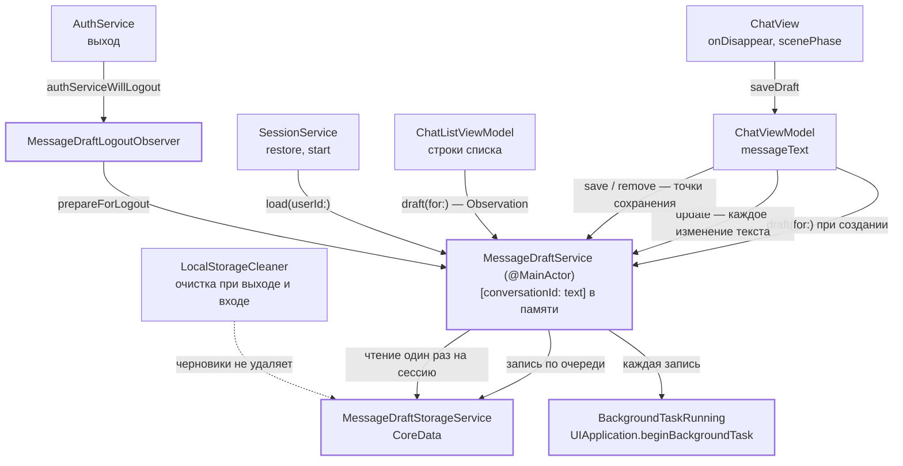

# Черновики сообщений: архитектура клиента

16.10.2026 · Mikhail Kuzmin

Статус: реализовано.

## Цель и требования

Текст, набранный в поле ввода переписки и не отправленный, не должен теряться при уходе с экрана, сворачивании и перезапуске приложения.

1. Черновик хранится в БД и переживает перезапуск приложения. Вместе с текстом запоминается пользователь, который его набрал: другой пользователь на том же устройстве черновик не видит.
2. Черновик переживает выход из аккаунта — и по кнопке «Выйти», и по истечению сессии на сервере: если на устройстве снова войти под тем же пользователем, его черновики на месте.
3. Черновик записывается в БД при уходе с экрана переписки, а также при сворачивании или закрытии приложения. Пустой текст удаляет черновик.
4. При отправке сообщения черновик удаляется сразу, как только поле ввода очистилось.
5. При входе на экран переписки черновик подставляется в поле ввода.
6. Черновиками управляет единый сервис: по id переписки он синхронно отвечает, есть ли черновик и какой у него текст. Кэш читается из БД один раз на сессию — при старте приложения или при входе, дальше тексты берутся из памяти, БД при чтении не трогается.
7. В списке чатов черновик показывается вместо текста последнего сообщения в формате «Черновик: <текст>», где «Черновик:» — тёмно-оранжевым цветом, читаемым в светлой и тёмной теме.

Синхронизации черновиков с сервером нет: черновик живёт только на устройстве.

## Ключевые решения

1. **`MessageDraftService`** — новый сервис уровня приложения (`@MainActor @Observable`, живёт в `DIContainer`). Единственный, кто читает и пишет черновики в БД. В памяти держит словарь `[conversationId: text]` черновиков текущего пользователя. Чтение синхронное и отслеживается Observation: список чатов перерисуется, когда черновик изменится. О выходе из аккаунта сервис узнаёт через отдельный наблюдатель `MessageDraftLogoutObserver` — по образцу `MessageCacheLogoutObserver`, — поэтому `AuthServiceObserver` не входит в протокол сервиса и экраны его методов не видят.
2. **Память меняется при каждом изменении текста, БД — в точках сохранения.** Текстом поля владеет `ChatViewModel` (`messageText`) и при каждом его изменении передаёт текст сервису (`update`) — меняется только словарь в памяти. В БД изменения уходят в точках сохранения: уход с экрана, переход приложения в неактивное состояние или в фон, отправка. Так строка переписки в списке актуальна уже во время возврата к списку — и в анимации, и при жесте «назад», когда список виден из-под уходящего экрана, а `onDisappear` ещё не вызван. Набор текста стоит одной записи в словарь: пока переписка открыта, `ChatListView` скрыт, его `.task` с `observeConversations()` отменён, и строки списка от ввода не пересобираются; при возврате список собирает строки сразу.
3. **Запись в БД — асинхронно и строго по очереди.** Переписки, изменённые в памяти и ещё не записанные, сервис помнит в наборе `dirtyConversationIds`. В точке сохранения все они уходят в БД одной пачкой, записи не обгоняют друг друга — последней записывается последняя версия. Неудавшаяся запись не теряется: переписки остаются в наборе и уходят со следующей пачкой. Уход с экрана без изменений оставляет набор пустым — в БД ничего не пишется.
4. **Черновик пустой, если в нём ничего не остаётся после обрезки** `MessageTextValidator.trimmedCharacters` (пробелы, табуляции, переводы строк, включая юникодные, и невидимые символы нулевой ширины) — так же сервер решает, пусто ли сообщение. Пустой черновик удаляется и из памяти, и из БД. Непустой хранится как есть, без обрезки: пользователь вернётся ровно к тому, что набрал.
5. **Черновики — единственные данные БД, которые переживают выход из аккаунта.** Это сознательное исключение из правила проекта «при выходе БД очищается целиком» (стандарт `ios-swiftui-standards`, раздел «Очистка БД при logout»): остальная БД — кэш серверных данных, его можно загрузить заново, а черновик есть только на устройстве. `LocalStorageCleaner` при выходе и при входе удаляет все сущности, кроме `MessageDraftEntity`. Пользователей разделяет не очистка, а ключ записи — пара `(userId, conversationId)`: сервис загружает в память только черновики текущего пользователя, чужие лежат в БД и в интерфейс не попадают.

   **Компромисс по приватности (принят 16.10.2026):** тексты пользователя A остаются на устройстве (в той же SQLite, что и раньше), когда входит пользователь B, — пока A не войдёт снова и не отправит или не сотрёт их, но не дольше 30 дней с последнего сохранения (решение 9). Интерфейс их B не показывает, но они читаются из файла БД при доступе к файловой системе устройства (бэкап, отладка). Риск того же порядка, что у кэша переписок до выхода: файл защищён стандартной защитой данных iOS. Альтернатива — удалять черновики при входе другого пользователя — отвергнута: она ломает требование 2 для устройства, на котором работают по очереди несколько аккаунтов.
6. **Кэш загружается до показа списка чатов**: при старте — до окончания splash, при входе — до открытия сессии. Иначе экран переписки, открытый раньше загрузки, показал бы пустое поле, а уход с него стёр бы черновик. Загрузку вызывает `SessionService` — единственное место, где сессия восстанавливается и открывается, поэтому новый путь входа не сможет её пропустить.
7. **Черновик привязан к пользователю, открывшему экран, а не к текущей сессии.** `ChatViewModel` запоминает `userId` при создании и передаёт его при каждом изменении и сохранении. Если сессия истекла при открытой переписке (код 2003), экран уходит уже после выхода — набранный текст всё равно записывается в БД этому пользователю и вернётся к нему после входа.
8. **Неудачная загрузка не стирает черновиков в БД.** Если чтение из БД упало, сервис до следующего входа или перезапуска работает «только на запись»: словарь содержит лишь то, что пользователь набрал в этой сессии; непустой текст записывается в БД поверх старого — это более поздняя версия от того же пользователя; пустой текст для переписки, которой нет в словаре, ничего не удаляет — поле было пустым, потому что черновик не загрузился, а не потому, что пользователь его стёр. Повторной загрузки и отложенных изменений нет: локальное чтение на практике не падает (хранилище, которое не открылось, `CoreDataStack` пересоздаёт), и сложность восстановления не окупается.
9. **Черновик живёт 30 дней с последнего сохранения** (`MessageDraftService.draftLifetime`). При каждой загрузке — на старте и при входе — сервис удаляет из БД черновики всех пользователей устройства с `updatedAt` старше 30 дней, затем читает черновики текущего. Так не копятся черновики пропавших переписок и пользователей, которые больше не входят на устройстве, и ограничивается срок хранения чужих текстов (компромисс решения 5). Срок отсчитывается от последнего сохранения, а не от создания: черновик, к которому возвращались, живёт дальше. Удаление идёт после очереди записи, поэтому только что сохранённый черновик его не задевает; ошибка удаления логируется и загрузку не останавливает — просроченные удалятся при следующей.



## Хранение в БД

Новая версия модели `Chatik 8` с сущностью `MessageDraftEntity`; остальные сущности не меняются, миграция лёгкая (автоматическая).

| Атрибут | Тип | Назначение |
| --- | --- | --- |
| `userId` | Integer 64 | пользователь, набравший текст |
| `conversationId` | Integer 64 | переписка |
| `text` | String | текст черновика, необрезанный |
| `updatedAt` | Date | когда черновик сохранён последний раз (локальное время); от него отсчитывается срок жизни черновика (решение 9) |

- Ограничение уникальности — `(userId, conversationId)`: повторное сохранение обновляет запись (upsert, как в `OutgoingMessageStorageService`).
- Индекс по `userId` — загрузка черновиков пользователя одним запросом.
- `LocalStorageCleaner.clearAll()` получает список сущностей-исключений `preservedEntityNames = ["MessageDraftEntity"]`: по-прежнему удаляет записи всех сущностей модели, не перечисляя их (новая сущность очищается автоматически), кроме перечисленных. Исключение — явный список в самом очистителе, а не признак в модели: так видно в одном месте, что переживает выход. `SessionService` вызывает `clearAll()` и при выходе, и при входе — черновики переживают оба вызова. Очистка после миграции с моделей «в секундах» (`CoreDataStack.serverTimeEntityNames`) черновики тоже не трогает.
- Пересоздание повреждённого хранилища (`CoreDataStack.destroyStores`) черновики теряет — допустимо, как и для очереди отправки.

Хранилище — `MessageDraftStorageService` по образцу `OutgoingMessageStorageService`:

```swift
/// Изменение черновика одной переписки.
enum MessageDraftChange: Equatable, Sendable {
    /// Записать текст: upsert по `userId` и `conversationId`.
    case save(String)
    /// Удалить черновик, если запись есть.
    case delete
}

protocol MessageDraftStorageServiceProtocol {
    /// Черновики пользователя: `conversationId` → текст.
    func fetchAll(userId: Int) async throws -> [Int: String]
    /// Применяет изменения черновиков пользователя одним фоновым контекстом.
    func apply(_ changes: [Int: MessageDraftChange], userId: Int) async throws
    /// Удаляет черновики всех пользователей, сохранённые последний раз раньше `date`.
    func deleteAll(updatedBefore date: Date) async throws
}
```

- Один метод с пачкой изменений, а не пара `save` / `delete`: точка сохранения отправляет все переписки из `dirtyConversationIds` (решение 3), и всё это должно уйти одним `context.save()`.
- Изменение — перечисление, а не `String?`: в словаре `[Int: String?]` присваивание `changes[id] = nil` удаляет ключ, а не записывает удаление, — такую ошибку легко допустить и трудно заметить.

## Сервис черновиков

```swift
@MainActor
protocol MessageDraftServiceProtocol: AnyObject, MessageDraftLoading {
    /// Текст черновика переписки; `nil` — черновика нет. Читается из памяти, отслеживается Observation.
    func draft(for conversationId: Int) -> String?
    /// `true`, если у переписки есть черновик.
    func hasDraft(for conversationId: Int) -> Bool
    /// Меняет черновик пользователя `userId` в памяти — при каждом изменении поля ввода. БД не трогает.
    func update(text: String, conversationId: Int, userId: Int)
    /// Меняет черновик в памяти, как `update`, и ставит в очередь записи все незаписанные изменения
    /// пользователя `userId` — в точках сохранения.
    func save(text: String, conversationId: Int, userId: Int)
    /// Удаляет черновик пользователя `userId` из памяти и из БД — после отправки сообщения.
    func remove(conversationId: Int, userId: Int)
}

/// Загрузка черновиков при открытии сессии — всё, что о сервисе черновиков знает `SessionService`.
@MainActor
protocol MessageDraftLoading: AnyObject {
    /// Загружает черновики пользователя из БД в память; повторный вызов для того же пользователя после успешной
    /// загрузки ничего не делает.
    func load(userId: Int) async
}

/// Реакция сервиса черновиков на выход — всё, что о нём знает `MessageDraftLogoutObserver`.
@MainActor
protocol MessageDraftLogoutHandling: AnyObject {
    /// Сессия заканчивается: незаписанные изменения уходят в очередь записи, память очищается.
    func prepareForLogout()
}
```

`userId` в `update`, `save` и `remove` — пользователь, открывший экран переписки (решение 7), а не текущая сессия: экран может уйти уже после выхода из аккаунта. `remove` устроен так же, как `save` с пустым текстом.

Устройство:

- **Память.**
  - `private(set) var drafts: [Int: String]` — черновики, которые видит интерфейс. `draft(for:)` и `hasDraft(for:)` — чтение словаря, O(1). Observation отслеживает словарь целиком: изменение любого черновика пересобирает все строки списка, но неизменённые строки берутся из `CachedRow`, а пока открыта переписка, список за черновиками не следит (решение 2).
  - `state` — чьи черновики в памяти и что с ними можно делать:

    ```swift
    private enum State {
        /// Загрузки ещё не было: изменения не принимаются.
        case idle
        /// Черновики пользователя загружены в словарь.
        case loaded(userId: Int)
        /// Загрузка не удалась: в словаре только набранное в этой сессии (решение 8).
        case loadFailed(userId: Int)
        /// Сессия пользователя закончилась: словарь пуст, изменения пишутся только в БД (решение 7).
        /// Пустой текст удаляет черновик только у `deletableConversationIds` (решение 8).
        case loggedOut(userId: Int, deletableConversationIds: Set<Int>)
    }
    ```

    Одно поле вместо нескольких независимых `userId?`: противоречивые сочетания («загружен и вышел», «загрузка упала у одного, загружен другой») невозможны.
  - `dirtyConversationIds: Set<Int>` — переписки, изменённые в памяти и ещё не записанные в БД (в том числе после неудачной записи).
- **Загрузка.** `load(userId:)` дожидается очереди записи (поздняя запись прошлой сессии того же пользователя должна попасть в БД раньше чтения), удаляет просроченные черновики — `deleteAll(updatedBefore: now() − draftLifetime)` (решение 9) — и читает `fetchAll(userId:)`. Одновременно идёт не больше одной загрузки: повторный вызов дожидается текущей; вызов для пользователя в `.loaded` ничего не делает.
  - Успех: словарь заменяется прочитанным, `dirtyConversationIds` очищается, `state = .loaded(userId)`.
  - Ошибка: логируется; словарь и `dirtyConversationIds` очищаются, `state = .loadFailed(userId)`.
- **Изменение в памяти (`update`).** Зависит от `state` и `userId`:
  - `.loaded` того же пользователя — пустой текст убирает переписку из словаря, непустой записывает. Если значение изменилось, переписка попадает в `dirtyConversationIds`, а список чатов узнаёт об изменении через Observation.
  - `.loadFailed` того же пользователя — так же, но пустой текст для переписки, которой нет в словаре, ничего не делает (решение 8).
  - любое другое сочетание — ничего не делает: в `.loggedOut` словарь принадлежит следующей сессии.
- **Сохранение (`save`).** Сначала `update`, затем:
  - `.loaded` или `.loadFailed` того же пользователя — если `dirtyConversationIds` не пуст, в очередь записи уходит пачка: для каждой переписки из набора — `.save(text)` из словаря или `.delete`, если её там нет.
  - `.loggedOut` того же пользователя — экран ушёл после выхода (истечение сессии при открытой переписке): словарь не трогается, в очередь уходит одно изменение этой переписки. Пустой текст даёт `.delete`, только если переписка входит в `deletableConversationIds`: была в словаре или в `dirtyConversationIds` к моменту выхода либо сохранялась после него. Иначе черновика в БД нет или он не загрузился (`.loadFailed` до выхода), и защита решения 8 не должна теряться при выходе.
  - любое другое сочетание — ничего не делает.
- **Очередь записи.** Каждая запись ждёт предыдущую (`pendingWrite = backgroundTasks.run { await previous?.value; … }`), поэтому записи применяются в порядке вызовов. Успех снимает с пометки переписки, текст которых в словаре не изменился с момента сборки пачки; изменённые за время записи остаются помеченными до следующей точки сохранения. Ошибка логируется, пометки остаются — переписки уйдут со следующей пачкой; память не откатывается — пользователь видит свой текст. Пометка снимается только после записи, поэтому переписка, запись которой ещё идёт, попадает и в следующую пачку: повторная запись того же текста безвредна, а отдельный учёт «записывается сейчас» не окупается. Если за время записи сменилось `state` (выход, загрузка другого пользователя), результат записи к пометкам не применяется.
- **Фон.** Каждая запись выполняется внутри фоновой задачи системы через протокол-обёртку `BackgroundTaskRunning` (в приложении — `UIApplication.beginBackgroundTask`, в тестах — мок): сервис не знает, вызвана ли запись уходом с экрана или уходом приложения в фон, а для записи при уходе с экрана фоновая задача почти ничего не стоит. `beginBackgroundTask` вызывается синхронно внутри `save`, до создания задачи записи: запрошенная из уже запущенной `Task`, она может опоздать — система успеет приостановить приложение. Обработчик истечения завершает фоновую задачу (`endBackgroundTask`), иначе система завершит приложение за просроченную задачу; сама запись при этом не отменяется — если система приостановит приложение раньше, она продолжится при возврате.

  ```swift
  @MainActor
  protocol BackgroundTaskRunning {
      /// Синхронно просит систему не приостанавливать приложение и запускает работу. Фоновая задача завершается
      /// вместе с работой или по истечении отведённого системой времени; работа при этом не отменяется.
      /// - Returns: задача с работой — по ней очередь записи дожидается предыдущей записи.
      @discardableResult
      func run(named name: String, _ work: @escaping @MainActor () async -> Void) -> Task<Void, Never>
  }
  ```
- **Выход из аккаунта.** `MessageDraftLogoutObserver` в фазе `authServiceWillLogout` вызывает `prepareForLogout()`: незаписанные изменения из `dirtyConversationIds` уходят в очередь записи, `.loaded` / `.loadFailed` переходит в `.loggedOut` того же пользователя с `deletableConversationIds` = ключи словаря ∪ `dirtyConversationIds`, словарь и набор очищаются — следующая сессия не увидит черновиков прежнего пользователя. Записи в БД остаются: `LocalStorageCleaner` их не удаляет, и при входе того же пользователя `load(userId:)` вернёт их в память. Ждать очередь записи при выходе не нужно — БД с черновиками не очищается, поэтому запись, закончившаяся после выхода, ничего не портит.

## Экран переписки

- **Вход.** `ChatViewModel.init` получает `MessageDraftServiceProtocol`, запоминает `draftUserId = sessionService.currentUser?.userId` и подставляет черновик: `messageText = draftService.draft(for: conversationId) ?? ""`. Кэш к этому моменту загружен (решение 6), чтение синхронное — поле заполнено с первого кадра. Без пользователя (`draftUserId == nil`) экран черновики не меняет и не сохраняет.
- **Набор текста.** `didSet` у `messageText` вызывает `draftService.update(text:conversationId:userId:)` — меняется только память (решение 2).
- **`init` без записи.** `ChatViewModel` создаётся прямо в замыкании `navigationDestination` (`ChatListRootView`), и SwiftUI может выполнить его несколько раз, оставив в `@State` только первый экземпляр. Поэтому `init` только читает черновик: наблюдатели свойств в `init` не срабатывают, и подстановка черновика в `messageText` ничего не пишет в сервис. Всё остальное, что пишет в сервис, вызывают ввод пользователя и View (`onDisappear`, `scenePhase`, отправка).
- **Уход с экрана.** `ChatView` в `.onDisappear` вызывает `viewModel.saveDraft()` → `draftService.save(text: messageText, conversationId:, userId: draftUserId)`. Память к этому моменту уже актуальна — сохранение только записывает изменения в БД. Прерванный жест «назад» `onDisappear` не вызывает — экран остаётся открытым, сохранять нечего.
- **Неактивное состояние, сворачивание и закрытие.** `ChatView` следит за `@Environment(\.scenePhase)` и при переходе в `.inactive` или `.background` вызывает тот же `saveDraft()`. `.inactive` нужен для закрытия из переключателя приложений: там приложение неактивно, и переход в `.background` перед закрытием не гарантирован. Шторка и системные алерты тоже переводят приложение в `.inactive`, но повторное сохранение без изменений в БД не пишет (решение 3). `AppRouter.didChangeScenePhase` `.inactive` пропускает, чтобы не рвать WebSocket, — у черновика такой причины нет. Закрытие из переключателя проверить на устройстве.
- **Отправка.** `didTapSend()` после `messageText = ""` вызывает `draftService.remove(conversationId:, userId: draftUserId)`: черновик удаляется из памяти и из БД сразу, не дожидаясь ухода с экрана и ответа сервера.
- **Ручная очистка поля.** Отдельно не обрабатывается: из памяти черновик пропадает сразу (через `update`), из БД — в ближайшей точке сохранения.

## Список чатов

- `ChatListViewModel` получает `MessageDraftServiceProtocol`; `makeRows()` читает `draftService.draft(for: conversation.id)` для каждой переписки. Чтение идёт внутри `withObservationTracking`, поэтому изменение черновика пересобирает строки тем же механизмом, что и изменение переписки, — не чаще раза в `rowsUpdateInterval`. `CachedRow` хранит и сравнивает черновик: строка без изменений берётся из кэша.
- Черновик передаётся в сборку строки: `RowBuilder` становится `(Conversation, CachedUser?, String?, MessageTimeFormatter) -> ChatRowDisplayModel`, `ChatRowDisplayModel.init(conversation:opponent:draft:timeFormatter:)`. Тесты кэша строк, подменяющие `makeRow`, обновляются под новую сигнатуру.
- `ChatRowDisplayModel.preview` становится перечислением:

  ```swift
  enum ChatRowPreview: Equatable {
      /// Текст последнего сообщения; «Новый чат» — сообщений нет; пустая строка — строка-заглушка без данных.
      case message(String)
      /// Черновик, готовый к показу: цветной префикс «Черновик:», пробел и текст в одну строку.
      case draft(AttributedString)
  }
  ```

  Черновик в приоритете: если он есть, строка показывает его, даже если сообщений в переписке нет. Без черновика переписка без сообщений показывает «Новый чат» (`ChatListStrings.rowNoMessages`, ключ `chat_list.row.no_messages`) — обычным цветом превью, без префикса.
- Превью черновика целиком собирает `ChatRowDisplayModel` (форматирование — ответственность слоя, готовящего данные, а не View):
  - текст сначала обрезается до первых 200 символов — строка всё равно показывает одну строку, а вставленный длинный текст не должен обрабатываться целиком при каждой пересборке;
  - переводы строк и повторяющиеся пробельные символы заменяются одним пробелом, края обрезаются по `MessageTextValidator.trimmedCharacters` (как и при решении, пуст ли черновик, — невидимые символы нулевой ширины в превью не попадают) — иначе в одной строке был бы виден только первый абзац;
  - префикс `ChatListStrings.rowDraftPrefix` получает `foregroundColor = Color.draftLabel`, затем пробел и текст без цвета.
- `ChatRowView` показывает `Text(attributed)` с тем же стилем, что превью сообщения (`.subheadline`, `.secondary`, `lineLimit(1)`): части без цвета наследуют `.secondary`, обрезка работает по всей строке.
- Положение переписки в списке и время в строке черновик не меняет: порядок задаёт сервер, переписку поднимают только сообщения.

### Строки

| Ключ | ru | en |
| --- | --- | --- |
| `chat_list.row.draft_prefix` | `Черновик:` | `Draft:` |
| `chat_list.row.no_messages` | `Новый чат` | `New chat` |

`chat_list.row.no_messages` совпадает по тексту с кнопкой создания `chat_list.create`, но ключ отдельный: это разные смыслы, и переводы могут разойтись.

Пробел после двоеточия добавляет `ChatRowDisplayModel`, а не строка — так он не теряется при переводе.

### Цвет «Черновик:»

Новый цвет `DraftLabel` в `Assets.xcassets` с вариантами для светлой и тёмной темы. Системный `.orange` на белом фоне недостаточно контрастен для мелкого текста, поэтому оттенки подобраны отдельно под требование WCAG AA (не меньше 4,5:1):

| Тема | Цвет | Фон | Контраст |
| --- | --- | --- | --- |
| Светлая | `#C2410C` | белый `#FFFFFF` | ≈ 5,2 : 1 |
| Тёмная | `#FF8A3D` | чёрный `#000000` | ≈ 9,0 : 1 |
| Тёмная | `#FF8A3D` | `secondarySystemBackground` `#1C1C1E` | ≈ 7,2 : 1 |

В тёмной теме «тёмно-оранжевый» в буквальном смысле на тёмном фоне не читается, поэтому оттенок светлее, но остаётся насыщенным оранжевым. Проверить на подсветке выбранной строки (`selectedConversationId`).

## Порядок при старте, входе и выходе

`SessionService` получает `MessageDraftLoading` (необязательный параметр: тестам и превью, которым черновики не нужны, его можно не передавать) и сам загружает черновики перед тем, как сессия станет видна корню (решение 6):

- **Старт.** `SessionService.restore()`: прочитав пользователя из `UserDefaults`, вызывает `await draftLoader.load(userId:)` (если сессия есть) и только затем поднимает `isRestored`. Ошибка загрузки `isRestored` не задерживает (решение 8). `AppRouter.restoreSession()` не меняется: список, очередь отправки и WebSocket запускаются после `restore()`, как и сейчас. Обычно чтение укладывается в минимальное время splash, но `load` дожидается открытия хранилища (`BackgroundLoadedContainer`): при первом запуске после миграции на `Chatik 8` — вместе с миграцией и проверкой `storesUseSecondsModel` — splash может задержаться дольше.
- **Вход.** `SessionService.start(user:)`: сначала очистка БД (черновики не трогает), затем `await draftLoader.load(userId: user.userId)`, затем `currentUser = user` — корень переключится на список чатов уже с загруженными черновиками. `AuthViewModel` не меняется.
- **Выход.** `DIContainer` подписывает `MessageDraftLogoutObserver` на `AuthService` (`addObserver`); в фазе `authServiceWillLogout` сервис отправляет незаписанные изменения в очередь записи, очищает память и переходит в `.loggedOut`, затем `SessionService` в фазе `authServiceDidLogout` очищает БД — все сущности, кроме черновиков. Если сессию завершили в обход `AuthService` (`end()` / `expire()` напрямую), память не очищается, но следующий `load(userId:)` при входе всё равно заменит словарь.

## Ограничения

- **Черновики пропавших переписок удаляются только по сроку.** Если переписка исчезла (пользователя исключили из группы, переписку удалили), её черновик остаётся в БД до истечения 30 дней (решение 9): список чатов приходит постранично, и по нему нельзя уверенно сказать, что переписки больше нет.
- **Срок проверяется только при загрузке.** Пока приложение не перезапускают и из аккаунта не выходят, просроченные черновики в БД не удаляются, а черновики в памяти живут до конца сессии: удалять текст, который пользователь видит, посреди сессии хуже, чем держать его дольше срока.
- **Срок зависит от часов устройства.** `updatedAt` — локальное время: если перевести часы вперёд, черновики удалятся раньше срока, если назад — позже.
- **Черновики прежних пользователей на устройстве** — принятый компромисс, см. решение 5.
- **Повреждённое хранилище** пересоздаётся без черновиков (`CoreDataStack.destroyStores`).
- **Неудавшаяся запись в БД без следующей точки сохранения** теряется при завершении приложения: повтор идёт только со следующей пачкой (решение 3).

## Затронутые файлы

| Файл | Изменение |
| --- | --- |
| `Storage/Chatik.xcdatamodeld/Chatik 8.xcdatamodel` | новая версия модели с `MessageDraftEntity`, текущая версия |
| `Storage/Entities/MessageDraftEntity.swift` | новая Entity |
| `Storage/MessageDraftStorageService.swift` | новое хранилище, `MessageDraftChange`, удаление просроченных `deleteAll(updatedBefore:)` |
| `Storage/LocalStorageCleaner.swift` | `preservedEntityNames`: черновики не удаляются; doc-комментарии протокола и класса: БД — кэш серверных данных пользователя плюс черновики, которые переживают выход |
| `Services/Session/SessionService.swift` | загрузка черновиков в `restore()` и `start(user:)` через `MessageDraftLoading`; doc-комментарии класса, `start(user:)` и `end()`: БД очищается, кроме черновиков, чужие черновики скрывает ключ `userId` |
| `Services/MessageDraft/MessageDraftService.swift` | новый сервис, срок жизни `draftLifetime` и `MessageDraftLogoutObserver` |
| `Services/MessageDraft/BackgroundTaskRunner.swift` | `BackgroundTaskRunning` и реализация поверх `UIApplication` |
| `DIContainer.swift` | создание сервиса до `SessionService`, подписка `MessageDraftLogoutObserver` на выход |
| `Screens/Chat/ViewModel/ChatViewModel.swift` | подстановка черновика, `update` в `didSet` у `messageText`, `saveDraft()`, удаление при отправке |
| `Screens/Chat/View/ChatView.swift` | `onDisappear` и `scenePhase` (`.inactive`, `.background`) |
| `Screens/ChatList/ViewModel/ChatListViewModel.swift` | чтение черновиков в `makeRows()`, черновик в `CachedRow` и `RowBuilder` |
| `Screens/ChatList/ViewModel/ChatRowDisplayModel.swift` | `ChatRowPreview`, сборка превью черновика |
| `Screens/ChatList/View/Subviews/ChatRowView.swift` | показ превью черновика, превью в `#Preview` |
| `Screens/ChatList/ChatListStrings.swift`, `*.lproj/ChatList.strings` | `chat_list.row.draft_prefix` |
| `Assets.xcassets/DraftLabel.colorset` | цвет префикса |
| `Preview Content/PreviewDependencies.swift` | сервис черновиков для превью, `MessageDraftLoading` для `SessionService` |

Вне репозитория: стандарт `ios-swiftui-standards`, раздел «Очистка БД при logout», — исключение для данных, существующих только на устройстве (черновики), с разделением пользователей по ключу.

## Тесты

- **`MessageDraftStorageService`**: upsert по `(userId, conversationId)`; `apply` с `.save` и `.delete` в одной пачке; удаление несуществующего не падает; `fetchAll` возвращает только черновики переданного пользователя; `deleteAll(updatedBefore:)` удаляет черновики всех пользователей, сохранённые раньше границы, и не трогает сохранённые на границе и позже; повторное сохранение продлевает срок.
- **`MessageDraftService`**:
  - загрузка из БД; `load` дожидается очереди записи; до чтения удаляются черновики старше `draftLifetime`, ошибка удаления не останавливает загрузку; `load` другого пользователя заменяет словарь и не видит чужих черновиков; повторный `load` того же пользователя не читает БД;
  - `update` меняет словарь и не пишет в БД; пустой и пробельный текст убирает черновик из словаря;
  - `save` пишет одной пачкой все переписки, изменённые через `update`; `save` без изменений не пишет в БД; записи применяются в порядке вызовов; `remove` удаляет из словаря и из БД;
  - ошибка записи: переписка остаётся помеченной, следующий `save` другой переписки повторяет неудавшуюся; текст, изменённый во время записи, остаётся помеченным после её успеха;
  - ошибка загрузки: `update` / `save` с непустым текстом показывают его в словаре и пишут в БД поверх старого; пустой `save` и `remove` для переписки, которой нет в словаре, не удаляют черновик из БД; пустой `save` после непустого в той же сессии удаляет;
  - с пользователем, для которого не было `load`, `update`, `save` и `remove` ничего не делают;
  - выход: незаписанные изменения уходят в БД, память очищается, БД — нет; после выхода `save` с `userId` вышедшего пользователя пишет только в БД, `update` ничего не делает, с другим `userId` — ничего не делает; после неудачной загрузки и выхода пустой `save` не удаляет невиденный черновик, а после непустого `save` вслед за выходом — удаляет; `load` того же пользователя после выхода возвращает его черновики, включая записанный после выхода;
  - каждая запись выполняется внутри `BackgroundTaskRunning.run`, и `run` вызывается синхронно внутри `save`.
- **`LocalStorageCleaner`**: `clearAll()` удаляет записи всех сущностей, кроме `MessageDraftEntity`.
- **`SessionService`**: `restore()` загружает черновики восстановленного пользователя до `isRestored`, без пользователя — не загружает; `start(user:)` загружает черновики до `currentUser`; черновики переживают `end()` и `start(user:)`.
- **`ChatViewModel`**: черновик подставляется в поле при создании; `init` ничего не пишет в сервис; изменение `messageText` вызывает `update` с `userId` пользователя, открывшего экран; `saveDraft()` передаёт сервису текст и этот `userId`; отправка удаляет черновик.
- **`ChatRowDisplayModel` / `ChatListViewModel`**: черновик вытесняет последнее сообщение; черновик в переписке без сообщений вытесняет «Новый чат»; без черновика и сообщений — «Новый чат»; переводы строк схлопываются; невидимые символы по краям обрезаются; длинный текст обрезается; префикс окрашен, текст — нет; изменение черновика пересобирает строку, а не берёт её из кэша.
- **Миграция**: хранилище версии `Chatik 7` открывается моделью `Chatik 8` без потери данных.
