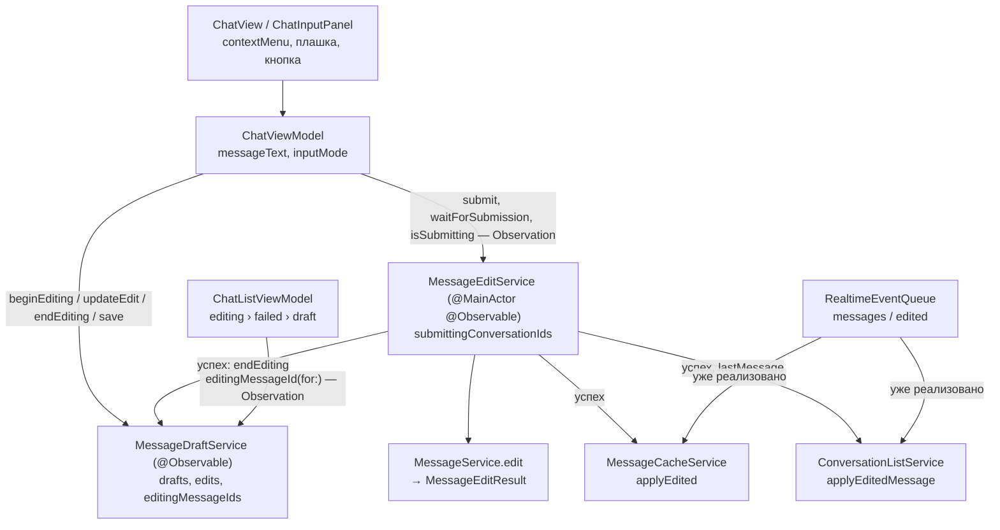

# Редактирование сообщений: архитектура клиента

19.10.2026 · Mikhail Kuzmin

Статус: реализовано 19.10.2026.

## Цель и требования

Пользователь может исправить текст своего сообщения, уже доставленного на сервер. Метод `POST /messages/edit` и WS-событие `messages` / `edited` на сервере уже есть.

1. Редактировать можно только свои сообщения, доставленные на сервер (`MessageDeliveryState.delivered`). Отправляющиеся и неотправленные сообщения, а также сообщения неизвестного типа редактировать нельзя.
2. Долгое нажатие на сообщение открывает список действий. Пока в нём одно действие, «Редактировать», и только у своих сообщений. Пока режим редактирования включён, действие скрыто у всех сообщений: чтобы отредактировать другое, текущее редактирование нужно сначала закрыть (принято 19.10.2026). У сообщений без действий долгое нажатие ничего не делает.
3. При включении редактирования текст из поля ввода, если он непустой, остаётся черновиком, а в поле подставляется текст редактируемого сообщения. После выхода из режима редактирования в поле возвращается черновик.
4. Пока режим редактирования включён, над полем ввода закреплена плашка: заголовок «Редактирование», текст редактируемого сообщения в одну строку и справа крестик, который выключает режим.
5. Подтверждение редактирования, в отличие от отправки, не происходит мгновенно. Пока запрос идёт, кнопка заблокирована и показывает индикатор, а крестик скрыт. После успеха режим выключается, сообщение в ленте обновляется. Если текст после обрезки не отличается от текущего текста сообщения, режим выключается сразу, без запроса (принято 19.10.2026). Если текст пуст после обрезки, кнопка неактивна, как у пустого нового сообщения: удаления сообщений через пустую правку нет (принято 19.10.2026). При ошибке показывается ошибка, режим остаётся включённым: можно отправить ещё раз или закрыть режим.
6. Если уйти с экрана в режиме редактирования, набранный, но не отправленный текст запоминается. При следующем входе на экран режим включается снова, с этим текстом.
7. В списке чатов незавершённое редактирование показывается фразой «Редактирование активно» цветом слова «Черновик:». Оно в приоритете над неотправленным сообщением и черновиком. Если пользователь вернулся в список во время запроса и запрос завершился успешно, «Редактирование активно» из строки пропадает.
8. Событие `messages` / `edited` (например, о правке с другого устройства) меняет сообщение в ленте, а также текст последнего сообщения в списке чатов, если отредактировано именно последнее сообщение.
9. Отредактированное сообщение, своё или чужое, показывается в ленте с пометкой «Изменено» в подвале пузыря перед временем. Пометка появляется сразу после успешной правки, а для правки с другого устройства — по событию `edited` или после синхронизации.

## Как сейчас

- **API.** `MessageEndpoint.edit(messageId:newText:)` и `MessageService.edit(messageId:newText:) -> Message` уже есть; doc-комментарий `MessageEndpoint.edit` называет ответом `MessageResponse`. Ответ `/messages/edit` содержит `lastMessage`, если отредактировано последнее сообщение переписки ([API-изменения от 13.10.2026](api-changes/2026-10-13-conversation-position-and-ms-time.md)), но `MessageResponse` это поле отбрасывает. Ошибки: `6001` — сообщения нет, `6003` — сообщение чужое (`CommonStrings.errorMessageEditForbidden` уже есть), `1005` — недопустимый текст. Если текст после обрезки совпал с текущим, сервер возвращает сообщение без изменений и без `lastMessage`.
- **WS-событие `edited` уже обрабатывается** (требование 8 по большей части выполнено):
  - `MessageCacheService.handle(.messageEdited)` обновляет сообщение, если оно есть в БД, а переписка синхронизирована, и публикует `.upserted`. `MessagesListService` выдаёт новый снимок, лента пересобирается. В несинхронизированной переписке правку подхватит следующая синхронизация (`updatedBlockIds`, [messages-sync-architecture.md](messages-sync-architecture.md)).
  - `ConversationListService.handle(.messageEdited)` с `lastMessage` сливает патч (правило 2 `ConversationMerger`: тот же `messageId`, больший `updatedAt`). Без `lastMessage` ничего не делает.
  - Пометка в пузыре уже есть (`MessageDisplayModel.editedLabel` по `Message.isEdited`, в подвале `MessageBubbleView` перед временем), но со строчной буквы: `chat.message.edited` — «изменено» / «edited». По требованию 9 строка меняется на «Изменено» / «Edited».
- **Черновики.** `MessageDraftService` (`@MainActor @Observable`) держит в памяти `[conversationId: String]`, загружает его один раз на сессию (`SessionDataLoading`), пишет в БД в точках сохранения цепочкой записей, переживает выход (`MessageDraftEntity` с ключом `(userId, conversationId)` входит в `preservedEntityNames`) и удаляет записи старше `draftLifetime`. `ChatViewModel.messageText` в `didSet` меняет черновик в памяти, `saveDraft()` вызывается в `onDisappear` и при уходе приложения из `.active`.
- **Действия с сообщением.** Есть только выбор «повторить / удалить» у неотправленного: тап, `confirmationDialog` на пузыре (`MessageBubbleView`). Долгого нажатия нет.
- **Список чатов.** `ChatListViewModel.localPreview(for:)` выбирает `ChatRowLocalPreview` с приоритетом `failed` › `draft`. `ChatRowDisplayModel.labeledPreview(prefix:color:text:)` собирает строку с цветным префиксом, цвет черновика — `DraftLabel`.

## Ключевые решения

1. **Состояние редактирования хранит `MessageDraftService`, в той же записи, что и черновик.** Редактирование — второе состояние поля ввода переписки, и требования к нему совпадают с требованиями к черновику: переживает уход с экрана, перезапуск и выход, принадлежит пользователю, синхронно читается списком чатов через Observation, удаляется по сроку. Сервис черновиков уже решает все эти задачи: загрузка на сессию, состояния `loaded` / `loadFailed` / `loggedOut`, пачечная запись в фоновой задаче, срок жизни. Отдельный сервис с отдельной сущностью повторил бы этот механизм целиком, а две записи об одной переписке пришлось бы согласовывать при выходе и по сроку.

   Требование 3 при этом выполняется само: черновик в режиме редактирования не трогается. Поле ввода просто показывает и меняет текст правки, а не текст черновика. После выхода из режима в поле возвращается неизменившийся черновик. Отдельного «отложить черновик» и «восстановить черновик» нет, а значит, нет и пути, где черновик теряется.

   Имя сервиса не меняется: переименование в «состояние поля ввода» затронуло бы список чатов, сессию и тесты без изменения поведения. Doc-комментарий сервиса описывает оба состояния.
2. **Запрос редактирования выполняет сервис уровня приложения `MessageEditService`, а не экран.** По требованию 7 запрос должен завершиться и убрать «Редактирование активно» из списка, даже если экран уже закрыт. Задача экрана отменяется при уходе (`.task`), поэтому запрос живёт в сервисе, как отправка в `MessageSendQueue`. Сервис после успеха записывает сообщение в кэш, обновляет превью в списке и выключает режим в `MessageDraftService`. Экран только запускает запрос, показывает индикатор по `isSubmitting(conversationId:)` и узнаёт результат, если ещё открыт.
3. **Результат правки применяется сразу по ответу, а не по WS-событию.** Как и при отправке, ответ — это готовая версия сообщения. Ждать события нельзя: соединения может не быть, и тогда лента и список остались бы со старым текстом. Новый метод `MessageCacheServiceProtocol.applyEdited(_:)` обновляет сообщение, если оно есть в БД (правка не создаёт записей, иначе в непрерывном кэше появилась бы дыра, как и у события `edited`). Он сдвигает `syncMark` при признаке синхронизации и публикует `.upserted`. Превью в списке обновляется через `ConversationPositionUpdating.applyEditedMessage(_:lastMessage:)` тем же правилом слияния. Последующее эхо-событие `edited` по тому же сообщению ничего не меняет: слияние идемпотентно, побеждает больший `updatedAt`.
4. **Режим экрана хранится во ViewModel и сверяется с сервисом черновиков в явных точках.** При открытии экрана режим берётся из `draftService.edit(for:)`; дальше ViewModel меняет его сама: включение, крестик, подтверждение без изменений и успех запроса (исход `submit` или `waitForSubmission`, после которого режим сверяется с `editingMessageId(for:)`). Вычислять режим по сервису нельзя: при выходе из аккаунта сервис очищает память, и вычисляемый режим принял бы выход за выключение редактирования — в поле подставился бы пустой черновик, а сохранение при уходе с экрана удалило бы настоящий черновик в БД. Отмена запроса выходом режим не трогает. Список чатов, которому важен только факт режима, по-прежнему читает `editingMessageId(for:)` через Observation.
5. **Выход из аккаунта отменяет запрос, а режим редактирования сохраняется.** Так же поступает очередь отправки (решение 6 в [unsent-messages.md](unsent-messages.md)): ответ не должен применяться к кэшу и списку закрывающейся сессии. Если запрос успел дойти до сервера, после входа режим включится с тем же текстом, а повторная отправка ничего не изменит: сервер вернёт сообщение без изменений.
6. **Индикатор отправки живёт только в памяти.** Если приложение закрыли во время запроса, после запуска режим включён без индикатора, и пользователь отправляет правку снова. Автоматического повтора нет: в отличие от нового сообщения, устаревшая правка может затереть более позднюю, сделанную с другого устройства.
7. **Список действий собирается при сборке ленты.** `MessageDisplayModel` получает `actions: [MessageAction]`, которые вычисляются вне main вместе с остальной моделью. View только показывает `contextMenu`, если список непустой. Новое действие («Копировать», «Удалить») добавляется вариантом перечисления и правилом в одном месте.



## API

`MessageService.edit` возвращает `lastMessage` вместе с сообщением:

```swift
/// Ответ `/messages/edit`: сообщение и новое превью переписки, если отредактировано последнее сообщение.
struct MessageEditResult: Decodable, Equatable, Sendable {
    let message: Message
    /// `nil` — отредактировано не последнее сообщение или текст не изменился.
    let lastMessage: LastMessage?
}

protocol MessageServiceProtocol: Sendable {
    // …
    /// Заменяет текст своего сообщения.
    func edit(messageId: Int, newText: String) async throws -> MessageEditResult
}
```

`MessageResponse` остаётся для `/messages/send`.

## Хранение в БД

Новая версия модели `Chatik 10`, меняется только `MessageDraftEntity`, миграция лёгкая.

| Атрибут | Тип | Зачем |
| --- | --- | --- |
| `editMessageId` | `Int64`, по умолчанию `0` | редактируемое сообщение; `0` — режим выключен |
| `editOriginalText` | `String?` | текст сообщения на момент включения режима — для плашки, пока сообщения нет в окне ленты |
| `editText` | `String?` | набранный текст правки; хранится как есть, пустая строка допустима |

`text` становится необязательным по смыслу: запись существует, если есть черновик **или** правка. Срок жизни (`draftLifetime` по `updatedAt`) общий: записи пишутся одной операцией.

`MessageDraftStorageService`:

```swift
/// Локальное состояние поля ввода переписки.
struct MessageDraft: Equatable, Sendable {
    /// Черновик нового сообщения; `nil` — черновика нет.
    var text: String?
    /// Незавершённое редактирование; `nil` — режим выключен.
    var edit: MessageEditDraft?

    var isEmpty: Bool { text == nil && edit == nil }
}

/// Незавершённое редактирование своего сообщения.
struct MessageEditDraft: Equatable, Sendable {
    let messageId: Int
    /// Текст сообщения на момент включения режима.
    let originalText: String
    /// Набранный текст правки.
    var text: String
}

/// Изменение записи одной переписки: меняются только переданные поля.
struct MessageDraftChange: Equatable, Sendable {
    /// `nil` — не трогать; `.some(nil)` — удалить черновик; `.some(text)` — записать.
    var text: String??
    /// `nil` — не трогать; `.some(nil)` — выключить режим; `.some(edit)` — записать.
    var edit: MessageEditDraft??

    /// Изменение только черновика: `.draft(nil)` — удалить.
    static func draft(_ text: String?) -> MessageDraftChange
    /// Изменение только правки: `.edit(nil)` — выключить режим.
    static func edit(_ edit: MessageEditDraft?) -> MessageDraftChange
}

protocol MessageDraftStorageServiceProtocol {
    /// Состояния полей ввода пользователя по `conversationId`.
    func fetchAll(userId: Int) async throws -> [Int: MessageDraft]
    /// Применяет изменения к записям (upsert по `userId` и `conversationId`); запись, в которой не осталось
    /// ни черновика, ни правки, удаляется.
    func apply(_ changes: [Int: MessageDraftChange], userId: Int) async throws
    func deleteAll(updatedBefore date: Date) async throws
}
```

Запись всегда частичная, а не «состояние целиком». Черновик и правка лежат в одной записи, и сервис не всегда знает оба поля: при `loadFailed` черновик из БД не загружен, у вышедшего пользователя память пуста. Запись целиком в таких случаях стёрла бы невидимое поле: например, включение редактирования при `loadFailed` записало бы `text = nil` поверх незагруженного черновика. Частичная запись меняет только то, что пользователь трогал в этой сессии, — одно правило для всех состояний сервиса, без отдельной ветки для выхода.

`fetchAll` пропускает записи, где нет ни текста, ни правки. Запись с `editMessageId != 0`, но без `editOriginalText` или `editText` (повреждение) читается без правки.

## Сервис черновиков

```swift
@MainActor
protocol MessageDraftServiceProtocol: AnyObject, SessionDataLoading {
    func draft(for conversationId: Int) -> String?
    func hasDraft(for conversationId: Int) -> Bool
    func update(text: String, conversationId: Int, userId: Int)
    func save(text: String, conversationId: Int, userId: Int)
    func remove(conversationId: Int, userId: Int)

    /// Незавершённое редактирование переписки вместе с набранным текстом; `nil` — режим выключен.
    /// Из памяти, отслеживается Observation и меняется при каждом изменении текста правки.
    func edit(for conversationId: Int) -> MessageEditDraft?
    /// Редактируемое сообщение переписки; `nil` — режим выключен. Отслеживается Observation и меняется только
    /// при включении и выключении режима — для тех, кому текст правки не нужен (лента, список чатов).
    func editingMessageId(for conversationId: Int) -> Int?
    /// Включает режим редактирования и сразу ставит запись в очередь —
    /// точка сохранения. Черновик не меняется.
    func beginEditing(messageId: Int, originalText: String, conversationId: Int, userId: Int)
    /// Меняет текст правки в памяти — при каждом изменении поля ввода в режиме редактирования.
    func updateEdit(text: String, conversationId: Int, userId: Int)
    /// Меняет текст правки, как `updateEdit`, и ставит в очередь все незаписанные изменения — в точках сохранения.
    /// Принимает правку целиком: у вышедшего пользователя память пуста, а записать нужно всю правку.
    func saveEdit(_ edit: MessageEditDraft, conversationId: Int, userId: Int)
    /// Выключает режим редактирования сообщения `messageId` и ставит запись в очередь. Если редактируется уже
    /// другое сообщение, ничего не делает: поздний ответ на прежнюю правку не должен закрыть новую.
    func endEditing(messageId: Int, conversationId: Int, userId: Int)
}
```

Устройство:

- **Память** — три наблюдаемых словаря вместо одного:
  - `drafts: [Int: String]` — черновики, как сейчас;
  - `edits: [Int: MessageEditDraft]` — правки с набранным текстом;
  - `editingMessageIds: [Int: Int]` — `conversationId` → редактируемое сообщение, меняется только в `beginEditing` и `endEditing`.

  Observation отслеживает свойство целиком, а не ключ словаря. Поэтому кто читает `draft(for:)` или `edit(for:)`, тот получает изменение на каждое нажатие клавиши в любой переписке. Лента и список чатов читают `editingMessageId(for:)`, и набор текста их не пересобирает.
- **Изменения** черновика — как сейчас (`applyToMemory`), пустой черновик определяется обрезкой `MessageTextValidator.trimmedCharacters`. Текст правки не обрезается и не превращается в `nil`: пустое поле в режиме редактирования — всё ещё режим редактирования.
- **Пометка незаписанного — по полям**: `dirtyFields: [Int: MessageDraftFields]`, где `MessageDraftFields` — `OptionSet` из `text` и `edit`. `flush` собирает для каждой переписки `MessageDraftChange` только из помеченных полей, значения берёт из памяти. `didWrite` снимает пометку с поля, если его значение в памяти совпадает с записанным, — логика «снять пометку, если память не изменилась за время записи» прежняя, только по полям.
- **`loadFailed`**: в БД уходят только поля, изменённые в этой сессии, поэтому включение и выключение редактирования не трогает незагруженный черновик. `endEditing` для переписки без правки в памяти ничего не пишет — по той же причине, по которой пустой текст не удаляет черновик.
- **Вышедший пользователь** (`State.loggedOut`): `saveEdit` и `endEditing` пишут в БД только эту переписку, как сейчас `save`, и только своё поле. Так экран, закрытый после выхода, сохранит правку и не сотрёт черновик, и наоборот. `endEditing` пишет выключение режима, только если правка этой переписки была в памяти на момент выхода (по аналогии с `deletableConversationIds`).

## Сервис редактирования

```swift
/// Отправка правок сообщений — всё, что о ней знает экран переписки.
@MainActor
protocol MessageEditServiceProtocol: AnyObject, AuthServiceObserver {
    /// Идёт ли запрос правки в переписке. Отслеживается Observation.
    func isSubmitting(conversationId: Int) -> Bool
    /// Начинает отправку текущей правки переписки (`MessageDraftService.edit(for:)`). Синхронно: к возврату
    /// переписка уже в `isSubmitting`, и кнопка с полем ввода блокируются в том же кадре, что и нажатие.
    /// Запрос живёт в сервисе и не отменяется при уходе с экрана.
    /// - Returns: задача запроса — её исход получает и тот, кто начал запрос, даже если запрос завершится раньше,
    ///   чем его начнут ждать; `nil` — запрос не начат: режим выключен, запрос по переписке уже идёт или идёт выход.
    @discardableResult
    func submit(conversationId: Int, userId: Int) -> Task<Void, Error>?
    /// Дожидается идущего запроса переписки и получает его исход; запроса нет — сразу возвращается.
    /// Все ожидающие получают один и тот же исход одного запроса.
    /// - Throws: ошибка сервера или сети; `CancellationError` — запрос отменён выходом.
    func waitForSubmission(conversationId: Int) async throws
    /// Забирает ошибку последнего запроса переписки, которую ещё не показали.
    func takeFailure(conversationId: Int) -> Error?
}
```

Начало отправки и ожидание исхода разделены. Так нет промежутка между нажатием и блокировкой кнопки, в который можно нажать ещё раз или дописать текст, и нет вопроса, что значит «присоединиться»: второй запрос по переписке не начинается, а исход один для всех, кто его ждёт.

Ошибка запроса хранится в сервисе, пока её не заберёт экран (`takeFailure`), — так она не теряется, если запрос упал, пока экран был закрыт или ещё не начал ждать: её покажет следующее открытие экрана (принято 19.10.2026). Ошибку забирает только показанный экран, поэтому показывается она один раз.

Зависимости: `MessageServiceProtocol`, `MessageCacheServiceProtocol`, `ConversationPositionUpdating`, `MessageDraftServiceProtocol`. Создаётся в `DIContainer` после них, подписывается на `AuthService`.

- **Память.** `private(set) var submittingConversationIds: Set<Int>` (наблюдается), `@ObservationIgnored private var submissions: [Int: Submission]` (задача и её `UUID`), `failures: [Int: Error]` (непоказанные ошибки), `sessionGeneration`, `isLoggingOut`.
- **`submit`** (синхронный):
  1. Идёт выход или есть задача по переписке — вернуть `nil`.
  2. Взять `edit(for:)`. Режим выключен — вернуть `nil`.
  3. Сбросить прежнюю ошибку переписки. Создать неструктурированную задачу, добавить её в `submissions`, а переписку — в `submittingConversationIds`, вернуть задачу.
  4. Задача: `messageService.edit(messageId:newText:)`. При успехе по очереди: `await messageCache.applyEdited(result.message)` → `conversationList.applyEditedMessage(result.message, lastMessage: result.lastMessage)` → `draftService.endEditing(messageId:conversationId:userId:)`. Поколение сессии проверяется перед каждым шагом, то есть и после ответа, и после `await applyEdited`: выход мог начаться во время ожидания, и тогда кэш запись уже отбросил, а `endEditing` от вышедшего пользователя записал бы в БД выключение режима вопреки решению 5. Сменилось — бросить `CancellationError`. Порядок шагов важен: экран узнаёт об успехе по выключенному режиму, и к этому моменту лента уже должна получить новую версию. Иначе на долю секунды был бы виден старый текст.
  5. В любом исходе (`defer` в задаче) — убрать переписку из `submittingConversationIds` и `submissions`, если там всё ещё эта задача (сверка по `UUID`). Ошибка сети после отмены выходом превращается в `CancellationError`. Любая другая ошибка записывается в `failures`.
- **`waitForSubmission`** — `try await submissions[conversationId]?.task.value`. Отмена ожидающего не отменяет запрос.
- **Выход** (`authServiceWillLogout`): `isLoggingOut = true`, `sessionGeneration += 1`, сбросить `failures`, отменить все задачи и дождаться их; задачи убирают себя из идущих сами. Ответ отменённого запроса не применяется (решение 5). Режим редактирования остаётся в БД: его сохраняет сервис черновиков. Пока выход идёт, новые запросы не начинаются: наблюдатели выхода вызываются по очереди, и запрос, начатый, пока сервис ждёт отмены, не был бы отменён и применился бы к закрывающейся сессии. `authServiceDidLogout` снимает `isLoggingOut`.

## Кэш сообщений и список чатов

```swift
protocol MessageCacheServiceProtocol: Sendable {
    // …
    /// Сообщение из ответа `/messages/edit`: обновляет его, если оно есть в БД, и публикует `.upserted`.
    /// Записей не создаёт. `syncMark` двигается только при признаке. Ошибка записи логируется.
    func applyEdited(_ message: Message) async
}
```

Реализация — через `MessageStorageChanges.updatesOfExisting` в цепочке записей, как `edited` из события, но независимо от признака синхронизации: экран уже показывает это сообщение (по той же причине `applySent` пишет всегда). Сообщение защищается от удаления идущей синхронизацией (`protectedIds`). Во время выхода запись отбрасывается.

```swift
@MainActor
protocol ConversationPositionUpdating: AnyObject {
    func applySentMessage(_ message: Message)
    /// Обновляет превью переписки по ответу `/messages/edit`. Без `lastMessage` ничего не делает.
    /// Переписки нет в списке — не загружает её.
    func applyEditedMessage(_ message: Message, lastMessage: LastMessage?)
}
```

Реализация — `applyLocal(.patch(ConversationPatch(message:lastMessage:)))`. Патч никогда не вставляет переписку, которой нет в списке (`MergeBatch.apply` вставляет только `.full`), поэтому отдельный `insertIfMissing: false` не нужен. Позиция не меняется (тот же `messageId` и `positionUpdatedAt`), срабатывает правило 2 слияния. Правка, пришедшая во время основной фазы синхронизации, сохраняется в `pendingLocalUpdates`.

## Экран переписки

### Список действий

```swift
/// Действие с сообщением из меню по долгому нажатию.
enum MessageAction: Equatable, Sendable {
    case edit
}
```

- `MessageDisplayModel.actions: [MessageAction]` вычисляется в `init(message:sender:context:)`. `.edit` — если `isOutgoing`, тип `.text` и режим редактирования выключен (`MessageDisplayContext.isEditing`; требование 2). `isEditing` — `inputMode != .compose` в `makeBuildInput()`, поэтому включение и выключение режима пересобирают ленту тем же механизмом Observation. Текст правки и черновик в сборке не читаются: иначе каждое нажатие клавиши пересобирало бы ленту. У сообщений очереди отправки (`init(outgoing:)`) список всегда пуст.
- `MessageBubbleView` получает `onAction: (MessageAction) -> Void` и вешает на пузырь `contextMenu` с пунктами из `actions`. Модификатор не делается условным, чтобы не менять идентичность View: он стоит всегда, а `contextMenu` с пустым содержимым меню не показывает.
- **Превью при долгом нажатии задано явно** (`contextMenu(menuItems:preview:)` с пузырём без отражения). Строки ленты отражены `flippedVertically()`, и снимок, который система делает сама, на iOS 26 получался вырожденным: вместо пузыря — тонкая вертикальная полоса (проверено 19.10.2026). У сообщений без действий долгое нажатие по-прежнему ничего не показывает.
- **Пузырь отражён внутри `contextMenu` и ещё раз снаружи** (`bubble.flippedVertically().contextMenu {…}.flippedVertically()`). В ленте два отражения взаимно гасятся. Подсветку при нажатии и возврат при закрытии меню система рисует снимком содержимого `contextMenu` в своём контейнере внутри перевёрнутой прокрутки, без отражения строки. Без внутреннего отражения пузырь на это время переворачивался вверх ногами — при нажатии и почти на секунду после выбора «Редактировать» (проверено записью экрана 19.10.2026). Остаток: на переходе между пузырём в ленте и превью меню система анимирует снимок из перевёрнутого контейнера в окно, и 1–2 кадра (около 70 мс) он сплющен. Убрать это можно только меню на UIKit (`UIContextMenuInteraction` с собственными `UITargetedPreview` в координатах окна).
- `ChatViewModel.didSelectAction(_:for:)` по `message.id` находит `Message` в `serverMessages` (там есть `messageId` и текст) и вызывает `beginEditing`.

### Режим ввода

```swift
/// Что делает поле ввода.
enum ChatInputMode: Equatable {
    /// Новое сообщение; текст поля — черновик.
    case compose
    /// Правка сообщения; текст поля — текст правки. Текст правки в режим не входит: режим меняется только
    /// при переходах, а не на каждое нажатие клавиши.
    case editing(messageId: Int, originalText: String)
}
```

- `inputMode` — хранимое наблюдаемое свойство (решение 4), при открытии экрана берётся из `draftService.edit(for:)`. `isEditSubmitting` — `editService.isSubmitting(conversationId:)`. Логика режима — в `ChatViewModel+Editing`.
- `messageText.didSet` направляет изменение в `updateEdit` или `update` в зависимости от режима. `saveDraft()` в точках сохранения вызывает `saveEdit` или `save` соответственно.
- `init`: если есть правка, в поле подставляется её текст, иначе черновик.
- **Включение** `didSelectAction(.edit, for:)`: `draftService.save(text: messageText, …)` (черновик уходит в БД — точка сохранения), затем `draftService.beginEditing(…)`, затем замена текста поля на `message.text` и фокус в поле. Включение при уже включённом режиме невозможно: действие «Редактировать» в это время скрыто (требование 2). `beginEditing` в сервисе черновиков при уже существующей правке логирует ошибку и ничего не делает — защита от нового пути вызова.
- **Замена текста поля** при смене режима идёт через `replaceInput(with:)`. Метод ставит `@ObservationIgnored` флаг, чтобы `didSet` не записал подставленный текст обратно в чужое состояние. Например, текст черновика не должен стать текстом правки в момент выключения режима.
- **Смена режима извне.** Режим может выключиться без участия ViewModel: успех запроса, начатого на прошлом открытии экрана. ViewModel узнаёт об этом из исхода запроса (`observeEditSubmission` в `.task` экрана) и после успеха сверяет режим с `draftService.editingMessageId(for:)`: выключен — подставляет черновик. Отмена выходом из аккаунта (`CancellationError`) режим не трогает (решение 4).
- **Крестик** `cancelEditing()`: `draftService.endEditing(…)` и подстановка черновика. Пока идёт запрос, крестик скрыт.
- **Подтверждение** `didTapSend()` в режиме редактирования: если кнопка доступна и текст после обрезки `MessageTextValidator.trimmedCharacters` совпадает с `editedMessageText` (тот же источник, что у плашки), — `endEditing` и подстановка черновика, без запроса (требование 5). Иначе `saveEdit` (последний текст — в память и в БД), затем синхронный `editService.submit(…)`: кнопка и поле блокируются сразу. Если запрос начат — сигнал в `observeEditSubmission`, иначе запись в лог (`Logger.chat`).
- **Ожидание исхода** — только в `.task` экрана: `observeEditSubmission` создаёт `AsyncStream` сигналов о начатых запросах и для каждого сигнала (и один раз при появлении экрана) ждёт `waitForSubmission`. Затем, если задача не отменена (экран показан): ошибка из `takeFailure` → `errorMessage = ErrorMessages.message(for:)`, режим остаётся; иначе режим сверяется с сервисом. `CancellationError` (выход) не показывается и режим не трогает. Если экран закрыт, ошибка остаётся в сервисе.
- **Вход во время запроса или после ошибки.** При появлении экрана `observeEditSubmission` дожидается запроса, начатого на прошлом открытии, а если запроса нет — показывает непоказанную ошибку или сверяет режим с сервисом (запрос успел завершиться между созданием ViewModel и появлением экрана).
- **Кнопка.** `isSendEnabled` в режиме редактирования — валидатор текста и `!isEditSubmitting`. Пустой текст валидатор не пропускает, поэтому кнопка неактивна (требование 5). Подсказка о длине — как у нового сообщения. Во время запроса поле ввода только для чтения (`disabled`): текст правки должен совпадать с отправленным, иначе успех закрыл бы режим с потерей дописанного. Недоступное поле теряет фокус, поэтому `ChatInputPanel` запоминает фокус при нажатии кнопки в режиме редактирования и возвращает его по окончании запроса.
- **Текст плашки** — `private(set) var editedMessageText: String?`, наблюдаемое хранимое свойство. Вычислять его из `serverMessages` нельзя: тот помечен `@ObservationIgnored`, и View не узнала бы о правке с другого устройства. Свойство обновляется в `apply(_ snapshot:)` и при смене режима: текст сообщения из снимка, если оно в окне ленты, иначе `edit.originalText`. Присваивается только при изменении, чтобы снимки без правки не перерисовывали панель. В плашке переводы строк схлопываются в пробел.

### View

- `ChatInputPanel` над `MessageInputView` показывает `MessageEditBanner`, если `isEditing`; включение режима ставит фокус в поле (`onChange(of: isEditing)`):
  - слева акцентная вертикальная черта и значок `pencil`, заголовок «Редактирование» (`.subheadline.weight(.semibold)`, акцентный цвет), под ним текст сообщения (`.subheadline`, `.secondary`, `lineLimit(1)`, `truncationMode(.tail)`);
  - справа кнопка `xmark` (`accessibilityLabel` «Отменить редактирование»), скрытая через `opacity(0)` и `disabled` на время запроса — высота плашки не прыгает;
  - фон — тот же `.bar`, что у панели, плашка с панелью — один блок у нижнего края (`safeAreaInset`).
- `MessageInputView` получает `isSubmitting` и `sendIcon`. В режиме редактирования значок кнопки — `checkmark.circle.fill`, `accessibilityLabel` «Сохранить». Во время запроса на месте значка `ProgressView` того же размера.
- Появление и исчезновение плашки — с анимацией `.default` по смене `isEditing`. Анимация стоит в `ChatView` над `safeAreaInset`, а не в панели: смена высоты панели меняет отступ ленты, и лента сдвигается в той же анимации. Иначе она скачком вставала на новое место, пока плашка ещё исчезала.

### Строки

| Ключ | ru | en |
| --- | --- | --- |
| `chat.message_actions.edit` | `Редактировать` | `Edit` |
| `chat.edit.title` | `Редактирование` | `Editing` |
| `chat.edit.cancel` | `Отменить редактирование` | `Cancel editing` |
| `chat.edit.save` | `Сохранить` | `Save` |
| `chat.message.edited` (есть, меняется значение) | `Изменено` | `Edited` |

### Пометка «Изменено»

Механизм уже есть: `Message.isEdited` → `MessageDisplayModel.editedLabel` → текст в подвале `MessageBubbleView` перед временем, с той же прозрачностью, что у времени. Меняется только строка (требование 9). После своей правки пометка появляется вместе с новым текстом: `applyEdited` пишет версию с `isEdited == true`, и лента пересобирается по `.upserted`. У сообщений очереди отправки пометки нет: они ещё не на сервере.

## Список чатов

- `ChatRowLocalPreview` получает `.editing` без текста. `ChatListViewModel.localPreview(for:)` выбирает с приоритетом `editing` › `failed` › `draft`: `draftService.editingMessageId(for:) != nil ? .editing : …`. Набор текста правки строку не пересобирает: текст в ней не показывается. Новой зависимости нет — список уже читает сервис черновиков внутри `withObservationTracking`, поэтому выключение режима после успеха (в том числе когда экран закрыт) пересобирает строку, не чаще раза в `rowsUpdateInterval`.
- `ChatRowDisplayModel`: `.editing` → `.labeled` с фразой «Редактирование активно» целиком цветом `DraftLabel` и без текста после неё. `labeledPreview` получает вариант без текста (`text: nil` — без пробела и обрезки).
- Изменение текста последнего сообщения после своей правки приходит через `applyEditedMessage`, после чужой — через событие `edited`. Пока режим включён, строка показывает «Редактирование активно», а после выключения — уже обновлённое последнее сообщение.

| Ключ | ru | en |
| --- | --- | --- |
| `chat_list.row.editing` | `Редактирование активно` | `Editing` |

## Порядок при старте, входе и выходе

Ничего нового: состояние редактирования загружается вместе с черновиками (`SessionDataLoading`) до показа списка, поэтому «Редактирование активно» видно с первого кадра. При выходе `MessageEditService` отменяет запросы, `MessageDraftLogoutObserver` записывает незаписанные правки вместе с черновиками, `LocalStorageCleaner` `MessageDraftEntity` не удаляет. Порядок наблюдателей выхода не важен: отменённый запрос ничего не пишет, а запись правки не зависит от запроса.

## Ограничения

- **Правка поверх более поздней правки.** Если сообщение изменили с другого устройства, пока здесь был включён режим редактирования, подтверждение затрёт ту правку: сервер версий не проверяет. Плашка покажет новый текст (если сообщение в окне ленты), текст в поле не меняется.
- **Доставленная, но не подтверждённая правка** (выход или закрытие приложения во время запроса) после возврата оставляет режим включённым. Повторное подтверждение безвредно.
- **Сообщение вне окна ленты.** Если редактируемого сообщения нет в БД (кэш сброшен), `applyEdited` его не создаёт. Лента получит новую версию при синхронизации.
- **Устаревший `originalText`.** Если сообщения нет в окне ленты, плашка и проверка «текст не изменился» используют `originalText` — текст на момент включения режима. Если сообщение тем временем изменили с другого устройства, а в поле оставили исходный текст, режим закроется без запроса, и на сервере останется чужая правка. Это безопасный исход: ничего не затирается.
- **Режим для пропавшего сообщения** (переписку удалили или из неё вышли) живёт до срока `draftLifetime`. При подтверждении придёт `6001` / `5002`, и пользователь закроет режим крестиком.
- **Удаления сообщений нет**, поэтому сценарий «редактируемое сообщение удалено» не рассматривается.

## Затронутые файлы

| Файл | Изменение |
| --- | --- |
| `Model/MessageEditResult.swift` | новый: ответ `/messages/edit` |
| `Services/Message/MessageService.swift` | `edit` возвращает `MessageEditResult` |
| `Services/Message/MessageEndpoint.swift` | doc-комментарий `edit`: ответ — `MessageEditResult` |
| `Services/Message/MessageCacheService.swift` | `applyEdited(_:)` |
| `Services/Message/MessageEditService.swift` | новый: `MessageEditServiceProtocol`, запросы правок, выход |
| `Services/ConversationList/ConversationListService.swift` | `applyEditedMessage(_:lastMessage:)` в `ConversationPositionUpdating` |
| `Services/MessageDraft/MessageDraftService.swift` | `edits` и `editingMessageIds` в памяти, `edit(for:)`, `editingMessageId(for:)`, `beginEditing`, `updateEdit`, `saveEdit`, `endEditing`, пометка незаписанного по полям |
| `Storage/Chatik.xcdatamodeld/Chatik 10.xcdatamodel` | `editMessageId`, `editOriginalText`, `editText` у `MessageDraftEntity`; текущая версия |
| `Storage/Entities/MessageDraftEntity.swift`, `Storage/MessageDraftStorageService.swift` | новые атрибуты, `MessageDraft`, `MessageEditDraft`, частичный `MessageDraftChange` |
| `DIContainer.swift` | `messageEditService`, подписка на `AuthService` |
| `Screens/Chat/ViewModel/ChatViewModel.swift`, `ChatViewModel+Editing.swift` (новый), `ChatViewModel+Texts.swift`, `ChatInputMode.swift` (новый) | `editService`, `inputMode`, `editedMessageText`, `didSelectAction`, `cancelEditing`, подтверждение правки, `replaceInput`, `observeEditSubmission` |
| `Screens/Chat/ViewModel/MessageDisplayModel.swift` | `MessageAction`, `actions`, `isEditing` в контексте |
| `Screens/Chat/View/Subviews/MessageBubbleView.swift`, `MessagesListView.swift`, `ChatView.swift` | `contextMenu`, `onAction` |
| `Screens/Chat/View/Subviews/ChatInputPanel.swift`, `MessageInputView.swift`, `MessageEditBanner.swift` (новый) | плашка, индикатор, значок кнопки |
| `Screens/Chat/ChatStrings.swift`, `*.lproj/Chat.strings` | строки редактирования; `chat.message.edited` — «Изменено» / «Edited» |
| `Screens/ChatList/ViewModel/ChatListViewModel.swift`, `ChatRowDisplayModel.swift` | `ChatRowLocalPreview.editing`, приоритет, превью без текста |
| `Screens/ChatList/ChatListStrings.swift`, `*.lproj/ChatList.strings` | `chat_list.row.editing` |
| `Preview Content/PreviewDependencies.swift` | мок `MessageEditService`, `edit` с `MessageEditResult` |

## Тесты

- **`MessageService`**: `edit` разбирает ответ с `lastMessage` и без него.
- **`MessageDraftStorageService`**: запись и чтение правки вместе с черновиком и без него; запись без текста и без правки удаляется; изменение меняет только переданные поля (правка не стирает черновик и наоборот) и удаляет запись, ставшую пустой; повреждённая запись правки читается без правки.
- **`MessageDraftService`**:
  - `beginEditing` не меняет черновик и сразу ставит запись; при уже существующей правке ничего не меняет; `updateEdit` пишет только в память; `saveEdit` ставит запись;
  - пустой текст правки не выключает режим; `endEditing` с другим `messageId` ничего не делает;
  - `editingMessageId(for:)` наблюдается и меняется только при включении и выключении режима: `update` и `updateEdit` его наблюдателей не будят; после выключения режима `draft(for:)` прежний;
  - выход: незаписанная правка записана; `saveEdit` и `endEditing` вышедшего пользователя не стирают черновик, которого нет в памяти; после `load` того же пользователя правка на месте;
  - `loadFailed`: `beginEditing`, `saveEdit` и `endEditing` не стирают незагруженный черновик в БД; `endEditing` переписки без правки в памяти ничего не пишет;
  - пометка незаписанного по полям: запись черновика во время изменения правки снимает пометку только с черновика;
  - срок жизни общий для черновика и правки.
- **`MessageEditService`**:
  - успех: `applyEdited` → `applyEditedMessage` → `endEditing` именно в этом порядке (общий журнал вызовов моков);
  - ошибка: режим не выключен, ошибка проброшена, `isSubmitting` снова `false`; ошибка забирается `takeFailure` один раз; новый запрос и выход сбрасывают непоказанную ошибку;
  - во время выхода новый запрос не начинается, после `authServiceDidLogout` — снова начинается;
  - `submit` синхронно делает `isSubmitting` равным `true`; повторный `submit` во время запроса возвращает `nil`, второго запроса нет; при выключенном режиме — `nil`;
  - несколько `waitForSubmission` получают один и тот же исход; без запроса `waitForSubmission` сразу возвращается;
  - отмена ожидающей задачи не отменяет запрос;
  - выход: запрос отменён, ответ не применён, режим не выключен;
  - выход во время `applyEdited`: `applyEditedMessage` и `endEditing` не вызываются.
- **`MessageCacheService`**: `applyEdited` обновляет существующее сообщение и публикует `.upserted` и в несинхронизированной переписке; отсутствующее не создаёт; `syncMark` двигается только при признаке; во время выхода не пишет.
- **`ConversationListService`**: `applyEditedMessage` с `lastMessage` обновляет превью без перемещения; без `lastMessage` и для переписки не из списка ничего не делает; правка во время основной фазы синхронизации не теряется после замены списка страницей; последующее событие `edited` с той же версией ничего не меняет.
- **`MessageDisplayModel`**: `.edit` есть только у своего текстового доставленного сообщения; нет у чужого, у сообщения неизвестного типа, у сообщений очереди и ни у одного сообщения, пока режим редактирования включён. `editedLabel` — «Изменено» у отредактированного сообщения (своего и чужого) и `nil` у неотредактированного и у сообщений очереди.
- **`ChatViewModel`**:
  - включение: черновик сохранён, в поле текст сообщения, у сообщений ленты пропадает действие «Редактировать» и возвращается после выключения режима; ввод меняет правку, а не черновик; крестик возвращает черновик;
  - новый экран с сохранённой правкой открывается в режиме редактирования с её текстом;
  - подтверждение: пустой текст правки (в том числе из одних пробелов) — кнопка неактивна, режим не выключается; текст не изменился (в том числе отличается только краевыми пробелами) — режим закрыт, запроса нет; кнопка неактивна сразу после нажатия, ещё до запуска задачи; двойное нажатие даёт один запрос; успех возвращает в поле черновик; ошибка показывается, режим остаётся;
  - режим, выключенный извне (успех после повторного входа), подставляет черновик; ошибка запроса прошлого открытия показывается через `waitForSubmission`; ошибка запроса, упавшего при закрытом экране, не забирается закрытым экраном и показывается при новом открытии; отказ сервиса в запросе не меняет режим; отмена выходом не показывает ошибку и не меняет режим и текст поля;
  - текст плашки (`editedMessageText`) берётся из ленты, если сообщение в окне, иначе из `originalText`; снимок с правкой с другого устройства меняет его и будит наблюдателя;
  - набор текста не пересобирает ленту (`makeBuildInput` не читает `edit(for:)` и `draft(for:)`);
  - точки сохранения в режиме редактирования вызывают `saveEdit`, а не `save`.
- **`ChatRowDisplayModel` / `ChatListViewModel`**: «Редактирование активно» вытесняет неотправленное и черновик; цвет — `DraftLabel`, текста после фразы нет; выключение режима пересобирает строку.
- **Миграция**: хранилище `Chatik 9` с черновиками открывается моделью `Chatik 10` без потери данных, правок в нём нет.
- **Вручную** (19.10.2026, iOS 26, тестовые пользователи локального сервера): превью и меню по долгому нажатию на своём сообщении, на чужом меню нет; включение режима сохраняет черновик и подставляет текст; подтверждение правки — пометка «Изменено» и возврат черновика; правка с другого устройства меняет пузырь и плашку, но не текст в поле; «Редактирование активно» в списке; режим восстанавливается при повторном входе; крестик возвращает черновик; после перезапуска — «Черновик:». Не проверено вручную: iOS 17.
