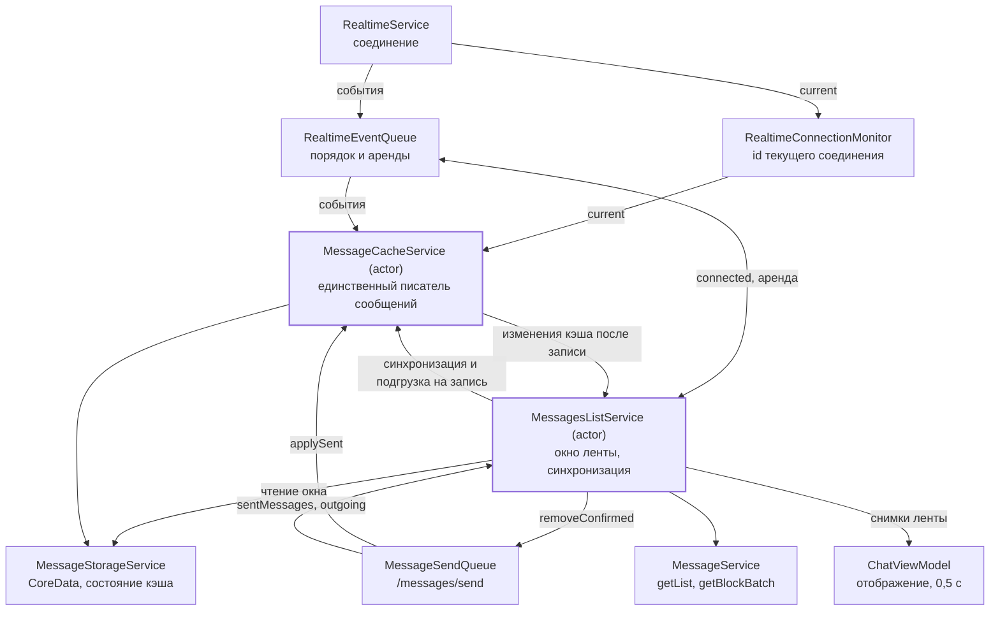
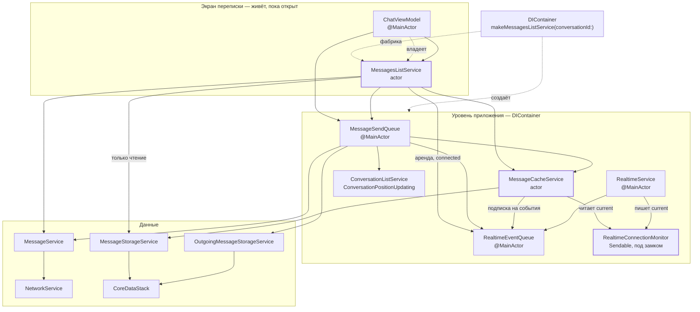
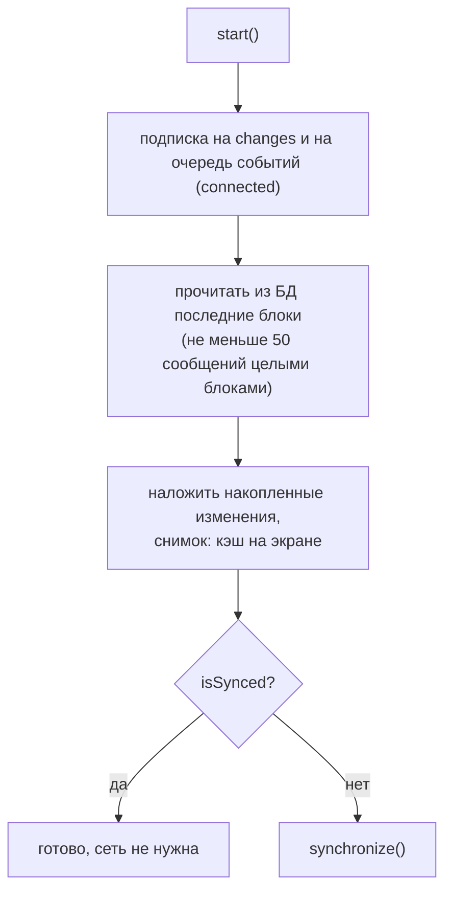
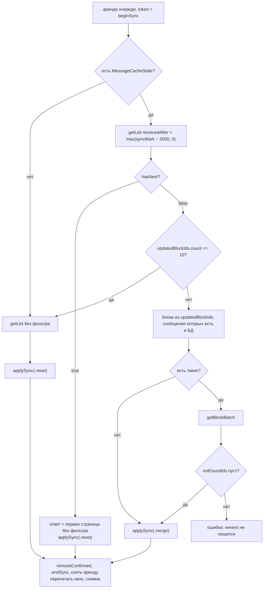
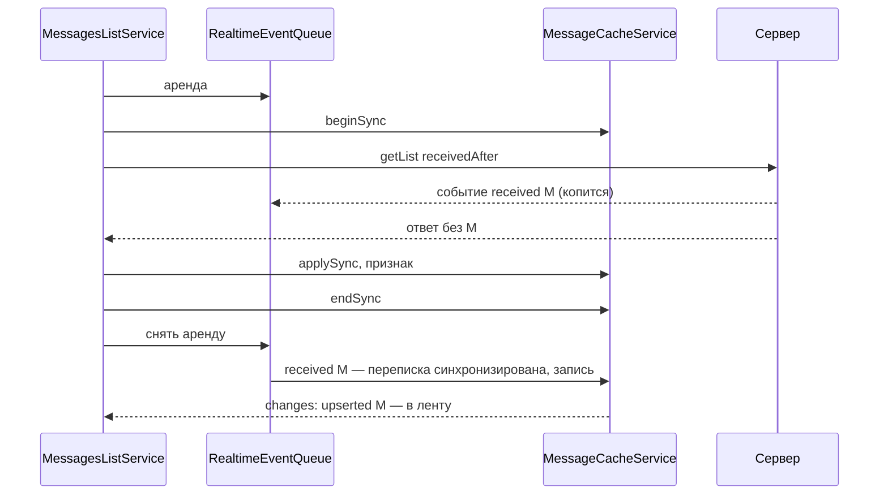

# Синхронизация ленты сообщений: архитектура клиента

14.10.2026 · Mikhail Kuzmin

## Цель и ключевые решения

Лента переписки открывается из кэша БД мгновенно и догоняет сервер дельтой — `getList` с `receivedAfter` и `getBlockBatch` вместо перезагрузки первой страницы. События WebSocket о сообщениях пишутся в БД только для переписок, кэш которых сейчас достоверен. Серверная часть описана в документе [Синхронизация кэша сообщений: изменения API для клиентов](api-changes/2026-10-14-message-cache-sync.md); здесь — только клиент iOS. Удаления сообщений в API пока нет, но клиент сразу поддерживает пустые блоки и удаление сообщений при применении блока.

Ключевые решения:

1. **Синхронизирована ли переписка — признак в памяти**, привязанный к текущему WebSocket-соединению. На старте приложения не синхронизирована ни одна переписка. Переписка становится синхронизированной после успешной синхронизации, начатой и законченной в одном соединении, во время которой не было пропущено ни одно событие этой переписки, и перестаёт ею быть при разрыве соединения.
2. **`MessageCacheService`** — новый сервис уровня приложения (`actor`, живёт в `DIContainer`, не зависит от экранов). Он единственный пишет сообщения в БД: события WebSocket, ответы `/messages/send`, результаты синхронизации и подгрузки. Событие в синхронизированную переписку записывается, в несинхронизированную — игнорируется. Он же единственный решает, синхронизирована ли переписка, и публикует изменения кэша после записи.
3. **`MessagesListService`** — новый сервис ленты одной переписки (`actor`, создаётся экраном через фабрику). Показывает кэш, синхронизирует, подгружает старые сообщения, накладывает отправленные на ленту. В БД сам не пишет — передаёт данные `MessageCacheService`. События WebSocket о сообщениях сам не обрабатывает: лента получает только то, что `MessageCacheService` уже записал, — поэтому лента и БД не расходятся.
4. **На время синхронизации очередь событий заблокирована арендой.** События, пришедшие во время запросов, применятся после неё — уже к синхронизированной переписке, и запишутся в БД.
5. **Тяжёлое — не на MainActor.** Слияние, чтение окна из БД, сортировка и сборка `MessageDisplayModel` идут в акторах сервисов и `@concurrent`-функциях. На main остаются присвоение готового массива и ввод.
6. **Лента обновляется не чаще раза в 0,5 с**; своё отправленное сообщение показывается сразу, вне интервала.



Пишет в БД только `MessageCacheService`; `RealtimeService`, `MessageSendQueue` и `ChatViewModel` перестают сохранять сообщения сами.

## Зависимости компонентов

Схема выше показывает потоки данных, эта — кто от кого зависит: стрелка `A → B` значит, что `A` получает `B` в `init` и обращается к нему через протокол. Пунктир — кто кого создаёт.



`ChatViewModel` также зависит от `UserCacheService`, `SessionService`, `LocalizationService` и `MessageTextValidator`, как сейчас; на схеме их нет, потому что синхронизации они не касаются.

**Направление зависимостей.** Циклов нет: экран зависит от сервисов приложения, сервисы приложения ничего не знают об экране. `MessageCacheService` не зависит ни от `MessageSendQueue`, ни от `MessagesListService` — они сами передают ему данные на запись, а изменения он отдаёт потоком, на который подписывается лента. `RealtimeService` и `MessageCacheService` связаны только через монитор соединения и очередь событий.

**Порядок создания в `DIContainer`:** `RealtimeConnectionMonitor` → `RealtimeEventQueue` → `MessageCacheService` (сразу после создания `DIContainer` подписывает его на очередь — `MessageCacheService.subscribe(_:to:)`, токен подписки хранит контейнер) → `MessageSendQueue` → `RealtimeService`. Подписка `MessageCacheService` должна появиться до `realtimeService.start()`: очередь не хранит события для будущих подписчиков. Порядок подписки задаёт и порядок доставки: `MessageCacheService` получает каждое событие раньше `MessageSendQueue` и экранов.

**Что меняется в зависимостях:**

| Компонент | Добавляется | Удаляется |
| --- | --- | --- |
| `ChatViewModel` | `MessagesListServiceProtocol` | `MessageServiceProtocol`, `MessageStorageServiceProtocol`, `RealtimeEventQueueProtocol` |
| `MessagesListService` (новый) | `MessageCacheServiceProtocol`, `RealtimeEventQueueProtocol`, `MessageSendQueueProtocol`, `MessageServiceProtocol`, `MessageStorageReading` | — |
| `MessageCacheService` (новый) | `MessageStorageReading`, `MessageStorageWriting`, `RealtimeEventQueueProtocol`, `RealtimeConnectionMonitor` | — |
| `MessageSendQueue` | `MessageCacheServiceProtocol` | `MessageStorageServiceProtocol` |
| `RealtimeService` | `RealtimeConnectionMonitor` | `MessageStorageServiceProtocol` |

`MessageStorageService` после изменений используют двое: `MessageCacheService` пишет и читает, `MessagesListService` только читает окно. Чтобы чтение нельзя было перепутать с записью, протокол делится на `MessageStorageReading` и `MessageStorageWriting`, и `MessagesListService` получает только первый.

**`Sendable` у протоколов `@MainActor`-сервисов.** Акторы хранят `RealtimeEventQueueProtocol` и `MessageSendQueueProtocol` и получают их из `DIContainer` (main) через неизолированный `init`. Экзистенциал `@MainActor`-протокола сам по себе не `Sendable`, поэтому оба протокола наследуют `Sendable` — это безопасно: реализации изолированы на main и обращаются к ним через `await`.

## Что считается кэшем

Кэш переписки — сообщения в БД плюс запись о его состоянии `MessageCacheState`:

| Поле | Значение |
| --- | --- |
| `syncMark: ServerTime` | максимум `createdAt` / `updatedAt` полученных сообщений и `updatedAt` блоков из `getBlockBatch` — по правилам сервера (с одним отступлением, см. «Отступление от серверного документа») |
| `nextBlockId: Int?` | блок, с которого продолжить подгрузку более старых сообщений с сервера (`nextBlockId` последней страницы) |
| `hasMorePages: Bool` | есть ли на сервере сообщения старше кэша |

**Инвариант непрерывности:**

- **Синхронизированная переписка:** сообщения в БД — непрерывный префикс истории, от самых новых до блока перед `nextBlockId`, без дыр.
- **Несинхронизированная переписка:** непрерывен префикс до `syncMark` — все сообщения с `createdAt ≤ syncMark` от блока перед `nextBlockId` и новее есть в БД. Новее `syncMark` могут лежать отдельные сообщения из `applySent` с дырой перед ними: своё сообщение, отправленное, пока кэш устарел. Дыру закрывает следующая синхронизация — `receivedAfter` берётся от `syncMark`, а `applySent` без признака его не двигает, так что пропущенные сообщения вернутся в ответе.

На инварианте держатся показ кэша без сети, подгрузка старых сообщений из БД и правило «изменение незагруженного сообщения игнорируется». Дыра в несинхронизированной переписке им не мешает: она всегда новее `syncMark`, а подгрузка из БД читает блоки старше окна, то есть часть до `syncMark`. Пока дыра есть, лента показывает кэш как есть вместе с индикатором синхронизации. Синхронизация при открытии такой переписки запускается всегда, потому что признак не стоит.

Чтобы инвариант не ломался:

- страница без курсора (`getList` без `blockId`) либо стыкуется с кэшем через `receivedAfter`, либо **заменяет** его (сброс);
- более старая страница дописывается только по сохранённому `nextBlockId`;
- событие `received` записывается только в синхронизированную переписку — сообщение заведомо новее всего кэша, дыры между ними нет;
- событие `edited` в синхронизированную переписку меняет только сообщение, которое уже есть в БД: отсутствующее старше кэша, и его запись создала бы дыру;
- `applySent` в несинхронизированную переписку может создать дыру только новее `syncMark` — см. выше.

**Переписка без записи о состоянии** — «без кэша», даже если в БД есть её сообщения (кэш до этой версии клиента, переписка, куда только отправляли). Её первая синхронизация — обычная загрузка, которая заменяет всё, что лежит в БД.

## Признак «синхронизирована»

Признак хранится только в памяти `MessageCacheService` — как id соединения, в котором переписка синхронизирована:

```swift
/// Идентификатор WebSocket-соединения: новый на каждое подключение, дошедшее до `auth` / `connected`.
struct RealtimeConnectionId: Hashable, Sendable { let rawValue: UInt64 }

/// Текущее соединение. Пишет RealtimeService, читают акторы без перехода на main — под замком.
final class RealtimeConnectionMonitor: Sendable {
    /// `nil` — соединения нет или оно ещё не дошло до `auth` / `connected`.
    var current: RealtimeConnectionId? { get }
}
```

`isSynced(conversationId)` = `syncedIn[conversationId] != nil && syncedIn[conversationId] == monitor.current`. Сбрасывать признаки при разрыве не нужно: с закрытием соединения `current` становится `nil`, а у нового соединения другой id, и все старые признаки разом перестают совпадать. На старте приложения словарь пуст.

Признак проверяет только `MessageCacheService` — и при записи событий, и для ленты (`isSynced` в протоколе нужен лишь для решения «синхронизировать ли при открытии»). Двух независимых проверок в разное время нет, поэтому запись в БД и лента не расходятся при смене соединения между ними.

Синхронизация обрамляется вызовами `beginSync` / `endSync` (см. `MessageSyncToken`). Признак ставится в `applySync`, если:

- при `beginSync` было соединение (`token.connection != nil`), и в момент `applySync` `current` — тот же id;
- между `beginSync` и `applySync` `MessageCacheService` не проигнорировал ни одного события этой переписки (`token.missedEvents == false`).

Второе условие проверяется внутри актора, атомарно с установкой признака, и заменяет проверку `lease.isExpired`. Она была бы гонкой: аренда изолирована на main, и сторож мог бы сработать между проверкой в `MessagesListService` и вызовом `applySync` — очередь доставила бы события, `MessageCacheService` проигнорировал бы их как в несинхронизированную переписку, а затем поставил бы признак, и кэш разошёлся бы с сервером до конца соединения. Счётчик пропущенных событий ловит этот случай независимо от причины: истёкшая аренда, вторая синхронизация без аренды, смена соединения.

Если условия не выполнены, результат синхронизации всё равно записывается (и `syncMark` двигается — см. «Отступление от серверного документа»), но признак не ставится: следующее открытие или переподключение синхронизирует снова.

`RealtimeService` выставляет `monitor.current` при `auth` / `connected` и обнуляет при закрытии соединения — синхронно, мимо очереди событий: аренда задержала бы и это. В очередь по-прежнему идёт `.connected`, по нему открытая переписка синхронизируется заново.

### Отступление от серверного документа

Серверный документ требует без признака не двигать `syncMark`. Клиент следует этому для событий и `applySent`, но **синхронизация двигает `syncMark` и без признака** (соединения не было или во время синхронизации пропущено событие).

Почему это безопасно: `syncMark` после синхронизации — максимум времени в ответе, то есть не позже момента, когда сервер его собрал. Всё, что создано или изменено раньше, есть в ответе; всё, что позже, имеет большее время и вернётся при следующей синхронизации, а совпадения в пределах миллисекунды покрывает запас 5 с. Почему это нужно: без этого следующая синхронизация повторяла бы дельту от старой отметки и при долгом офлайне упиралась бы в `hasNext: true` — сброс кэша.

**Нужно подтвердить у бэкенда**, что ответ `getList` / `getBlockBatch` — согласованный снимок: сообщение, созданное во время сборки ответа, либо попадает в ответ, либо получает время больше максимума ответа (с точностью до запаса 5 с). Если нет — синхронизация без признака перестаёт двигать `syncMark`, как в серверном документе.

## MessageCacheService — единый писатель сообщений

Файл: `Services/Message/MessageCacheService.swift`. `actor`: вся логика слияния и записи — вне main. На `RealtimeEventQueue` его подписывает `DIContainer` сразу после создания (до `realtimeService.start()`): актор не может подписаться сам в неизолированном `init`, потому что очередь изолирована на main. Обработчик подписки — `@MainActor`-замыкание, которое передаёт событие в актор через `await`.

```swift
protocol MessageCacheServiceProtocol: Sendable {
    /// Синхронизирована ли переписка в текущем соединении.
    func isSynced(conversationId: Int) async -> Bool
    /// Состояние кэша переписки; nil — кэша нет.
    func cacheState(conversationId: Int) async throws -> MessageCacheState?
    /// Изменения кэша переписки — публикуются после записи в БД. Подписка регистрируется до возврата,
    /// поэтому подписываться нужно до чтения окна.
    func changes(conversationId: Int) async -> AsyncStream<MessageCacheChange>
    /// Начало синхронизации: запоминает соединение, начинает копить id из applySent и пропущенные события.
    func beginSync(conversationId: Int) async -> MessageSyncToken
    /// Записывает итог синхронизации одной транзакцией и, если условия выполнены, ставит признак.
    func applySync(_ result: MessageSyncResult, token: MessageSyncToken) async throws
    /// Конец синхронизации при любом исходе: освобождает защищённые id и счётчик. Идемпотентен.
    func endSync(_ token: MessageSyncToken) async
    /// Дописывает более старую страницу, если продолжение подгрузки в кэше всё ещё requestedBlockId.
    /// false — кэш за время запроса сброшен, страница не записана.
    func appendOlderPage(_ page: MessagesPage, requestedBlockId: Int, conversationId: Int) async throws -> Bool
    /// Сообщение из ответа /messages/send.
    func applySent(_ message: Message) async
}

/// Идёт синхронизация одной переписки. Синхронизаций одной переписки может быть несколько одновременно
/// (второй экран той же переписки) — у каждой свой токен и свои защищённые id.
struct MessageSyncToken: Hashable, Sendable {
    let id: UInt64
    let conversationId: Int
    /// Соединение на момент beginSync; nil — соединения не было, признак не поставится.
    let connection: RealtimeConnectionId?
}

/// Итог синхронизации, который MessagesListService передаёт на запись.
enum MessageSyncResult: Sendable {
    /// Дельта: новые сообщения и полные блоки из getBlockBatch, кэш остаётся.
    case merge(messages: [Message], blocks: [MessageBlock])
    /// Сброс: первая страница без фильтра заменяет кэш.
    case reset(firstPage: MessagesPage)
}

/// Изменение кэша переписки после записи в БД.
enum MessageCacheChange: Sendable {
    /// Сообщения записаны (received, edited, applySent) — версии после слияния, как в БД.
    case upserted([Message])
    /// Кэш перезаписан синхронизацией — окно нужно перечитать.
    case rewritten(by: MessageSyncToken)
}
```

С удалением сообщений в API добавится `case removed(messageIds:)`. Состояние синхронизации в акторе — по токену: соединение, `missedEvents` и защищённые id. `endSync` удаляет токен; `applySync` по закрытому токену ничего не пишет и бросает `CancellationError`.

### События WebSocket

| Событие | Синхронизированная переписка | Несинхронизированная |
| --- | --- | --- |
| `messages/received` | upsert сообщения; `syncMark` = максимум с `createdAt`, `updatedAt`; публикуется `.upserted` | сообщение не пишется; у открытых токенов переписки ставится `missedEvents` |
| `messages/edited` | обновить, если сообщение есть в БД (побеждает больший `updatedAt`), и опубликовать `.upserted`; нет в БД — не создавать и не публиковать. `syncMark` двигается в обоих случаях | сообщение не пишется; `missedEvents` |
| будущие действия с сообщениями (удаление и др.) | применяются к записям в БД по тем же правилам, публикуется `.removed` (появится вместе с удалением) | игнорируются; `missedEvents` |
| `connected` | — | — |

В обоих случаях из БД удаляется неотправленная копия с тем же `clientId` (`OutgoingMessageEntity.deleteConfirmed`): иначе после перезапуска очередь отправки повторила бы уже доставленное сообщение. Это единственная запись, которую делает игнорируемое событие. Из памяти очереди отправки копию убирает сама `MessageSendQueue` — она подписана на очередь событий, как сейчас.

Почему событие в несинхронизированную переписку можно не писать: `syncMark` без признака не двигается, поэтому следующая синхронизация вернёт это сообщение (`createdAt > receivedAfter`) или его блок в `updatedBlockIds`. Если синхронизация идёт прямо сейчас, `missedEvents` не даст ей поставить признак.

**Порядок и скорость.** Обработчик подписки проверяет признак и ставит запись в последовательную цепочку актора, не дожидаясь CoreData, — очередь событий не стоит на каждой записи. Записи подряд идущих событий склеиваются в одну транзакцию. `applySync`, `appendOlderPage` и `applySent` идут через ту же цепочку, поэтому порядок записей совпадает с порядком событий и вызовов. Изменения публикуются в `changes` после коммита транзакции, а не при постановке записи в цепочку: лента видит только то, что уже есть в БД.

**Убийство приложения.** Сообщения из событий теперь пишутся при обработке очередью, а не при получении: событие, подтверждённое серверу, но не дошедшее до БД, теряется. Это безопасно — признак после запуска не стоит ни у одной переписки, и синхронизация при открытии вернёт пропущенное.

### Ответ на отправку

`applySent` вызывается из `MessageSendQueue.confirm` вместо прямой записи в `MessageStorageService`. Сообщение сливается с кэшем **всегда** — и в несинхронизированную переписку: экран уже показывает его, и после перечитывания окна из БД оно не должно пропасть. `syncMark` двигается только при признаке. В несинхронизированной переписке это может оставить дыру новее `syncMark` — см. «Инвариант непрерывности». Публикуется `.upserted`.

Переписка без записи о состоянии получает сообщение в БД, но остаётся «без кэша» — первая синхронизация заменит его вместе с остальным.

### Запись синхронизации

`applySync` — одна транзакция `MessageStorageService`:

- **`.merge`** — upsert сообщений по `messageId` (побеждает больший `updatedAt`). Каждый блок применяется целиком: сообщения блока, которых нет в ответе, удаляются; пустой `messages` — блок очищен.
- **`.reset`** — сообщения переписки удаляются, страница записывается, `nextBlockId` и `hasMorePages` берутся из неё.
- `syncMark` = максимум из прежнего (только для `.merge`) и всего полученного; записывается всегда.
- Признак ставится по правилам выше.
- После коммита публикуется `.rewritten(by: token)`.

**Исключение из удаления** — сообщения, записанные через `applySent` после `beginSync` этого токена: актор копит их id в состоянии токена до `endSync`. Сервер требует щадить и сообщения из `received` после запроса, но они во время синхронизации в БД не попадают — очередь событий заблокирована арендой (а если аренда истекла, событие проигнорировано и учтено в `missedEvents`). Неподтверждённые сообщения лежат в `OutgoingMessageEntity` и сбросом не затрагиваются.

### Выход из аккаунта

`AuthServiceObserver` — `@MainActor`-протокол, а актор не может реализовать протокол, изолированный на глобальном акторе, даже `nonisolated`-методами. Поэтому выход передаёт адаптер `MessageCacheLogoutObserver` (`@MainActor`-класс в том же файле), а `AuthService` держит наблюдателей слабо — адаптер хранит `DIContainer`:

```swift
@MainActor
final class MessageCacheLogoutObserver: AuthServiceObserver {
    private let messageCache: MessageCacheService

    func authServiceWillLogout() async {
        await messageCache.prepareForLogout()
    }

    func authServiceDidLogout(reason: LogoutReason) async {
        await messageCache.finishLogout()
    }
}
```

`prepareForLogout`: очистить признаки, токены синхронизаций и защищённые id, завершить потоки `changes`, дождаться цепочки записей (новые не принимаются до `finishLogout`). БД чистит `LocalStorageCleaner`, включая `MessageCacheStateEntity`.

## MessagesListService — лента одной переписки

Файл: `Services/Message/MessagesListService.swift`. `actor`, по экземпляру на открытый экран; создаётся фабрикой `DIContainer.makeMessagesListService(conversationId:)`, принадлежит `ChatViewModel`.

```swift
protocol MessagesListServiceProtocol: Sendable {
    /// Снимки ленты. Новый снимок — после каждого изменения; частоту ограничивает потребитель.
    func snapshots() async -> AsyncStream<MessagesListSnapshot>
    /// Подписывается на изменения кэша и событие connected, показывает кэш и, если переписка
    /// не синхронизирована, запускает синхронизацию. Возвращается, когда кэш показан.
    func start() async
    /// Синхронизация по требованию (pull-to-refresh) — даже если признак стоит. Ждёт её окончания;
    /// ошибка приходит в снимке.
    func synchronize() async
    /// Подгружает более старые сообщения: сначала из БД, затем с сервера. Ошибка приходит в снимке.
    func loadOlder() async
    /// Уход с экрана: отменяет синхронизацию и подгрузку, дожидается снятия аренды, отписывается.
    func stop() async
}

struct MessagesListSnapshot: Sendable {
    /// Сообщения с сервера, сначала самые новые.
    let messages: [Message]
    let isSyncing: Bool
    let isLoadingOlder: Bool
    let hasOlder: Bool
    /// Снимок нужно показать сразу, вне интервала 0,5 с: своё отправленное сообщение и кэш при открытии.
    let isUrgent: Bool
    /// Ошибка синхронизации или подгрузки к этому снимку; показывается один раз. Ошибки не бросаются из методов:
    /// синхронизацию запускают и открытие, и `connected`, а показать ошибку должен экран в любом случае.
    let failure: Error?
}
```

**Окно.** Сервис держит в памяти окно — сообщения от самого нового до самого старого показанного блока (`[messageId: Message]` и упорядоченный массив). Окно — проекция БД плюс наложенные изменения кэша и отправленные: чтение из БД, слияние по `updatedAt` и сортировка идут в акторе.

**Чтение окна без потерь.** Подписка на `changes` берётся до первого чтения из БД, а изменения публикуются после коммита. Поэтому любая запись либо закоммичена до чтения и попадёт в прочитанное, либо придёт в потоке после подписки; запись, попавшая в оба, безвредна — слияние идемпотентно. Пока идёт чтение (открытие, перечитывание после синхронизации, `loadOlder` из БД), пришедшие изменения не применяются к окну, а копятся и накладываются на результат после него: иначе правка сообщения из читаемого блока была бы отброшена как «не в окне», а затем затёрта старой версией из чтения.

### Открытие



Кэш показывается до сети и без неё. Если переписка уже синхронизирована (открывали в этом соединении и с тех пор события писались в БД), синхронизация не нужна: БД уже актуальна, а то, что ещё в цепочке записей, придёт через `changes`.

### Синхронизация

Весь процесс — под арендой очереди, от `beginSync` до записи в БД. `isSyncing` в снимке — `true` всё это время и до перечитывания окна.



- Сервер рекомендует запас 5 с (`syncMargin`, как в списке чатов): повторы безвредны, слияние идемпотентно.
- `updatedBlockIds` фильтруются по блокам, которые есть в кэше: остальные придут актуальными при подгрузке.
- Ошибка любого запроса, в том числе `getBlockBatch`, — в БД ничего не пишется, `syncMark` не двигается, признак не ставится. Повтор — целиком: при pull-to-refresh, следующем `connected` или открытии. Ошибка показывается алертом, кэш остаётся на экране.
- **Непустой `notFoundIds`** — ошибка синхронизации. `getList` уже прошёл проверку доступа, значит доступ к переписке пропал между запросами; кэш не трогается, признак не ставится, следующий `getList` вернёт `5002`.
- **Пустые страницы — вне аренды.** Сброс записывает страницу как есть, даже пустую с `hasNext: true`, вместе с её `nextBlockId`. Если после перечитывания в окне меньше 50 сообщений и `hasOlder`, сервис сразу запускает `loadOlder()` — уже без аренды, и пропуск пустых страниц не держит общую очередь событий. Так под арендой всегда 1–3 запроса.
- После записи окно перечитывается из БД с прежней глубины (после сброса — первая страница): так удаления и сброс отражаются в ленте без отдельной логики. Перечитывание запускает сама синхронизация; `.rewritten` со своим токеном сервис пропускает, с чужим (второй экран той же переписки) — перечитывает окно.
- **Подтверждение доставки.** После `applySync` сервис вызывает `messageSendQueue.removeConfirmed(by:)` со всеми полученными сообщениями (страница и блоки) — как сейчас делает `ChatViewModel` для первой страницы. Иначе сообщение, доставленное без ответа на `/messages/send` и без события в ленту (событие проигнорировано или пришло до подписки), осталось бы висеть в `outgoingMessages`. Из БД неотправленные копии удаляет та же транзакция `applySync`.

**Аренда, отмена и очистка.** Аренда `@MainActor`, а `withProcessingSuspended` выполняет операцию на main, поэтому сервис его не использует. Аренду берёт либо `await eventQueue.suspendProcessing(reason: "chat.sync")` из актора (открытие, pull-to-refresh), либо обработчик `connected` синхронно на main, до первого `await`, — как `ConversationListService`; затем объект аренды (`@MainActor`-класс, `Sendable`) передаётся в актор. Дальше:

```swift
private func runSync(lease: RealtimeQueueLease) async throws {
    await cancelRunningSync()   // отменить идущую и дождаться её очистки
    let token = await messageCache.beginSync(conversationId: conversationId)
    var outcome: Result<Void, Error>
    do {
        try await performSync(token: token)   // запросы, Task.checkCancellation(), applySync
        outcome = .success(())
    } catch {
        outcome = .failure(error)
    }
    await messageCache.endSync(token)
    await lease.release()
    try outcome.get()
}
```

`defer` не умеет `await`, поэтому `endSync` и снятие аренды вызываются явно после `do`/`catch` — на всех путях, включая отмену: `await` вызова на другом акторе выполняется и в отменённой задаче. Страховка от ошибки в коде — снятие аренды в её `deinit` и сторож очереди.

**Когда синхронизировать:** при открытии без признака; по событию `connected`; по pull-to-refresh. Синхронизации одного экрана не пересекаются: новый запуск отменяет идущий и дожидается его очистки (`endSync`, снятие аренды), прежде чем вызвать свой `beginSync`. Перед `applySync` отменённая синхронизация проверяет `Task.checkCancellation()`; если отмена пришла уже после проверки, её результат запишется раньше результата новой — это безвредно, потому что новая синхронизация начинается позже и её ответ свежее. **Уход с экрана отменяет синхронизацию.** `stop()` отменяет задачу синхронизации (вместе с ней — сетевой запрос) и дожидается её очистки: `endSync` и снятие аренды. Иначе при слабом интернете общая очередь стояла бы до таймаута запросов уже после ухода пользователя — список чатов не поднимал бы переписки, а очередь отправки не видела бы подтверждений. Отменённая до `applySync` синхронизация ничего не пишет и признак не ставит: при следующем открытии переписка синхронизируется заново, а `MessageCacheService` до тех пор игнорирует её события — БД остаётся согласованной. Если отмена пришла, когда `applySync` уже начался, запись доводится до конца: это локальная транзакция без сети, и обрывать её незачем. Подгрузка старых сообщений по сети отменяется так же — её результат экрану уже не нужен.

**Почему аренда на всю синхронизацию.** События, пришедшие во время запросов, ждут в очереди. После снятия аренды переписка уже синхронизирована, и `MessageCacheService` их записывает — например, сообщение, пришедшее в момент синхронизации, не теряется и не пишется в ещё не сброшенный кэш. Цена выше, чем у прежней аренды первой страницы: очередь общая, и пока идут 1–3 запроса, события не получает никто и они не пишутся в БД. Держится аренда только пока экран открыт: уход с экрана отменяет синхронизацию и снимает аренду. Подробнее — «Компромисс» в [архитектуре списка чатов](conversation-list-architecture.md). Все запросы — под `timeoutInterval` 30 с, сторож аренды — 90 с.



### Изменения кэша в ленте

Сервис применяет к окну изменения из `changes` — то, что `MessageCacheService` уже записал в БД. События очереди он не обрабатывает, кроме `connected`; признак не проверяет: решение «писать или нет» принял писатель, и лента ему следует.

| Изменение | Действие с окном |
| --- | --- |
| `upserted`, сообщение новее самого нового в окне | добавить в начало |
| `upserted`, блок сообщения не старше самого старого блока окна | слить по `updatedAt` (заменить или вставить) |
| `upserted`, блок старше окна | игнорировать — придёт при подгрузке из БД |
| `removed` (с удалением в API) | убрать из окна, если есть |
| `rewritten` с чужим токеном | перечитать окно с прежней глубины |
| событие очереди `connected` | синхронизировать |

### Отправка

- Неотправленные сообщения по-прежнему читаются из `MessageSendQueue.outgoingMessages` — их показывает `ChatViewModel` внизу ленты.
- Сервис слушает `sentMessages()` и накладывает созданное сообщение на окно сразу, не дожидаясь записи в БД и независимо от признака; запись делает `MessageSendQueue` через `applySent`, и пришедший затем `upserted` сливается идемпотентно. Снимок помечается `isUrgent`.

### Подгрузка старых сообщений

`loadOlder()` без аренды:

1. Если в БД есть блоки старше самого старого в окне — прочитать следующие целыми блоками (не меньше 40 сообщений) и дописать к окну, затем наложить изменения, накопленные за время чтения. Сеть не нужна: эта часть кэша старше `syncMark` и непрерывна.
2. Иначе, если `hasMorePages`, — `getList(blockId: nextBlockId)`, `appendOlderPage`, `removeConfirmed`, дописать к окну. Пустые страницы с `hasNext: true` пропускаются: сервис запрашивает следующую, пока не получит сообщения или `hasNext: false`.

Подгрузка по сети возможна и в несинхронизированной переписке: старые страницы не меняют начало кэша, а `syncMark` без признака не двигается.

## ChatViewModel и экран

- Зависит от `MessagesListServiceProtocol` вместо `MessageService`, `MessageStorageService` и `RealtimeEventQueue`. Удаляются `PaginatedList`, `liveMessages`, `loadFirstPage`, `syncFirstPage`, `observeRealtimeEvents` и вызов `messageSendQueue.removeConfirmed` — его делает `MessagesListService`.
- **`messages` — хранимое свойство.** Его пересобирает `observeMessages()` (`.task` экрана) не чаще раза в `messagesUpdateInterval` = 0,5 с по образцу `ChatListViewModel.observeConversations()`: первое изменение после паузы — сразу, остальные за интервал склеиваются в последний снимок. Снимок с `isUrgent` и нажатие «Отправить» (новое сообщение в `outgoingMessages`) показываются сразу.
- **Сборка `MessageDisplayModel` — вне main.** `@concurrent` статическая функция получает значения: сообщения, неотправленные, снимок отправителей из кэша пользователей, `MessageDisplayContext`. На main — только сбор входных данных и присвоение результата. Сюда же переезжает текущая логика `displayedItems` (неотправленное с уже показанной серверной версией скрывается).
- `isSyncing`, `isLoadingOlder` и ошибки обновляются сразу, без интервала.
- **Индикатор синхронизации.** Пока `isSyncing`, в заголовке под именем собеседника — `ProgressView` и «Обновление…» (новая строка в `ChatStrings`, ru/en). Лента из кэша остаётся интерактивной, ввод и отправка доступны. Прелоадер по центру — только если кэша нет и лента пуста.
- Pull-to-refresh → `synchronize()`; уход с экрана → `stop()`: отмена синхронизации и подгрузки, снятие аренды, отписка от `changes` и очереди. `stop()` вызывается при исчезновении экрана (отмена `.task` / `onDisappear`), а не в `deinit` ViewModel — `deinit` не может ждать снятия аренды.

## Сетевой слой и модели

| Тип / файл | Изменение |
| --- | --- |
| `MessageListFilter` (новый) | `.block(Int?)` — обычная пагинация, `.receivedAfter(ServerTime)` — синхронизация. Перечисление, чтобы `receivedAfter` вместе с `blockId` (ошибка `1004`) нельзя было собрать; отрицательная метка уходит как 0 |
| `MessageEndpoint` | `getList(conversationId:filter:)`, новый `getBlockBatch(blockIds:)` — id через запятую, 1–10. `getBlock` удаляется |
| `MessageServiceProtocol` | `fetchMessages(conversationId:filter:)`, `fetchBlocks(ids:) -> MessageBlocksBatch`; `fetchBlock(id:)` удаляется |
| `MessagesPage` | `updatedBlockIds: [Int]?` — только при `receivedAfter` и `hasNext: false`. Комментарий «минимум 40 сообщений» заменяется контрактом: число сообщений не говорит о конце, только `hasNext`; страница может быть пустой |
| `MessageBlock` (новый) | `blockId`, `conversationId`, `messages: [Message]`, `updatedAt: ServerTime?` — объект `MessageBlock` из API |
| `MessagesBlock` | удаляется вместе с `getBlock`: клиент его не использует (только `MessageService.fetchBlock` и тесты), а имя почти совпадает с `MessageBlock`. Один блок при необходимости — `getBlockBatch` с одним id |
| `MessageBlocksBatch` (новый) | `blocks: [MessageBlock]`, `notFoundIds: [Int]`. Непустой `notFoundIds` при синхронизации — ошибка, см. «Синхронизация» |
| `RealtimeService` | `RealtimeConnectionMonitor`; запись сообщений событий в БД и зависимость от `MessageStorageService` удаляются |
| `MessageSendQueue` | `confirm` вызывает `messageCache.applySent` вместо `messageStorage.save` |
| `RealtimeEventQueueProtocol`, `MessageSendQueueProtocol` | наследуют `Sendable` — см. «Зависимости компонентов» |

## Хранилище

Новая версия модели `Chatik 7.xcdatamodel` (лёгкая миграция, очистка не нужна):

| Entity | Изменение |
| --- | --- |
| `MessageCacheStateEntity` (новая) | `conversationId: Int64` (уникальный), `syncMark: Int64`, `nextBlockId: NSNumber?`, `hasMorePages: Bool` |
| `MessageEntity` | индекс по `(conversationId, blockId)` — чтение окна целыми блоками и удаление по блоку |

Протокол хранилища делится на чтение и запись (см. «Зависимости компонентов»); `MessageStorageService` реализует оба, все операции — в фоновых контекстах:

```swift
protocol MessageStorageReading: Sendable {
    func fetchState(conversationId: Int) async throws -> MessageCacheState?
    /// Самые новые блоки (не меньше minCount сообщений, целыми блоками), сначала самые новые.
    func fetchLatestBlocks(conversationId: Int, minCount: Int) async throws -> [Message]
    /// Блоки старше beforeBlockId, тем же правилом.
    func fetchBlocks(conversationId: Int, olderThan beforeBlockId: Int, minCount: Int) async throws -> [Message]
    /// Сообщения начиная с блока fromBlockId — перечитывание окна после синхронизации.
    func fetchMessages(conversationId: Int, fromBlockId: Int) async throws -> [Message]
    /// Какие из blockIds есть в кэше переписки.
    func cachedBlockIds(conversationId: Int, among blockIds: [Int]) async throws -> Set<Int>
}

/// Только для MessageCacheService.
protocol MessageStorageWriting: Sendable {
    /// Одна транзакция: изменения сообщений, удаление неотправленных копий, изменения состояния кэша.
    /// Возвращает записанные версии сообщений — их MessageCacheService публикует в changes.
    func write(_ changes: MessageStorageChanges) async throws -> [Message]
}
```

`MessageStorageChanges` — upsert, «обновить только существующие», замена блоков с исключениями, удаление переписки с исключениями, подтверждённые сообщения и изменения состояния `MessageCacheStateChange`: замена целиком (сброс), сдвиг `syncMark` до максимума и пагинация после старой страницы. Сдвиг и пагинация без записи о состоянии ничего не делают — переписка без кэша остаётся без кэша. Решения о том, что писать, принимает `MessageCacheService`; хранилище только применяет. `fetchLatest(limit:)`, `find`, `delete` и прямой `save` удаляются. В `LocalStorageCleaner` добавляется `MessageCacheStateEntity`.

## Что уходит с MainActor

| Работа | Где теперь |
| --- | --- |
| Слияние, проверка признака, запись событий | `MessageCacheService` (actor) + фоновые контексты CoreData |
| Чтение окна, слияние изменений и отправленных, сортировка | `MessagesListService` (actor) |
| Сборка `MessageDisplayModel` (форматирование времени, серии отправителей) | `@concurrent`-функция над значениями |
| Сеть, разбор JSON | `@concurrent` `NetworkService.request` (как сейчас) |

На main остаются `RealtimeEventQueue` (её гарантии порядка держатся на изоляции), `MessageSendQueue`, ViewModel и присвоение готовых массивов. Переходы main → актор в обработчиках очереди — это `await`, и очередь ждёт обработчик, поэтому порядок событий сохраняется.

## Тесты

| Файл | Что проверяет |
| --- | --- |
| `MessageCacheServiceTests` (новый) | событие в синхронизированную переписку пишется и публикуется после записи, в несинхронизированную — нет, но неотправленная копия удаляется; `edited` по отсутствующему сообщению не создаёт запись и не публикуется; признак гаснет при смене соединения; признак не ставится при смене соединения во время синхронизации и при событии, проигнорированном между `beginSync` и `applySync` (в том числе после истечения аренды); `syncMark` двигается без признака только синхронизацией; `applySent` пишется всегда; исключения из удаления при сбросе и применении блока — по своему токену, в том числе для двух одновременных синхронизаций; `endSync` после ошибки очищает защищённые id, `applySync` по закрытому токену ничего не пишет; порядок записей; выход |
| `MessagesListServiceTests` (новый) | кэш до сети; синхронизированная переписка не ходит в сеть; изменение, закоммиченное во время чтения окна при открытии, не теряется; изменение старого блока во время `loadOlder` из БД не затирается старой версией; три исхода синхронизации (`hasNext`, 10 блоков, дельта); запас 5 с; фильтр `updatedBlockIds` по кэшу; ошибка `getBlockBatch` и непустой `notFoundIds` — ничего не записано; `removeConfirmed` после синхронизации и подгрузки; события во время синхронизации появляются в ленте после неё; `upserted` старше окна игнорируется; `connected` — повторная синхронизация, предыдущая отменена и очищена до `beginSync` новой; аренда снимается и `endSync` вызывается при ошибке и отмене; `stop()` во время запроса отменяет синхронизацию, снимает аренду до возврата и ничего не пишет; `stop()` во время `applySync` не обрывает запись; пустая первая страница — сброс без цикла под арендой, догрузка через `loadOlder`; подгрузка из БД, затем с сервера; пустые страницы с `hasNext: true` |
| `ChatViewModelTests` | интервал 0,5 с и склейка снимков; немедленный показ своего сообщения; индикатор; pull-to-refresh |
| `MessageServiceTests`, `MessagesPageTests`, `MessageBlockTests` | параметры фильтра, `getBlockBatch`, разбор `updatedBlockIds`, `MessageBlock`; `MessagesBlockTests` удаляется |
| `MessageStorageServiceTests`, `CoreDataStackTests` | окно целыми блоками, замена блока, возврат записанных версий, миграция 6 → 7 |
| `RealtimeServiceTests`, `MessageSendQueueTests` | монитор соединения; `applySent` вместо записи в БД |

## План работ

1. Модели и сеть: `MessageListFilter`, `updatedBlockIds` и новый комментарий контракта в `MessagesPage`, `MessageBlock`, `getBlockBatch`; удаление `MessagesBlock` и `getBlock`.
2. CoreData 7, `MessageCacheStateEntity`, новый `MessageStorageService`.
3. `RealtimeConnectionMonitor` в `RealtimeService`; удаление записи сообщений из `RealtimeService`; `Sendable` у `RealtimeEventQueueProtocol` и `MessageSendQueueProtocol`.
4. `MessageCacheService`: события, `changes`, `beginSync` / `applySync` / `endSync`, `applySent`, выход; перевод `MessageSendQueue`.
5. `MessagesListService`: окно с накоплением изменений при чтении, синхронизация с арендой и очисткой, `removeConfirmed`, подгрузка.
6. `ChatViewModel`, индикатор, интервал 0,5 с, сборка ленты вне main; `DIContainer`, `PreviewDependencies`, порядок запуска в `AppRouter`.
7. Согласовать с бэкендом «Отступление от серверного документа».

## Принятые решения

| Вопрос | Решение |
| --- | --- |
| Где хранится признак «синхронизирована» | в памяти `MessageCacheService` как id соединения; сброс при разрыве — автоматически через `RealtimeConnectionMonitor` |
| Кто проверяет признак | только `MessageCacheService`; лента применяет то, что он записал, через `changes` |
| Когда признак не ставится | смена соединения или событие переписки, проигнорированное между `beginSync` и `applySync`; проверка в акторе вместо `lease.isExpired` |
| Событие в несинхронизированную переписку | не пишется; удаляется только неотправленная копия; идущая синхронизация не ставит признак |
| `edited` по сообщению, которого нет в БД / старше окна | не создаётся / игнорируется — запись нарушила бы непрерывность кэша |
| Ответ на отправку в несинхронизированную переписку | пишется всегда, `syncMark` не двигает; возможная дыра новее `syncMark` закрывается следующей синхронизацией |
| Двигает ли синхронизация `syncMark` без признака | да — отступление от серверного документа, требует подтверждения бэкенда |
| Аренда очереди | на всю синхронизацию, включая `getBlockBatch` и запись; берётся через `suspendProcessing`, снимается явно на всех путях |
| Пустые страницы при сбросе | под арендой не догружаются; после сброса — `loadOlder` без аренды |
| Пересечение синхронизаций одного экрана | нет: новая отменяет старую и ждёт её очистки |
| Уход с экрана во время синхронизации | синхронизация отменяется, аренда снимается сразу — чтобы при слабом интернете не держать общую очередь; признак не ставится, переписка синхронизируется при следующем открытии |
| `notFoundIds` при синхронизации | ошибка синхронизации, кэш не трогается |
| Ошибка синхронизации | ничего не пишется, повтор целиком: pull-to-refresh, `connected`, открытие |
| Подтверждение доставки по результатам синхронизации | `MessagesListService` вызывает `removeConfirmed` |
| Pull-to-refresh в переписке | синхронизация даже при стоящем признаке, а не перезагрузка первой страницы |
| Частота обновления ленты | не чаще раза в 0,5 с; своё отправленное сообщение — сразу |
| Изоляция сервисов | `MessageCacheService` и `MessagesListService` — `actor`, в отличие от `@MainActor`-сервиса списка чатов: их состояние не является состоянием экрана целиком, а объём слияния и чтения больше. `AuthServiceObserver` — через адаптер `MessageCacheLogoutObserver` |
