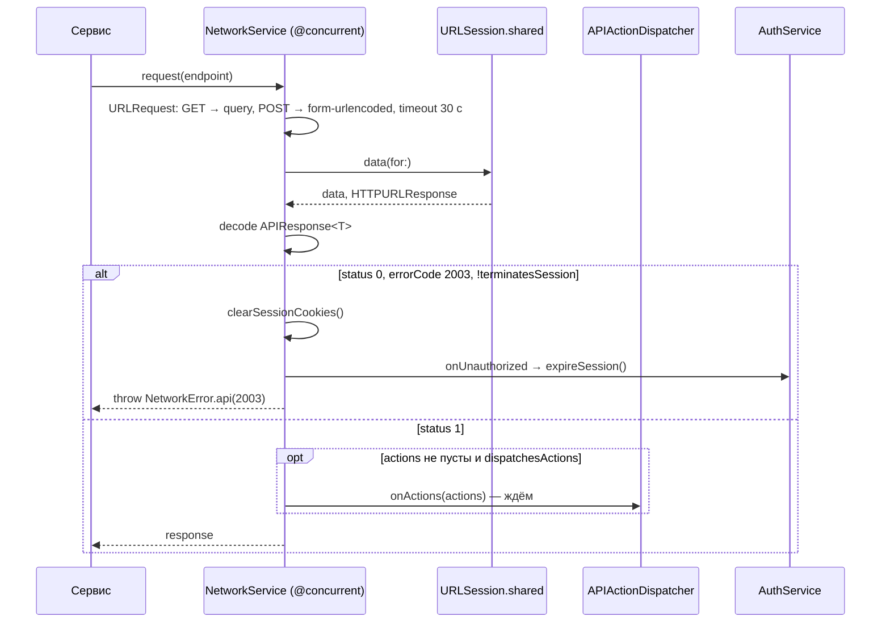

# Сетевой слой: архитектура клиента

22.10.2026 · Mikhail Kuzmin

Статус: описание реализованного.

## Назначение

Все HTTP-запросы к API идут через один `NetworkService`. Он собирает запрос из описания эндпоинта, разбирает общую обёртку ответа, переводит ошибки в `NetworkError` и выполняет две глобальные обязанности, о которых вызывающий не думает:

- **код 2003** (сессия недействительна) от любого запроса завершает сессию локально;
- **`actions`** из успешного ответа выполняются до того, как данные вернутся вызывающему.

WebSocket в этот слой не входит — см. [соединение реального времени](realtime-connection.md).

## Состав

| Тип | Роль |
| --- | --- |
| `Endpoint` | протокол описания запроса: `path`, `method`, `parameters: [String: String]`, `headers`, флаги `terminatesSession` и `dispatchesActions` |
| `HTTPMethod` | `GET` / `POST` |
| `NetworkServiceProtocol` / `NetworkService` | `request(_:)`, `upload(_:file:onProgress:)`, `clearSessionCookies()` |
| `APIResponse<T>` | обёртка `{status, response, errorCode, actions}` |
| `EmptyResponse` | для методов с `"response": {}` |
| `APIAction`, `LossyAPIAction` | указания клиенту из `actions` |
| `APIActionDispatcher` | выполняет `actions` (сейчас — только `users`) |
| `NetworkError` | все ошибки слоя и коды API (`NetworkError.Code`) |
| `FormURLEncoder` | тело `x-www-form-urlencoded` |
| `MultipartFile`, `MultipartFormEncoder` | тело `multipart/form-data` на диске |
| `UploadProgressDelegate` | прогресс отправки тела |
| `NetworkLogger` | лог запросов и ответов в Debug |

Эндпоинты — `enum` по разделам API рядом со своим сервисом: `AuthEndpoint`, `ProfileEndpoint`, `FilesEndpoint`, `UsersEndpoint`, `ConversationEndpoint`, `MessageEndpoint`, `GlobalEndpoint`. Сервис раздела (`AuthService`, `UsersService`…) только вызывает `networkService.request` с нужным case и типом ответа.

## Запрос

- **Сборка.** URL — `baseURL.appendingPathComponent(path)`. GET-параметры — в query string, POST — в теле `application/x-www-form-urlencoded`. Ключи сортируются в обоих случаях: запрос детерминирован, его удобно сравнивать в тестах и логах. `FormURLEncoder` экранирует всё, кроме букв, цифр и `-._*`, пробел — `+`.
- **Таймаут** — `AppConfig.requestTimeout` (30 с), а не системные 60 с: очередь событий WebSocket ждёт запросы под арендой, и её сторожевой таймаут должен быть заметно больше.
- **`@concurrent`.** Сборка запроса, логирование и декодирование идут в пуле потоков, а не на акторе вызывающего: вызов из ViewModel иначе декодировал бы JSON на main.
- **Сессия — cookie `PHPSESSID`.** `URLSession.shared` сама сохраняет и подставляет её через `HTTPCookieStorage.shared`. `clearSessionCookies()` удаляет все cookie базового URL.

## Разбор ответа

Порядок в `decodeAPIResponse` подобран под то, что сервер отдаёт ошибку и на статусе вне 2xx (внутренняя ошибка — HTTP 500 с кодом 9001):

1. Ответ не HTTP — `invalidResponse(statusCode: nil)`.
2. Тело разбирается как `APIResponse<T>` **до** проверки статуса. Не разобралось: статус вне 2xx — `invalidResponse(statusCode:)`, иначе — `decoding(...)`.
3. Тело сообщает об успехе, а статус вне 2xx — `invalidResponse(statusCode:)`.
4. Код 2003 — глобальная обработка (ниже).
5. `status == 0` — `api(code:)`; `status == 1` без `response` — `missingResponse`.
6. `actions` — выполнение (ниже), затем возврат `response`.

`APIResponse` разбирает `actions` без потерь для ответа: битый массив целиком игнорируется, неизвестный тип или неразборчивые данные отдельного action становятся `nil` и отбрасываются (`LossyAPIAction`). Сервер будет добавлять новые типы, и старый клиент не должен из-за них ломаться.

## Истечение сессии — код 2003

Любой запрос, получивший `errorCode == 2003`, очищает cookie и вызывает `onUnauthorized`. В приложении это `SessionExpirationRelay.expireSession()` → `AuthService.expireSession()`: наблюдатели выхода останавливают работу, сессия завершается с `isExpired = true`, корень переключается на экран авторизации, и там показывается «сессия истекла» ([авторизация и сессия](auth-and-session.md)).

- Ошибка пробрасывается вызывающему **после** обработчика: к её обработке сессия уже закрыта.
- `SessionExpirationRelay` нужен, потому что сетевой слой собирается раньше `AuthService`, который от него зависит; ссылка слабая и проставляется после сборки.
- `Endpoint.terminatesSession == true` (только `/auth/logout`) — 2003 в ответе означает «сессии уже нет», это штатно, обработчик не вызывается.

## Actions — указания клиенту

Сейчас один тип: `users(userIds:)` — пользователи, упомянутые в ответе (участники переписок, отправители сообщений). Клиенту нужно иметь их в кэше, чтобы показать имена и аватары: сервер не вкладывает пользователей в переписки и сообщения, только id.

`APIActionDispatcher` (`@MainActor`) получает actions каждого успешного ответа, и сетевой слой **ждёт** его, прежде чем вернуть данные. Так экран обычно получает ответ, когда имена уже в кэше, и не мигает заглушками. Ожидание ограничено `usersWaitLimit` (2 с): медленный `/users/getBatch` иначе задержал бы любой ответ — список чатов, отправку, выход. По истечении лимита загрузка продолжается в фоне, а экран перерисуется через Observation, когда пользователи появятся. Устаревших пользователей кэш обновляет в фоне и не задерживает ответ — см. [кэш пользователей](users-cache.md).

`Endpoint.dispatchesActions == false` — у `/users/getBatch`: его вызывает сам кэш, выполняя action `users`, и action в его ответе заставил бы загрузку ждать саму себя.

## Загрузка файла

`upload(_:file:onProgress:)` — POST с телом `multipart/form-data`: параметры эндпоинта — текстовые поля, `MultipartFile` — файловая часть.

- Тело собирается **во временном файле** (`MultipartFormEncoder.write`): текстовые поля, заголовки файловой части, содержимое файла порциями по 1 МБ, закрывающий разделитель. Содержимое загружаемого файла в память целиком не читается.
- Отправка — `session.upload(for:fromFile:delegate:)`: `URLSession` читает тело с диска потоком. `UploadProgressDelegate` переводит отправленные байты в долю 0…1; вызывается не на main.
- Временный файл удаляется после отправки при любом исходе; при ошибке записи — сразу, и бросается `fileAccess`.
- Не-POST эндпоинт — `unsupportedMethod`, запрос не уходит (ошибка программиста).
- Разбор ответа — тот же `decodeAPIResponse`.

Поверх — `FilesService.uploadImage` ([профиль и аватар](profile-and-avatar.md)).

## Ошибки

| `NetworkError` | Когда | Текст пользователю (`ErrorMessages`) |
| --- | --- | --- |
| `transport(URLError)` | нет сети, таймаут, отмена | «нет соединения» |
| `api(code:)` | `status == 0` | по коду: `NetworkError.Code` → строка `CommonStrings`; неизвестный — общий текст |
| `invalidURL`, `invalidResponse`, `missingResponse`, `decoding`, `unsupportedMethod`, `fileAccess` | сбои протокола и клиента | общий текст |

`NetworkError` — `Equatable`: транспортные ошибки равны при одинаковом `URLError.Code`, `userInfo` не сравнивается.

Коды API (`NetworkError.Code`): 1001–1006 — валидация параметров; 2001–2004 — авторизация (2003 — нет сессии, 2004 — токен WebSocket не подошёл, приходит только по WS); 3001–3005 — файлы; 4001 — пользователь не найден; 5001–5002 — переписки; 6001–6004 — сообщения; 9001 — внутренняя ошибка сервера.

## Логирование

`NetworkLogger` пишет в консоль Xcode **только в Debug**: в Release методы пустые, и ни тела запросов, ни ответы в лог не попадают.

- Через `print`, а не `os.Logger`: unified logging обрезает длинные сообщения, а тела ответов бывают большими.
- Запрос: `➡️ METHOD URL`, заголовки по алфавиту, тело. Ответ: `⬅️ STATUS METHOD URL (N ms)` и тело — JSON с отступами, без экранирования `/`. Ошибка без ответа: `❌ …`.
- Маскируются значения поля формы `password` и заголовков `cookie`, `authorization`.
- Тело длиннее 10 000 символов обрезается; тело upload-запроса не выводится — только размер файла.

## `/global/*`

`GlobalService` — данные для начала работы, используется `RealtimeService`:

- `GET /global/start` — `websocketConnectInfo` или `null`, если пользователь не авторизован. Доступен без сессии.
- `GET /global/getWebsocketToken` — новый токен для переподключения; требует сессии.

Ответы приходят с `Cache-Control: no-store` (в них токен).

## Тесты

- `NetworkServiceTests` (через `URLProtocolStub`): сборка GET (query, заголовки) и POST (form-urlencoded); успех, `status = 0`, нет `response`, битый JSON, транспортная ошибка; статус вне 2xx без тела API, с ошибкой API и с телом успеха; 2003 чистит cookie и вызывает обработчик, кроме `terminatesSession`; actions передаются до возврата, но не из ответа с ошибкой, не неизвестные и не при `dispatchesActions == false`; multipart-тело из файла, не-POST и отсутствующий файл — ошибка без запроса.
- `APIResponseTests`: отсутствующие, битые и неизвестные actions не ломают ответ.
- `APIActionDispatcherTests`: ожидание загрузки пользователей, возврат по лимиту ожидания, без кэша — ничего.
- `UserCacheActionsWiringTests`: ответ `/users/getBatch` с action `users` не зацикливает загрузку.
- `FormURLEncoderTests`, `MultipartFormEncoderTests`, `UploadProgressDelegateTests`, `NetworkLoggerTests` (маскирование, обрезка, форматирование).
- `NetworkServiceUploadIntegrationTests` — прогресс загрузки против локального сервера.
