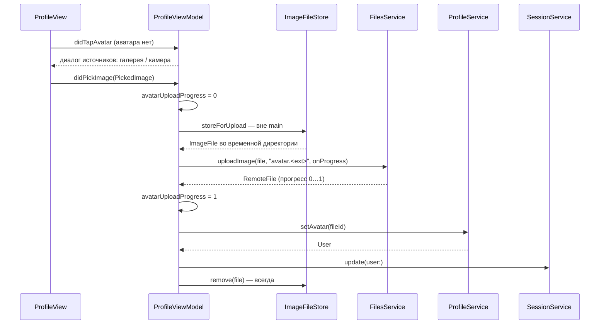

# Профиль и аватар: архитектура клиента

22.10.2026 · Mikhail Kuzmin

Статус: описание реализованного.

## Назначение

Экран профиля показывает текущего пользователя (имя, логин, id, аватар), обновляет его с сервера, позволяет установить аватар из галереи или с камеры и выйти из аккаунта. Аватары всех пользователей показывает общий `AvatarView`.

## Состав

| Тип | Роль |
| --- | --- |
| `ProfileEndpoint`, `ProfileService` | `GET /profile/get`, `POST /profile/setAvatar(fileId)`, `POST /profile/removeAvatar` |
| `FilesEndpoint`, `FilesService` | `POST /files/uploadImage` (multipart), `GET /files/get` |
| `ImageMIMEType`, `ImageUploadLimits` | форматы и лимиты сервера: JPEG / PNG / WebP, 10 МБ, 25 Мп |
| `PickedImage` | выбранное изображение: `.image(UIImage)` с камеры или `.file(ImageFile)` из галереи |
| `ImageFile`, `ImageFileStore` | временный файл, готовый к загрузке как есть, и его подготовка |
| `AvatarSourcePickerViewModifier`, `CameraPicker` | `PhotosPicker` и системная камера |
| `ProfileViewModel` (+`AvatarPicking`, +`Texts`), `ProfileDisplayModel` | состояние экрана |
| `AvatarView` | круглый аватар через Kingfisher |
| `RemoteFile`, `FileEntity`, `FileStorageService` | объект `File` API и его хранение в БД |

## Профиль

- Экран открывается из списка чатов (`ChatListRoute.profile`).
- **Данные — из сессии** (`SessionService.currentUser`): экран показывает пользователя сразу, без ожидания сети.
- При открытии (`.task`) и pull-to-refresh — `GET /profile/get` → `SessionService.update(user:)`. Повторный вызов во время запроса игнорируется. Ошибка — уведомление, на экране остаются данные сессии.
- Обновлённый пользователь пишется в `UserDefaults` вместе с сессией ([авторизация и сессия](auth-and-session.md)).

## Установка аватара

1. **Нажатие на аватар** открывает выбор источника, только если аватара нет и загрузка не идёт. Камера предлагается, только если она есть (`UIImagePickerController.isSourceTypeAvailable(.camera)`).
2. **Галерея** — `PhotosPicker`. Файл запрашивается через `Transferable` в одном из форматов сервера и **копируется как есть** во временную директорию: на сервер уходит оригинал. HEIC система сама отдаёт как JPEG; формат вне списка (GIF и т.п.) — ошибка `loadTransferable`, экран показывает ошибку `ProfileStrings.avatarLoadFailed` («не удалось открыть выбранное изображение»).
3. **Камера** — `CameraPicker` поверх `UIImagePickerController` в `fullScreenCover`; закрывается сам до передачи снимка.
4. **Подготовка файла** — `ImageFileStore.storeForUpload` в `Task.detached`: main не блокируется, прелоадер поверх аватара анимируется.
5. **Загрузка** — `FilesService.uploadImage`: проверяет размер до запроса (`fileTooLarge` — без запроса, сервер ответил бы 3002), затем `NetworkService.upload` с файловой частью `file` ([сетевой слой](networking.md)).
6. **Назначение** — `POST /profile/setAvatar(fileId)`, ответ — обновлённый `User` в сессию.
7. **Временный файл** удаляется сразу после подготовки через `defer` — даже если задача отменится до начала загрузки.
8. **Ошибки.** Ошибка подготовки (`ImageFileStoreError`) — проблема выбранного изображения, а не сети: свой текст `avatarLoadFailed`. Остальные — `ErrorMessages`. Аватар остаётся прежним.

### Прогресс

`avatarUploadProgress: Double?`: `nil` — загрузка не идёт; 0 — файл готовится; доля отправленного; 1 — файл отправлен и аватар назначается. Колбэк прогресса приходит не на main и пересылается задачей на main actor. Порядок доставки не гарантирован, поэтому прогресс только растёт; поздний колбэк вне загрузки игнорируется. Выбор нового фото во время загрузки игнорируется, а его временный файл удаляется.

### Подготовка изображения — `ImageFileStore`

Цель — файл, который сервер примет без 3002, с минимальной потерей качества.

| Вход | Что делается |
| --- | --- |
| файл из галереи в лимитах | отдаётся как есть, без перекодирования |
| снимок с камеры | JPEG в исходном разрешении, качество 0.9, ориентация в EXIF |
| больше 25 Мп | уменьшенная JPEG-копия: большая сторона уменьшается пропорционально до лимита пикселей |
| больше 10 МБ | уменьшенная JPEG-копия (качество 0.85) с большей стороной 2048, если не уложилась — 1024 |

- Размер кадра читается из метаданных (`CGImageSource`), кадр в память не декодируется; уменьшение — `CGImageSourceCreateThumbnailAtIndex`, полный кадр в память не попадает.
- Наружу отдаётся ровно один файл: заменённые и промежуточные удаляются, при ошибке созданные здесь файлы тоже удаляются — удалять вызывающему нужно только результат.
- `remove(_:)` удаляет файл в фоне; отсутствие файла — не ошибка.
- `ImageUploadLimits` — единственный владелец чисел лимитов: их используют и `ImageFileStore`, и `FilesService`.

`ProfileService.removeAvatar()` реализован, но на экране сейчас не используется: при установленном аватаре нажатие на него ничего не делает.

## Выход

Кнопка «Выйти» → подтверждение (`isLogoutConfirmationPresented`) → `AuthService.logout()`. Выход не может не удаться; корень переключится на экран авторизации через сессию. Во время выхода повторные нажатия игнорируются.

## `AvatarView`

Круглый аватар, размер задаётся снаружи `.frame`. Загрузка через Kingfisher (`KFImage`, кэш в памяти и на диске) в две ступени:

1. пока грузится полноразмерный `url`, показывается уменьшенная копия `thumbnailURL` (как правило, уже в кэше после списка);
2. пока нет и её, а также при `url == nil` и ошибке — силуэт `person.crop.circle.fill`.

Уменьшенная копия — `RemoteFile.smallURL` (не более 200 px по меньшей стороне, только для изображений; приходит во вложенном `data.smallUrl`).

## `RemoteFile` и хранение

`RemoteFile` — объект `File` API: `fileId`, `type` (`image` / неизвестное → `other`), `url`, `size`, `filename`, `extension`, `data.smallUrl`. Отсутствующий или `null` `data` — не ошибка. Кодирование — в том же формате, что отдаёт сервер (нужно `UserDefaultsService`, который хранит `User` с аватаром в JSON).

В БД файлы — `FileEntity` (upsert по `fileId`), на них ссылаются `UserEntity.avatar` и `ConversationEntity.avatar` с правилом `Nullify` ([локальная БД](local-storage.md)).

## Строки и разрешения

Строки экрана — `ProfileStrings` (`Profile.strings`). Текст запроса доступа к камере — `NSCameraUsageDescription` в `InfoPlist.strings`; его язык выбирает система, а не переключатель в приложении ([локализация](localization.md)).

## Тесты

- `ProfileViewModelTests`: профиль из сессии; загрузка, ошибка, повторный вызов; источники с камерой и без; нажатие на аватар с ним и без; ошибка выбора; загрузка аватара — успех, имя файла по типу, ошибки подготовки / загрузки / назначения, блокировка нажатия, этапы и монотонность прогресса, поздний прогресс вне загрузки; выбор во время загрузки удаляет файл; подтверждение выхода и защита от повтора.
- `ImageFileStoreTests`: снимок с камеры — полноразмерный JPEG, уникальные файлы, пустое изображение; файл галереи без изменений; уменьшение по размеру, по пикселям и по обоим лимитам; файлы в лимитах не трогаются; не изображение — ошибка; после ошибки не остаётся временных файлов; удаление.
- `FilesServiceTests`: загрузка на `uploadImage`, прогресс, лимит размера (больше — без запроса, ровно лимит — загружается), отсутствующий файл, ошибка API, `fetchFile`.
- `ProfileServiceTests`, `ImageMIMETypeTests`, `RemoteFileTests`, `FileStorageServiceTests`.
