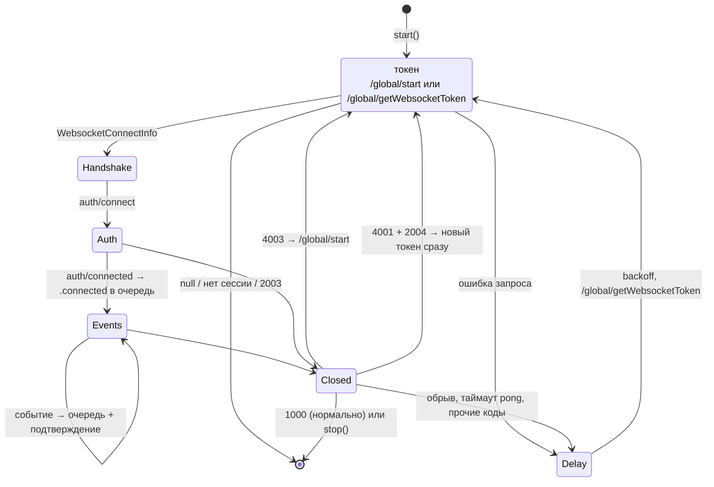

# Соединение реального времени (WebSocket): архитектура клиента

22.10.2026 · Mikhail Kuzmin

Статус: описание реализованного.

## Назначение

`RealtimeService` держит одно WebSocket-соединение с сервером: получает токен, авторизует соединение, пингует его, разбирает события, подтверждает их и переподключается после сбоев. События уходят потребителям через `RealtimeEventQueue`.

Что делают с событиями потребители, описано в их документах: очередь с приостановкой и список переписок — [conversation-list-architecture.md](conversation-list-architecture.md), кэш сообщений — [messages-sync-architecture.md](messages-sync-architecture.md), прочтение — [unread-messages.md](unread-messages.md) и [read-receipts.md](read-receipts.md), уведомления — [incoming-message-notifications.md](incoming-message-notifications.md).

## Состав

| Тип | Роль |
| --- | --- |
| `RealtimeService` | цикл соединения и переподключения; `start()`, `stop()`, наблюдатель выхода |
| `RealtimeEvent` | событие для потребителей очереди |
| `WebSocketConnectionProtocol` / `URLSessionWebSocketConnection` | одно соединение поверх `URLSessionWebSocketTask` |
| `URLSessionWebSocketConnectionFactory` | открывает соединения на отдельной `URLSession` |
| `WebSocketServerMessage`, `WebSocketServerEvent`, `WebSocketClientMessage` | протокол: разбор и сборка JSON |
| `WebSocketCloseCode`, `WebSocketConnectionError` | коды закрытия и ошибки соединения |
| `ReconnectBackoff` | задержки переподключения |
| `NetworkPathMonitor` | появление сети прерывает задержку |
| `RealtimeConnectionMonitor` | id текущего соединения для `MessageCacheService` |
| `GlobalService`, `WebsocketConnectInfo` | `/global/start` и `/global/getWebsocketToken` |

## Протокол

Сообщение сервера — `{ uid, group, event, body, userIds }`. Клиент разбирает пару `group` / `event`:

| `group` / `event` | `WebSocketServerEvent` | В очередь |
| --- | --- | --- |
| `auth` / `connected` | `.connected` | `.connected` |
| `auth` / `connectionError` | `.connectionError(errorCode:)` | — (код запоминается до закрытия 4001) |
| `conversations` / `singleCreated` | `.conversationCreated` | `.conversationCreated` |
| `conversations` / `read` | `.conversationRead` | `.conversationRead` |
| `conversations` / `memberRead` | `.memberRead` | `.memberRead` |
| `messages` / `received` | `.messageReceived` | `.messageReceived` |
| `messages` / `edited` | `.messageEdited` | `.messageEdited` |
| прочее или неразборчивое тело | `.unknown` | — (но подтверждается) |

Неизвестное событие подтверждается, а не роняет соединение: сервер будет добавлять новые. Нет заголовка (`uid`, `group`, `event`) — ошибка разбора, фрейм пропускается как `malformedMessage`, соединение продолжает работать. Бинарные фреймы протоколом не используются и тоже считаются неразборчивыми.

Сообщения клиента (`uid` — новый UUID v4 на каждое):

- `auth` / `connect` `{ userId, token }` — первое сообщение соединения;
- `events` / `received` `{ receivedUid }` — подтверждение всего, кроме группы `auth`.

`userIds` события обрабатываются как action `users`: `userCache.loadUsers(ids:)` запускается в фоне и не ждётся.

## Цикл соединения

1. **Токен.** При `start()` (старт, вход, возврат из фона) и после закрытия 4003 — `/global/start`; при переподключении — `/global/getWebsocketToken`. Токен одноразовый (гасится первой же попыткой авторизации, даже неуспешной) и живёт 120 с. Адрес сервера между вызовами не хранится — сервер может его сменить.
2. **`/global/start` вернул `null`.** Пользователь не авторизован: если локально сессия ещё открыта, она завершается как истёкшая (`authService.expireSession()`, отдельной задачей — выход сам дожидается остановки этого цикла). Подключаться не с чем.
3. **`/global/getWebsocketToken` ответил 2003** — сессии нет, сетевой слой уже завершил её; переподключаться не нужно.
4. **Авторизация.** `auth` / `connect` с `userId` текущего пользователя. До `auth` / `connected` обрабатываются только сообщения авторизации.
5. **`connected`.** Соединение отмечается в `RealtimeConnectionMonitor`, в очередь уходит `.connected`, счётчик переподключений сбрасывается. WebSocket не гарантирует доставку, поэтому потребители по `.connected` синхронизируются через REST. `.connected` идёт через очередь, чтобы события старого соединения применились раньше синхронизации.
6. **События.** Событие кладётся в очередь и подтверждается **не дожидаясь обработки**: приостановленная очередь иначе задержала бы чтение сокета. Событие, потерянное из памяти при убийстве приложения, восстановят стартовая синхронизация списка и синхронизация переписки при открытии.
7. **Смена пользователя.** Перед каждым событием проверяется, что `currentUser.userId` не сменился; иначе соединение закрывается (1000), события чужого пользователя не применяются.

### Исход соединения

| Закрытие | Исход | Дальше |
| --- | --- | --- |
| 1000 или отмена клиентом | `closedNormally` | не переподключаться |
| 4003 — сессия завершена (выход, повторный вход, удаление пользователя) | `sessionEnded` | сразу `/global/start` |
| 4001 после `connectionError` с кодом 2004 — токен не подошёл | `tokenRejected` | сразу новый токен |
| 1006 (обрыв без close-фрейма), таймаут pong, прочие коды, ошибки сети | `failed` | задержка, затем новый токен |
| нет сессии, `null` из `/global/start` | `notAuthorized` | не подключаться |

Без задержки повторяется только **первая** попытка после 2004 или 4003: если и она закончилась тем же, не дойдя до `connected`, — ждём, как при сбое, чтобы не забрасывать сервер запросами.

### Переподключение

`ReconnectBackoff`: 1, 2, 4, 8, 16, 30 с, дальше 30, со случайным разбросом ±20% — чтобы клиенты, потерявшие соединение одновременно (перезапуск сервера), не переподключались залпом. Номер попытки сбрасывается после `connected`.

`NetworkPathMonitor` (`NWPathMonitor`) вызывает `networkDidBecomeAvailable()`, когда сеть появилась после отсутствия (на первое известное состояние — нет): идущая задержка прерывается, и переподключение начинается сразу.

### Heartbeat

Сервер сам не пингует и разрывает соединение после 60 с тишины. Клиент шлёт ping каждые 25 с и ждёт pong 10 с (ожидание входит в интервал). Pong не пришёл — соединение закрывается как потерянное (`failed`, а не `closedNormally`, хотя код закрытия 1000), и начинается переподключение.

## Управление

- **Одно соединение в каждый момент.** Его ведёт задача `runTask`. `start()` отменяет прежнюю, дожидается её завершения и начинает новую с `/global/start`. Отмена закрывает соединение кодом 1000, и его поздние события и закрытие ни на что не влияют (например, 4003 по старому соединению после входа под другим пользователем).
- **`stop()`** закрывает соединение и прекращает переподключения; возвращается, когда соединение закрыто. Вызывается при уходе в фон.
- **Выход из аккаунта.** `authServiceWillLogout()` закрывает соединение **до** запроса выхода: сервер закроет соединения сессии кодом 4003, и по ещё текущему соединению это выглядело бы как истечение. До `authServiceDidLogout` `start()` ничего не делает — иначе возврат из фона во время выхода открыл бы соединение по ещё живой cookie.

## Соединение поверх `URLSession`

- Отдельная `URLSession` без cookie (`httpShouldSetCookies = false`, `httpCookieStorage = nil`) и без кэша: соединение авторизуется только токеном.
- Сборка и разбор JSON — `@concurrent`, вне main.
- Код закрытия — присланный сервером; если close-фрейма не было — 1006.
- Клиент закрывает соединения только нормально: неизвестный код заменяется на 1000.

## `RealtimeConnectionMonitor`

Каждое соединение, дошедшее до `connected`, получает новый `RealtimeConnectionId`; при закрытии он снимается (если текущее уже другое — ничего). Пишет `RealtimeService` синхронно, мимо очереди событий (аренда задержала бы и это); читают акторы без перехода на main, поэтому состояние под `OSAllocatedUnfairLock`.

По нему `MessageCacheService` понимает, синхронизирована ли переписка: признак — id соединения, в котором прошла синхронизация; с закрытием соединения все признаки разом перестают совпадать с `current` ([messages-sync-architecture.md](messages-sync-architecture.md)).

## Логи

Сбои подключения пользователю не показываются — клиент переподключается сам. Они пишутся в `Logger.realtime` (категория `Realtime`).

## Тесты

- `RealtimeServiceTests` (моки соединения и `GlobalService`, подменённое ожидание): подключение и авторизация; `connected` в очередь и в монитор; `null` из `/global/start` при открытой и закрытой сессии; события — в очередь по порядку, загрузка пользователей, подтверждение; неизвестное — только подтверждение; события до `connected` игнорируются; после смены сессии — отбрасываются, соединение закрывается; 1000 без переподключения; обрыв — backoff и сброс после `connected`; 2004 — сразу, затем с задержкой; 2003 при запросе токена — стоп; 4003 — `/global/start`; появление сети пропускает задержку; таймаут pong; `stop`; выход закрывает соединение и блокирует `start` до конца выхода; перезапуск заменяет соединение.
- `ReconnectBackoffTests`: рост до 30 с, разброс в пределах ±20%.
- `WebSocketMessagesTests`: разбор всех событий, неразборчивые тела — `.unknown`, нет заголовка — ошибка; сборка сообщений клиента и уникальный `uid`.
