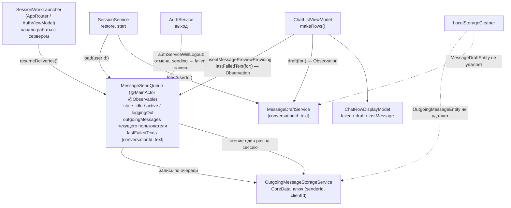

# Неотправленные сообщения в списке чатов: архитектура клиента

16.10.2026 · Mikhail Kuzmin

Статус: реализовано.

## Цель и требования

Сообщение, отправка которого не удалась, не должно теряться и должно быть видно не только в ленте переписки, но и в списке чатов.

1. Неотправленным называется сообщение очереди отправки в статусе `.failed`: отправка не удалась, пользователь может повторить её или удалить сообщение. Сообщения в статусе `.sending` в списке чатов не показываются.
2. В списке чатов неотправленное сообщение показывается вместо текста последнего сообщения в формате «Не отправлено: <текст>» — так же, как черновик («Черновик: <текст>», [message-drafts.md](message-drafts.md)).
3. Неотправленное сообщение в приоритете перед черновиком: если в переписке есть и то и другое, строка показывает неотправленное. Неотправленное вытесняет последнее сообщение и тогда, когда после него в переписке появились более новые — отправленные или входящие (принято 16.10.2026).
4. Если неотправленных в переписке несколько, показывается текст последнего из них — по времени нажатия «Отправить» (`createdAt`).
5. Неотправленные сообщения переживают выход из аккаунта — и по кнопке «Выйти», и по истечению сессии на сервере: после входа того же пользователя они на месте, в ленте и в списке чатов. Другой пользователь на устройстве их не видит.
6. Сообщение, которое в момент выхода отправлялось или ждало отправки, переводится в статус `.failed`, а отправка прерывается.
7. Список чатов берёт неотправленные сообщения из памяти, БД при сборке строк не трогается — как и в случае черновиков.

## Как сейчас

- `MessageSendQueue` (`@MainActor @Observable`) держит в памяти `outgoingMessages` — сообщения всех переписок, сначала самые старые; каждое изменение пишет в БД через `OutgoingMessageStorageService`. Ошибка отправки переводит в `.failed` упавшее сообщение и все, что ждали после него.
- Очередь читается из БД только при старте приложения: `AppRouter.restoreSession()` вызывает `start()` после `conversationList.start()` и до `realtimeService.start()` — ответ на отправку поднимает переписку в списке, и список к этому моменту должен прочитать кэш и подписаться на события. При входе очередь не читается: БД после очистки пуста.
- При выходе (`authServiceWillLogout`) память очищается, текущий запрос отменяется, поставленные записи в БД не выполняются (`generation`), затем `LocalStorageCleaner` удаляет все `OutgoingMessageEntity`. Неотправленные сообщения теряются.
- `OutgoingMessageEntity` уникальна по `clientId`; `fetchAll()` возвращает записи без фильтра по пользователю — в БД лежат сообщения только текущего пользователя.
- Список чатов не знает об очереди отправки: превью — черновик (`ChatRowPreview.draft`) или последнее сообщение (`.message`).
- Цвет `FailedLabel` в `Assets.xcassets` занят: это светло-розовая подпись «не отправлено» на синем пузыре (`MessageBubbleView`). Красный сигнал ошибки у пузыря — значок слева, системный `.red`.

## Ключевые решения

1. **Владелец данных — `MessageSendQueue`, отдельного сервиса нет.** Очередь уже держит неотправленные сообщения в памяти, пишет их в БД и наблюдается через Observation. Второй сервис с копией тех же данных пришлось бы синхронизировать с очередью на каждом переходе статуса. Очередь получает производный индекс для списка чатов (решение 2) и загрузку по пользователю (решение 4). Список чатов видит её через узкий протокол `UnsentMessagePreviewProviding` — только чтение превью, как `MessageDraftLoading` у `SessionService`.
2. **Индекс для списка чатов — словарь `[Int: String]` (ключ — `conversationId`), а не фильтрация массива при сборке строк.** `makeRows()` вызывается для каждой переписки списка; поиск по `outgoingMessages` сделал бы сборку O(переписки × сообщения очереди). Очередь держит `private(set) var lastFailedTexts: [Int: String]` — текст последнего `.failed` сообщения каждой переписки — и пересчитывает его в `didSet` у `outgoingMessages` (очередь маленькая, пересчёт O(n)). `didSet`, а не пересчёт в каждом действии: новый путь изменения очереди не сможет забыть обновить индекс. Массовые изменения (перевод в `.failed` нескольких сообщений, загрузка) собирают новый массив и присваивают его один раз — иначе пересчёт шёл бы на каждый элемент, O(n²). Присваивание индекса идёт только при изменении значения: Observation сообщает о любом присваивании, и без проверки каждая смена статуса `.sending` → подтверждение пересобирала бы список. Чтение `lastFailedText(for:)` — O(1).

   Observation отслеживает свойство целиком, а не ключи словаря: изменение неотправленного в одной переписке запускает `makeRows()` для всего списка. Это дёшево — неизменившиеся строки берутся из `CachedRow`, пересборка не чаще раза в `rowsUpdateInterval`, а неотправленные меняются редко.
3. **Неотправленные сообщения переживают выход так же, как черновики.** Правило «при выходе БД очищается целиком» (стандарт `ios-swiftui-standards`, раздел «Очистка БД при logout») относится к кэшу серверных данных; сообщения очереди есть только на устройстве, на сервер они не попали, — это исключение «данные, которых нет на сервере» из того же раздела. `LocalStorageCleaner.preservedEntityNames` получает `OutgoingMessageEntity`. Пользователей разделяет ключ — `senderId` в записи: очередь загружает в память только сообщения текущего пользователя.

   **Компромисс по приватности** — тот же, что принят для черновиков (решение 5 в [message-drafts.md](message-drafts.md)): тексты пользователя A остаются в файле БД, когда входит B; интерфейс их B не показывает; срок хранения ограничен (решение 8).
4. **Очередь загружается в память при открытии сессии в `SessionService`, до показа списка чатов** — как черновики. При старте и при входе строки списка с первого кадра показывают «Не отправлено:», без мигания последним сообщением. Загрузка в одном месте не даёт новому пути входа её пропустить. Загрузка только читает — прерванные отправки возобновляются отдельно (решение 5).

   **Отправитель — пользователь, чья очередь загружена**, а не `sessionService.currentUser`: `load(userId:)` запоминает его в состоянии очереди (`State.active(userId:)`), `enqueue` берёт `senderId` оттуда. Зависимость очереди от `SessionService` удаляется, и цикл в `DIContainer` (сессии нужны загрузчики, очереди — сессия) не возникает: очередь создаётся раньше `SessionService`, как черновики.
5. **Загрузка не отправляет: прерванные отправки возобновляет `resumeDeliveries()`.** Ответ на отправку поднимает переписку в списке (`ConversationPositionUpdating.applySentMessage`), а `SessionService.restore()` выполняется раньше `conversationList.start()` — отправка из `load` при старте пришла бы в список, который ещё не прочитал кэш и не подписан на события. Поэтому `load` раскладывает сообщения в `.sending` в очередь отправки, но обработку не запускает; её запускает `resumeDeliveries()` вместе с началом работы с сервером. Порядок задаёт одна точка — `SessionWorkLauncher.startSessionWork()`: `conversationList.start()` → `messageSendQueue.resumeDeliveries()` → `realtimeService.start()`. Её вызывают оба места открытия сессии — `AppRouter.restoreSession()` после `sessionService.restore()` и `AuthViewModel.performAuthentication()` после `sessionService.start(user:)`, — поэтому новый путь входа не сможет пропустить шаг или нарушить порядок (так же, как загрузка данных собрана в `SessionService`). Повторный `conversationList.start()` при входе после выхода ничего не делает: список запускается один раз за жизнь процесса, выход только сбрасывает его состояние. Экран входа и роутер видят только `SessionWorkStarting`, а сам запуск знает об очереди лишь `MessageDeliveryResuming`.

   До `resumeDeliveries()` новые сообщения и повторы встают в очередь отправки, но не уходят — после вызова они отправляются за загруженными, порядок не нарушается. Повторный вызов ничего не делает; выход снова останавливает обработку до следующего `resumeDeliveries()`.
6. **Выход прерывает отправку и сохраняет сообщения как неотправленные.** В `authServiceWillLogout` очередь перестаёт принимать действия пользователя, отменяет текущий запрос, переводит в `.failed` все сообщения в `.sending` (и отправляющееся, и ждущие), дожидается **всех** поставленных записей в БД и только потом очищает память. Сейчас поставленные, но не начатые записи при выходе отбрасываются (`generation`) — после изменения они выполняются: БД с очередью при выходе не очищается.

   **Очередь не зависит от порядка наблюдателей выхода** — контракт `AuthServiceObserver` запрещает на него полагаться. Подтверждённое сообщение записывается в кэш (`applySent`) в цепочке записей очереди, и эта запись может выполниться, когда `MessageCacheService` уже в выходе и запись отбрасывает. Неотправленную копию тогда не удалил бы никто. Поэтому `applySent` возвращает `SentMessageWriteResult`: `.written` — сообщение записано вместе с удалением копии; `.discarded` — кэш в выходе, запись отброшена или отменена; `.failed` — ошибка записи. Только при `.discarded` очередь удаляет копию сама: `outgoingMessageStorage.delete(senderId:clientId:)`. В обычном случае вторая запись не нужна и не ставится. При `.failed` копия тоже не удаляется: она остаётся в `.sending`, при следующей загрузке очередь отправит её повторно с тем же `clientId`, сервер вернёт уже созданное сообщение, и кэш его запишет — иначе сообщение пропало бы из ленты до синхронизации. Серверное сообщение, не попавшее в кэш, не теряется: кэш при выходе всё равно очищается, а при входе лента загрузит его с сервера. Если не выполнится и удаление (ошибка записи), остаётся запись в `.sending`: после входа очередь отправит её повторно с тем же `clientId`, сервер вернёт уже созданное сообщение без дубля.
7. **Отменённый запрос мог дойти до сервера.** Сообщение, запрос которого отменён при выходе, станет `.failed`, хотя сервер мог его создать. После входа оно покажется как неотправленное, пока не подтвердится: повтор с тем же `clientId` вернёт уже созданное сообщение (сервер не создаёт дубль), а загрузка страницы переписки с этим `clientId` уберёт его из очереди (`removeConfirmed`) и из БД (`OutgoingMessageEntity.deleteConfirmed`). Список чатов подтвердить его сам не может: `LastMessage` не содержит `clientId`.
8. **Неотправленное сообщение живёт 30 дней с `createdAt`** — `MessageSendQueue.unsentMessageLifetime`. Срок совпадает с черновиками (`MessageDraftService.draftLifetime`), но константы разные: черновик устаревает по `updatedAt`, неотправленное — по `createdAt`, это две политики, и изменение одной не должно незаметно сдвигать другую. При каждой загрузке очередь удаляет из БД сообщения всех пользователей старше срока, затем читает сообщения текущего. Так ограничивается срок хранения чужих текстов и не копятся сообщения пользователей, которые больше не входят на устройстве. Отсчёт от `createdAt`, а не от последней смены статуса: повтор, упавший снова, срок не продлевает — сообщение месячной давности отправлять уже поздно. Удаление неотправленного сообщения без действия пользователя принято 16.10.2026.
9. **Смена пользователя без выхода не поддерживается — только страховка.** Сессия завершается только через `AuthService` (`SessionService.end()` / `expire()` вызываются лишь из `authServiceDidLogout`), поэтому `load(userId:)` другого пользователя при загруженной очереди — ошибка программы. Повторять в `load` сценарий выхода бессмысленно: он сработал бы поздно — `start(user:)` до загрузки ждёт очистки БД, и worker прежнего пользователя успел бы отправить его сообщения с cookie нового. Очередь логирует ошибку (`fault`), отменяет отправку и очищает память без записи в БД; сообщения прежнего пользователя остаются в БД в своём статусе и вернутся ему при следующем входе. Не `assertionFailure`: путь проверяется тестом.



## Хранение в БД

Новая версия модели `Chatik 9`; меняется только `OutgoingMessageEntity`, миграция лёгкая (автоматическая).

| Изменение | Зачем |
| --- | --- |
| ограничение уникальности `clientId` → `(senderId, clientId)` | `clientId` уникален только в пределах отправителя (`MessageClientKey`); в БД теперь лежат сообщения нескольких пользователей |
| составной индекс `(senderId, createdAt)` | загрузка очереди пользователя одним запросом, сразу в порядке `createdAt` |
| индекс по `createdAt` | удаление просроченных у всех пользователей (`deleteAll(createdBefore:)`) |
| `versionHashModifier` у `OutgoingMessageEntity` (`2`) | ограничения уникальности и индексы не входят в хеш версии сущности: без модификатора Core Data сочтёт хранилище `Chatik 8` совместимым с новой моделью, миграция не выполнится, и в SQLite останется уникальный индекс по одному `clientId` |

Новых атрибутов нет: пользователь — `senderId`, срок жизни — `createdAt`.

`OutgoingMessageStorageService`:

```swift
protocol OutgoingMessageStorageServiceProtocol {
    /// Сохраняет сообщение очереди: upsert по `senderId` и `clientId`.
    func save(message: OutgoingMessage) async throws
    /// Сохраняет сообщения очереди одной записью: upsert по `senderId` и `clientId`.
    func save(messages: [OutgoingMessage]) async throws
    /// Сообщения очереди пользователя, сначала самые старые.
    func fetchAll(senderId: Int) async throws -> [OutgoingMessage]
    /// Удаляет сообщение очереди, если оно найдено.
    func delete(senderId: Int, clientId: String) async throws
    /// Удаляет сообщения очереди всех пользователей, созданные раньше `date`.
    func deleteAll(createdBefore date: Date) async throws
}
```

- `OutgoingMessageEntity.fetchEntitiesByKey(keys:in:)` ищет записи по ключу `(senderId, clientId)`: один запрос `clientId IN %@`, отправитель сверяется в памяти. Не OR по парам ключа: `deleteConfirmed(by:in:)` получает все сообщения страницы или дельты синхронизации, и предикат из тысяч `senderId == … AND clientId == …` упёрся бы в предел глубины выражения SQLite (1000) — запись всей дельты упала бы. Им пользуются `save(messages:)`, `delete(senderId:clientId:)` и `deleteConfirmed(by:in:)`.
- `save(messages:)` — upsert списка в одном контексте с одним `save()`; `save(message:)` вызывает его со списком из одного. Очередь пишет им статусы, меняющиеся пачкой (`markFailed` при ошибке отправки и при выходе).
- Doc-комментарий `OutgoingMessageEntity` («в БД лежат сообщения только текущего пользователя, БД очищается при выходе») переписывается.
- Пересоздание повреждённого хранилища (`CoreDataStack.destroyStores`) очередь теряет — как и сейчас.

## Кэш сообщений

`MessageCacheServiceProtocol.applySent(_:)` возвращает результат (решение 6):

```swift
/// Записывает сообщение из ответа `/messages/send` и удаляет его неотправленную копию в той же транзакции.
/// - Returns: записано ли сообщение, отброшено выходом или запись не удалась.
@discardableResult
func applySent(_ message: Message) async -> SentMessageWriteResult

enum SentMessageWriteResult: Sendable {
    case written    // записано, копия удалена в той же транзакции
    case discarded  // кэш в выходе — копию удаляет очередь
    case failed     // ошибка записи — копия остаётся для повторной отправки
}
```

## Очередь отправки

```swift
/// Превью неотправленных сообщений для списка чатов — всё, что об очереди знает `ChatListViewModel`.
@MainActor
protocol UnsentMessagePreviewProviding: AnyObject {
    /// Текст последнего неотправленного (`.failed`) сообщения переписки; `nil` — таких нет.
    /// Читается из памяти, отслеживается Observation.
    func lastFailedText(for conversationId: Int) -> String?
}

@MainActor
protocol MessageSendQueueProtocol: AuthServiceObserver, SessionDataLoading, UnsentMessagePreviewProviding, Sendable {
    /// Сообщения текущего пользователя во всех переписках, ещё не подтверждённые сервером, сначала самые старые.
    var outgoingMessages: [OutgoingMessage] { get }

    /// Запускает отправку очереди: загруженные из БД сообщения в `.sending`, затем поставленные до вызова.
    /// Вызывается, когда начинается работа с сервером; повторный вызов ничего не делает.
    func resumeDeliveries()
    func enqueue(text: String, conversationId: Int)
    func retry(clientId: String)
    func delete(clientId: String)
    func removeConfirmed(by messages: [Message])
    func sentMessages() -> AsyncStream<Message>
}

/// Загрузка данных пользователя при открытии сессии — всё, что о сервисах с такими данными знает `SessionService`.
@MainActor
protocol SessionDataLoading: AnyObject, Sendable {
    /// Загружает данные пользователя из БД в память; повторный вызов для того же пользователя ничего не делает.
    func load(userId: Int) async
}
```

`SessionDataLoading` заменяет `MessageDraftLoading` (то же содержимое, общее имя): `MessageDraftService` и `MessageSendQueue` реализуют его оба. У `MessageDraftService` повторный вызов после ошибки чтения по-прежнему читает БД снова (`State.loadFailed`) — это его поведение, протокол его не запрещает. `start()` из протокола очереди удаляется, его место занимает `resumeDeliveries()`.

Устройство:

- **Зависимости.** `sessionService` из `init` удаляется (решение 4): отправитель берётся из `state`.
- **Память.**
  - `outgoingMessages` — только сообщения текущего пользователя (раньше это обеспечивала очистка БД, теперь — загрузка по `senderId`).
  - `private(set) var lastFailedTexts: [Int: String]` — производный индекс (решение 2). Пересчитывается в `didSet` у `outgoingMessages`: проход по массиву, для каждой переписки остаётся текст последнего `.failed` (массив отсортирован по `createdAt`). Присваивается, только если результат отличается от текущего. `markFailed` и загрузка меняют копию массива и присваивают её один раз.
  - `@ObservationIgnored private var isDeliveryResumed = false` — `resumeDeliveries()` уже вызван в этой сессии (решение 5). Пока `false`, `scheduleDelivery` только добавляет `clientId` в `pendingDeliveries`, не запуская `worker`.
  - `state` вместо пары `isLoggingOut` / неявного «загружено ли»:

    ```swift
    private enum State: Equatable {
        /// Сессии нет или очередь ещё не загружена: действия пользователя не принимаются.
        case idle
        /// Сессия пользователя открыта, он — отправитель новых сообщений. Если чтение БД не удалось, очередь
        /// начинает пустой, а неотправленные прошлых сессий появятся при следующей загрузке — следующем входе
        /// или старте приложения.
        case active(userId: Int)
        /// Идёт выход: новые сообщения, повторы и удаления не принимаются.
        case loggingOut
    }
    ```

    Отдельного состояния «загрузка не удалась» нет: оно отличалось бы только повторным чтением при `load` того же пользователя, а такого вызова без выхода не бывает — `restore()` выполняется один раз, `start(user:)` идёт после выхода, который возвращает очередь в `.idle`.
- **Загрузка `load(userId:)`.** Вызовы выполняются по одному: каждый дожидается предыдущего (`pendingLoad`, как в `MessageDraftService`), иначе загрузки при старте и при входе могли бы применить результаты в обратном порядке.
  1. `.active` того же пользователя — ничего не делает. `.active` **другого** пользователя — страховка из решения 9: ошибка в лог, `worker` отменяется, `pendingDeliveries` и память очищаются без записи в БД, `generation += 1`, `isDeliveryResumed = false`; дальше — обычная загрузка.
  2. Дожидается `lastWrite` (поздние записи прошлой сессии того же пользователя попадают в БД раньше чтения), удаляет просроченные — `deleteAll(createdBefore: now() − unsentMessageLifetime)` (решение 8; ошибка логируется и загрузку не останавливает), читает `fetchAll(senderId:)`. Результат, пришедший после смены `generation` (выход во время загрузки), не применяется.
  3. Успех: `outgoingMessages` = прочитанное, `state = .active`; `clientId` сообщений в `.sending` (приложение закрыли во время отправки) добавляются в `pendingDeliveries` в порядке `createdAt` — уйдут после `resumeDeliveries()`. Объединять с памятью не нужно: загрузка применяется только из `.idle`, а в `.idle` очередь пуста — она не принимает сообщений, выход и страховка из шага 1 очищают память. Это предусловие записывается в doc-комментарий `load`.
  4. Ошибка чтения: логируется, очередь остаётся пустой, `state = .active` — отправлять новые сообщения можно, неотправленные старые не видны до следующей загрузки.
- **`resumeDeliveries()`**: `isDeliveryResumed = true` и запуск `worker`, если `pendingDeliveries` не пуст. В `.idle` и `.loggingOut` и при повторном вызове ничего не делает.
- **`enqueue`** принимает сообщения только в `.active`; `senderId` — `userId` из состояния. **`retry` и `delete`** в `.idle` и `.loggingOut` ничего не делают.
- **Подтверждение.** Запись подтверждённого сообщения: `messageCache.applySent(message)`; если вернул `.discarded` — `outgoingMessageStorage.delete(senderId:clientId:)` (решение 6).
- **Выход `authServiceWillLogout`** (решение 6):
  1. `state = .loggingOut`, `isDeliveryResumed = false`; `pendingDeliveries` очищается; `worker` отменяется и дожидается — ответ на отменённый запрос не применяется (как сейчас).
  2. Все сообщения в `.sending` переводятся в `.failed` и ставятся в запись одной пачкой (`markFailed` → `save(messages:)`).
  3. Дожидается всей цепочки записей, включая только что поставленные и подтверждения: `await lastWrite?.value` в цикле, пока `lastWrite` не перестанет меняться. Действия пользователя в `.loggingOut` записей не ставят, цикл — защита на случай нового пути записи.
  4. `generation += 1`, `outgoingMessages` очищается (индекс очищается вместе с ним), `state = .idle`.

  `authServiceDidLogout` больше не нужен для снятия флага: следующий `load(userId:)` переведёт очередь в `.active`.
- **Запись в БД.** Цепочка `write` не меняется; проверка `generation` остаётся для записей, поставленных после выхода (их быть не должно — защита от гонок).

## Список чатов

- `ChatListViewModel` получает `UnsentMessagePreviewProviding` (в `ChatListRootView` — `DIContainer.shared.messageSendQueue`). `makeRows()` читает `lastFailedText(for: conversation.id)` рядом с черновиком — внутри `withObservationTracking`, поэтому смена статуса или удаление неотправленного пересобирает строку тем же механизмом, не чаще раза в `rowsUpdateInterval`.
- `CachedRow` хранит и сравнивает текст неотправленного. Чтобы сигнатура не росла дальше, черновик и неотправленное объединяются в одно значение:

  ```swift
  /// Локальное состояние переписки, вытесняющее последнее сообщение в превью строки.
  enum ChatRowLocalPreview: Equatable {
      /// Последнее неотправленное сообщение.
      case failed(String)
      /// Черновик.
      case draft(String)
  }
  ```

  `makeRows()` выбирает его с приоритетом `failed` › `draft` (требование 3): `lastFailedText(for:).map(ChatRowLocalPreview.failed) ?? draft(for:).map(ChatRowLocalPreview.draft)`. `RowBuilder` становится `(Conversation, CachedUser?, ChatRowLocalPreview?, MessageTimeFormatter) -> ChatRowDisplayModel`, параметр `draft:` у `ChatRowDisplayModel.init` — `localPreview:`.
- `ChatRowPreview` различает только то, что строка показывает по-разному: текст последнего сообщения или текст с цветным префиксом. Вариант `.draft` переименовывается и обслуживает оба случая:

  ```swift
  enum ChatRowPreview: Equatable {
      /// Текст последнего сообщения; «Новый чат» — сообщений нет; пустая строка — строка-заглушка без данных.
      case message(String)
      /// Локальное состояние, готовое к показу: цветной префикс («Черновик:», «Не отправлено:»), пробел и текст
      /// в одну строку.
      case labeled(AttributedString)
  }
  ```

  Что именно показано — черновик или неотправленное, — различает `ChatRowLocalPreview`; превью строки содержит уже готовый текст.
- Сборка превью: `draftPreview(_:)` обобщается до `labeledPreview(prefix:color:text:)` — та же обрезка до 200 символов, схлопывание пробелов и переводов строк, обрезка краёв по `MessageTextValidator.trimmedCharacters`. Черновик и неотправленное отличаются только префиксом и цветом.
- `ChatRowView` показывает `.labeled` так же, как сейчас `.draft`: `Text(attributed)`, `.subheadline`, `.secondary`, `lineLimit(1)`.
- Положение переписки и время в строке неотправленное сообщение не меняет: переписку поднимают только сообщения, созданные сервером.

### Строки

| Ключ | ru | en |
| --- | --- | --- |
| `chat_list.row.failed_prefix` | `Не отправлено:` | `Not sent:` |

Пробел после двоеточия добавляет `ChatRowDisplayModel`, как у черновика.

### Цвет «Не отправлено:»

Имя `FailedLabel` занято подписью на синем пузыре (светло-розовый `#FFD6D6`, см. «Как сейчас»); его значения не меняются. Системный красный (`#FF3B30`), которым отмечен значок ошибки у пузыря, для мелкого текста на белом недостаточно контрастен (≈ 3,6 : 1). Новый цвет `ChatListFailedLabel` в `Assets.xcassets` под WCAG AA (не меньше 4,5 : 1; оттенки приняты 16.10.2026):

| Тема | Цвет | Фон | Контраст |
| --- | --- | --- | --- |
| Светлая | `#C62828` | белый `#FFFFFF` | ≈ 5,6 : 1 |
| Тёмная | `#FF6B6B` | чёрный `#000000` | ≈ 7,6 : 1 |
| Тёмная | `#FF6B6B` | `secondarySystemBackground` `#1C1C1E` | ≈ 6,1 : 1 |

Проверить на подсветке выбранной строки (`selectedConversationId`).

## Порядок при старте, входе и выходе

`SessionService` получает `[SessionDataLoading]` вместо одного `MessageDraftLoading?` (по умолчанию пустой массив — для тестов и превью) и загружает их параллельно (`withTaskGroup`): чтения независимы и идут в фоновых контекстах.

- **Старт.** `restore()`: пользователь из `UserDefaults` → загрузка черновиков и очереди в память → `isRestored`. Затем `AppRouter.restoreSession()` вызывает `SessionWorkLauncher.startSessionWork()`: `conversationList.start()` → `messageSendQueue.resumeDeliveries()` (сообщения, оставшиеся в `.sending` после закрытия приложения, уходят в отправку) → `realtimeService.start()`. Параметры `conversationList` и `messageSendQueue` у `AppRouter` заменяются на `sessionWork: SessionWorkStarting`.
- **Вход.** `start(user:)`: очистка БД (очередь и черновики не трогаются) → загрузка черновиков и очереди → `currentUser = user`. Неотправленные сообщения пользователя видны в списке и в ленте с первого кадра. Затем `AuthViewModel.performAuthentication()` вызывает `SessionWorkLauncher.startSessionWork()` — тот же порядок. `AuthViewModel` вместо `realtimeService` получает `sessionWork: SessionWorkStarting` из `DIContainer` и об очереди не знает.
- **Выход.** `authServiceWillLogout` у наблюдателей по порядку подписки: … → `MessageSendQueue` (отмена, `.sending` → `.failed`, запись, очистка памяти) → `MessageCacheLogoutObserver` → `MessageDraftLogoutObserver`; затем запрос выхода; затем `SessionService.authServiceDidLogout` очищает БД — всё, кроме `MessageDraftEntity` и `OutgoingMessageEntity`. Порядок наблюдателей внутри фазы показан для примера: очередь от него не зависит (решение 6).

## Ограничения

- **Доставленное, но не подтверждённое до выхода** сообщение после входа показывается как неотправленное, пока не откроют переписку или не повторят отправку (решение 7). Повтор не создаст дубль.
- **Список чатов не подтверждает неотправленные сообщения сам** — у `LastMessage` нет `clientId`. Если понадобится, нужно добавить `clientId` и `senderId` в `LastMessage` на сервере.
- **Неотправленные сообщения переписок, которых больше нет**, удаляются только по сроку (решение 8).
- **Срок зависит от часов устройства** — `createdAt` локальное время.
- **Сообщения прежних пользователей на устройстве** — принятый компромисс (решение 3).
- **Повреждённое хранилище** пересоздаётся без очереди.
- **Ошибка чтения очереди** скрывает неотправленные прошлых сессий до следующего входа или старта приложения: повторно в той же сессии очередь БД не читает.
- **Повтор на время отправки убирает «Не отправлено:» из строки.** После «Повторить» сообщение в `.sending`, и строка показывает черновик или последнее сообщение (требование 1); при новой ошибке «Не отправлено:» возвращается. Это ожидаемое поведение, а не мигание.
- **Срок жизни в памяти не проверяется.** Просроченные удаляются при загрузке; в сессии, которая идёт дольше срока без перезапуска приложения, неотправленное остаётся видно до следующей загрузки.

## Затронутые файлы

| Файл | Изменение |
| --- | --- |
| `Storage/Chatik.xcdatamodeld/Chatik 9.xcdatamodel` | уникальность `OutgoingMessageEntity` по `(senderId, clientId)`, индексы `(senderId, createdAt)` и `createdAt`, `versionHashModifier`; текущая версия |
| `Storage/Entities/OutgoingMessageEntity.swift` | `fetchEntitiesByKey(keys:in:)` (`clientId IN` + сверка отправителя), запрос по `senderId`, doc-комментарий |
| `Storage/OutgoingMessageStorageService.swift` | `save(messages:)`, `fetchAll(senderId:)`, `delete(senderId:clientId:)`, `deleteAll(createdBefore:)` |
| `Storage/LocalStorageCleaner.swift` | `OutgoingMessageEntity` в `preservedEntityNames`, doc-комментарии |
| `Services/Message/MessageCacheService.swift` | `applySent(_:)` возвращает `SentMessageWriteResult` |
| `Services/Message/MessageSendQueue.swift` | `UnsentMessagePreviewProviding`, `SessionDataLoading`, `state`, `lastFailedTexts`, `resumeDeliveries()`, `unsentMessageLifetime`, `MessageDeliveryResuming`, удаление копии при `.discarded`, пачечная запись `markFailed`, новый выход, без `sessionService` и `start()` |
| `Services/MessageDraft/MessageDraftService.swift` | `MessageDraftLoading` → `SessionDataLoading` |
| `Services/Session/SessionService.swift` | `[SessionDataLoading]`, параллельная загрузка, doc-комментарии |
| `Services/Session/SessionWorkLauncher.swift` | новый: `SessionWorkStarting`, порядок начала работы с сервером |
| `Screens/AppRoot/AppRouter.swift`, `AppRootView.swift` | `sessionWork` вместо `conversationList` и `messageSendQueue`, doc-комментарии |
| `Screens/Auth/ViewModel/AuthViewModel.swift`, `AuthViewModel+Authentication.swift`, `View/AuthRootView.swift` | `sessionWork` вместо `realtimeService`, `startSessionWork()` после входа |
| `DIContainer.swift` | очередь создаётся до `SessionService`, без `sessionService`, и передаётся в его загрузчики вместе с черновиками; `sessionWorkLauncher` |
| `Screens/ChatList/ViewModel/ChatListViewModel.swift` | `UnsentMessagePreviewProviding`, чтение `lastFailedText`, `ChatRowLocalPreview` в `CachedRow` и `RowBuilder` |
| `Screens/ChatList/ViewModel/ChatRowDisplayModel.swift` | `ChatRowPreview.draft` → `.labeled`, `localPreview:`, `labeledPreview` |
| `Screens/ChatList/View/Subviews/ChatRowView.swift`, `ChatListRootView.swift` | показ `.labeled`, передача очереди, `#Preview` |
| `Screens/ChatList/ChatListStrings.swift`, `*.lproj/ChatList.strings` | `chat_list.row.failed_prefix` |
| `Assets.xcassets/ChatListFailedLabel.colorset` | цвет префикса; `FailedLabel.colorset` не меняется |
| `Preview Content/PreviewDependencies.swift` | загрузчики сессии, очередь для списка, `SessionWorkPreviewMock` для экрана входа |

Остальные зависимости очереди (`messageService`, `messageCache`, `realtimeEventQueue`, `conversationListService`) от `SessionService` не зависят и создаются раньше него — порядок сборки в `DIContainer` меняется без новых механизмов.

Очередь выполняет условия стандарта `ios-swiftui-standards` для данных, которых нет на сервере (раздел «Очистка БД при logout»): ключ `(senderId, clientId)`, загрузка по `senderId` при открытии сессии, срок `unsentMessageLifetime`, сохранение при выходе, `preservedEntityNames` и компромисс по приватности (решение 3).

## Тесты

- **`OutgoingMessageStorageService`**: upsert по `(senderId, clientId)` — одинаковый `clientId` у разных отправителей даёт две записи; `fetchAll(senderId:)` возвращает только сообщения пользователя по `createdAt`; `deleteAll(createdBefore:)` удаляет сообщения всех пользователей раньше границы и не трогает сообщения на границе и позже; `save(messages:)` обновляет существующие записи и схлопывает повторы ключа. `MessageStorageService`: подтверждение пачки из 2000 сообщений проходит и удаляет копию.
- **`MessageCacheService`**: `applySent` возвращает `.written` после записи, `.discarded` — во время выхода, `.failed` — при ошибке записи.
- **`MessageSendQueue`**:
  - `load` читает только сообщения пользователя, дожидается цепочки записей, удаляет просроченные до чтения; результат загрузки после выхода не применяется; до `load` `enqueue` ничего не делает, `senderId` нового сообщения — пользователь из `load`;
  - `load` не отправляет: `.sending` из БД уходят только после `resumeDeliveries()`, в порядке `createdAt`, а сообщения, поставленные до вызова, — после них; повторный `resumeDeliveries()` ничего не делает; после выхода и новой `load` отправка снова ждёт `resumeDeliveries()`;
  - `load`: повторный вызов для того же пользователя БД не читает — и после успеха, и после ошибки чтения; после ошибки чтения `enqueue` работает; два вызова подряд применяются в порядке вызова; `load` другого пользователя без выхода отменяет отправку, очищает память, ничего не пишет в БД и загружает очередь нового пользователя;
  - `lastFailedText`: `nil` без `.failed`; текст последнего по `createdAt` из нескольких; `.sending` не учитывается; меняется при `retry` (уходит в `.sending`), `delete` и подтверждении; не присваивается заново, если значение не изменилось; перевод нескольких сообщений в `.failed` присваивает индекс один раз;
  - подтверждение: `applySent` вернул `.written` или `.failed` — удаление копии не ставится; `.discarded` (мок кэша в выходе) — копия удаляется из БД;
  - выход: статусы «не отправлено» всех отправлявшихся сообщений записаны одной пачкой;
  - выход: отправляющееся и ждущие сообщения становятся `.failed` в БД, запрос отменён, ответ на него не применён; поставленные до выхода записи выполнены; `retry` и `delete` во время выхода ничего не делают; память и индекс пусты; `load` того же пользователя после выхода возвращает их как `.failed`; `load` другого пользователя их не видит;
  - выход, когда кэш сообщений уже остановлен раньше очереди: подтверждённое до выхода сообщение после `load` не появляется в очереди; если удаление копии не удалось, запись в `.sending` после `load` и `resumeDeliveries()` отправляется повторно с тем же `clientId`.
- **`LocalStorageCleaner`**: `clearAll()` не удаляет `OutgoingMessageEntity` и `MessageDraftEntity`.
- **`SessionService`**: `restore()` и `start(user:)` вызывают `load(userId:)` у всех загрузчиков до `isRestored` / `currentUser`.
- **`SessionWorkLauncher`**: `startSessionWork()` вызывает `conversationList.start()`, `messageSendQueue.resumeDeliveries()` и `realtimeService.start()` именно в этом порядке (общий журнал вызовов моков).
- **`AppRouter`**, **`AuthViewModel`** (над настоящим `SessionWorkLauncher` и моками): `restoreSession()` запускает работу после восстановления сессии; успешный вход — после `sessionService.start(user:)`; ошибка входа — не запускает.
- **`ChatRowDisplayModel` / `ChatListViewModel`**: неотправленное вытесняет черновик и последнее сообщение, в том числе более новое; «Новый чат» вытесняется неотправленным; `makeRow` получает `ChatRowLocalPreview.failed`, а не `.draft`, когда есть оба; префикс окрашен, текст — нет; переводы строк схлопываются; изменение неотправленного пересобирает строку, а не берёт её из кэша.
- **Миграция**: хранилище `Chatik 8` с очередью открывается моделью `Chatik 9` без потери данных; после миграции сохраняются две записи с одинаковым `clientId` и разными `senderId` — новое ограничение уникальности действует.
- **Цвета**: `FailedLabel` сохраняет `#FFD6D6`; `ChatListFailedLabel` в светлой и тёмной теме — `#C62828` и `#FF6B6B` (`UIColor(named:)` с нужным `UITraitCollection`).
