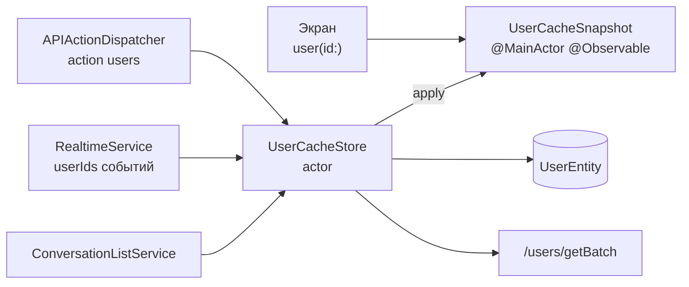

# Пользователи: кэш и выбор собеседника

22.10.2026 · Mikhail Kuzmin

Статус: описание реализованного.

## Назначение

Сервер не вкладывает пользователей в переписки, сообщения и события — только их id (поля `opponentUserId`, `senderId`, `memberIds`, `userIds` событий и action `users`). Имена и аватары клиент берёт из кэша пользователей. Отдельно — постраничный список пользователей с поиском на экране создания личного диалога.

## Состав

| Тип | Роль |
| --- | --- |
| `UsersEndpoint` | `GET /users/getList` (поиск, страницы по `maxId`), `GET /users/getBatch` (до 100 id) |
| `UsersService` | запросы `/users/*`; пустой поисковый запрос не отправляется |
| `UserCacheServiceProtocol` / `UserCacheService` | `@MainActor` фасад кэша: `user(id:) -> CachedUser`, `loadUsers(ids:)` |
| `UserCacheStore` | `actor`, вся логика кэша: память, БД, запросы, устаревание |
| `UserCacheSnapshot` | `@Observable` копия состояний на main — то, что читают экраны |
| `CachedUser` | `.loaded(User)` / `.pending` / `.notFound` |
| `UserStorageService`, `UserEntity` | пользователи в БД со временем получения `cachedAt` |
| `CreateSingleConversation*` | экран выбора собеседника и создания переписки |

## Кэш

Уровни: память → БД (переживает перезапуск) → сервер.

### Стратегия `loadUsers(ids:)`

1. Повторы id убираются.
2. Кого нет в памяти (и кто не отмечен «не найден»), читаются из БД одним запросом.
3. **Нет ни в памяти, ни в БД** — запрашиваются, и вызывающий **ждёт** ответа.
4. **Есть, но устарел** (`freshnessInterval` = 3 мин с получения с сервера; у записи без метки — `.distantPast`) — перезапрашиваются **в фоне**, вызывающий не ждёт и видит прежние данные.
5. Запросы — пачками по `UsersEndpoint.batchLimit` (100).
6. Перед возвратом состояние запрошенных передаётся в копию на main, и `loadUsers` дожидается применения: вызывающий (сетевой слой) отдаёт ответ экрану, и экран сразу видит имена.

- **Один запрос на пользователя.** Идущие запросы учитываются по id: повторное упоминание дожидается идущего запроса, а не шлёт свой.
- **Не найденные** (`notFoundIds` ответа) становятся `.notFound` и повторно не запрашиваются.
- **Ошибки не пробрасываются.** Незагруженные остаются `.pending` и запрашиваются снова при следующем упоминании; ошибка логируется (`Logger.users`, `Logger.storage`). Ошибка записи в БД не мешает показать пользователей из памяти; ошибка чтения БД — запросить с сервера.

### Почему actor и копия

Решения, что читать и что запрашивать, сеть и БД выполняются в `actor UserCacheStore` — не на main. Экранам же нужно читать синхронно в `body` и перерисовываться, когда пользователь загрузится. Поэтому на main — только копия состояний `UserCacheSnapshot`, `@Observable`.

Actor реентерабелен: на каждом `await` могут выполниться другие вызовы, поэтому после `await` состояние перепроверяется. Например, БД, прочитанная позже ответа сервера, не затирает пришедших с ним пользователей и не «воскрешает» ненайденных.

Изменения из хранилища могут прийти в копию не в том порядке, в каком произошли (между изменением и доставкой есть точка ожидания). Поэтому каждое изменение получает номер `revision` в момент, когда происходит, и копия применяет только состояние новее известного. Наблюдатели уведомляются один раз и только если что-то изменилось.

### Откуда приходят id

- **action `users`** из ответов API — с ожиданием до 2 с ([сетевой слой](networking.md));
- **`userIds` событий WebSocket** — в фоне, без ожидания ([соединение реального времени](realtime-connection.md));
- **сервисы и экраны**, которым нужны конкретные пользователи: `ConversationListService` (собеседники переписок), `MessageNotificationService` (отправитель для уведомления), `ChatViewModel` (отправители в ленте), `MessageReadersViewModel` (прочитавшие).

`/users/getBatch` сам actions не выполняет (`dispatchesActions == false`): action `users` в его ответе заставил бы загрузку ждать саму себя.

### Выход из аккаунта

Кэш в памяти **не очищается**: профили не принадлежат текущему пользователю — любой из них отдаёт `/users/getList` — и остаются верными для следующего. БД очищается целиком (`LocalStorageCleaner`), поэтому после перезапуска такие пользователи загрузятся с сервера заново.

### Чтение на экранах

`user(id:)` регистрируется Observation: экран перерисуется, когда `.pending` станет `.loaded`. Вместо незагруженного пользователя экраны показывают заглушку (пустое имя, аватар по умолчанию из `AvatarView`).

## Список пользователей — `/users/getList`

- `query` — подстрока по `name` или `login` без учёта регистра; пустая строка и строка из пробелов не отправляются (`UsersService.filter`).
- Выдача по возрастанию `userId`; следующая страница — `maxId = nextMaxId` предыдущего ответа.
- `count` — по умолчанию 30, максимум 100.

## Экран создания личного диалога

`ChatListRouter.showCreateSingleConversation()` открывает лист `CreateSingleConversationRootView`.

- **Список** — `PaginatedList<UserRowDisplayModel>` по курсору `maxId`, страница 30 ([постраничный список](paginated-list.md)). Текущий пользователь из списка исключается: переписку с собой создать нельзя (сервер ответил бы 5001).
- **Поиск** — `searchTextDidChange()` вызывается из `task(id: searchText)`: непустой ввод выдерживается паузой 300 мс, а новый ввод отменяет прежний вызов — запрос уходит только по последнему. Ответы устаревших запросов отбрасывает `PaginatedList`.
- **Следующие страницы** запрашиваются под запрос, по которому загружен список (`listedQuery`), а не под текущий текст поля: во время паузы перед поиском текст уже новый, а курсор — от прежней выдачи.
- **Выбор** — одного собеседника; если после нового поиска выбранного нет в списке, выбор сбрасывается — нельзя создать переписку с тем, кого не видно.
- **«Создать»** — `POST /conversations/createSingle`; ответ — созданная или уже существовавшая переписка. `CreateSingleConversationRouter.finish(with:)` отдаёт её `ChatListRootView`: тот добавляет её в список (`ChatListViewModel.didCreateConversation`) и закрывает лист. Ошибка — уведомление, экран остаётся.
- **«Отмена»** — `router.cancel()`; во время создания неактивна.
- Pull-to-refresh — `loadFirstPage()`; прежний список остаётся на экране до ответа.

## Тесты

- `UserCacheServiceTests`: неизвестный — `.pending`; отсутствующий — ожидание запроса и запись; повторное упоминание ждёт тот же запрос; ошибка — повтор при следующем вызове; ненайденный не запрашивается снова; свежий в памяти или БД — без запроса; устаревший в памяти или БД — фоновое обновление без ожидания; устаревший и отсутствующий вместе — ожидание только отсутствующего; ненайденный на сервере пользователь из БД становится `.notFound`; параллельные вызовы из фона — один запрос; позднее чтение БД не возвращает ненайденного; пачки по лимиту; повторы id; ошибка чтения БД; уведомление наблюдателей.
- `UserCacheActionsWiringTests`: ответ `/users/getBatch` с action `users` не зацикливает загрузку.
- `UsersServiceTests`, `UserStorageServiceTests`, `UsersPageTests`, `UserTests`.
- `CreateSingleConversationViewModelTests`, `UserRowDisplayModelTests`.
